# 🧪 Laboratório 17 — STP Load Balancing com PVST+

> **Sequência:** este é o laboratório 17 da série de estudos para o CCNP ENCOR (350-401), dando continuidade à análise de STP iniciada nos labs anteriores (teoria em 01-15, cenário configurado no lab 16). Aqui a análise sai do campo teórico: valido manualmente o algoritmo em 8 switches reais, capturo a convergência com Wireshark, e corrijo ao longo do caminho três suposições que eu tinha feito sobre a topologia — a base para os próximos labs de RSTP e MSTP.

---

## 📌 Sumário

- [🧪 Laboratório 17 — STP Load Balancing com PVST+](#-laboratório-17--stp-load-balancing-com-pvst)
  - [📌 Sumário](#-sumário)
  - [🎯 Objetivo do Laboratório](#-objetivo-do-laboratório)
  - [Por que isso é importante?](#por-que-isso-é-importante)
  - [🧠 Como o algoritmo do STP constrói a árvore?](#-como-o-algoritmo-do-stp-constrói-a-árvore)
  - [O que iremos verificar](#o-que-iremos-verificar)
  - [✨ Contexto](#-contexto)
  - [🏗️ Cenário Configurado](#️-cenário-configurado)
    - [🖥️ Equipamentos Utilizados](#️-equipamentos-utilizados)
    - [Switches](#switches)
    - [Hosts Finais](#hosts-finais)
    - [🌐 VLANs Utilizadas](#-vlans-utilizadas)
  - [📊 Etapa 01 - Análise Inicial](#-etapa-01---análise-inicial)
  - [📋 Estratégia de Análise](#-estratégia-de-análise)
    - [🔍 Identificando o Root Bridge](#-identificando-o-root-bridge)
    - [🔍 Identificando o Bridge ID](#-identificando-o-bridge-id)
  - [🔎 Análise Detalhada do Protocolo](#-análise-detalhada-do-protocolo)
  - [🎯 Quando utilizar este comando?](#-quando-utilizar-este-comando)
  - [📋 Executando o comando](#-executando-o-comando)
  - [📊 O que esse comando nos mostra?](#-o-que-esse-comando-nos-mostra)
  - [🔎 Informações Gerais da Instância](#-informações-gerais-da-instância)
  - [🔄 Histórico de Mudanças da Topologia](#-histórico-de-mudanças-da-topologia)
  - [⏱️ Temporizadores do Protocolo](#️-temporizadores-do-protocolo)
    - [⏳ Por que o PVST+ pode demorar até 50 segundos para convergir?](#-por-que-o-pvst-pode-demorar-até-50-segundos-para-convergir)
  - [🚦 Estados das Portas no PVST+](#-estados-das-portas-no-pvst)
  - [⏱️ Relação entre o Max Age e os Estados das Portas](#️-relação-entre-o-max-age-e-os-estados-das-portas)
  - [🔌 Informações Individuais das Interfaces](#-informações-individuais-das-interfaces)
  - [📦 Contadores de BPDUs](#-contadores-de-bpdus)
  - [🔄 Número de Transições](#-número-de-transições)
  - [💡 Importante](#-importante)
  - [✅ Conclusão](#-conclusão)
  - [⌨ Comando Complementar](#-comando-complementar)
  - [✅ Conclusão da Etapa 1 — Eleição do Root Bridge](#-conclusão-da-etapa-1--eleição-do-root-bridge)
  - [➡️ Próxima Etapa](#️-próxima-etapa)
  - [📊 Etapa 2 — Cálculo do Root Path Cost](#-etapa-2--cálculo-do-root-path-cost)
  - [💡 O que é o Root Path Cost?](#-o-que-é-o-root-path-cost)
  - [📖 Custos Padrão dos Enlaces](#-custos-padrão-dos-enlaces)
  - [🔎 Onde podemos visualizar essa informação?](#-onde-podemos-visualizar-essa-informação)
  - [🤔 Por que o custo é igual a 4?](#-por-que-o-custo-é-igual-a-4)
    - [🤔 Uma Reflexão](#-uma-reflexão)
  - [🤔 Onde estamos no algoritmo?](#-onde-estamos-no-algoritmo)
  - [📊 Etapa 3 — Eleição da Root Port](#-etapa-3--eleição-da-root-port)
  - [🎯 O que é a Root Port?](#-o-que-é-a-root-port)
  - [📌 Como a Root Port é escolhida?](#-como-a-root-port-é-escolhida)
    - [1️⃣ Menor Root Path Cost](#1️⃣-menor-root-path-cost)
  - [🔍 Onde identificamos a Root Port?](#-onde-identificamos-a-root-port)
  - [💡 Uma observação importante](#-uma-observação-importante)
  - [🧩 Relacionando o Root Path Cost com a Root Port](#-relacionando-o-root-path-cost-com-a-root-port)
  - [📊 Etapa 4 — Eleição das Designated Ports](#-etapa-4--eleição-das-designated-ports)
  - [🎯 O que é a Designated Port?](#-o-que-é-a-designated-port)
  - [📌 Como a Designated Port é escolhida?](#-como-a-designated-port-é-escolhida)
  - [🔍 Onde identificamos a Designated Port?](#-onde-identificamos-a-designated-port)
  - [💡 Uma observação importante](#-uma-observação-importante-1)
  - [🧩 Relacionando a Root Port com a Designated Port](#-relacionando-a-root-port-com-a-designated-port)
  - [📊 Etapa 5 — Portas Blocking (Non-Designated Ports)](#-etapa-5--portas-blocking-non-designated-ports)
  - [🎯 O que é uma Blocking Port?](#-o-que-é-uma-blocking-port)
  - [📌 Por que essa porta perdeu a eleição?](#-por-que-essa-porta-perdeu-a-eleição)
  - [🔍 Onde identificamos a Blocking Port?](#-onde-identificamos-a-blocking-port)
  - [💡 Alternate Port x Blocking Port: existe diferença?](#-alternate-port-x-blocking-port-existe-diferença)
  - [🧩 Fechando o ciclo: a árvore completa do SW\_CORE01](#-fechando-o-ciclo-a-árvore-completa-do-sw_core01)
  - [➡️ Próxima Etapa](#️-próxima-etapa-1)
  - [📋 Tabela Comparativa — VLAN 1 (em construção)](#-tabela-comparativa--vlan-1-em-construção)
  - [💻 Switch SW\_CORE02](#-switch-sw_core02)
    - [Pergunta 1: Esse switch é o Root Bridge?](#pergunta-1-esse-switch-é-o-root-bridge)
    - [Pergunta 2: Qual é o Root Path Cost do SW\_CORE02?](#pergunta-2-qual-é-o-root-path-cost-do-sw_core02)
    - [Pergunta 3: Qual é a Root Port do SW\_CORE02?](#pergunta-3-qual-é-a-root-port-do-sw_core02)
    - [Pergunta 4: Quais são as Designated Ports do SW\_CORE02?](#pergunta-4-quais-são-as-designated-ports-do-sw_core02)
    - [Pergunta 5: Quais são as Blocking Ports (Non-Designated) do SW\_CORE02?](#pergunta-5-quais-são-as-blocking-ports-non-designated-do-sw_core02)
    - [Resumo — SW\_CORE02 (VLAN 1)](#resumo--sw_core02-vlan-1)
  - [📋 Tabela Comparativa — VLAN 1 (em construção)](#-tabela-comparativa--vlan-1-em-construção-1)
  - [💻 Switch SW\_DST01](#-switch-sw_dst01)
    - [Pergunta 1: Esse switch é o Root Bridge?](#pergunta-1-esse-switch-é-o-root-bridge-1)
    - [Pergunta 2: Qual é o Root Path Cost do SW\_DST01?](#pergunta-2-qual-é-o-root-path-cost-do-sw_dst01)
    - [Pergunta 3: Qual é a Root Port do SW\_DST01?](#pergunta-3-qual-é-a-root-port-do-sw_dst01)
    - [Pergunta 4: Quais são as Designated Ports do SW\_DST01?](#pergunta-4-quais-são-as-designated-ports-do-sw_dst01)
    - [Pergunta 5: Quais são as Blocking Ports (Non-Designated) do SW\_DST01?](#pergunta-5-quais-são-as-blocking-ports-non-designated-do-sw_dst01)
    - [Resumo — SW\_DST01 (VLAN 1)](#resumo--sw_dst01-vlan-1)
  - [📋 Tabela Comparativa — VLAN 1 (em construção)](#-tabela-comparativa--vlan-1-em-construção-2)
  - [💻 Switch SW\_DST02](#-switch-sw_dst02)
    - [Pergunta 1: Esse switch é o Root Bridge?](#pergunta-1-esse-switch-é-o-root-bridge-2)
    - [Pergunta 2: Qual é o Root Path Cost do SW\_DST02?](#pergunta-2-qual-é-o-root-path-cost-do-sw_dst02)
    - [Pergunta 3: Qual é a Root Port do SW\_DST02?](#pergunta-3-qual-é-a-root-port-do-sw_dst02)
    - [Pergunta 4: Quais são as Designated Ports do SW\_DST02?](#pergunta-4-quais-são-as-designated-ports-do-sw_dst02)
    - [Pergunta 5: Quais são as Blocking Ports (Non-Designated) do SW\_DST02?](#pergunta-5-quais-são-as-blocking-ports-non-designated-do-sw_dst02)
    - [Resumo — SW\_DST02 (VLAN 1)](#resumo--sw_dst02-vlan-1)
  - [📋 Tabela Comparativa — VLAN 1 (em construção)](#-tabela-comparativa--vlan-1-em-construção-3)
  - [💻 Switch SW\_ACC01](#-switch-sw_acc01)
    - [Pergunta 1: Esse switch é o Root Bridge?](#pergunta-1-esse-switch-é-o-root-bridge-3)
    - [Pergunta 2: Qual é o Root Path Cost do SW\_ACC01?](#pergunta-2-qual-é-o-root-path-cost-do-sw_acc01)
    - [Pergunta 3: Qual é a Root Port do SW\_ACC01?](#pergunta-3-qual-é-a-root-port-do-sw_acc01)
    - [Pergunta 4: Quais são as Designated Ports do SW\_ACC01?](#pergunta-4-quais-são-as-designated-ports-do-sw_acc01)
    - [Pergunta 5: Quais são as Blocking Ports (Non-Designated) do SW\_ACC01?](#pergunta-5-quais-são-as-blocking-ports-non-designated-do-sw_acc01)
    - [Resumo — SW\_ACC01 (VLAN 1)](#resumo--sw_acc01-vlan-1)
  - [📋 Tabela Comparativa — VLAN 1 (em construção)](#-tabela-comparativa--vlan-1-em-construção-4)
  - [💻 Switch SW\_ACC02](#-switch-sw_acc02)
    - [Pergunta 1: Esse switch é o Root Bridge?](#pergunta-1-esse-switch-é-o-root-bridge-4)
    - [Pergunta 2: Qual é o Root Path Cost do SW\_ACC02?](#pergunta-2-qual-é-o-root-path-cost-do-sw_acc02)
    - [Pergunta 3: Qual é a Root Port do SW\_ACC02?](#pergunta-3-qual-é-a-root-port-do-sw_acc02)
    - [Pergunta 4: Quais são as Designated Ports do SW\_ACC02?](#pergunta-4-quais-são-as-designated-ports-do-sw_acc02)
    - [Pergunta 5: Quais são as Blocking Ports (Non-Designated) do SW\_ACC02?](#pergunta-5-quais-são-as-blocking-ports-non-designated-do-sw_acc02)
    - [Resumo — SW\_ACC02 (VLAN 1)](#resumo--sw_acc02-vlan-1)
  - [📋 Tabela Comparativa — VLAN 1 (em construção)](#-tabela-comparativa--vlan-1-em-construção-5)
  - [💻 Switch SW\_ACC03](#-switch-sw_acc03)
    - [Pergunta 1: Esse switch é o Root Bridge?](#pergunta-1-esse-switch-é-o-root-bridge-5)
    - [Pergunta 2: Qual é o Root Path Cost do SW\_ACC03?](#pergunta-2-qual-é-o-root-path-cost-do-sw_acc03)
    - [Pergunta 3: Qual é a Root Port do SW\_ACC03?](#pergunta-3-qual-é-a-root-port-do-sw_acc03)
    - [Pergunta 4: Quais são as Designated Ports do SW\_ACC03?](#pergunta-4-quais-são-as-designated-ports-do-sw_acc03)
    - [Pergunta 5: Quais são as Blocking Ports (Non-Designated) do SW\_ACC03?](#pergunta-5-quais-são-as-blocking-ports-non-designated-do-sw_acc03)
    - [Resumo — SW\_ACC03 (VLAN 1)](#resumo--sw_acc03-vlan-1)
  - [📋 Tabela Comparativa — VLAN 1 (em construção)](#-tabela-comparativa--vlan-1-em-construção-6)
  - [💻 Switch SW\_ACC04](#-switch-sw_acc04)
    - [Pergunta 1: Esse switch é o Root Bridge?](#pergunta-1-esse-switch-é-o-root-bridge-6)
    - [Pergunta 2: Qual é o Root Path Cost do SW\_ACC04?](#pergunta-2-qual-é-o-root-path-cost-do-sw_acc04)
    - [Pergunta 3: Qual é a Root Port do SW\_ACC04?](#pergunta-3-qual-é-a-root-port-do-sw_acc04)
    - [Pergunta 4: Quais são as Designated Ports do SW\_ACC04?](#pergunta-4-quais-são-as-designated-ports-do-sw_acc04)
    - [Pergunta 5: Quais são as Blocking Ports (Non-Designated) do SW\_ACC04?](#pergunta-5-quais-são-as-blocking-ports-non-designated-do-sw_acc04)
    - [Resumo — SW\_ACC04 (VLAN 1)](#resumo--sw_acc04-vlan-1)
  - [📋 Tabela Comparativa — VLAN 1 (completa)](#-tabela-comparativa--vlan-1-completa)
  - [🤔 Reflexão — O que a Tabela Completa Revela](#-reflexão--o-que-a-tabela-completa-revela)
    - [O Root Bridge está no melhor local do projeto?](#o-root-bridge-está-no-melhor-local-do-projeto)
    - [Por que isso aconteceu?](#por-que-isso-aconteceu)
    - [As consequências já aparecem na própria tabela](#as-consequências-já-aparecem-na-própria-tabela)
    - [Essa escolha de Root já antecipa o problema que vamos demonstrar com o iperf](#essa-escolha-de-root-já-antecipa-o-problema-que-vamos-demonstrar-com-o-iperf)
    - [Quanto trabalho manual isso representa?](#quanto-trabalho-manual-isso-representa)
    - [E se, um dia, precisarmos trocar um switch em produção?](#e-se-um-dia-precisarmos-trocar-um-switch-em-produção)
  - [🧪 Capturando a Convergência do STP com Wireshark](#-capturando-a-convergência-do-stp-com-wireshark)
    - [Onde capturar](#onde-capturar)
    - [Filtro utilizado](#filtro-utilizado)
    - [Sequência de execução](#sequência-de-execução)
  - [⚙️ Comandos de Prioridade: priority x root primary x root secondary](#️-comandos-de-prioridade-priority-x-root-primary-x-root-secondary)
  - [🔬 Capturando a Convergência em Tempo Real](#-capturando-a-convergência-em-tempo-real)
    - [Passo 1 — Ajustar o relógio e habilitar timestamps e debug no SW\_CORE01](#passo-1--ajustar-o-relógio-e-habilitar-timestamps-e-debug-no-sw_core01)
    - [Passo 2 — Aplicar a mudança de Root Bridge](#passo-2--aplicar-a-mudança-de-root-bridge)
    - [Passo 3 — Saída do debug (convergência em tempo real)](#passo-3--saída-do-debug-convergência-em-tempo-real)
    - [Passo 4 — Evidência no Wireshark](#passo-4--evidência-no-wireshark)
    - [Passo 5 — Desligar o debug](#passo-5--desligar-o-debug)
    - [Passo 6 — Confirmando a nova situação da VLAN 1 no SW\_CORE01](#passo-6--confirmando-a-nova-situação-da-vlan-1-no-sw_core01)
  - [🌳 Fechamento — A Árvore STP da VLAN 1, Antes e Depois](#-fechamento--a-árvore-stp-da-vlan-1-antes-e-depois)
    - [Antes — Root Bridge = SW\_DST01](#antes--root-bridge--sw_dst01)
    - [Depois — Root Bridge = SW\_CORE01](#depois--root-bridge--sw_core01)
    - [🐍 Script utilizado](#-script-utilizado)
  - [🔜 Próximo Laboratório — Da Análise Manual à Coleta Automatizada](#-próximo-laboratório--da-análise-manual-à-coleta-automatizada)

---

## 🎯 Objetivo do Laboratório

Nesta etapa iremos identificar qual switch foi eleito como Root Bridge para cada uma das dez instâncias do protocolo PVST+.

Embora o protocolo esteja funcionando corretamente, ainda não sabemos se essa eleição representa a melhor decisão para o projeto de rede desenvolvido no Laboratório 16.

O objetivo desta seção é compreender como interpretar a saída do protocolo e preparar os dados que serão utilizados posteriormente durante a análise automatizada.

Também iremos analisar os aspectos do protocolo PVST+, os papéis das portas, porque o protocolo demora até 50 segundos para convergir, caminho percorrido pelo tráfego e outros comportamentos importantes do protocolo.

Ao final deste laboratório seremos capazes de compreender as principais limitações do PVST+ e identificar situações em que protocolos mais modernos oferecem soluções mais eficientes.

---

## Por que isso é importante?

O Root Bridge representa o ponto central de toda a árvore de spanning-tree.

Todas as demais decisões tomadas pelo protocolo são calculadas a partir dele.

Caso o Root Bridge esteja localizado em uma posição inadequada da topologia, todo o tráfego poderá percorrer caminhos maiores que o necessário, desperdiçando enlaces redundantes e concentrando carga em poucos links.

Embora esse comportamento não represente um erro do protocolo, ele pode resultar em um projeto pouco eficiente.

Em ambientes corporativos, uma eleição inadequada do Root Bridge pode aumentar a utilização de determinados enlaces, reduzir o aproveitamento da redundância disponível e dificultar futuras expansões da infraestrutura.

---

## 🧠 Como o algoritmo do STP constrói a árvore?

Antes de iniciarmos a análise dos comandos, vamos relembrar, em alto nível, quais decisões o protocolo toma para construir a árvore lógica da rede.

Ao longo deste laboratório iremos seguir exatamente essa sequência, validando cada etapa por meio dos comandos de monitoramento do Cisco IOS.

Nosso objetivo não será apenas aprender os comandos, mas compreender como o protocolo toma suas decisões e como podemos verificar cada uma delas na prática.

A sequência executada pelo algoritmo é apresentada a seguir.

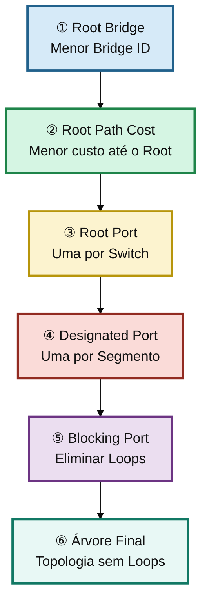

| **Etapa** | **Objetivo**                    | **Comando Principal**              |
| :---      | :---                            | :---                               |
| **①**     | Identificar o Root Bridge       | show spanning-tree root            |
| **②**     | Verificar o Root Path Cost      | show spanning-tree vlan 1          |
| **③**     | Identificar a Root Port         | show spanning-tree vlan 1          |
| **④**     | Identificar as Designated Ports | show spanning-tree vlan 1          |
| **⑤**     | Identificar as portas Blocking  | show spanning-tree vlan 1          |
| **⑥**     | Validar a árvore completa       | Comparação entre todos os switches |

---

## O que iremos verificar

Ao final desta etapa deveremos responder às seguintes perguntas:

- Qual switch foi eleito Root Bridge?
- Todas as VLANs utilizam o mesmo Root Bridge?
- Essa eleição faz sentido para o projeto?
- O algoritmo tomou a decisão esperada?
- Essa eleição foi determinada pela prioridade ou pelo endereço MAC?
- Quais portas permaneceram bloqueadas?
- Quais enlaces realmente estão transportando tráfego?
- Existe desperdício de enlaces redundantes?
- Os caminhos escolhidos representam a melhor topologia possível?
- Quais evidências justificam essas decisões do protocolo?

---

## ✨ Contexto

Agora que já temos o nosso cenário base pronto, vamos iniciar uma análise detalhada do comportamento do protocolo **PVST+**.

Nesta etapa iremos executar os principais comandos de monitoramento e diagnóstico do protocolo, interpretando as informações fornecidas pelos equipamentos e compreendendo como o PVST+ toma suas decisões para construir a árvore lógica da rede.

Também iremos analisar diversos parâmetros importantes do protocolo para compreender seu funcionamento e identificar situações que podem comprometer a eficiência da topologia.

Embora o **PVST+** mantenha uma instância independente do Spanning Tree para cada VLAN, iniciaremos nossa análise utilizando apenas a **VLAN 1**. Essa abordagem permitirá compreender o comportamento do protocolo em uma única árvore lógica antes de expandirmos a análise para as demais VLANs por meio da automação que será desenvolvida nas próximas etapas do laboratório.

Ao final deste laboratório seremos capazes de compreender as principais limitações do **PVST+**, identificar oportunidades de melhoria e reunir evidências que servirão como base para as otimizações que serão implementadas no **Laboratório 18**.

---

## 🏗️ Cenário Configurado

Antes de iniciarmos a análise, vamos relembrar o cenário construído no laboratório anterior.

Todo o ambiente já se encontra configurado e operacional. Nosso objetivo agora não será realizar novas configurações, mas sim entender como o protocolo está se comportando diante da topologia implementada.

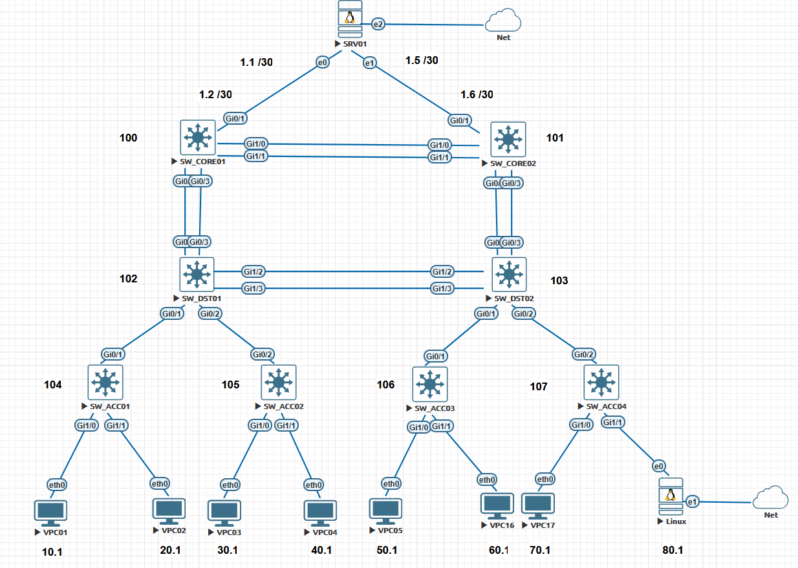

---

### 🖥️ Equipamentos Utilizados

### Switches

| Equipamento | Função       |
|:------------|:-------------|
| SW_CORE01   | CORE         |
| SW_CORE02   | CORE         |
| SW_DST01    | Distribuição |
| SW_DST02    | Distribuição |
| SW_ACC01    | Acesso       |
| SW_ACC02    | Acesso       |
| SW_ACC03    | Acesso       |
| SW_ACC04    | Acesso       |

---

### Hosts Finais

| Host  | VLAN        |
|:------|:------------|
| SRV01 | TODAS VLANS |
| VPC01 | VLAN 10     |
| VPC02 | VLAN 20     |
| VPC03 | VLAN 30     |
| VPC04 | VLAN 40     |
| VPC05 | VLAN 50     |
| VPC06 | VLAN 60     |
| VPC07 | VLAN 70     |
| VPC08 | VLAN 80     |
| LINUX | TODAS VLANS |

---

### 🌐 VLANs Utilizadas

| VLAN | Nome       | Faixa IP      |
|:----:|:-----------|:--------------|
| 10   | USERS      | 10.0.10.0/24  |
| 20   | VOICE      | 10.0.20.0/24  |
| 30   | DATA       | 10.0.30.0/24  |
| 40   | MANAGEMENT | 10.0.40.0/24  |
| 50   | MKT        | 10.0.50.0/24  |
| 60   | FINANCEIRO | 10.0.60.0/24  |
| 70   | RH         | 10.0.70.0/24  |
| 80   | PROD       | 10.0.80.0/24  |
| 90   | SERVERS01  | 10.0.90.0/24  |
| 100  | SERVERS02  | 10.0.100.0/24 |

---

## 📊 Etapa 01 - Análise Inicial

Agora que relembramos a topologia do ambiente, vamos iniciar a análise do protocolo **PVST+**.

Como explicado anteriormente, nosso foco inicial será apenas a **VLAN 1**. Isso facilitará o entendimento do funcionamento do protocolo antes de expandirmos a análise para todas as demais instâncias do **PVST+**.

O primeiro passo consiste em identificar o **Root Bridge**, pois todas as decisões da árvore lógica são tomadas a partir dele. Cada switch calcula o melhor caminho em direção ao Root Bridge e, com base nessas informações, define quais interfaces permanecerão em estado de encaminhamento (**Forwarding**) e quais serão bloqueadas (**Blocking**) para eliminar a possibilidade de loops na camada 2.

---

## 📋 Estratégia de Análise

O comando `show spanning-tree vlan 1` fornece uma grande quantidade de informações sobre o funcionamento do protocolo.

Para facilitar a interpretação dos dados, não iremos analisar toda a saída de uma única vez.

Dividiremos a análise em pequenas etapas, permitindo compreender o significado de cada campo antes de avançarmos para o próximo.

Nossa sequência será a seguinte:

1. Identificar o Root Bridge.
2. Identificar o Bridge ID local.
3. Interpretar os temporizadores do protocolo.
4. Analisar os papéis das portas.
5. Analisar os estados das portas.
6. Relacionar essas informações com a topologia construída no Laboratório 16.

---

> **Importante**
>
> Estamos utilizando o protocolo **PVST+**, uma implementação proprietária da Cisco que cria uma instância independente do Spanning Tree para cada VLAN.
>
> Por esse motivo, sempre que executarmos um comando de diagnóstico, será necessário informar qual VLAN desejamos analisar senão ele mostra todas as instâncias.
>
> Ao longo deste laboratório utilizaremos inicialmente a **VLAN 1**, mas posteriormente veremos como automatizar a coleta das informações para todas as VLANs existentes na topologia.

---

Agora vamos acessar o switch **SW_CORE01** e executar o comando abaixo.

```ios
show spanning-tree vlan 1
```

Resultado obtido:

```ios
SW_CORE01#show spanning-tree vlan 1

VLAN0001
  Spanning tree enabled protocol ieee
  Root ID    Priority    32769
             Address     5000.0003.0000
             Cost        4
             Port        1 (GigabitEthernet0/0)
             Hello Time   2 sec  Max Age 20 sec  Forward Delay 15 sec

  Bridge ID  Priority    32769  (priority 32768 sys-id-ext 1)
             Address     5000.000a.0000
             Hello Time   2 sec  Max Age 20 sec  Forward Delay 15 sec
             Aging Time  300 sec

Interface           Role Sts Cost      Prio.Nbr Type
------------------- ---- --- --------- -------- --------------------------------
Gi0/0               Root FWD 4         128.1    P2p
Gi0/1               Desg FWD 4         128.2    P2p
Gi0/2               Desg FWD 4         128.3    P2p
Gi0/3               Altn BLK 4         128.4    P2p
Gi1/0               Desg FWD 4         128.5    P2p
Gi1/1               Desg FWD 4         128.6    P2p
Gi1/2               Desg FWD 4         128.7    P2p

Interface           Role Sts Cost      Prio.Nbr Type
------------------- ---- --- --------- -------- --------------------------------

Gi1/3               Desg FWD 4         128.8    P2p
Gi2/0               Desg FWD 4         128.9    P2p
Gi2/1               Desg FWD 4         128.10   P2p
Gi2/2               Desg FWD 4         128.11   P2p
Gi2/3               Desg FWD 4         128.12   P2p
Gi3/0               Desg FWD 4         128.13   P2p
Gi3/1               Desg FWD 4         128.14   P2p
Gi3/2               Desg FWD 4         128.15   P2p
Gi3/3               Desg FWD 4         128.16   P2p

SW_CORE01#
```

O comando `show spanning-tree vlan 1` apresenta uma grande quantidade de informações sobre o estado atual do protocolo. Por esse motivo, iremos analisar cada seção separadamente.

Nosso objetivo, neste primeiro momento, é compreender quais informações o comando disponibiliza e como elas serão utilizadas ao longo das próximas etapas do laboratório.

---

### 🔍 Identificando o Root Bridge

Observe a seguinte seção da saída do comando:

```text
Root ID    Priority    32769
           Address     5000.0003.0000
           Cost        4
           Port        1 (GigabitEthernet0/0)
           Hello Time   2 sec  Max Age 20 sec  Forward Delay 15 sec
```

Essa seção apresenta todas as informações referentes ao **Root Bridge** da **VLAN 1**.

Observe que o endereço MAC informado é **5000.0003.0000**.

Isso significa que o switch proprietário desse endereço foi eleito como **Root Bridge** para essa instância do protocolo.

Além disso, podemos observar que o switch **SW_CORE01** alcança o Root Bridge através da interface **GigabitEthernet0/0**, utilizando um custo igual a **4**.

---

### 🔍 Identificando o Bridge ID

Logo abaixo encontramos a seção **Bridge ID**.

```text
Bridge ID  Priority    32769  (priority 32768 sys-id-ext 1)
           Address     5000.000a.0000
           Hello Time   2 sec  Max Age 20 sec  Forward Delay 15 sec
           Aging Time  300 sec
```

Enquanto a seção **Root ID** descreve o equipamento eleito como Root Bridge, a seção **Bridge ID** apresenta as informações do próprio switch onde o comando foi executado.

Como estamos executando o comando no **SW_CORE01**, o endereço MAC **5000.000a.0000** pertence ao próprio equipamento.

Comparando os endereços MAC apresentados nas duas seções, podemos confirmar que o **SW_CORE01** **não** foi eleito como Root Bridge da VLAN 1.

---

> **Importante**
>
> Embora a saída do comando apresente a informação `Spanning tree enabled protocol ieee`, o equipamento continua executando o protocolo **PVST+**.
>
> Essa mensagem apenas indica que o algoritmo utilizado por cada instância é baseado no padrão **IEEE 802.1D**.
>
> O **PVST+** é uma implementação proprietária da Cisco que cria uma instância independente do protocolo para cada VLAN.

---

> **Resumo da análise**
>
> ✔ Estamos analisando a instância correspondente à VLAN 1.
>
> ✔ O switch **SW_CORE01** não é o Root Bridge.
>
> ✔ O Root Bridge possui o endereço MAC **5000.0003.0000**.
>
> ✔ O SW_CORE01 alcança o Root Bridge através da interface **GigabitEthernet0/0**.
>
> ✔ Nas próximas etapas iremos interpretar os temporizadores, os papéis das portas e os estados definidos pelo protocolo.

---

## 🔎 Análise Detalhada do Protocolo

No tópico anterior utilizamos o comando `show spanning-tree vlan 1`, que apresenta um resumo do estado atual do protocolo para uma determinada VLAN.

Esse comando é excelente para uma análise inicial, permitindo identificar rapidamente informações como:

- Root Bridge;
- Bridge ID local;
- Root Port;
- Papéis das portas (*Roles*);
- Estados das portas (*States*);
- Custos (*Cost*);
- Temporizadores principais do protocolo.

Entretanto, em muitas situações essas informações não são suficientes para compreender completamente o comportamento do protocolo.

Quando precisamos realizar uma investigação mais aprofundada, o comando mais utilizado é o **show spanning-tree vlan 1 detail**.

Como o próprio nome sugere, esse comando apresenta uma visão extremamente detalhada do funcionamento do protocolo, incluindo informações que normalmente são utilizadas durante atividades de **Troubleshooting**, auditoria e análise de desempenho.

Além das informações já apresentadas pelo comando anterior, agora também teremos acesso a diversos contadores, temporizadores, estatísticas de BPDUs e histórico de mudanças de topologia.

Essas informações permitem compreender não apenas **como a árvore está atualmente**, mas também **como ela chegou ao estado atual**.

---

## 🎯 Quando utilizar este comando?

Embora seja possível utilizar esse comando em qualquer situação, ele normalmente é empregado durante atividades de diagnóstico, principalmente quando existem sintomas como:

- Lentidão após falhas de links;
- Mudanças frequentes na topologia;
- Suspeita de loops na camada 2;
- Root Bridge inesperado;
- Portas mudando constantemente de estado;
- Perda intermitente de conectividade;
- Excesso de processamento relacionado ao STP;
- Problemas envolvendo convergência da rede.

Por apresentar uma quantidade muito maior de informações, esse comando é amplamente utilizado por administradores de redes, analistas de infraestrutura e engenheiros de suporte durante processos de troubleshooting.

---

## 📋 Executando o comando

Vamos novamente acessar o equipamento **SW_CORE01** e executar o comando abaixo.

```ios
show spanning-tree vlan 1 detail
```

Resultado obtido:

```ios
SW_CORE01#show spanning-tree vlan 1 detail

 VLAN0001 is executing the ieee compatible Spanning Tree protocol
  Bridge Identifier has priority 32768, sysid 1, address 5000.000a.0000
  Configured hello time 2, max age 20, forward delay 15
  Current root has priority 32769, address 5000.0003.0000
  Root port is 1 (GigabitEthernet0/0), cost of root path is 4
  Topology change flag not set, detected flag not set
  Number of topology changes 3 last change occurred 04:16:40 ago
          from GigabitEthernet1/1
  Times:  hold 1, topology change 35, notification 2
          hello 2, max age 20, forward delay 15
  Timers: hello 0, topology change 0, notification 0, aging 300

 Port 1 (GigabitEthernet0/0) of VLAN0001 is root forwarding
   Port path cost 4, Port priority 128, Port Identifier 128.1.
   Designated root has priority 32769, address 5000.0003.0000
   Designated bridge has priority 32769, address 5000.0003.0000
   Designated port id is 128.1, designated path cost 0
   Timers: message age 3, forward delay 0, hold 0
   Number of transitions to forwarding state: 1
   Link type is point-to-point by default
   BPDU: sent 5, received 7632

 Port 2 (GigabitEthernet0/1) of VLAN0001 is designated forwarding
   Port path cost 4, Port priority 128, Port Identifier 128.2.
   Designated root has priority 32769, address 5000.0003.0000
   Designated bridge has priority 32769, address 5000.000a.0000
   Designated port id is 128.2, designated path cost 4
   Timers: message age 0, forward delay 0, hold 0
   Number of transitions to forwarding state: 1
   Link type is point-to-point by default
   BPDU: sent 7634, received 0

 Port 3 (GigabitEthernet0/2) of VLAN0001 is designated forwarding
   Port path cost 4, Port priority 128, Port Identifier 128.3.
   Designated root has priority 32769, address 5000.0003.0000
   Designated bridge has priority 32769, address 5000.000a.0000
   Designated port id is 128.3, designated path cost 4
   Timers: message age 0, forward delay 0, hold 0
   Number of transitions to forwarding state: 1
   Link type is point-to-point by default
   BPDU: sent 7635, received 0

 Port 4 (GigabitEthernet0/3) of VLAN0001 is alternate blocking
   Port path cost 4, Port priority 128, Port Identifier 128.4.
   Designated root has priority 32769, address 5000.0003.0000
   Designated bridge has priority 32769, address 5000.0003.0000
   Designated port id is 128.4, designated path cost 0
   Timers: message age 2, forward delay 0, hold 0
   Number of transitions to forwarding state: 0
   Link type is point-to-point by default
   BPDU: sent 3, received 7630

 Port 5 (GigabitEthernet1/0) of VLAN0001 is designated forwarding
   Port path cost 4, Port priority 128, Port Identifier 128.5.
   Designated root has priority 32769, address 5000.0003.0000
   Designated bridge has priority 32769, address 5000.000a.0000
   Designated port id is 128.5, designated path cost 4
   Timers: message age 0, forward delay 0, hold 0
   Number of transitions to forwarding state: 1
   Link type is point-to-point by default
   BPDU: sent 7635, received 5

 Port 6 (GigabitEthernet1/1) of VLAN0001 is designated forwarding
   Port path cost 4, Port priority 128, Port Identifier 128.6.
   Designated root has priority 32769, address 5000.0003.0000
   Designated bridge has priority 32769, address 5000.000a.0000
   Designated port id is 128.6, designated path cost 4
   Timers: message age 0, forward delay 0, hold 0
   Number of transitions to forwarding state: 1
   Link type is point-to-point by default
   BPDU: sent 7635, received 5

 Port 7 (GigabitEthernet1/2) of VLAN0001 is designated forwarding
   Port path cost 4, Port priority 128, Port Identifier 128.7.
   Designated root has priority 32769, address 5000.0003.0000
   Designated bridge has priority 32769, address 5000.000a.0000
   Designated port id is 128.7, designated path cost 4
   Timers: message age 0, forward delay 0, hold 0
   Number of transitions to forwarding state: 1
   Link type is point-to-point by default
   BPDU: sent 7637, received 0

 Port 8 (GigabitEthernet1/3) of VLAN0001 is designated forwarding
   Port path cost 4, Port priority 128, Port Identifier 128.8.
   Designated root has priority 32769, address 5000.0003.0000
   Designated bridge has priority 32769, address 5000.000a.0000
   Designated port id is 128.8, designated path cost 4
   Timers: message age 0, forward delay 0, hold 0
   Number of transitions to forwarding state: 1
   Link type is point-to-point by default
   BPDU: sent 7637, received 0

 Port 9 (GigabitEthernet2/0) of VLAN0001 is designated forwarding
   Port path cost 4, Port priority 128, Port Identifier 128.9.
   Designated root has priority 32769, address 5000.0003.0000
   Designated bridge has priority 32769, address 5000.000a.0000
   Designated port id is 128.9, designated path cost 4
   Timers: message age 0, forward delay 0, hold 0
   Number of transitions to forwarding state: 1
   Link type is point-to-point by default
   BPDU: sent 7637, received 0

 Port 10 (GigabitEthernet2/1) of VLAN0001 is designated forwarding
   Port path cost 4, Port priority 128, Port Identifier 128.10.
   Designated root has priority 32769, address 5000.0003.0000
   Designated bridge has priority 32769, address 5000.000a.0000
   Designated port id is 128.10, designated path cost 4
   Timers: message age 0, forward delay 0, hold 0
   Number of transitions to forwarding state: 1
   Link type is point-to-point by default
   BPDU: sent 7638, received 0

 Port 11 (GigabitEthernet2/2) of VLAN0001 is designated forwarding
   Port path cost 4, Port priority 128, Port Identifier 128.11.
   Designated root has priority 32769, address 5000.0003.0000
   Designated bridge has priority 32769, address 5000.000a.0000
   Designated port id is 128.11, designated path cost 4
   Timers: message age 0, forward delay 0, hold 0
   Number of transitions to forwarding state: 1
   Link type is point-to-point by default
   BPDU: sent 7638, received 0

 Port 12 (GigabitEthernet2/3) of VLAN0001 is designated forwarding
   Port path cost 4, Port priority 128, Port Identifier 128.12.
   Designated root has priority 32769, address 5000.0003.0000
   Designated bridge has priority 32769, address 5000.000a.0000
   Designated port id is 128.12, designated path cost 4
   Timers: message age 0, forward delay 0, hold 0
   Number of transitions to forwarding state: 1
   Link type is point-to-point by default
   BPDU: sent 7639, received 0

 Port 13 (GigabitEthernet3/0) of VLAN0001 is designated forwarding
   Port path cost 4, Port priority 128, Port Identifier 128.13.
   Designated root has priority 32769, address 5000.0003.0000
   Designated bridge has priority 32769, address 5000.000a.0000
   Designated port id is 128.13, designated path cost 4
   Timers: message age 0, forward delay 0, hold 0
   Number of transitions to forwarding state: 1
   Link type is point-to-point by default
   BPDU: sent 7639, received 0

 Port 14 (GigabitEthernet3/1) of VLAN0001 is designated forwarding
   Port path cost 4, Port priority 128, Port Identifier 128.14.
   Designated root has priority 32769, address 5000.0003.0000
   Designated bridge has priority 32769, address 5000.000a.0000
   Designated port id is 128.14, designated path cost 4
   Timers: message age 0, forward delay 0, hold 0
   Number of transitions to forwarding state: 1
   Link type is point-to-point by default
   BPDU: sent 7639, received 0

 Port 15 (GigabitEthernet3/2) of VLAN0001 is designated forwarding
   Port path cost 4, Port priority 128, Port Identifier 128.15.
   Designated root has priority 32769, address 5000.0003.0000
   Designated bridge has priority 32769, address 5000.000a.0000
   Designated port id is 128.15, designated path cost 4
   Timers: message age 0, forward delay 0, hold 0
   Number of transitions to forwarding state: 1
   Link type is point-to-point by default
   BPDU: sent 7639, received 0

 Port 16 (GigabitEthernet3/3) of VLAN0001 is designated forwarding
   Port path cost 4, Port priority 128, Port Identifier 128.16.
   Designated root has priority 32769, address 5000.0003.0000
   Designated bridge has priority 32769, address 5000.000a.0000
   Designated port id is 128.16, designated path cost 4
   Timers: message age 0, forward delay 0, hold 0
   Number of transitions to forwarding state: 1
   Link type is point-to-point by default
   BPDU: sent 7641, received 0

SW_CORE01#
```

---

## 📊 O que esse comando nos mostra?

Observe que a quantidade de informações aumentou significativamente.

Agora não temos apenas uma fotografia da árvore de Spanning Tree.

Temos também diversas informações relacionadas ao histórico de funcionamento do protocolo.

Entre as informações mais importantes podemos destacar:

- Root Bridge atual;
- Bridge ID local;
- Root Port;
- Custo até o Root Bridge;
- Histórico de mudanças da topologia;
- Quantidade de Topology Changes;
- Interface responsável pela última mudança de topologia;
- Quantidade de transições para o estado Forwarding;
- Quantidade de BPDUs enviadas;
- Quantidade de BPDUs recebidas;
- Tipo do enlace (*Point-to-Point ou Shared*);
- Temporizadores individuais de cada interface;
- Papel de cada porta;
- Estado operacional de cada porta.

Essas informações tornam esse comando uma das principais ferramentas de análise do protocolo STP.

---

## 🔎 Informações Gerais da Instância

Logo no início da saída encontramos um resumo completo da instância correspondente à VLAN analisada.

```text
VLAN0001 is executing the ieee compatible Spanning Tree protocol
Bridge Identifier...
Current root...
Root port...
```

Nessa primeira parte conseguimos identificar rapidamente:

- Qual protocolo está sendo executado;
- Quem é o Root Bridge;
- Quem é o Bridge local;
- Qual interface conduz ao Root Bridge;
- Qual o custo acumulado até o Root Bridge.

Essas informações já haviam sido apresentadas pelo comando anterior, porém agora aparecem acompanhadas de diversos dados adicionais que serão extremamente úteis durante a investigação.

---

## 🔄 Histórico de Mudanças da Topologia

Uma das informações mais importantes desse comando é o histórico das mudanças ocorridas na árvore.

Observe o trecho abaixo.

```text
Topology change flag not set, detected flag not set

Number of topology changes 3
last change occurred 04:08:04 ago

from GigabitEthernet1/1
```

Essas informações praticamente não aparecem no comando anterior.

Aqui conseguimos responder perguntas extremamente importantes durante um troubleshooting.

Por exemplo:

- Quantas mudanças de topologia ocorreram?
- Quando ocorreu a última mudança?
- Qual interface originou essa alteração?

No nosso exemplo podemos observar que:

- ocorreram **3 mudanças de topologia**;
- a última mudança aconteceu há aproximadamente **4 minutos**;
- essa alteração foi iniciada pela interface **GigabitEthernet1/1**.

Em ambientes corporativos essas informações são extremamente úteis para localizar equipamentos instáveis, conexões intermitentes ou interfaces que permanecem entrando e saindo de operação.

---

## ⏱️ Temporizadores do Protocolo

Outro ponto interessante é a quantidade de temporizadores apresentados.

```text
Configured hello time 2

max age 20

forward delay 15

Timers:

hello

topology change

notification

aging
```

Agora conseguimos observar tanto os temporizadores configurados quanto os temporizadores atualmente utilizados pela instância do protocolo.

Essas informações ajudam a confirmar se os parâmetros do STP estão de acordo com o projeto da rede e também podem auxiliar na identificação de alterações indevidas na configuração.

### ⏳ Por que o PVST+ pode demorar até 50 segundos para convergir?

Ao observar os temporizadores do protocolo, já conseguimos entender uma das principais limitações do **IEEE 802.1D (PVST+)**.

Sempre que ocorre uma mudança na topologia, como a falha de um enlace ou a indisponibilidade de um switch, o protocolo não coloca imediatamente uma porta em estado de encaminhamento.

Antes disso, a porta precisa passar por uma sequência de estados para garantir que não exista nenhum loop na camada 2.

De forma simplificada, o processo ocorre da seguinte maneira:

- O switch pode aguardar até **20 segundos (Max Age)** para considerar que as informações recebidas anteriormente não são mais válidas.
- Em seguida, a porta permanece **15 segundos no estado Listening**, período em que participa da eleição da nova árvore, mas ainda não encaminha quadros.
- Depois, a porta permanece mais **15 segundos no estado Learning**, aprendendo endereços MAC, porém ainda sem encaminhar tráfego de dados.
- Somente após essas etapas a interface entra no estado **Forwarding**, permitindo novamente o tráfego dos usuários.

Na pior situação possível, esse processo pode levar aproximadamente:

```ios
20 s (Max Age)
+15 s (Listening)
+15 s (Learning)
------------------
≈ 50 segundos
```

Esse tempo de convergência era considerado aceitável quando o padrão IEEE 802.1D foi criado. Entretanto, nas redes atuais, permanecer até **50 segundos** sem encaminhar tráfego pode causar indisponibilidade perceptível para aplicações críticas, telefonia IP, videoconferência e diversos outros serviços.

Essa limitação foi um dos principais motivos para o desenvolvimento do **Rapid Spanning Tree Protocol (RSTP - IEEE 802.1w)**, que será estudado nos próximos laboratórios e reduz significativamente o tempo de convergência da rede.

## 🚦 Estados das Portas no PVST+

Durante a construção da árvore lógica da rede, cada interface do switch assume um determinado **estado operacional**.

É importante destacar que **estado da porta** e **papel da porta (Role)** são conceitos diferentes.

- O **papel** define a função da interface dentro da árvore (Root Port, Designated Port ou Non-Designated Port).
- O **estado** define o comportamento operacional da interface, ou seja, se ela encaminha quadros, aprende endereços MAC ou apenas participa da troca de BPDUs.

A tabela abaixo resume os cinco estados existentes no protocolo **IEEE 802.1D (PVST+)**.

| Estado         | Encaminha Dados? | Aprende MAC? | Envia/Recebe BPDUs? | Descrição                                                                                          |
|:-------        |:---------------: |:------------:|:-------------------:|:---------------------------------------------------------------------------------------------------|
| **Disabled**   | ❌               | ❌           | ❌                 | Interface desabilitada administrativamente ou inoperante.                                          |
| **Blocking**   | ❌               | ❌           | ❌ (só recebe)     | Impede a formação de loops. Apenas recebe BPDUs e aguarda alterações na topologia.                 |
| **Listening**  | ❌               | ❌           | ✅               | Participa da construção da nova árvore, porém ainda não encaminha quadros nem aprende endereços MAC. |
| **Learning**   | ❌               | ✅           | ✅                 | Aprende endereços MAC para preencher a tabela CAM, porém ainda não encaminha tráfego de usuários.  |
| **Forwarding** | ✅               | ✅           | ✅      | Estado normal de operação. A interface encaminha quadros, aprende endereços MAC e participa do protocolo STP. |

---

## ⏱️ Relação entre o Max Age e os Estados das Portas

Ao observar os temporizadores do protocolo, uma dúvida bastante comum é imaginar que o **Max Age** representa mais um estado da porta.

Na realidade, isso não acontece.

O **Max Age** é um temporizador utilizado pelo algoritmo para determinar quanto tempo um switch deve aguardar antes de concluir que as informações recebidas anteriormente sobre a árvore de spanning-tree não são mais válidas.

Enquanto esse tempo não expira, **nenhuma transição de estados ocorre**.

Em outras palavras, durante o período de **20 segundos do Max Age**, as portas permanecem exatamente no mesmo estado em que já estavam, normalmente **Forwarding** ou **Blocking**.

Somente após o vencimento do **Max Age** é que o protocolo inicia uma nova convergência. Nesse momento, as interfaces que precisam passar a encaminhar tráfego percorrem a sequência de estados **Listening**, **Learning** e, por fim, **Forwarding**.

Essa característica explica por que o protocolo **IEEE 802.1D (PVST+)** pode levar aproximadamente **50 segundos** para convergir em seu pior cenário:

- Até **20 segundos** aguardando o vencimento do **Max Age**;
- **15 segundos** no estado **Listening**;
- **15 segundos** no estado **Learning**;
- Finalmente, a interface entra no estado **Forwarding**.

Esse comportamento conservador foi projetado para evitar loops durante a reconstrução da árvore lógica da rede. Entretanto, em redes modernas, esse tempo de convergência é considerado elevado, motivo pelo qual o **Rapid Spanning Tree Protocol (RSTP)** foi desenvolvido para reduzir significativamente esse intervalo.

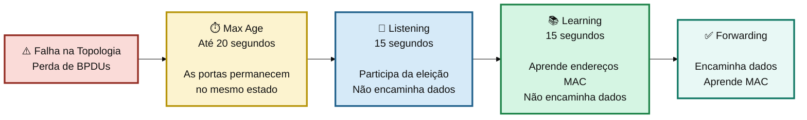

---

## 🔌 Informações Individuais das Interfaces

Após o resumo geral, o comando passa a apresentar informações detalhadas de cada interface participante da árvore.

Cada porta possui seu próprio bloco de informações.

Por exemplo:

```text
Port 1 (GigabitEthernet0/0)

Port 2 (GigabitEthernet0/1)

Port 3 (GigabitEthernet0/2)
...
```

Essa organização facilita bastante a análise individual de cada enlace.

Para cada interface podemos verificar diversas informações importantes.

Entre elas:

- Papel da porta (*Root, Designated ou Alternate*);
- Estado atual da porta;
- Custo;
- Prioridade;
- Identificador da porta;
- Root Bridge conhecido pela interface;
- Bridge Designada;
- Designated Port ID;
- Caminho até o Root Bridge;
- Tipo do enlace;
- Temporizadores;
- Quantidade de transições para o estado Forwarding;
- Quantidade de BPDUs enviadas;
- Quantidade de BPDUs recebidas.

---

## 📦 Contadores de BPDUs

Uma das informações mais interessantes desse comando é a presença dos contadores de BPDUs.

Observe o trecho abaixo.

```text
BPDU:

sent 7388

received 0
```

Agora conseguimos saber exatamente quantas BPDUs cada interface enviou e recebeu desde que o protocolo entrou em operação.

Esses contadores são extremamente úteis durante atividades de troubleshooting.

Por exemplo, uma interface que deveria receber BPDUs mas permanece com o contador zerado pode indicar problemas como:

- falha física;
- configuração incorreta;
- bloqueio indevido;
- equipamento desconectado;
- problemas de negociação do enlace.

---

## 🔄 Número de Transições

Outro campo bastante importante é:

```text
Number of transitions to forwarding state
```

Esse contador informa quantas vezes uma determinada interface entrou no estado **Forwarding**.

Interfaces que apresentam um número elevado de transições podem indicar instabilidade na topologia, falhas intermitentes ou mudanças frequentes do protocolo.

Durante uma investigação esse contador pode fornecer indícios importantes sobre o comportamento da rede ao longo do tempo.

---

## 💡 Importante

Embora esse comando apresente muito mais informações do que o comando `show spanning-tree vlan 1`, ele ainda representa apenas um **snapshot** do estado atual da árvore.

Ou seja, ele não mostra toda a sequência de eventos ocorridos durante a convergência do protocolo.

Para compreender completamente como a árvore evoluiu ao longo do tempo será necessário correlacionar essas informações com capturas de BPDUs, testes de falha e automação da coleta de dados, atividades que serão realizadas nas próximas etapas deste laboratório.

---

## ✅ Conclusão

O comando **show spanning-tree vlan 1 detail** é uma das ferramentas mais importantes para análise do protocolo STP.

Além de apresentar todas as informações básicas da árvore, ele fornece métricas e estatísticas que normalmente são utilizadas durante atividades de troubleshooting e análise de incidentes.

Nos próximos tópicos iremos explorar essas informações com maior profundidade e demonstrar como automatizar sua coleta utilizando Python e TextFSM, transformando centenas de linhas de saída CLI em dados estruturados que poderão ser analisados de forma muito mais rápida e eficiente.

---

## ⌨ Comando Complementar

Agora que analisamos os comandos que nos fornecem uma "foto" da nossa árvore do PVST+ pudemos verificar vários aspectos interessantes. Dentre eles temos o **ROOT ID** que é o ID do Root Bridge. Mas agora vamos executar um comando complementar:

```ios
show spanning-tree vlan 1 root
```

**SW_CORE01**  

```ios
SW_CORE01#show spanning-tree vlan 1 root

                                        Root    Hello Max Fwd
Vlan                   Root ID          Cost    Time  Age Dly  Root Port
---------------- -------------------- --------- ----- --- ---  ------------
VLAN0001         32769 5000.0003.0000         4    2   20  15  Gi0/0
SW_CORE01#
```

Esse comando é mais direto ao ponto para descobrimos que é o nosso ROOT BRIDGE.

> **🎄 Relembrando: Como o Root Bridge é eleito?**
>
> Antes de prosseguirmos com a análise dos comandos de monitoramento, vale a pena relembrar como ocorre a eleição do **Root Bridge**.
>
> O Root Bridge é o switch considerado o ponto de referência de toda a árvore lógica do Spanning Tree. Todos os demais switches calculam seus melhores caminhos até esse equipamento e, a partir dessas informações, determinam quais portas permanecerão em estado de encaminhamento (**Forwarding**) e quais serão bloqueadas (**Blocking**) para evitar loops na camada 2.
>
> A eleição do Root Bridge ocorre durante a inicialização do protocolo e segue uma ordem bem definida:
>
> 1. **Menor prioridade (Bridge Priority)**;
> 2. **Menor VLAN ID (System ID Extension)** — utilizada quando a prioridade configurada é igual;
> 3. **Menor endereço MAC (Bridge MAC Address)**.
>
> Essas três informações formam o chamado **Bridge ID (BID)**, que identifica unicamente cada switch participante da eleição.
>
> O switch que possuir o **menor Bridge ID** será eleito como **Root Bridge** daquela instância do protocolo.
>
> > **Importante**
> >
> > No **PVST+**, cada VLAN possui sua própria instância do Spanning Tree. Isso significa que uma mesma rede pode possuir Root Bridges diferentes para VLANs distintas, permitindo distribuir a carga entre múltiplos switches quando a rede é corretamente projetada.
>
> No cenário deste laboratório, todas as prioridades permanecem com os valores padrão. Portanto, a eleição do Root Bridge ocorreu utilizando o **menor endereço MAC**, exatamente como estudamos no laboratório anterior.
>
> No comando anterior podemos observar o campo **Root ID**, que formam o nosso Bridge ID
>
> - Prioridade: 32768
> - Extension Id: 1
> - Mac Address: 5000.0003.0000
>
> Como a prioridade está configurada como 32768 (padrão) + extension id (1) = 32769, o desempate na eleição do Root se dá pelo **menor mac**. O mac da caixa que estamos analisando é **5000.000a.0000** que é maior do que o mac **5000.0003.0000**. Portanto quem tem esse mac foi eleito o ROOT BRIDGE.

## ✅ Conclusão da Etapa 1 — Eleição do Root Bridge

Com a análise realizada até este momento, já conseguimos responder à primeira pergunta do algoritmo do **PVST+**:

> **Quem foi eleito como Root Bridge da VLAN 1?**

Utilizando os comandos apresentados anteriormente, verificamos que o **Root Bridge** da VLAN 1 possui o endereço MAC **5000.0003.0000**.

Também relembramos que essa eleição ocorre com base no **Bridge ID**, composto pela prioridade da bridge e pelo endereço MAC do switch. Como todos os equipamentos estavam utilizando a prioridade padrão, o desempate ocorreu por meio do menor endereço MAC.

Além disso, analisamos os principais temporizadores do protocolo e compreendemos como eles influenciam o processo de convergência da rede. Também estudamos os estados das portas do STP e vimos como as interfaces transitam entre **Blocking**, **Listening**, **Learning** e **Forwarding** até que a nova árvore lógica seja estabelecida.

Com isso, concluímos a primeira etapa da análise do protocolo.

---

## ➡️ Próxima Etapa

Agora que já sabemos **quem é o Root Bridge**, a próxima pergunta do algoritmo é igualmente importante:

> **Como os demais switches descobrem qual é o melhor caminho para chegar até o Root Bridge?**

Para responder essa pergunta, precisamos compreender como o protocolo calcula o **Root Path Cost**, ou seja, o custo acumulado do caminho entre cada switch da topologia e o Root Bridge.

Inicialmente continuaremos nossa análise utilizando apenas o **SW_CORE01**. Somente após compreendermos todos os critérios de decisão do algoritmo nessa caixa, repetiremos a mesma análise nos demais switches da topologia para consolidar os resultados em uma tabela comparativa.

## 📊 Etapa 2 — Cálculo do Root Path Cost

Agora que já identificamos qual equipamento foi eleito como **Root Bridge**, surge uma nova pergunta.

> Como os demais switches sabem qual caminho utilizar para chegar até ele?

A resposta é simples.

O protocolo **Spanning Tree** calcula automaticamente o custo de todos os caminhos possíveis até o **Root Bridge** e escolhe aquele que possui o **menor custo acumulado**.

Esse valor recebe o nome de **Root Path Cost**.

Em outras palavras, cada switch responde à seguinte pergunta:

> "Qual é o caminho mais barato até o Root Bridge?"

É justamente esse cálculo que permitirá ao protocolo definir posteriormente qual interface será eleita como **Root Port**.

---

## 💡 O que é o Root Path Cost?

O **Root Path Cost** representa o custo acumulado do melhor caminho entre um switch e o **Root Bridge**.

Cada enlace da rede possui um custo associado à sua velocidade. À medida que as BPDUs percorrem a topologia, esses custos são somados até que cada switch descubra qual caminho possui o menor valor.

Quanto menor o custo total, melhor será o caminho escolhido pelo protocolo.

---

## 📖 Custos Padrão dos Enlaces

No método de custo revisado (**Short Path Cost**), adotado por padrão nas implementações atuais da Cisco (incluindo PVST+), os valores mais comuns são:

| Velocidade do Enlace | Custo     |
|:---------------------|----------:|
| 10 Mbps              | **100 **  |
| 100 Mbps             | **19**    |
| 1 Gbps               | **4**     |
| 10 Gbps              | **2**     |

Esses valores são utilizados pelo protocolo durante o cálculo do melhor caminho até o Root Bridge.

---

## 🔎 Onde podemos visualizar essa informação?

Vamos continuar utilizando o mesmo switch analisado anteriormente (**SW_CORE01**) e executar novamente o comando:

```ios
show spanning-tree vlan 1
```

Na saída do comando, observe a seguinte linha:

```ios
Root ID    Priority    32769
           Address     5000.0003.0000
           Cost        4
```

O campo **Cost** representa exatamente o **Root Path Cost**.

Nesse caso, o protocolo informa que o melhor caminho entre o **SW_CORE01** e o **Root Bridge** possui custo igual a **4**.

---

## 🤔 Por que o custo é igual a 4?

Para responder essa pergunta, basta observar a topologia construída no laboratório anterior.

Entre o **SW_CORE01** e o **Root Bridge** existe apenas um enlace Gigabit Ethernet.

Como um enlace de **1 Gbps** possui custo **4**, o custo acumulado até o Root Bridge também será igual a **4**.

Neste momento ainda estamos analisando apenas uma única caixa para compreender como o algoritmo realiza seus cálculos.

Nas próximas etapas repetiremos essa análise em todos os switches da topologia para verificar como o custo varia de acordo com a posição de cada equipamento na árvore lógica do protocolo.

### 🤔 Uma Reflexão

Até este momento, a decisão tomada pelo protocolo parece bastante simples.

O **SW_CORE01** encontrou um único caminho Gigabit até o **Root Bridge**, resultando em um **Root Path Cost igual a 4**.

Entretanto, imagine um cenário diferente.

E se existissem **dois caminhos** até o Root Bridge com exatamente o **mesmo custo**?

Como o protocolo decidiria qual deles utilizar?

Essa situação é bastante comum em redes corporativas que possuem enlaces redundantes para aumentar a disponibilidade da infraestrutura.

Nesses casos, calcular apenas o menor custo já não é suficiente. O protocolo precisa aplicar novos critérios de desempate para garantir que todos os switches construam exatamente a mesma árvore lógica.

É justamente isso que estudaremos na próxima etapa do laboratório.

---

## 🤔 Onde estamos no algoritmo?

Até este momento já conseguimos compreender como o protocolo começa a construir a árvore lógica da rede.

Primeiramente identificamos qual switch foi eleito como **Root Bridge**, entendendo que essa decisão é baseada no menor **Bridge ID**.

Na sequência, estudamos os principais temporizadores do protocolo e vimos como eles influenciam diretamente o tempo de convergência do **IEEE 802.1D (PVST+)**.

Também analisamos os estados das portas e entendemos por que uma interface pode levar até aproximadamente **50 segundos** para voltar ao estado de encaminhamento após uma alteração na topologia.

Por fim, descobrimos como cada switch calcula o **Root Path Cost**, ou seja, o custo acumulado do melhor caminho até o Root Bridge.

Neste ponto, o protocolo já conhece duas informações fundamentais:

- Quem é o Root Bridge;
- Qual é o menor custo para alcançá-lo.

Entretanto, ainda existe uma pergunta importante.

Mesmo conhecendo o menor custo, **por qual interface o switch deverá encaminhar o tráfego em direção ao Root Bridge?**

É justamente essa decisão que veremos na próxima etapa.

---

## 📊 Etapa 3 — Eleição da Root Port

Agora que compreendemos como o protocolo calcula o **Root Path Cost**, podemos avançar para a próxima decisão do algoritmo.

Até este ponto sabemos:

- Quem é o **Root Bridge**;
- Qual é o custo do melhor caminho até ele.

A próxima pergunta é:

> **Qual interface o switch deverá utilizar para alcançar o Root Bridge?**

A resposta é dada pela **Root Port**.

---

## 🎯 O que é a Root Port?

A **Root Port (RP)** é a interface utilizada pelo switch para alcançar o **Root Bridge** através do caminho de menor custo.

Com exceção do próprio Root Bridge, **todo switch da topologia possui exatamente uma Root Port**.

Essa interface representa o melhor caminho até a raiz da árvore e será utilizada para encaminhar o tráfego em direção ao Root Bridge.

---

## 📌 Como a Root Port é escolhida?

O algoritmo do STP utiliza uma sequência de critérios para eleger a Root Port.

O principal critério é justamente o que acabamos de estudar.

### 1️⃣ Menor Root Path Cost

O protocolo seleciona inicialmente a interface que possui o **menor custo acumulado** até o Root Bridge.

Na maioria das topologias, esse critério já é suficiente para definir a Root Port.

Entretanto, existem situações em que dois ou mais caminhos apresentam exatamente o mesmo custo.

Quando isso acontece, o protocolo aplica critérios adicionais de desempate.

De forma simplificada, a ordem é a seguinte:

1. **Menor Root Path Cost;**
2. **Menor Bridge ID do switch vizinho;**
3. **Menor Port ID anunciado pelo switch vizinho.**

Esses critérios garantem que todos os switches da rede tomem exatamente a mesma decisão, evitando inconsistências na construção da árvore lógica.

---

## 🔍 Onde identificamos a Root Port?

Vamos analisar novamente a saída do comando:

```ios
show spanning-tree vlan 1
```

Observe a seguinte informação:

```text
Root ID    Priority    32769
           Address     5000.0003.0000
           Cost        4
           Port        1 (GigabitEthernet0/0)
```

A linha **Port 1 (GigabitEthernet0/0)** informa exatamente qual interface foi eleita como **Root Port** neste switch.

Essa será a interface utilizada pelo **SW_CORE01** para encaminhar o tráfego em direção ao Root Bridge.

---

## 💡 Uma observação importante

Neste laboratório estamos analisando apenas o **SW_CORE01** para compreender como o algoritmo toma cada decisão.

Somente após concluirmos todas as etapas da análise nesta caixa repetiremos o mesmo procedimento nos demais switches da topologia.

Dessa forma será possível comparar os resultados manualmente, compreender o comportamento do protocolo em toda a rede e, posteriormente, demonstrar por que a automação se torna essencial em ambientes com múltiplos switches e VLANs.

## 🧩 Relacionando o Root Path Cost com a Root Port

Agora que identificamos a **Root Port**, podemos entender como o protocolo chegou a essa decisão.

Observe que essas duas informações estão diretamente relacionadas.

Primeiramente o protocolo calcula o **Root Path Cost**, determinando qual é o menor custo para alcançar o Root Bridge.

Em seguida, a interface responsável por esse menor custo é eleita como **Root Port**.

Em outras palavras, a Root Port não é escolhida aleatoriamente.

Ela representa exatamente a interface que oferece o melhor caminho até o Root Bridge.

No exemplo do **SW_CORE01**, verificamos que:

- O Root Bridge possui o endereço **5000.0003.0000**;
- O menor custo até ele é igual a **4**;
- A interface **GigabitEthernet0/0** foi eleita como **Root Port**.

Até este momento, o algoritmo tomou apenas duas decisões:

- Descobrir quem é o Root Bridge;
- Descobrir qual é o melhor caminho para alcançá-lo.

Agora ainda resta uma pergunta importante.

Como o protocolo decide quais interfaces poderão encaminhar tráfego em cada segmento da rede?

Essa resposta será dada pelas **Designated Ports**.

---

## 📊 Etapa 4 — Eleição das Designated Ports

Agora que já sabemos quem é o **Root Bridge** e qual interface cada switch utiliza como **Root Port**, falta responder à última pergunta desta fase do algoritmo.

Até este ponto sabemos:

- Quem é o **Root Bridge**;
- Qual é o custo do melhor caminho até ele;
- Qual interface cada switch utiliza como **Root Port**.

A próxima pergunta é:

> **Quem poderá encaminhar tráfego em cada segmento de rede, quando existe mais de um switch conectado ao mesmo enlace?**

A resposta é dada pela **Designated Port**.

---

## 🎯 O que é a Designated Port?

A **Designated Port (DP)** é a interface responsável por encaminhar tráfego em um determinado segmento de rede, em direção ao sentido oposto ao Root Bridge.

Enquanto a **Root Port** representa o melhor caminho **até** o Root Bridge, a **Designated Port** representa o melhor caminho **a partir** do Root Bridge, em direção aos demais switches daquele segmento.

Diferente da Root Port, que existe apenas uma por switch, a **Designated Port** existe **uma por segmento** de rede.

Isso significa que, em um enlace ponto a ponto entre dois switches, apenas um dos lados será eleito Designated Port. O outro lado, caso não seja Root Port, permanecerá bloqueado (**Blocking**) para evitar loops.

---

## 📌 Como a Designated Port é escolhida?

O algoritmo aplica os seguintes critérios, nesta ordem, para eleger a Designated Port de cada segmento:

1. **Menor Root Path Cost anunciado no segmento;**
2. **Menor Bridge ID do switch que está anunciando;**
3. **Menor Port ID do switch que está anunciando.**

Ou seja, o switch que anuncia o menor custo acumulado até o Root Bridge, naquele segmento específico, vence a eleição e assume a porta como Designated.

O próprio **Root Bridge** é um caso especial: como o custo dele até ele mesmo é sempre **0**, todas as suas interfaces são automaticamente eleitas como **Designated Ports**.

---

## 🔍 Onde identificamos a Designated Port?

Vamos retomar a saída já analisada anteriormente, executada no **SW_CORE01**:

```ios
show spanning-tree vlan 1
```

```ios
Interface           Role Sts Cost      Prio.Nbr Type
------------------- ---- --- --------- -------- --------------------------------
Gi0/0               Root FWD 4         128.1    P2p
Gi0/1               Desg FWD 4         128.2    P2p
Gi0/2               Desg FWD 4         128.3    P2p
Gi0/3               Altn BLK 4         128.4    P2p
Gi1/0               Desg FWD 4         128.5    P2p
```

Observe a coluna **Role**.

Enquanto a interface **Gi0/0** aparece como **Root**, as demais interfaces (**Gi0/1, Gi0/2, Gi1/0**, entre outras) aparecem com o papel **Desg**, ou seja, **Designated**.

Isso significa que o **SW_CORE01** foi eleito Designated Switch nesses segmentos, sendo responsável por encaminhar o tráfego local nessas interfaces.

---

## 💡 Uma observação importante

Vale reforçar que **Role** (papel da porta) e **State** (estado da porta) são conceitos diferentes, como já vimos anteriormente.

Uma interface pode ser **Designated** e estar em estado **Forwarding**, mas também pode existir, em outras topologias, uma Designated Port temporariamente em **Listening** ou **Learning**, durante o processo de convergência.

Neste momento, todas as Designated Ports do **SW_CORE01** já se encontram estáveis em **Forwarding**, o que indica que a árvore está convergida nesta instância.

---

## 🧩 Relacionando a Root Port com a Designated Port

Observe como as três decisões do algoritmo se conectam:

- O **SW_CORE01** possui uma única **Root Port** (**Gi0/0**), utilizada para alcançar o Root Bridge;
- Todas as demais interfaces ativas do switch (**Gi0/1, Gi0/2, Gi1/0** e assim por diante) são **Designated Ports**, utilizadas para encaminhar tráfego em direção aos switches conectados a jusante;
- A interface **Gi0/3** não se enquadra em nenhum dos dois papéis — ela é **Alternate**, e por isso permanece em **Blocking**.

Isso nos leva à última pergunta do algoritmo:

> **Por que a interface Gi0/3 não foi eleita nem Root Port nem Designated Port, permanecendo bloqueada?**

Essa resposta será dada pela **Blocking Port (Non-Designated Port)**, que veremos na próxima etapa.

## 📊 Etapa 5 — Portas Blocking (Non-Designated Ports)

Concluídas as três primeiras decisões do algoritmo — Root Bridge, Root Path Cost e Root Port — e também a eleição das Designated Ports, resta apenas uma pergunta para fechar a construção da árvore lógica.

Até este ponto sabemos:

- Quem é o **Root Bridge**;
- Qual é o custo do melhor caminho até ele;
- Qual interface cada switch utiliza como **Root Port**;
- Quais interfaces foram eleitas **Designated Ports** em cada segmento.

A última pergunta é:

> **O que acontece com as interfaces que não foram eleitas nem Root Port nem Designated Port?**

A resposta é dada pela **Blocking Port**, também chamada de **Non-Designated Port**.

---

## 🎯 O que é uma Blocking Port?

Uma **Blocking Port** é a interface que, em um determinado segmento de rede, **perdeu** a eleição para Designated Port.

Isso significa que já existe outra interface — de outro switch conectado ao mesmo segmento — anunciando um caminho melhor (menor Root Path Cost, ou vencendo o desempate por Bridge ID / Port ID) até o Root Bridge.

Como já existe uma Designated Port cuidando desse segmento, a interface perdedora não pode encaminhar tráfego. Caso contrário, o mesmo segmento teria dois caminhos ativos simultâneos, criando um **loop de camada 2**.

Por isso, essa interface é colocada em estado **Blocking**: ela continua recebendo BPDUs para monitorar a topologia, mas não encaminha nenhum quadro de dados.

---

## 📌 Por que essa porta perdeu a eleição?

O critério é exatamente o inverso do que já vimos na eleição da Designated Port. A interface que **não** apresentar o melhor resultado em nenhum dos critérios abaixo se torna Blocking:

1. **Menor Root Path Cost anunciado no segmento;**
2. **Menor Bridge ID do switch que está anunciando;**
3. **Menor Port ID do switch que está anunciando.**

Em outras palavras: se a interface vizinha, do outro lado do mesmo segmento, anuncia um caminho melhor até o Root Bridge do que a nossa própria interface, a nossa interface se torna **Non-Designated (Blocking)**.

---

## 🔍 Onde identificamos a Blocking Port?

Vamos retomar a saída já analisada anteriormente, executada no **SW_CORE01**:

```ios
show spanning-tree vlan 1
```

```ios
Interface           Role Sts Cost      Prio.Nbr Type
------------------- ---- --- --------- -------- --------------------------------
Gi0/0               Root FWD 4         128.1    P2p
Gi0/1               Desg FWD 4         128.2    P2p
Gi0/2               Desg FWD 4         128.3    P2p
Gi0/3               Altn BLK 4         128.4    P2p
Gi1/0               Desg FWD 4         128.5    P2p
```

Observe a interface **Gi0/3**.

Seu **Role** aparece como **Altn** (Alternate) e seu **State** como **BLK** (Blocking).

Isso significa que, no segmento conectado por essa interface, existe outro switch cuja porta foi eleita Designated — e a nossa perdeu essa disputa.

---

## 💡 Alternate Port x Blocking Port: existe diferença?

Vale um esclarecimento importante para não gerar confusão mais adiante, quando estudarmos o **RSTP**.

No **PVST+ / IEEE 802.1D clássico**, toda porta que não é Root nem Designated recebe genericamente o nome de **Blocking Port** (ou Non-Designated Port).

Já a nomenclatura **Alternate**, que aparece na coluna Role do IOS, é na verdade um refinamento que o Cisco IOS já exibe internamente, adotado formalmente pelo **RSTP (IEEE 802.1w)** — protocolo que estudaremos nos próximos laboratórios. No RSTP, esse papel é dividido em **Alternate Port** (caminho alternativo até o Root Bridge) e **Backup Port** (caminho redundante para o mesmo segmento onde o próprio switch já é Designated).

No PVST+ puro, esse detalhamento não existe — todas essas portas são tratadas apenas como **Blocking**. O fato de o IOS já rotular como "Altn" na nossa saída é uma pista visual de que estamos, na prática, rodando uma implementação de switch já preparada para RSTP por baixo, mesmo enquanto operamos no modo PVST+.

---

## 🧩 Fechando o ciclo: a árvore completa do SW_CORE01

Juntando as cinco decisões do algoritmo, já temos o quadro completo da VLAN 1 no **SW_CORE01**:

- **Root Bridge:** switch com endereço MAC **5000.0003.0000**;
- **Root Path Cost:** **4**, através de um único enlace Gigabit;
- **Root Port:** **Gi0/0**;
- **Designated Ports:** **Gi0/1, Gi0/2, Gi1/0** e demais interfaces em Forwarding;
- **Blocking Port:** **Gi0/3**, bloqueada por ter perdido a eleição de Designated no seu segmento.

Com isso, concluímos as cinco etapas do algoritmo de construção da árvore STP para a **VLAN 1**, analisadas até aqui em uma única caixa (**SW_CORE01**).

---

## ➡️ Próxima Etapa

Agora que compreendemos como o algoritmo toma cada uma das cinco decisões em um único switch, o próximo passo é repetir essa mesma análise nos demais switches da topologia (**SW_CORE02, SW_DST01, SW_DST02, SW_ACC01 a SW_ACC04**), ainda restritos à **VLAN 1**.

O objetivo dessa próxima etapa será consolidar os resultados de todas as caixas em uma **tabela comparativa manual**, permitindo visualizar de forma completa qual é a árvore lógica final da VLAN 1 em toda a topologia — e verificar se essa árvore representa, de fato, o melhor projeto possível para a rede.

---

## 📋 Tabela Comparativa — VLAN 1 (em construção)

A tabela abaixo consolida as cinco decisões do algoritmo STP para a **VLAN 1**, switch por switch.

Até este momento analisamos apenas o **SW_CORE01**. As demais linhas serão preenchidas nas próximas etapas, à medida que repetirmos a mesma sequência de comandos em cada equipamento da topologia.

| Switch     | Root Bridge (MAC)     | Root Path Cost   | Root Port     | Designated Ports                                                   | Blocking Ports |
|:-----------|:----------------------|:----------------:|:-------------:|:-------------------------------------------------------------------|:---------------|
| SW_CORE01  | 5000.0003.0000        | 4                | Gi0/0         | Gi0/1, Gi0/2, Gi1/0, Gi1/1, Gi1/2, Gi1/3, Gi2/0–Gi2/3, Gi3/0–Gi3/3 | Gi0/3          |
| SW_CORE02  | *A completar*         | *A completar*    | *A completar* | *A completar*                                                      | *A completar*  |
| SW_DST01   | *A completar*         | *A completar*    | *A completar* | *A completar*                                                      | *A completar*  |
| SW_DST02   | *A completar*         | *A completar*    | *A completar* | *A completar*                                                      | *A completar*  |
| SW_ACC01   | *A completar*         | *A completar*    | *A completar* | *A completar*                                                      | *A completar*  |
| SW_ACC02   | *A completar*         | *A completar*    | *A completar* | *A completar*                                                      | *A completar*  |
| SW_ACC03   | *A completar*         | *A completar*    | *A completar* | *A completar*                                                      | *A completar*  |
| SW_ACC04   | *A completar*         | *A completar*    | *A completar* | *A completar*                                                      | *A completar*  |

> **Como preencher as próximas linhas**
>
> Para cada switch restante, execute:
>
> ```ios
> show spanning-tree vlan 1
> ```
>
> E identifique, na saída, os mesmos cinco campos já analisados no SW_CORE01: Root Bridge (endereço do Root ID), Root Path Cost (campo Cost), Root Port (interface com Role = Root), Designated Ports (interfaces com Role = Desg) e Blocking Ports (interfaces com Role = Altn e State = BLK).

Agora que terminamos a análise em **SW_CORE01**, vamos realizar a mesma análise nos demais equipamentos.

A partir deste momento vou seguir com o mesmo comando **show spanning-tree vlan 1**

## 💻 Switch SW_CORE02

O comando utilizado é o mesmo:

```ios
show spanning-tree vlan 1
```

<details>
<summary>📄 SW_CORE02 — show spanning-tree vlan 1</summary>

```ios
VLAN0001
  Spanning tree enabled protocol ieee
  Root ID    Priority    32769
             Address     5000.0003.0000
             Cost        8
             Port        1 (GigabitEthernet0/0)
             Hello Time   2 sec  Max Age 20 sec  Forward Delay 15 sec
  Bridge ID  Priority    32769  (priority 32768 sys-id-ext 1)
             Address     5000.000b.0000
             Hello Time   2 sec  Max Age 20 sec  Forward Delay 15 sec
             Aging Time  300 sec
Interface           Role Sts Cost      Prio.Nbr Type
------------------- ---- --- --------- -------- --------------------------------
Gi0/0               Root FWD 4         128.1    P2p
Gi0/1               Desg FWD 4         128.2    P2p
Gi0/2               Desg FWD 4         128.3    P2p
Gi0/3               Altn BLK 4         128.4    P2p
Gi1/0               Altn BLK 4         128.5    P2p
Gi1/1               Altn BLK 4         128.6    P2p
Gi1/2               Desg FWD 4         128.7    P2p
Gi1/3               Desg FWD 4         128.8    P2p
Gi2/0               Desg FWD 4         128.9    P2p
Gi2/1               Desg FWD 4         128.10   P2p
Gi2/2               Desg FWD 4         128.11   P2p
Gi2/3               Desg FWD 4         128.12   P2p
Gi3/0               Desg FWD 4         128.13   P2p
Gi3/1               Desg FWD 4         128.14   P2p
Gi3/2               Desg FWD 4         128.15   P2p
Gi3/3               Desg FWD 4         128.16   P2p
```

</details>
  
---

### Pergunta 1: Esse switch é o Root Bridge?

Comparando os dois blocos da saída:

- **Root ID → Address:** 5000.0003.0000
- **Bridge ID → Address:** 5000.000b.0000

Os dois endereços são diferentes. Isso já nos diz, de forma direta, que o **SW_CORE02 não é o Root Bridge** — se fosse, o Root ID e o Bridge ID exibiriam exatamente o mesmo endereço MAC, e o campo **Cost** apareceria zerado.

De fato, o campo **Root ID → Cost** mostra **8**, não **0**, o que confirma: este switch está a uma certa distância do Root Bridge, e não é ele.

---

### Pergunta 2: Qual é o Root Path Cost do SW_CORE02?

O valor exibido é **Cost 8**.

Vale reforçar o raciocínio acumulativo que já vimos na Etapa 2: esse número não representa apenas o custo do enlace local do SW_CORE02, e sim o **custo total acumulado** até chegar ao Root Bridge.

Sabemos, do SW_CORE01, que o enlace até o Root custava **4**. Aqui no SW_CORE02, o custo total é **8** — ou seja, **4 (enlace local do SW_CORE02) + 4 (o que o SW_CORE01 já anunciava até o Root)**. Isso confirma que o SW_CORE02 **não está conectado diretamente ao Root Bridge**: ele chega até lá **através do SW_CORE01**, em dois saltos Gigabit.

---

### Pergunta 3: Qual é a Root Port do SW_CORE02?

Observando a coluna **Role**, a interface **Gi0/0** aparece como **Root**, com custo **4** — o menor custo entre todas as interfaces do switch, exatamente como o algoritmo exige.

Isso confirma que é através da **Gi0/0** que o SW_CORE02 alcança o Root Bridge com o menor custo acumulado possível (os **8** que vimos na pergunta anterior).

---

### Pergunta 4: Quais são as Designated Ports do SW_CORE02?

Todas as interfaces com **Role = Desg** e **Sts = FWD**:

**Gi0/1, Gi0/2, Gi1/2, Gi1/3, Gi2/0, Gi2/1, Gi2/2, Gi2/3, Gi3/0, Gi3/1, Gi3/2, Gi3/3**

São 12 interfaces — a maioria do switch — encaminhando tráfego normalmente, cada uma responsável pelo segmento ao qual está conectada.

---

### Pergunta 5: Quais são as Blocking Ports (Non-Designated) do SW_CORE02?

Aqui está o primeiro ponto realmente diferente em relação ao SW_CORE01.

No SW_CORE01 tínhamos **apenas uma** porta em Blocking. Aqui no SW_CORE02, temos **três**:

**Gi0/3, Gi1/0, Gi1/1** — todas com **Role = Altn** e **Sts = BLK**.

Isso significa que existem **três segmentos diferentes** em que o SW_CORE02 perdeu a eleição de Designated Port para outro switch do outro lado do enlace. Na prática, isso é sinal de que o SW_CORE02 possui **múltiplos caminhos redundantes** na topologia — o que é ótimo para redundância física, mas também é exatamente o tipo de situação que o STP existe para conter: sem o bloqueio dessas três portas, teríamos loop de camada 2 imediato.

---

### Resumo — SW_CORE02 (VLAN 1)

- Não é o Root Bridge (Bridge ID ≠ Root ID);
- Root Path Cost: **8**, alcançado através do SW_CORE01;
- Root Port: **Gi0/0**;
- Designated Ports: 12 interfaces em Forwarding;
- Blocking Ports: **Gi0/3, Gi1/0, Gi1/1** — o primeiro caso com múltiplas portas bloqueadas na nossa análise.

## 📋 Tabela Comparativa — VLAN 1 (em construção)

A tabela abaixo consolida as cinco decisões do algoritmo STP para a **VLAN 1**, switch por switch.

Agora analisamos o switch **SW_CORE02**. As demais linhas serão preenchidas nas próximas etapas, à medida que repetirmos a mesma sequência de comandos em cada equipamento da topologia.

| Switch     | Root Bridge (MAC)     | Root Path Cost   | Root Port     | Designated Ports                                                           | Blocking Ports      |
|:-----------|:----------------------|:----------------:|:-------------:|:---------------------------------------------------------------------------|:--------------------|
| SW_CORE01  | 5000.0003.0000        | 4                | Gi0/0         | Gi0/1, Gi0/2, Gi1/0, Gi1/1, Gi1/2, Gi1/3, Gi2/0–Gi2/3, Gi3/0–Gi3/3         | Gi0/3               |
| SW_CORE02  | 5000.0003.0000        | 8                | Gi0/0         | Gi0/1, Gi0/2, Gi1/2, Gi1/3, Gi2/0–Gi2/3, Gi3/0–Gi3/3                       | Gi0/3, Gi1/0, Gi1/1 |
| SW_DST01   | *A completar*         | *A completar*    | *A completar* | *A completar*                                                              | *A completar*       |
| SW_DST02   | *A completar*         | *A completar*    | *A completar* | *A completar*                                                              | *A completar*       |
| SW_ACC01   | *A completar*         | *A completar*    | *A completar* | *A completar*                                                              | *A completar*       |
| SW_ACC02   | *A completar*         | *A completar*    | *A completar* | *A completar*                                                              | *A completar*       |
| SW_ACC03   | *A completar*         | *A completar*    | *A completar* | *A completar*                                                              | *A completar*       |
| SW_ACC04   | *A completar*         | *A completar*    | *A completar* | *A completar*                                                              | *A completar*       |

## 💻 Switch SW_DST01

O comando utilizado é o mesmo:

```ios
show spanning-tree vlan 1
```

<details>
<summary>📄 SW_DST01 — show spanning-tree vlan 1</summary>

```ios
VLAN0001
  Spanning tree enabled protocol ieee
  Root ID    Priority    32769
             Address     5000.0003.0000
             This bridge is the root
             Hello Time   2 sec  Max Age 20 sec  Forward Delay 15 sec

  Bridge ID  Priority    32769  (priority 32768 sys-id-ext 1)
             Address     5000.0003.0000
             Hello Time   2 sec  Max Age 20 sec  Forward Delay 15 sec
             Aging Time  300 sec

Interface           Role Sts Cost      Prio.Nbr Type
------------------- ---- --- --------- -------- --------------------------------
Gi0/0               Desg FWD 4         128.1    P2p
Gi0/1               Desg FWD 4         128.2    P2p
Gi0/2               Desg FWD 4         128.3    P2p
Gi0/3               Desg FWD 4         128.4    P2p
Gi1/0               Desg FWD 4         128.5    P2p
Gi1/1               Desg FWD 4         128.6    P2p
Gi1/2               Desg FWD 4         128.7    P2p
Gi1/3               Desg FWD 4         128.8    P2p
Gi2/0               Desg FWD 4         128.9    P2p
Gi2/1               Desg FWD 4         128.10   P2p
Gi2/2               Desg FWD 4         128.11   P2p
Gi2/3               Desg FWD 4         128.12   P2p
Gi3/0               Desg FWD 4         128.13   P2p
Gi3/1               Desg FWD 4         128.14   P2p
Gi3/2               Desg FWD 4         128.15   P2p
Gi3/3               Desg FWD 4         128.16   P2p
```

</details>

---

### Pergunta 1: Esse switch é o Root Bridge?

Aqui a resposta muda em relação aos dois anteriores.

Comparando os campos:

- **Root ID → Address:** 5000.0003.0000
- **Bridge ID → Address:** 5000.0003.0000

Os dois endereços são **idênticos**. E o próprio IOS confirma isso explicitamente, sem precisarmos nem comparar os campos manualmente:

This bridge is the root

**O SW_DST01 é o Root Bridge da VLAN 1.** É exatamente o switch cujo MAC (5000.0003.0000) vencemos identificar lá na Etapa 1, no SW_CORE01, através do critério de desempate por menor endereço MAC.

---

### Pergunta 2: Qual é o Root Path Cost do SW_DST01?

Aqui a pergunta deixa de fazer sentido da forma como perguntamos nos switches anteriores.

Repare que a saída **nem exibe o campo Cost** dentro do bloco Root ID — porque o custo do Root Bridge até ele mesmo é, por definição, **0**. Não existe "caminho até o Root" quando o próprio switch já é o Root.

---

### Pergunta 3: Qual é a Root Port do SW_DST01?

Olhando a coluna **Role**, não existe nenhuma interface com o valor **Root**.

Isso não é uma inconsistência — é exatamente o comportamento esperado. Como já antecipamos lá na Etapa 4: **o Root Bridge não possui Root Port**, porque ele não precisa alcançar a si mesmo. Todas as suas interfaces partem *dele* em direção aos demais switches, e não o contrário.

---

### Pergunta 4: Quais são as Designated Ports do SW_DST01?

Aqui está a confirmação prática de outra regra que já havíamos anunciado na Etapa 4: **todas as interfaces do Root Bridge são automaticamente Designated Ports.**

Observando a saída, **as 16 interfaces** aparecem com **Role = Desg** e **Sts = FWD** — sem uma única exceção. É o único switch, até agora, em que 100% das portas ativas são Designated.

---

### Pergunta 5: Quais são as Blocking Ports (Non-Designated) do SW_DST01?

Nenhuma. Não existe, na saída, nenhuma interface com **Role = Altn** ou **Sts = BLK**.

Isso faz sentido: como o Root Bridge sempre anuncia o menor Root Path Cost possível (**0**) em todos os seus segmentos, ele **nunca pode perder** uma eleição de Designated Port — ele sempre vence, em qualquer segmento em que estiver presente.

---

### Resumo — SW_DST01 (VLAN 1)

- **É o Root Bridge** (Root ID = Bridge ID = 5000.0003.0000, confirmado por "This bridge is the root");
- Root Path Cost: **0** (implícito — não existe caminho até si mesmo);
- Root Port: **nenhuma** (o Root Bridge não possui Root Port);
- Designated Ports: **todas as 16 interfaces**, sem exceção;
- Blocking Ports: **nenhuma**.

Esse switch é a prova prática de tudo que discutimos em teoria nas Etapas 1 e 4: encontramos, na topologia real, o único ponto onde as regras gerais do algoritmo têm um comportamento especial.

## 📋 Tabela Comparativa — VLAN 1 (em construção)

A tabela abaixo consolida as cinco decisões do algoritmo STP para a **VLAN 1**, switch por switch.

Agora analisamos o switch **SW_DST01**. As demais linhas serão preenchidas nas próximas etapas, à medida que repetirmos a mesma sequência de comandos em cada equipamento da topologia.

| Switch     | Root Bridge (MAC)     | Root Path Cost   | Root Port     | Designated Ports                                                           | Blocking Ports      |
|:-----------|:----------------------|:----------------:|:-------------:|:---------------------------------------------------------------------------|:--------------------|
| SW_CORE01  | 5000.0003.0000        | 4                | Gi0/0         | Gi0/1, Gi0/2, Gi1/0, Gi1/1, Gi1/2, Gi1/3, Gi2/0–Gi2/3, Gi3/0–Gi3/3         | Gi0/3               |
| SW_CORE02  | 5000.0003.0000        | 8                | Gi0/0         | Gi0/1, Gi0/2, Gi1/2, Gi1/3, Gi2/0–Gi2/3, Gi3/0–Gi3/3                       | Gi0/3, Gi1/0, Gi1/1 |
| SW_DST01   | 5000.0003.0000 (Root) | 0                | — (é o Root)  | Todas as 16 interfaces                                                     | —                   |
| SW_DST02   | *A completar*         | *A completar*    | *A completar* | *A completar*                                                              | *A completar*       |
| SW_ACC01   | *A completar*         | *A completar*    | *A completar* | *A completar*                                                              | *A completar*       |
| SW_ACC02   | *A completar*         | *A completar*    | *A completar* | *A completar*                                                              | *A completar*       |
| SW_ACC03   | *A completar*         | *A completar*    | *A completar* | *A completar*                                                              | *A completar*       |
| SW_ACC04   | *A completar*         | *A completar*    | *A completar* | *A completar*                                                              | *A completar*       |

## 💻 Switch SW_DST02

O comando utilizado é o mesmo:

```ios
show spanning-tree vlan 1
```

<details>
<summary>📄 SW_DST02 — show spanning-tree vlan 1</summary>

```ios
VLAN0001
  Spanning tree enabled protocol ieee
  Root ID    Priority    32769
             Address     5000.0003.0000
             Cost        4
             Port        7 (GigabitEthernet1/2)
             Hello Time   2 sec  Max Age 20 sec  Forward Delay 15 sec

  Bridge ID  Priority    32769  (priority 32768 sys-id-ext 1)
             Address     5000.0004.0000
             Hello Time   2 sec  Max Age 20 sec  Forward Delay 15 sec
             Aging Time  300 sec

Interface           Role Sts Cost      Prio.Nbr Type
------------------- ---- --- --------- -------- --------------------------------
Gi0/0               Desg FWD 4         128.1    P2p
Gi0/1               Desg FWD 4         128.2    P2p
Gi0/2               Desg FWD 4         128.3    P2p
Gi0/3               Desg FWD 4         128.4    P2p
Gi1/0               Desg FWD 4         128.5    P2p
Gi1/1               Desg FWD 4         128.6    P2p
Gi1/2               Root FWD 4         128.7    P2p
Gi1/3               Altn BLK 4         128.8    P2p
Gi2/0               Desg FWD 4         128.9    P2p
Gi2/1               Desg FWD 4         128.10   P2p
Gi2/2               Desg FWD 4         128.11   P2p
Gi2/3               Desg FWD 4         128.12   P2p
Gi3/0               Desg FWD 4         128.13   P2p
Gi3/1               Desg FWD 4         128.14   P2p
Gi3/2               Desg FWD 4         128.15   P2p
Gi3/3               Desg FWD 4         128.16   P2p
```

</details>

---

### Pergunta 1: Esse switch é o Root Bridge?

Comparando os dois blocos da saída:

- **Root ID → Address:** 5000.0003.0000
- **Bridge ID → Address:** 5000.0004.0000

Os endereços são diferentes, e não há a mensagem "This bridge is the root". **O SW_DST02 não é o Root Bridge.**

---

### Pergunta 2: Qual é o Root Path Cost do SW_DST02?

O valor exibido é **Cost 4** — o menor custo possível acima de zero, o mesmo valor que já vimos no SW_CORE01.

Isso indica que o SW_DST02 está **diretamente conectado ao Root Bridge**, através de um único enlace Gigabit, sem nenhum switch intermediário no caminho.

---

### Pergunta 3: Qual é a Root Port do SW_DST02?

A interface **Gi1/2** aparece como **Root**, com custo **4**. É por ela que o SW_DST02 alcança o Root Bridge (SW_DST01) diretamente.

---

### Pergunta 4: Quais são as Designated Ports do SW_DST02?

Todas as interfaces com **Role = Desg** e **Sts = FWD**:

**Gi0/0, Gi0/1, Gi0/2, Gi0/3, Gi1/0, Gi1/1, Gi2/0, Gi2/1, Gi2/2, Gi2/3, Gi3/0, Gi3/1, Gi3/2, Gi3/3**

São 14 interfaces em Forwarding.

---

### Pergunta 5: Quais são as Blocking Ports (Non-Designated) do SW_DST02?

Apenas uma: **Gi1/3**, com **Role = Altn** e **Sts = BLK**.

Vale um destaque aqui: **Gi1/2** (Root) e **Gi1/3** (Blocking) são portas vizinhas na numeração, ambas apontando para o mesmo par de switches núcleo/distribuição — um bom indício visual de que existe um segundo enlace redundante entre o SW_DST02 e a mesma dupla de switches acima dele, e que esse segundo enlace perdeu a eleição por ser, provavelmente, o caminho de maior Bridge ID ou Port ID do lado anunciante.

---

### Resumo — SW_DST02 (VLAN 1)

- Não é o Root Bridge (Bridge ID ≠ Root ID);
- Root Path Cost: **4** — conectado diretamente ao Root Bridge;
- Root Port: **Gi1/2**;
- Designated Ports: 14 interfaces em Forwarding;
- Blocking Port: **Gi1/3**.

## 📋 Tabela Comparativa — VLAN 1 (em construção)

A tabela abaixo consolida as cinco decisões do algoritmo STP para a **VLAN 1**, switch por switch.

Agora analisamos o switch **SW_DST02**. As demais linhas serão preenchidas nas próximas etapas, à medida que repetirmos a mesma sequência de comandos em cada equipamento da topologia.

| Switch     | Root Bridge (MAC)     | Root Path Cost   | Root Port     | Designated Ports                                                           | Blocking Ports      |
|:-----------|:----------------------|:----------------:|:-------------:|:---------------------------------------------------------------------------|:--------------------|
| SW_CORE01  | 5000.0003.0000        | 4                | Gi0/0         | Gi0/1, Gi0/2, Gi1/0, Gi1/1, Gi1/2, Gi1/3, Gi2/0–Gi2/3, Gi3/0–Gi3/3         | Gi0/3               |
| SW_CORE02  | 5000.0003.0000        | 8                | Gi0/0         | Gi0/1, Gi0/2, Gi1/2, Gi1/3, Gi2/0–Gi2/3, Gi3/0–Gi3/3                       | Gi0/3, Gi1/0, Gi1/1 |
| SW_DST01   | 5000.0003.0000 (Root) | 0                | — (é o Root)  | Todas as 16 interfaces                                                     | —                   |
| SW_DST02   | 5000.0003.0000        | 4                | Gi1/2         | Gi0/0–Gi0/3, Gi1/0, Gi1/1, Gi2/0–Gi2/3, Gi3/0–Gi3/3                        | Gi1/3               |
| SW_ACC01   | *A completar*         | *A completar*    | *A completar* | *A completar*                                                              | *A completar*       |
| SW_ACC02   | *A completar*         | *A completar*    | *A completar* | *A completar*                                                              | *A completar*       |
| SW_ACC03   | *A completar*         | *A completar*    | *A completar* | *A completar*                                                              | *A completar*       |
| SW_ACC04   | *A completar*         | *A completar*    | *A completar* | *A completar*                                                              | *A completar*       |

## 💻 Switch SW_ACC01

O comando utilizado é o mesmo:

```ios
show spanning-tree vlan 1
```

<details>
<summary>📄 SW_ACC01 — show spanning-tree vlan 1</summary>

```ios
VLAN0001
  Spanning tree enabled protocol ieee
  Root ID    Priority    32769
             Address     5000.0003.0000
             Cost        4
             Port        2 (GigabitEthernet0/1)
             Hello Time   2 sec  Max Age 20 sec  Forward Delay 15 sec

  Bridge ID  Priority    32769  (priority 32768 sys-id-ext 1)
             Address     5000.0006.0000
             Hello Time   2 sec  Max Age 20 sec  Forward Delay 15 sec
             Aging Time  300 sec

Interface           Role Sts Cost      Prio.Nbr Type
------------------- ---- --- --------- -------- --------------------------------
Gi0/0               Desg FWD 4         128.1    P2p
Gi0/1               Root FWD 4         128.2    P2p
Gi0/2               Desg FWD 4         128.3    P2p
Gi0/3               Desg FWD 4         128.4    P2p
Gi1/2               Desg FWD 4         128.7    P2p
Gi1/3               Desg FWD 4         128.8    P2p
Gi2/0               Desg FWD 4         128.9    P2p
Gi2/1               Desg FWD 4         128.10   P2p
Gi2/2               Desg FWD 4         128.11   P2p
Gi2/3               Desg FWD 4         128.12   P2p
Gi3/0               Desg FWD 4         128.13   P2p
Gi3/1               Desg FWD 4         128.14   P2p
Gi3/2               Desg FWD 4         128.15   P2p
Gi3/3               Desg FWD 4         128.16   P2p
```

</details>

---

### Pergunta 1: Esse switch é o Root Bridge?

Comparando os dois blocos:

- **Root ID → Address:** 5000.0003.0000
- **Bridge ID → Address:** 5000.0006.0000

Endereços diferentes, sem a mensagem "This bridge is the root". **O SW_ACC01 não é o Root Bridge.**

---

### Pergunta 2: Qual é o Root Path Cost do SW_ACC01?

**Cost 4** — o menor custo possível acima de zero. Assim como o SW_DST02, este switch está **diretamente conectado ao Root Bridge**, sem saltos intermediários.

---

### Pergunta 3: Qual é a Root Port do SW_ACC01?

A interface **Gi0/1** aparece como **Root**, com custo **4**. É por ela que o SW_ACC01 alcança diretamente o Root Bridge (SW_DST01).

---

### Pergunta 4: Quais são as Designated Ports do SW_ACC01?

Todas as demais interfaces ativas, com **Role = Desg** e **Sts = FWD**:

**Gi0/0, Gi0/2, Gi0/3, Gi1/2, Gi1/3, Gi2/0, Gi2/1, Gi2/2, Gi2/3, Gi3/0, Gi3/1, Gi3/2, Gi3/3**

São 13 interfaces em Forwarding.

---

### Pergunta 5: Quais são as Blocking Ports (Non-Designated) do SW_ACC01?

**Nenhuma.** Diferente de todos os switches analisados até agora (exceto o próprio Root Bridge), o SW_ACC01 não possui nenhuma interface em **Altn/BLK**.

Isso é coerente com o papel de um switch de acesso: ele está na ponta da topologia, sem enlaces redundantes concorrendo entre si pelo mesmo segmento. Como não há dois caminhos disputando a mesma Designated Port em nenhum dos seus segmentos, todas as suas portas vencem a eleição local automaticamente.

> **Observação:** repare que a numeração de interfaces deste switch pula de **Gi0/3** direto para **Gi1/2** — não aparecem **Gi1/0** e **Gi1/1** na saída. Isso é esperado: switches de acesso costumam ter menos uplinks físicos cabeados/ativos do que os switches de Core/Distribution, então nem toda porta do slot 1 está necessariamente conectada ou habilitada aqui.

---

### Resumo — SW_ACC01 (VLAN 1)

- Não é o Root Bridge (Bridge ID ≠ Root ID);
- Root Path Cost: **4** — conectado diretamente ao Root Bridge;
- Root Port: **Gi0/1**;
- Designated Ports: 13 interfaces em Forwarding;
- Blocking Ports: **nenhuma** — primeiro switch de acesso analisado, sem nenhuma porta bloqueada.

## 📋 Tabela Comparativa — VLAN 1 (em construção)

A tabela abaixo consolida as cinco decisões do algoritmo STP para a **VLAN 1**, switch por switch.

Agora analisamos o switch **SW_ACC01**. As demais linhas serão preenchidas nas próximas etapas, à medida que repetirmos a mesma sequência de comandos em cada equipamento da topologia.

| Switch     | Root Bridge (MAC)     | Root Path Cost   | Root Port     | Designated Ports                                                           | Blocking Ports      |
|:-----------|:----------------------|:----------------:|:-------------:|:---------------------------------------------------------------------------|:--------------------|
| SW_CORE01  | 5000.0003.0000        | 4                | Gi0/0         | Gi0/1, Gi0/2, Gi1/0, Gi1/1, Gi1/2, Gi1/3, Gi2/0–Gi2/3, Gi3/0–Gi3/3         | Gi0/3               |
| SW_CORE02  | 5000.0003.0000        | 8                | Gi0/0         | Gi0/1, Gi0/2, Gi1/2, Gi1/3, Gi2/0–Gi2/3, Gi3/0–Gi3/3                       | Gi0/3, Gi1/0, Gi1/1 |
| SW_DST01   | 5000.0003.0000 (Root) | 0                | — (é o Root)  | Todas as 16 interfaces                                                     | —                   |
| SW_DST02   | 5000.0003.0000        | 4                | Gi1/2         | Gi0/0–Gi0/3, Gi1/0, Gi1/1, Gi2/0–Gi2/3, Gi3/0–Gi3/3                        | Gi1/3               |
| SW_ACC01   | 5000.0003.0000        | 4                | Gi0/1         | Gi0/0, Gi0/2, Gi0/3, Gi1/2, Gi1/3, Gi2/0–Gi2/3, Gi3/0–Gi3/3                | —                   |
| SW_ACC02   | *A completar*         | *A completar*    | *A completar* | *A completar*                                                              | *A completar*       |
| SW_ACC03   | *A completar*         | *A completar*    | *A completar* | *A completar*                                                              | *A completar*       |
| SW_ACC04   | *A completar*         | *A completar*    | *A completar* | *A completar*                                                              | *A completar*       |

## 💻 Switch SW_ACC02

O comando utilizado é o mesmo:

```ios
show spanning-tree vlan 1
```

<details>
<summary>📄 SW_ACC02 — show spanning-tree vlan 1</summary>

```ios
SW_ACC02#show spanning-tree vlan 1

VLAN0001
  Spanning tree enabled protocol ieee
  Root ID    Priority    32769
             Address     5000.0003.0000
             Cost        4
             Port        3 (GigabitEthernet0/2)
             Hello Time   2 sec  Max Age 20 sec  Forward Delay 15 sec

  Bridge ID  Priority    32769  (priority 32768 sys-id-ext 1)
             Address     5000.0007.0000
             Hello Time   2 sec  Max Age 20 sec  Forward Delay 15 sec
             Aging Time  300 sec

Interface           Role Sts Cost      Prio.Nbr Type
------------------- ---- --- --------- -------- --------------------------------
Gi0/0               Desg FWD 4         128.1    P2p
Gi0/1               Desg FWD 4         128.2    P2p
Gi0/2               Root FWD 4         128.3    P2p
Gi0/3               Desg FWD 4         128.4    P2p
Gi1/2               Desg FWD 4         128.7    P2p
Gi1/3               Desg FWD 4         128.8    P2p
Gi2/0               Desg FWD 4         128.9    P2p
Gi2/1               Desg FWD 4         128.10   P2p
Gi2/2               Desg FWD 4         128.11   P2p
Gi2/3               Desg FWD 4         128.12   P2p
Gi3/0               Desg FWD 4         128.13   P2p
Gi3/1               Desg FWD 4         128.14   P2p
Gi3/2               Desg FWD 4         128.15   P2p
Gi3/3               Desg FWD 4         128.16   P2p
```

</details>

---

### Pergunta 1: Esse switch é o Root Bridge?

Comparando os dois blocos:

- **Root ID → Address:** 5000.0003.0000
- **Bridge ID → Address:** 5000.0007.0000

Endereços diferentes, sem a mensagem "This bridge is the root". **O SW_ACC02 não é o Root Bridge.**

---

### Pergunta 2: Qual é o Root Path Cost do SW_ACC02?

**Cost 4** — mesmo padrão do SW_ACC01: conexão **direta** ao Root Bridge, sem saltos intermediários.

---

### Pergunta 3: Qual é a Root Port do SW_ACC02?

A interface **Gi0/2** aparece como **Root**, com custo **4**. É por ela que o SW_ACC02 alcança diretamente o Root Bridge (SW_DST01).

---

### Pergunta 4: Quais são as Designated Ports do SW_ACC02?

Todas as demais interfaces ativas, com **Role = Desg** e **Sts = FWD**:

**Gi0/0, Gi0/1, Gi0/3, Gi1/2, Gi1/3, Gi2/0, Gi2/1, Gi2/2, Gi2/3, Gi3/0, Gi3/1, Gi3/2, Gi3/3**

São 13 interfaces em Forwarding.

---

### Pergunta 5: Quais são as Blocking Ports (Non-Designated) do SW_ACC02?

**Nenhuma.** Mesmo padrão do SW_ACC01: sem enlaces redundantes concorrendo pelo mesmo segmento, todas as portas vencem a eleição local.

---

### Resumo — SW_ACC02 (VLAN 1)

- Não é o Root Bridge (Bridge ID ≠ Root ID);
- Root Path Cost: **4** — conectado diretamente ao Root Bridge;
- Root Port: **Gi0/2**;
- Designated Ports: 13 interfaces em Forwarding;
- Blocking Ports: **nenhuma**.

Repare que o padrão do SW_ACC02 é praticamente idêntico ao do SW_ACC01 — muda apenas qual porta física é a Root Port (**Gi0/1** lá, **Gi0/2** aqui), refletindo apenas o cabeamento físico diferente de cada switch de acesso até o Root Bridge. Isso já começa a mostrar um padrão previsível para os switches de acesso desta topologia: conexão direta ao Root, sem redundância, sem bloqueio.

## 📋 Tabela Comparativa — VLAN 1 (em construção)

A tabela abaixo consolida as cinco decisões do algoritmo STP para a **VLAN 1**, switch por switch.

Agora analisamos o switch **SW_ACC02**. As demais linhas serão preenchidas nas próximas etapas, à medida que repetirmos a mesma sequência de comandos em cada equipamento da topologia.

| Switch     | Root Bridge (MAC)     | Root Path Cost   | Root Port     | Designated Ports                                                           | Blocking Ports      |
|:-----------|:----------------------|:----------------:|:-------------:|:---------------------------------------------------------------------------|:--------------------|
| SW_CORE01  | 5000.0003.0000        | 4                | Gi0/0         | Gi0/1, Gi0/2, Gi1/0, Gi1/1, Gi1/2, Gi1/3, Gi2/0–Gi2/3, Gi3/0–Gi3/3         | Gi0/3               |
| SW_CORE02  | 5000.0003.0000        | 8                | Gi0/0         | Gi0/1, Gi0/2, Gi1/2, Gi1/3, Gi2/0–Gi2/3, Gi3/0–Gi3/3                       | Gi0/3, Gi1/0, Gi1/1 |
| SW_DST01   | 5000.0003.0000 (Root) | 0                | — (é o Root)  | Todas as 16 interfaces                                                     | —                   |
| SW_DST02   | 5000.0003.0000        | 4                | Gi1/2         | Gi0/0–Gi0/3, Gi1/0, Gi1/1, Gi2/0–Gi2/3, Gi3/0–Gi3/3                        | Gi1/3               |
| SW_ACC01   | 5000.0003.0000        | 4                | Gi0/1         | Gi0/0, Gi0/2, Gi0/3, Gi1/2, Gi1/3, Gi2/0–Gi2/3, Gi3/0–Gi3/3                | —                   |
| SW_ACC02   | 5000.0003.0000        | 4                | Gi0/2         | Gi0/0, Gi0/1, Gi0/3, Gi1/2, Gi1/3, Gi2/0–Gi2/3, Gi3/0–Gi3/3                | —                   |
| SW_ACC03   | *A completar*         | *A completar*    | *A completar* | *A completar*                                                              | *A completar*       |
| SW_ACC04   | *A completar*         | *A completar*    | *A completar* | *A completar*                                                              | *A completar*       |

## 💻 Switch SW_ACC03

O comando utilizado é o mesmo:

```ios
show spanning-tree vlan 1
```

<details>
<summary>📄 SW_ACC03 — show spanning-tree vlan 1</summary>

```ios
VLAN0001
  Spanning tree enabled protocol ieee
  Root ID    Priority    32769
             Address     5000.0003.0000
             Cost        8
             Port        2 (GigabitEthernet0/1)
             Hello Time   2 sec  Max Age 20 sec  Forward Delay 15 sec

  Bridge ID  Priority    32769  (priority 32768 sys-id-ext 1)
             Address     5000.0008.0000
             Hello Time   2 sec  Max Age 20 sec  Forward Delay 15 sec
             Aging Time  300 sec

Interface           Role Sts Cost      Prio.Nbr Type
------------------- ---- --- --------- -------- --------------------------------
Gi0/0               Desg FWD 4         128.1    P2p
Gi0/1               Root FWD 4         128.2    P2p
Gi0/2               Desg FWD 4         128.3    P2p
Gi0/3               Desg FWD 4         128.4    P2p
Gi1/2               Desg FWD 4         128.7    P2p
Gi1/3               Desg FWD 4         128.8    P2p
Gi2/0               Desg FWD 4         128.9    P2p
Gi2/1               Desg FWD 4         128.10   P2p
Gi2/2               Desg FWD 4         128.11   P2p
Gi2/3               Desg FWD 4         128.12   P2p
Gi3/0               Desg FWD 4         128.13   P2p
Gi3/1               Desg FWD 4         128.14   P2p
Gi3/2               Desg FWD 4         128.15   P2p
Gi3/3               Desg FWD 4         128.16   P2p
```

</details>

---

### Pergunta 1: Esse switch é o Root Bridge?

Comparando os dois blocos:

- **Root ID → Address:** 5000.0003.0000
- **Bridge ID → Address:** 5000.0008.0000

Endereços diferentes, sem a mensagem "This bridge is the root". **O SW_ACC03 não é o Root Bridge.**

---

### Pergunta 2: Qual é o Root Path Cost do SW_ACC03?

**Cost 8** — diferente dos dois switches de acesso anteriores (SW_ACC01 e SW_ACC02, que tinham custo 4). Isso quebra o padrão que havíamos começado a generalizar no comentário do SW_ACC02.

Esse valor indica que o SW_ACC03 **não está conectado diretamente ao Root Bridge**: são **4 (enlace local) + 4 (já acumulados no switch intermediário)**, exatamente a mesma lógica de dois saltos que já vimos no SW_CORE02.

---

### Pergunta 3: Qual é a Root Port do SW_ACC03?

A interface **Gi0/1** aparece como **Root**, com custo **4** (o custo do enlace local até o próximo switch — não confundir com o Cost 8 do Root ID, que é o acumulado total).

---

### Pergunta 4: Quais são as Designated Ports do SW_ACC03?

Todas as demais interfaces ativas, com **Role = Desg** e **Sts = FWD**:

**Gi0/0, Gi0/2, Gi0/3, Gi1/2, Gi1/3, Gi2/0, Gi2/1, Gi2/2, Gi2/3, Gi3/0, Gi3/1, Gi3/2, Gi3/3**

São 13 interfaces em Forwarding.

---

### Pergunta 5: Quais são as Blocking Ports (Non-Designated) do SW_ACC03?

**Nenhuma**, mesmo padrão dos outros switches de acesso.

---

### Resumo — SW_ACC03 (VLAN 1)

- Não é o Root Bridge (Bridge ID ≠ Root ID);
- Root Path Cost: **8** — dois saltos até o Root Bridge, diferente dos demais switches de acesso já vistos;
- Root Port: **Gi0/1**;
- Designated Ports: 13 interfaces em Forwarding;
- Blocking Ports: **nenhuma**.

> **Ponto de atenção:** este é o primeiro switch de acesso com custo **8**, e não 4. Isso sugere que o SW_ACC03 não está pendurado diretamente no SW_DST01 (Root), mas sim em algum switch intermediário — provavelmente o SW_CORE01 ou SW_CORE02, que já vimos apresentarem Designated Ports em abundância. Vale confirmar essa hipótese quando a topologia física completa for documentada, já que a saída do STP sozinha não informa qual é o switch do outro lado do enlace.

## 📋 Tabela Comparativa — VLAN 1 (em construção)

A tabela abaixo consolida as cinco decisões do algoritmo STP para a **VLAN 1**, switch por switch.

Agora analisamos o switch **SW_ACC03**. As demais linhas serão preenchidas nas próximas etapas, à medida que repetirmos a mesma sequência de comandos em cada equipamento da topologia.

| Switch     | Root Bridge (MAC)     | Root Path Cost   | Root Port     | Designated Ports                                                           | Blocking Ports      |
|:-----------|:----------------------|:----------------:|:-------------:|:---------------------------------------------------------------------------|:--------------------|
| SW_CORE01  | 5000.0003.0000        | 4                | Gi0/0         | Gi0/1, Gi0/2, Gi1/0, Gi1/1, Gi1/2, Gi1/3, Gi2/0–Gi2/3, Gi3/0–Gi3/3         | Gi0/3               |
| SW_CORE02  | 5000.0003.0000        | 8                | Gi0/0         | Gi0/1, Gi0/2, Gi1/2, Gi1/3, Gi2/0–Gi2/3, Gi3/0–Gi3/3                       | Gi0/3, Gi1/0, Gi1/1 |
| SW_DST01   | 5000.0003.0000 (Root) | 0                | — (é o Root)  | Todas as 16 interfaces                                                     | —                   |
| SW_DST02   | 5000.0003.0000        | 4                | Gi1/2         | Gi0/0–Gi0/3, Gi1/0, Gi1/1, Gi2/0–Gi2/3, Gi3/0–Gi3/3                        | Gi1/3               |
| SW_ACC01   | 5000.0003.0000        | 4                | Gi0/1         | Gi0/0, Gi0/2, Gi0/3, Gi1/2, Gi1/3, Gi2/0–Gi2/3, Gi3/0–Gi3/3                | —                   |
| SW_ACC02   | 5000.0003.0000        | 4                | Gi0/2         | Gi0/0, Gi0/1, Gi0/3, Gi1/2, Gi1/3, Gi2/0–Gi2/3, Gi3/0–Gi3/3                | —                   |
| SW_ACC03   | 5000.0003.0000        | 8                | Gi0/1         | Gi0/0, Gi0/2, Gi0/3, Gi1/2, Gi1/3, Gi2/0–Gi2/3, Gi3/0–Gi3/3                | —                   |
| SW_ACC04   | *A completar*         | *A completar*    | *A completar* | *A completar*                                                              | *A completar*       |

## 💻 Switch SW_ACC04

O comando utilizado é o mesmo:

```ios
show spanning-tree vlan 1
```

<details>
<summary>📄 SW_ACC04 — show spanning-tree vlan 1</summary>

```ios
VLAN0001
  Spanning tree enabled protocol ieee
  Root ID    Priority    32769
             Address     5000.0003.0000
             Cost        8
             Port        3 (GigabitEthernet0/2)
             Hello Time   2 sec  Max Age 20 sec  Forward Delay 15 sec

  Bridge ID  Priority    32769  (priority 32768 sys-id-ext 1)
             Address     5000.0009.0000
             Hello Time   2 sec  Max Age 20 sec  Forward Delay 15 sec
             Aging Time  300 sec

Interface           Role Sts Cost      Prio.Nbr Type
------------------- ---- --- --------- -------- --------------------------------
Gi0/0               Desg FWD 4         128.1    P2p
Gi0/1               Desg FWD 4         128.2    P2p
Gi0/2               Root FWD 4         128.3    P2p
Gi0/3               Desg FWD 4         128.4    P2p
Gi1/1               Desg FWD 4         128.6    P2p
Gi1/2               Desg FWD 4         128.7    P2p
Gi1/3               Desg FWD 4         128.8    P2p
Gi2/0               Desg FWD 4         128.9    P2p
Gi2/1               Desg FWD 4         128.10   P2p
Gi2/2               Desg FWD 4         128.11   P2p
Gi2/3               Desg FWD 4         128.12   P2p
Gi3/0               Desg FWD 4         128.13   P2p
Gi3/1               Desg FWD 4         128.14   P2p
Gi3/2               Desg FWD 4         128.15   P2p
Gi3/3               Desg FWD 4         128.16   P2p
```

</details>

---

### Pergunta 1: Esse switch é o Root Bridge?

Comparando os dois blocos:

- **Root ID → Address:** 5000.0003.0000
- **Bridge ID → Address:** 5000.0009.0000

Endereços diferentes, sem a mensagem "This bridge is the root". **O SW_ACC04 não é o Root Bridge.**

---

### Pergunta 2: Qual é o Root Path Cost do SW_ACC04?

**Cost 8** — mesmo padrão do SW_ACC03: dois saltos até o Root Bridge (**4** do enlace local + **4** já acumulados no switch intermediário).

---

### Pergunta 3: Qual é a Root Port do SW_ACC04?

A interface **Gi0/2** aparece como **Root**, com custo **4** — o custo do enlace local, que somado ao acumulado do switch intermediário resulta no Cost 8 do Root ID.

---

### Pergunta 4: Quais são as Designated Ports do SW_ACC04?

Todas as demais interfaces ativas, com **Role = Desg** e **Sts = FWD**:

**Gi0/0, Gi0/1, Gi0/3, Gi1/1, Gi1/2, Gi1/3, Gi2/0, Gi2/1, Gi2/2, Gi2/3, Gi3/0, Gi3/1, Gi3/2, Gi3/3**

São 13 interfaces em Forwarding.

---

### Pergunta 5: Quais são as Blocking Ports (Non-Designated) do SW_ACC04?

**Nenhuma**, mesmo padrão de todos os switches de acesso já analisados.

---

### Resumo — SW_ACC04 (VLAN 1)

- Não é o Root Bridge (Bridge ID ≠ Root ID);
- Root Path Cost: **8** — dois saltos até o Root Bridge, mesmo padrão do SW_ACC03;
- Root Port: **Gi0/2**;
- Designated Ports: 13 interfaces em Forwarding;
- Blocking Ports: **nenhuma**.

> **Observação:** assim como no SW_ACC03, o Cost 8 sugere que o SW_ACC04 também está pendurado em um switch intermediário (provavelmente o mesmo Core que atende o SW_ACC03), e não diretamente no Root. E, da mesma forma que reparamos no SW_ACC01, aqui a numeração de interfaces também pula — não aparece **Gi1/0** na saída, só a partir de Gi1/1 — reforçando que switches de acesso têm subconjuntos diferentes de portas fisicamente ativas.

## 📋 Tabela Comparativa — VLAN 1 (completa)

A tabela abaixo consolida as cinco decisões do algoritmo STP para a **VLAN 1**, switch por switch.

Com a análise do **SW_ACC04**, concluímos as 8 caixas. A tabela abaixo representa a versão final e completa da VLAN 1.

| Switch     | Root Bridge (MAC)     | Root Path Cost   | Root Port     | Designated Ports                                                           | Blocking Ports      |
|:-----------|:----------------------|:----------------:|:-------------:|:---------------------------------------------------------------------------|:--------------------|
| SW_CORE01  | 5000.0003.0000        | 4                | Gi0/0         | Gi0/1, Gi0/2, Gi1/0, Gi1/1, Gi1/2, Gi1/3, Gi2/0–Gi2/3, Gi3/0–Gi3/3         | Gi0/3               |
| SW_CORE02  | 5000.0003.0000        | 8                | Gi0/0         | Gi0/1, Gi0/2, Gi1/2, Gi1/3, Gi2/0–Gi2/3, Gi3/0–Gi3/3                       | Gi0/3, Gi1/0, Gi1/1 |
| SW_DST01   | 5000.0003.0000 (Root) | 0                | — (é o Root)  | Todas as 16 interfaces                                                     | —                   |
| SW_DST02   | 5000.0003.0000        | 4                | Gi1/2         | Gi0/0–Gi0/3, Gi1/0, Gi1/1, Gi2/0–Gi2/3, Gi3/0–Gi3/3                        | Gi1/3               |
| SW_ACC01   | 5000.0003.0000        | 4                | Gi0/1         | Gi0/0, Gi0/2, Gi0/3, Gi1/2, Gi1/3, Gi2/0–Gi2/3, Gi3/0–Gi3/3                | —                   |
| SW_ACC02   | 5000.0003.0000        | 4                | Gi0/2         | Gi0/0, Gi0/1, Gi0/3, Gi1/2, Gi1/3, Gi2/0–Gi2/3, Gi3/0–Gi3/3                | —                   |
| SW_ACC03   | 5000.0003.0000        | 8                | Gi0/1         | Gi0/0, Gi0/2, Gi0/3, Gi1/2, Gi1/3, Gi2/0–Gi2/3, Gi3/0–Gi3/3                | —                   |
| SW_ACC04   | 5000.0003.0000        | 8                | Gi0/2         | Gi0/0, Gi0/1, Gi0/3, Gi1/1–Gi1/3, Gi2/0–Gi2/3, Gi3/0–Gi3/3                 | —                   |

## 🤔 Reflexão — O que a Tabela Completa Revela

Agora que temos as 8 caixas analisadas para a VLAN 1, vale parar e interpretar o desenho final da árvore como um todo, não só switch por switch.

---

### O Root Bridge está no melhor local do projeto?

**Categoricamente não.**

O Root Bridge eleito foi o **SW_DST01** — um switch de **Distribuição**. Em um projeto hierárquico bem desenhado (Core → Distribution → Access), o Root Bridge deveria estar, via de regra, em um switch de **Core** — o dispositivo com maior capacidade de comutação e posição mais central da topologia, e não em uma camada intermediária.

---

### Por que isso aconteceu?

A resposta está literalmente na saída de todos os switches: **Priority 32769** em 100% das caixas.

Nenhum switch teve sua prioridade alterada manualmente. Todos permaneceram no valor **default (32768) + sys-id-ext (1)**. Como consequência, a eleição do Root Bridge não foi decidida por projeto algum — foi decidida pelo **critério de desempate mais baixo da lista: o menor endereço MAC**. E, por pura coincidência de numeração/provisionamento, o menor MAC calhou de pertencer a um switch de Distribuição.

Isso não é uma falha do protocolo. É a demonstração prática de um princípio importante: **o STP sempre elege *um* Root Bridge, mas nunca garante que seja o *melhor* Root Bridge.** Essa decisão de projeto é responsabilidade do engenheiro de rede, através do comando `spanning-tree vlan 1 root primary` — e, neste cenário, ninguém a tomou.

---

### As consequências já aparecem na própria tabela

Repare nos custos acumulados (Root Path Cost) dos switches de acesso:

- **SW_ACC01** e **SW_ACC02**: custo **4** — conectados diretamente ao Root;
- **SW_ACC03** e **SW_ACC04**: custo **8** — precisam passar por um switch intermediário para alcançar o mesmo Root.

Ou seja, **switches do mesmo papel na hierarquia (todos são Access) têm caminhos estruturalmente diferentes** até o Root Bridge. Isso é sintoma direto de um Root mal posicionado: se ele estivesse no Core, a expectativa seria que todos os switches de Distribuição ficassem equidistantes dele, e os switches de Acesso tivessem, na maioria dos casos, o mesmo padrão de custo entre si.

Além disso, o próprio **SW_CORE02** — um switch de Core — precisa de custo **8** para alcançar um Root que está numa camada abaixo dele (Distribution). Fisicamente, isso significa que o tráfego de Core02 sobe até o Core01 antes de descer até a Distribuição, um caminho mais longo do que deveria existir em uma topologia bem projetada.

---

### Essa escolha de Root já antecipa o problema que vamos demonstrar com o iperf

Como nenhuma prioridade foi manipulada por VLAN, é bastante provável que o **SW_DST01 seja eleito Root Bridge nas 10 VLANs**, não só na VLAN 1. Se isso se confirmar, **todo o tráfego de todas as VLANs converge para os mesmos enlaces físicos**, sem nenhum balanceamento — exatamente o cenário que o teste de 10 fluxos simultâneos via iperf foi desenhado para expor. Em outras palavras: o problema de saturação de links que ainda vamos demonstrar tem sua causa raiz documentada bem aqui, antes mesmo de rodarmos qualquer tráfego.

---

### Quanto trabalho manual isso representa?

Fizemos, até aqui, **1 VLAN × 8 switches × 5 perguntas de análise = 40 decisões interpretadas manualmente**, além dos 8 comandos executados e suas saídas coladas uma a uma.

Se replicássemos esse mesmo processo para as **10 VLANs** configuradas neste laboratório, o total seria:

- **8 switches × 10 VLANs = 80 execuções** do comando `show spanning-tree vlan X`;
- **80 execuções × 5 perguntas cada = 400 decisões individuais** a serem interpretadas manualmente.

E o mais importante: como o PVST+ roda uma instância independente de STP por VLAN, **não existe atalho** — não dá para assumir que o resultado da VLAN 1 se repete nas demais. Cada uma das 400 decisões precisaria, em teoria, ser conferida individualmente, já que a prioridade de cada switch pode (e deveria) variar entre VLANs para permitir balanceamento de carga.

É exatamente esse ponto — a explosão combinatória entre número de VLANs e número de switches — que justifica, na prática e não só na teoria, a próxima fase deste laboratório: substituir a leitura manual por coleta via **Netmiko**, parsing via **TextFSM/NTC-templates**, e consolidação automática em uma estrutura de dados, ao invés de uma tabela markdown preenchida à mão.

### E se, um dia, precisarmos trocar um switch em produção?

Essa reflexão sobre prioridade default e desempate por MAC não é só acadêmica — ela expõe um risco operacional real.

Imagine que, por qualquer motivo (falha de hardware, upgrade, manutenção), um dos switches desta topologia precise ser substituído em produção. Se o equipamento novo entrar na rede com a **prioridade padrão (32768)** — que é exatamente o valor de fábrica, sem nenhuma configuração adicional — e, por coincidência, seu endereço MAC for **menor** do que o do atual Root Bridge (**5000.0003.0000**, no nosso caso), o resultado é imediato:

- O switch novo vence a eleição pelo mesmo critério de desempate que já vimos na Etapa 1;
- Ele se torna o **novo Root Bridge** da VLAN;
- Toda a árvore lógica é **recalculada do zero**, com um novo ciclo completo de Listening → Learning → Forwarding em cada switch da topologia;
- Durante esse recálculo (os ~50 segundos de convergência do 802.1D clássico que já documentamos), a rede inteira sofre uma interrupção momentânea de encaminhamento — mesmo sem nenhuma falha real de enlace ter ocorrido.

Essa é, de fato, uma técnica de ataque amplamente documentada, geralmente chamada de **STP Root Bridge takeover** ou **manipulação de root via BPDU**: conectar um dispositivo com prioridade artificialmente baixa (ou até um MAC forjado) para se tornar o novo Root e redirecionar o fluxo de tráfego da rede para si, permitindo interceptação de dados (man-in-the-middle em camada 2).

Vale reforçar, porém, que **isso exige acesso físico (ou lógico via porta liberada) ao segmento de rede** — não é uma exploração remota. No cenário que descrevemos, é bem mais provável que se trate de **erro humano** (um técnico substituindo um equipamento sem revisar sua configuração de prioridade) do que de um ataque intencional, mas o efeito na rede é o mesmo nos dois casos: instabilidade total causada por um único ponto de configuração ausente.

**A mitigação para isso já existe no protocolo, e é conteúdo direto de prova ENCOR:**

- **Root Guard** (`spanning-tree guard root`) — aplicado nas portas onde o Root Bridge *não* deveria aparecer (tipicamente as portas voltadas para o Access). Se um BPDU superior chegar por ali anunciando um Root melhor, a porta é colocada em estado de inconsistência (**root-inconsistent**) ao invés de aceitar a nova eleição.
- **BPDU Guard** (`spanning-tree bpduguard enable`) — normalmente combinado com portas de acesso (`portfast`), derruba a porta assim que qualquer BPDU chega onde nenhum switch deveria estar conectado.
- E, de forma preventiva e mais simples: **fixar manualmente a prioridade do Root Bridge desejado** (`spanning-tree vlan 1 root primary`), eliminando de vez a dependência do critério de desempate por MAC que expusemos nesta reflexão.

Este é exatamente o tipo de configuração que, olhando retrospectivamente, deveria ter sido aplicada nesta topologia desde o início como já vimos em tópicos anteriores.

## 🧪 Capturando a Convergência do STP com Wireshark

Antes de aplicar a mudança de Root Bridge, vamos capturar o processo de convergência para observar, na prática, os ~50 segundos de recálculo que documentamos na teoria (Etapa 1).

### Onde capturar

Serão abertas **3 capturas simultâneas** no EVE-NG, uma em cada um destes links:

1. **SW_CORE01 ↔ SW_DST01** — o novo Root vai anunciar diretamente ali;
2. **SW_CORE01 ↔ SW_CORE02** — para observar se o Root Port do SW_CORE02 muda de lugar;
3. **SW_DST01 ↔ SW_DST02** — para verificar se o SW_DST02 mantém ou muda seu Root Port, já que ele empata em custo (8) entre dois caminhos possíveis até o novo Root.

### Filtro utilizado

Em cada uma das 3 janelas do Wireshark:

```wireshark
stp
```

Filtros complementares úteis:

| **Filtro**              | **O que mostra**                                                      |
| :---                    | :---                                                                  |
| `stp`                   | Todos os BPDUs (Configuration + TCN)                                  |
| `stp.flags.tc == 1`     | Apenas os pacotes anunciando Topology Change                          |
| `stp.flags.tc_ack == 1` | Confirmação (Acknowledgment) da mudança                               |
| `stp.root.hw == <mac>`  | Filtra por um Root Bridge específico, útil para comparar antes/depois |

### Sequência de execução

1. Iniciar as 3 capturas com a rede **estável**, deixando rodar ~15-20s para registrar o baseline (Root ID atual = SW_DST01, sendo anunciado a cada Hello Time de 2s);
2. **Só então** aplicar o comando de mudança de prioridade no SW_CORE01;
3. Manter a captura por **60-90s** após o comando, com folga de segurança sobre os ~50s teóricos (Max Age 20s + Listening 15s + Learning 15s), já que a propagação do Topology Change pode levar um pouco mais para alcançar os switches de acesso, 2 saltos de distância do novo Root;
4. Parar e salvar os 3 arquivos separadamente (`captura_core01_dst01.pcap`, `captura_core01_core02.pcap`, `captura_dst01_dst02.pcap`).

> **Hipótese a confirmar na captura:** como o SW_DST02 empata em custo (8) entre o caminho via SW_CORE02 e via SW_DST01, e o SW_DST01 tem o menor endereço MAC entre os dois (5000.0003.0000 vs 5000.000b.0000), é esperado que o desempate por menor Bridge ID do anunciante mantenha o Root Port do SW_DST02 na mesma porta física que ele já usa hoje — ou seja, nem toda mudança de Root Bridge implica recálculo visível em todo lugar da topologia.

---

## ⚙️ Comandos de Prioridade: priority x root primary x root secondary

| **Comando**                             | **O que faz** | **Valor de prioridade**                                                                                           |
|:---                                     |:---           | :---                                                                                                              |
| `spanning-tree vlan 1 priority <valor>` | Define manualmente o valor exato. **Não verifica nada da rede** — se o valor não for menor que o do Root atual, a eleição pode ser perdida mesmo assim. | Múltiplo de 4096, de 0 a 61440 (0, 4096, 8192 ... 61440) — restrição existe porque os 12 bits mais baixos do campo são reservados ao Extended System ID (a VLAN). |
| `spanning-tree vlan 1 root primary`     | Macro da Cisco: consulta o Root Bridge atual da VLAN e calcula um valor garantidamente menor. Por padrão tenta **24576**; se não for suficiente, abaixa em passos de 4096 até vencer. | Dinâmico — 24576 ou menor, calculado automaticamente. |
| `spanning-tree vlan 1 root secondary`   | Define um candidato de **backup**, caso o Root primário caia. Não verifica nada da rede — valor sempre fixo. | Fixo em **28672**. |

**Comando escolhido para este lab:**

```ios
SW_CORE01(config)# spanning-tree vlan 1 root primary
```

> **Nota de prova (ENCOR):** `root primary` e `root secondary` são comandos de conveniência **proprietários da Cisco** — não existem no IEEE 802.1D puro, que define apenas o campo de prioridade em si (`priority`).

## 🔬 Capturando a Convergência em Tempo Real

Com as 3 capturas do Wireshark já rodando (SW_CORE01↔SW_DST01, SW_CORE01↔SW_CORE02, SW_DST01↔SW_DST02), vamos agora instrumentar o próprio switch para registrar, no CLI, o exato momento de cada transição de porta.

### Passo 1 — Ajustar o relógio e habilitar timestamps e debug no SW_CORE01

Vamos ajustar primeiro o fuso horário e logo em seguido vamos ajustar a data e horário.

```ios
SW_CORE01#show clock
*17:26:09.641 UTC Sun Jul 26 2026

SW_CORE01#conf t
Enter configuration commands, one per line.  End with CNTL/Z.
SW_CORE01(config)#clock timezone BR -3
SW_CORE01(config)#
*Jul 26 17:27:00.460: %SYS-6-CLOCKUPDATE: System clock has been updated from 17:27:00 UTC Sun Jul 26 2026 to 14:27:00 BR Sun Jul 26 2026, configured from console by console.
SW_CORE01(config)#exit
SW_CORE01#clock set 14:35:00 26 JUL 2026
SW_CORE01#
*Jul 26 17:35:00.000: %SYS-6-CLOCKUPDATE: System clock has been updated from 14:28:13 BR Sun Jul 26 2026 to 14:35:00 BR Sun Jul 26 2026, configured from console by console.
SW_CORE01#show clock
14:35:17.983 BR Sun Jul 26 2026
SW_CORE01#
```

Agora antes de aplicar a mudança de Root, entramos no SW_CORE01 e habilitamos:

```ios
SW_CORE01(config)# service timestamps debug datetime msec
SW_CORE01(config)# exit
SW_CORE01# debug spanning-tree events
```

O `service timestamps debug datetime msec` é aplicado primeiro porque, sem ele, as mensagens de debug aparecem sem hora — impossível de correlacionar com a régua de tempo do Wireshark depois. Já o `debug spanning-tree events` é o que efetivamente mostra, em tempo real, cada mudança de Role e State de porta (Blocking → Listening → Learning → Forwarding) conforme o protocolo recalcula a árvore — é a visão que o Wireshark sozinho não entrega, porque essas transições são um estado interno do switch, não um campo de BPDU.

---

### Passo 2 — Aplicar a mudança de Root Bridge

Com o debug já habilitado e as capturas rodando, aplicamos a mudança:

```ios
SW_CORE01(config)# spanning-tree vlan 1 root primary
```

---

### Passo 3 — Saída do debug (convergência em tempo real)

Agora podemos observar através do comando **debug** que ao setar a vlan 1 como **Root Bridge**, o stp vai rodar novamente na caixa até convergir. Também podemos observar os estados das portas que transinonam até convergirem.

```ios
SW_CORE01(config)#spanning-tree vlan 1 root primary
SW_CORE01(config)#exit
Jul 26 17:39:35.922: setting bridge id (which=1) prio 24577 prio cfg 24576 sysid 1 (on) id 6001.5000.000a.0000
Jul 26 17:39:35.922: STP: VLAN0001 Gi0/3 -> listening
Jul 26 17:39:35.955: STP: VLAN0001 Topology Change rcvd on Gi0/0
Jul 26 17:39:50.922: STP: VLAN0001 Gi0/3 -> learning
Jul 26 17:40:05.922: STP: VLAN0001 Gi0/3 -> forwarding
Jul 26 17:40:06.099: STP: VLAN0001 Topology Change rcvd on Gi1/0
```

---

### Passo 4 — Evidência no Wireshark

Agora vamos analisar as capturas.

**Captura 1 — SW_CORE01 ↔ SW_DST01**  

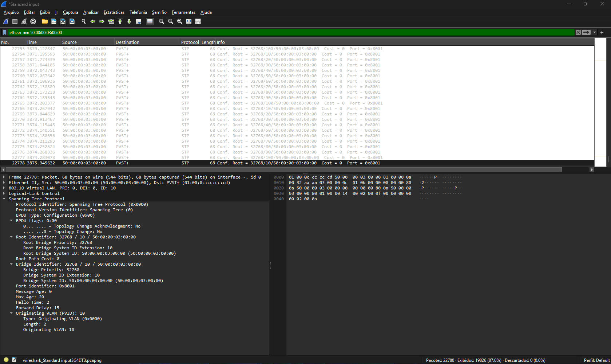

Antes/controle: SW_DST01 permanece Root nas demais VLANs (10-100), confirmando que a mudança não afetou o restante da topologia.

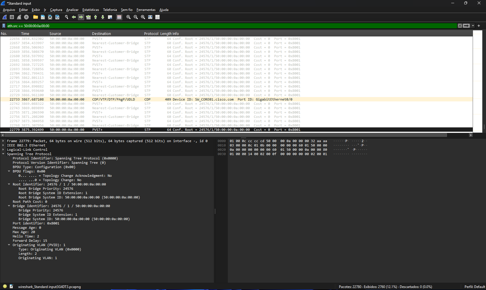

Depois: SW_CORE01 (MAC 50:00:00:0a:00:00) assume como Root da VLAN 1, com Priority 24576 — valor automático do comando root primary

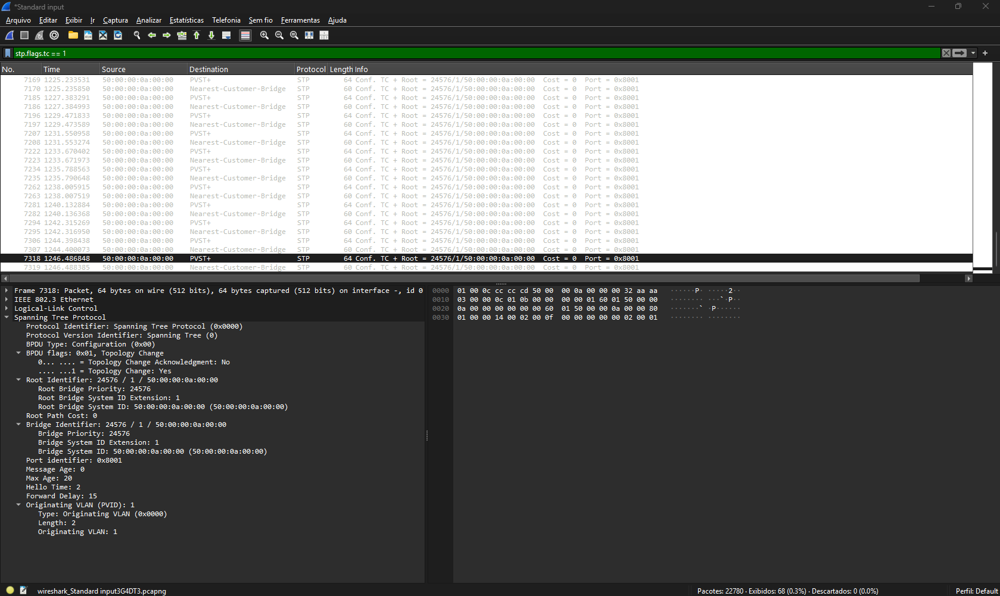

Janela de convergência: flag Topology Change ativo na VLAN 1

**Captura 2 — SW_CORE01 ↔ SW_CORE02**  

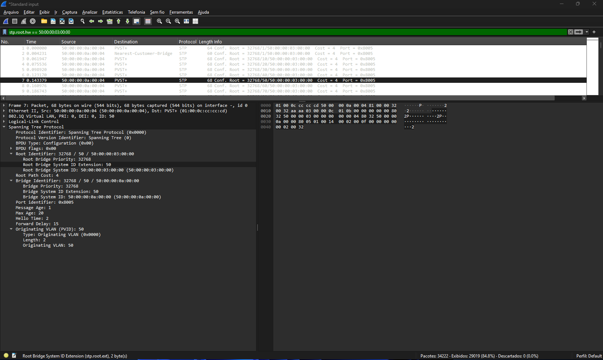  

Antes: BPDUs do SW_CORE02 anunciam Root ID = SW_DST01, com Root Path Cost refletindo o caminho antigo (8, via SW_DST02).  

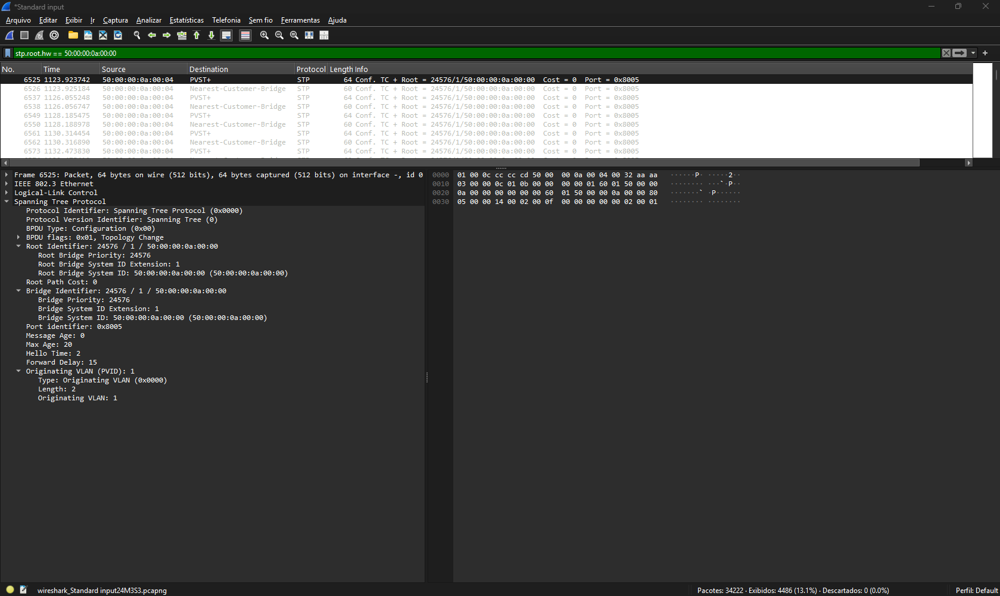  

Depois: o Root ID muda para SW_CORE01 nos dois lados, e o SW_CORE02 passa a anunciar Root Path Cost 4 por este link — confirmando que **Gi1/0 se tornou a nova Root Port do SW_CORE02**, já que agora o vizinho direto é o próprio Root Bridge.  
  
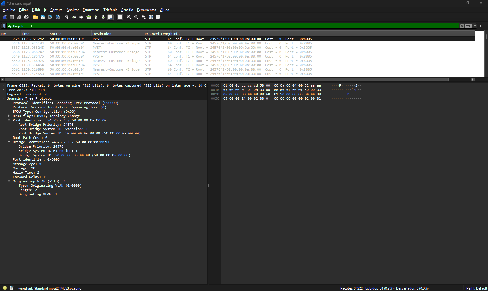  

Janela de convergência: flag Topology Change ativo, coincidindo com o mesmo intervalo observado na Captura 1.  

**Captura 3 — SW_DST01 ↔ SW_DST02**  

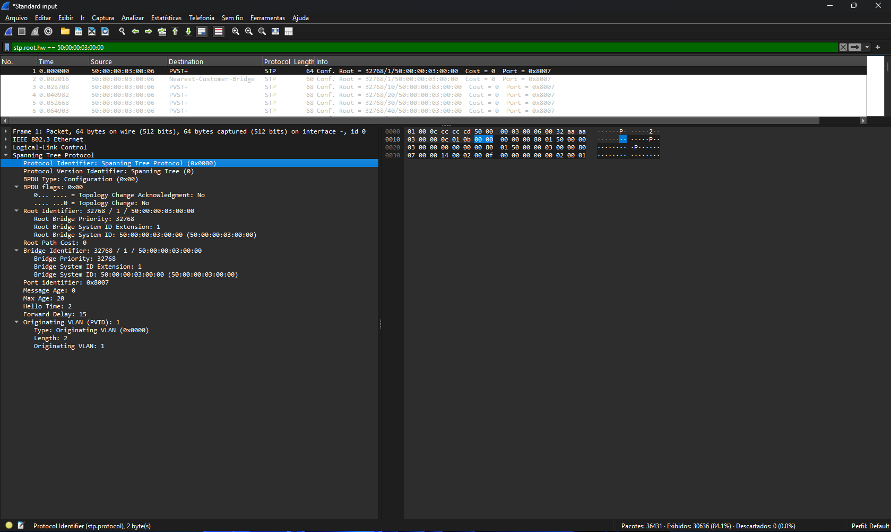  

Antes: Root ID = SW_DST01 nos dois lados, com o SW_DST02 anunciando Root Path Cost 4 por este link (o mesmo caminho que ele já usava antes da mudança).  

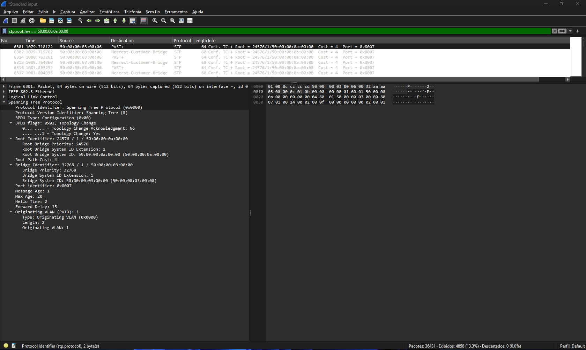  

Depois: o Root ID muda para SW_CORE01, mas o SW_DST02 **continua anunciando pela mesma interface** (Gi1/2) — confirmando a hipótese levantada antes da captura: o desempate por menor Bridge ID do anunciante (SW_DST01 vence sobre SW_CORE02) manteve o Root Port do SW_DST02 na mesma porta física, mesmo com o Root Bridge da rede tendo mudado de dono.  

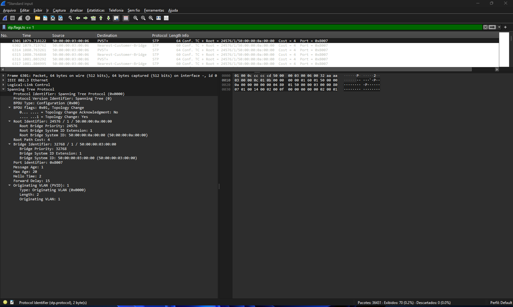  

Janela de convergência: flag Topology Change ativo neste segmento, fechando a evidência de que a reconvergência atingiu as três pontas monitoradas da topologia.

Em cada captura, vale anotar manualmente:

- O timestamp (segundos desde o início da captura) do primeiro BPDU já anunciando o SW_CORE01 como novo Root;
- O timestamp em que os BPDUs voltam a ficar estáveis (sem flag de Topology Change).

---

### Passo 5 — Desligar o debug

Antes de seguir, voltamos ao SW_CORE01 para não deixar o debug ligado desnecessariamente (ele consome CPU e polui o terminal):

```ios
SW_CORE01# undebug all
```

---

### Passo 6 — Confirmando a nova situação da VLAN 1 no SW_CORE01

Voltando ao SW_CORE01, rodamos novamente o comando de análise:

```ios
show spanning-tree vlan 1
```

Saída

```ios
SW_CORE01#show spanning-tree vlan 1

VLAN0001
  Spanning tree enabled protocol ieee
  Root ID    Priority    24577
             Address     5000.000a.0000
             This bridge is the root
             Hello Time   2 sec  Max Age 20 sec  Forward Delay 15 sec

  Bridge ID  Priority    24577  (priority 24576 sys-id-ext 1)
             Address     5000.000a.0000
             Hello Time   2 sec  Max Age 20 sec  Forward Delay 15 sec
             Aging Time  300 sec

Interface           Role Sts Cost      Prio.Nbr Type
------------------- ---- --- --------- -------- --------------------------------
Gi0/0               Desg FWD 4         128.1    P2p
Gi0/1               Desg FWD 4         128.2    P2p
Gi0/2               Desg FWD 4         128.3    P2p
Gi0/3               Desg FWD 4         128.4    P2p
Gi1/0               Desg FWD 4         128.5    P2p
Gi1/1               Desg FWD 4         128.6    P2p
Gi1/2               Desg FWD 4         128.7    P2p
Gi1/3               Desg FWD 4         128.8    P2p
Gi2/0               Desg FWD 4         128.9    P2p
Gi2/1               Desg FWD 4         128.10   P2p
Gi2/2               Desg FWD 4         128.11   P2p
Gi2/3               Desg FWD 4         128.12   P2p
Gi3/0               Desg FWD 4         128.13   P2p
Gi3/1               Desg FWD 4         128.14   P2p
Gi3/2               Desg FWD 4         128.15   P2p
Gi3/3               Desg FWD 4         128.16   P2p
```

Com essa saída, já podemos confirmar se o **SW_CORE01** de fato assumiu o papel de Root Bridge da VLAN 1, e como ficaram distribuídas suas portas Designated agora que ele não precisa mais de nenhuma Root Port.

## 🌳 Fechamento — A Árvore STP da VLAN 1, Antes e Depois

Com o Root Bridge corrigido e validado (CLI + Wireshark + debug), fechamos o ciclo que abrimos lá na reflexão sobre o posicionamento do Root: identificar o problema, corrigir, e demonstrar visualmente o resultado.

Os gráficos abaixo foram gerados pelo script `gerar_arvore_stp.py`, com os dados reais coletados nas 8 caixas em cada um dos dois momentos.

### Antes — Root Bridge = SW_DST01

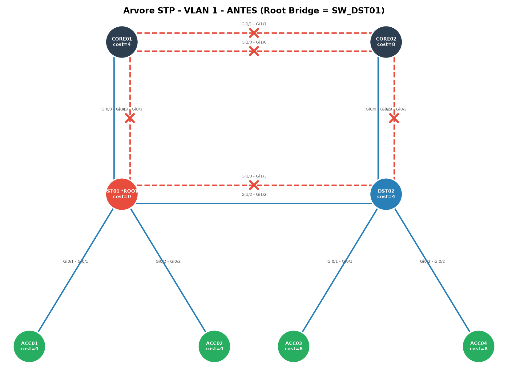

Neste estado, o Root Bridge caiu em um switch de Distribuição por consequência do critério de desempate padrão (menor endereço MAC), sem nenhuma intenção de projeto por trás — como já discutimos na reflexão anterior.

**[🔗 Abrir versão interativa (HTML)](https://alcancil.github.io/Cisco/CCNP%20350-401%20ENCOR/03%20-%20Infrastructure/02%20-%20STP%20(Spanning%20Tree%20Protocol)/17%20-%20Lab/Arquivos/stp_vlan1_antes.html)** — passe o mouse em cada switch para ver Root Path Cost, Root Port e Blocking Ports; passe o mouse nos links para confirmar qual porta física está de cada lado.

### Depois — Root Bridge = SW_CORE01

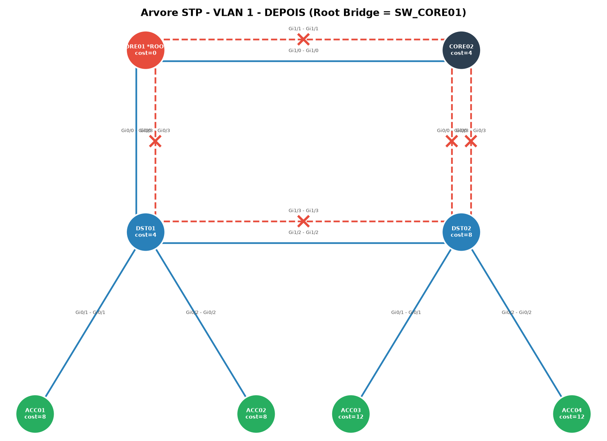

Após aplicar `spanning-tree vlan 1 root primary` no SW_CORE01, a árvore reconvergiu (~21s observados via Wireshark, dentro da janela teórica de até 50s do 802.1D). O Root agora ocupa o switch de Core, alinhado à hierarquia de projeto — ainda que, como discutido, isso tenha aumentado o custo agregado da árvore (40 → 56), já que a prioridade de projeto aqui não é minimizar custo total, e sim tirar a concentração de tráfego de um switch de Distribution.

**[🔗 Abrir versão interativa (HTML)](https://alcancil.github.io/Cisco/CCNP%20350-401%20ENCOR/03%20-%20Infrastructure/02%20-%20STP%20(Spanning%20Tree%20Protocol)/17%20-%20Lab/Arquivos/stp_vlan1_depois.html)** — passe o mouse em cada switch para ver Root Path Cost, Root Port e Blocking Ports; passe o mouse nos links para confirmar qual porta física está de cada lado.

---

### 🐍 Script utilizado

O script que gera os dois grafos (PNG estático + HTML interativo) está disponível para download:

**[📥 gerar_arvore_stp.py](./Arquivos/gerar_arvore_stp.py)**

Ele já nasce pensado para o próximo lab: a camada de dados (`DADOS_STP_VLAN1_ANTES` / `DADOS_STP_VLAN1_DEPOIS`) está separada da camada de renderização (`desenhar_grafo` / `desenhar_grafo_plotly`). Quando a coleta via Netmiko + TextFSM/NTC-templates estiver pronta, o parser só precisa devolver um dicionário no mesmo formato — a renderização não muda.

**Dependências:**

```bash
pip install networkx matplotlib plotly
```

**Uso:**

```bash
python3 gerar_arvore_stp.py
```

**Ou, instalando via requirements.txt:**

**[📥 requirements.txt](./Arquivos/requirements.txt)**

```bash
pip install -r requirements.txt
python3 gerar_arvore_stp.py
```

---

## 🔜 Próximo Laboratório — Da Análise Manual à Coleta Automatizada

Se você chegou até aqui seguindo a série, já deve ter sentido na pele o motivo de este lab ter demorado tanto: **8 switches, 5 perguntas cada, só para 1 das 10 VLANs configuradas.** Fizemos as contas lá na reflexão — são 400 decisões manuais se replicássemos esse mesmo processo para as 10 VLANs. E isso sem contar o tempo de captura no Wireshark, o debug de convergência, e a geração manual dos dicionários de dados que alimentam o script de hoje.

Essa dor é, propositalmente, o ponto de partida do próximo laboratório.

A partir daqui, a série vai substituir cada uma dessas etapas manuais por uma camada de automação:

- **Netmiko** — para abrir a conexão SSH com cada switch e executar `show spanning-tree vlan X` programaticamente, nas 10 VLANs e nas 8 caixas, sem precisar copiar e colar comando por comando;
- **TextFSM + NTC-templates** — para fazer o parsing estruturado da saída bruta do CLI, transformando texto solto em dados organizados (Root Bridge, Root Path Cost, Root Port, Designated/Blocking Ports) automaticamente, exatamente nos mesmos campos que hoje preenchemos à mão em `DADOS_STP_VLAN1_ANTES` e `DADOS_STP_VLAN1_DEPOIS`;
- **Reaproveitamento direto do script de hoje** — a camada de renderização (`desenhar_grafo` / `desenhar_grafo_plotly`) que construímos neste lab não muda uma linha. O parser via TextFSM só precisa devolver um dicionário no mesmo formato que já usamos aqui, e os mesmos gráficos — agora para as 10 VLANs, não só a VLAN 1 — saem prontos.

Em outras palavras: o próximo lab não começa do zero. Ele começa exatamente de onde a dor deste terminou.
