# 🧪 Laboratório 18 — Engenharia e Automação da Análise do PVST+

> **Sequência:** Este laboratório dá continuidade ao estudo iniciado no Laboratório 17. Depois de compreender manualmente o funcionamento do protocolo PVST+, iniciaremos agora um fluxo completo de engenharia baseado em automação. Começaremos reproduzindo um problema real de utilização da rede, coletaremos evidências automaticamente utilizando Python, estruturaremos essas informações com TextFSM e NTC Templates, reconstruiremos as árvores do Spanning Tree, tomaremos uma decisão técnica para otimizar a topologia por meio do balanceamento de VLANs e, finalmente, realizaremos uma nova coleta para validar os ganhos obtidos após a implementação da solução.

---

## 📌 Sumário

- [🧪 Laboratório 18 — Engenharia e Automação da Análise do PVST+](#-laboratório-18--engenharia-e-automação-da-análise-do-pvst)
  - [📌 Sumário](#-sumário)
  - [🎯 Objetivos](#-objetivos)
  - [📚 Contexto](#-contexto)
  - [🏗️ Topologia do Laboratório](#️-topologia-do-laboratório)
  - [🛠️ Ferramentas Utilizadas](#️-ferramentas-utilizadas)
  - [PARTE I — COMPREENDENDO O PROBLEMA](#parte-i--compreendendo-o-problema)
  - [Cenário Inicial](#cenário-inicial)
  - [Hipótese](#hipótese)
  - [Objetivos da Análise](#objetivos-da-análise)
  - [PARTE II — GERANDO EVIDÊNCIAS](#parte-ii--gerando-evidências)
  - [1. Gerando Tráfego na Rede](#1-gerando-tráfego-na-rede)
  - [Objetivo](#objetivo)
  - [Servidor iperf3](#servidor-iperf3)
  - [Cliente iperf3](#cliente-iperf3)
  - [Gerando 10 Fluxos Simultâneos](#gerando-10-fluxos-simultâneos)
  - [Validando o Tráfego](#validando-o-tráfego)
    - [No Servidor Linux](#no-servidor-linux)
    - [No Host Linux](#no-host-linux)
    - [Nos Switches Cisco](#nos-switches-cisco)
    - [Correlacionando as Evidências](#correlacionando-as-evidências)
  - [2. Observando o Comportamento da Rede](#2-observando-o-comportamento-da-rede)
  - [O que iremos observar?](#o-que-iremos-observar)
  - [Evidências Coletadas](#evidências-coletadas)
  - [Hipóteses Iniciais](#hipóteses-iniciais)
  - [PARTE III — COLETANDO EVIDÊNCIAS AUTOMATICAMENTE](#parte-iii--coletando-evidências-automaticamente)
  - [3. Automatizando a Coleta](#3-automatizando-a-coleta)
  - [Por que automatizar?](#por-que-automatizar)
  - [Netmiko x Paramiko](#netmiko-x-paramiko)
  - [Estrutura do Projeto](#estrutura-do-projeto)
  - [Inventário da Rede](#inventário-da-rede)
  - [Script 01 — Conectando a um Switch](#script-01--conectando-a-um-switch)
  - [Módulo `inventory_loader.py`](#módulo-inventory_loaderpy)
    - [Explicando o Código](#explicando-o-código)
  - [`connection.py`](#connectionpy)
    - [Explicando o Código](#explicando-o-código-1)
  - [`script_01.py`](#script_01py)
    - [Explicando o Código](#explicando-o-código-2)
  - [Executando o Script](#executando-o-script)
  - [Script 02 — Automatizando Toda a Topologia](#script-02--automatizando-toda-a-topologia)
  - [`connection.py`](#connectionpy-1)
  - [`coleta.py`](#coletapy)
    - [Explicando o Código](#explicando-o-código-3)
  - [`script_02_automatizar_topologia.py`](#script_02_automatizar_topologiapy)
    - [Explicando o Código](#explicando-o-código-4)
  - [Executando a Coleta](#executando-a-coleta)
  - [Organizando os Arquivos Coletados](#organizando-os-arquivos-coletados)
  - [Fluxo da Automação](#fluxo-da-automação)
  - [PARTE IV — TRANSFORMANDO TEXTO EM DADOS](#parte-iv--transformando-texto-em-dados)
  - [4. Parsing com TextFSM e NTC Templates](#4-parsing-com-textfsm-e-ntc-templates)
  - [O problema da CLI](#o-problema-da-cli)
  - [O que é o TextFSM](#o-que-é-o-textfsm)
  - [O que são os NTC Templates](#o-que-são-os-ntc-templates)
  - [Fluxo do Parsing](#fluxo-do-parsing)
  - [5. Consolidando os Dados Coletados](#5-consolidando-os-dados-coletados)
  - [Script 03 — Parsing das Saídas da CLI](#script-03--parsing-das-saídas-da-cli)
    - [Explicando o Código](#explicando-o-código-5)
  - [Script 04 — Consolidando os Dados](#script-04--consolidando-os-dados)
    - [Explicando o Código](#explicando-o-código-6)
  - [Consolidando Todos os Switches](#consolidando-todos-os-switches)
    - [Explicando o Código](#explicando-o-código-7)
  - [Validando os Dados](#validando-os-dados)
  - [6. Descobrindo a Topologia com CDP](#6-descobrindo-a-topologia-com-cdp)
  - [Habilitando o CDP](#habilitando-o-cdp)
  - [Integrando o CDP à Coleta Automatizada](#integrando-o-cdp-à-coleta-automatizada)
    - [Reutilizando o Script 02](#reutilizando-o-script-02)
  - [Nova Coleta de Dados](#nova-coleta-de-dados)
  - [Reutilizando o Parsing](#reutilizando-o-parsing)
    - [Executando o Script 03 Novamente](#executando-o-script-03-novamente)
  - [Reutilizando a Consolidação](#reutilizando-a-consolidação)
    - [Executando o Script 04 Novamente](#executando-o-script-04-novamente)
  - [PVST+ + CDP](#pvst--cdp)
  - [O Poder da Reutilização](#o-poder-da-reutilização)
  - [PARTE V — ANÁLISE AUTOMATIZADA](#parte-v--análise-automatizada)
  - [7. Reconstruindo Automaticamente as Árvores STP](#7-reconstruindo-automaticamente-as-árvores-stp)
    - [Como representar uma árvore STP](#como-representar-uma-árvore-stp)
  - [Comparando com a Análise Manual](#comparando-com-a-análise-manual)
  - [Validando os Resultados](#validando-os-resultados)
  - [PARTE VI — DECISÃO DE ENGENHARIA \& BALANCEAMENTO DE CARGA](#parte-vi--decisão-de-engenharia--balanceamento-de-carga)
  - [8. Implementando o Balanceamento de PVST+](#8-implementando-o-balanceamento-de-pvst)
  - [Planos de Priorização e Matriz de Eleição](#planos-de-priorização-e-matriz-de-eleição)
    - [Matriz de Prioridades STP](#matriz-de-prioridades-stp)
  - [Aplicação das Configurações](#aplicação-das-configurações)
    - [1. Configuração no SW\_CORE01](#1-configuração-no-sw_core01)
    - [2. Configuração no SW\_CORE02](#2-configuração-no-sw_core02)
    - [O Processo de Reconvergência do PVST+ e Medição do Tempo](#o-processo-de-reconvergência-do-pvst-e-medição-do-tempo)
    - [Reconfiguração dos Gateways Padrão nos Hosts](#reconfiguração-dos-gateways-padrão-nos-hosts)
    - [Reconfiguração nos VPCS](#reconfiguração-nos-vpcs)
    - [Reconfiguração nos Hosts Linux](#reconfiguração-nos-hosts-linux)
    - [Remover a rota padrão antiga da sub-interface VLAN 80](#remover-a-rota-padrão-antiga-da-sub-interface-vlan-80)
    - [Adicionar a nova rota padrão apontando para o Core02](#adicionar-a-nova-rota-padrão-apontando-para-o-core02)
    - [Validar](#validar)
    - [Consequências Esperadas Após o Realinhamento](#consequências-esperadas-após-o-realinhamento)
    - [Impacto da Reconvergência do PVST+ nas Tabelas de Encaminhamento](#impacto-da-reconvergência-do-pvst-nas-tabelas-de-encaminhamento)
    - [Estratégia de Reaquecimento das Tabelas](#estratégia-de-reaquecimento-das-tabelas)
    - [Script TCL de Reaquecimento](#script-tcl-de-reaquecimento)
    - [Observação Técnica: Limitação do VPCS na Resolução ARP](#observação-técnica-limitação-do-vpcs-na-resolução-arp)
    - [Validação nos Hosts (VPCS e Linux)](#validação-nos-hosts-vpcs-e-linux)
    - [Conclusão do Procedimento](#conclusão-do-procedimento)
  - [PARTE VII — VALIDANDO A SOLUÇÃO](#parte-vii--validando-a-solução)
  - [9. Nova Coleta Automatizada](#9-nova-coleta-automatizada)
    - [Nova coleta](#nova-coleta)
    - [Novo parsing](#novo-parsing)
    - [Nova base de dados](#nova-base-de-dados)
    - [Nova reconstrução das árvores](#nova-reconstrução-das-árvores)
  - [10. Comparando Antes × Depois](#10-comparando-antes--depois)
    - [Utilização dos enlaces](#utilização-dos-enlaces)
    - [Root Bridges](#root-bridges)
    - [CPU](#cpu)
    - [Distribuição das VLANs](#distribuição-das-vlans)
    - [Árvores STP](#árvores-stp)
    - [Tabela Comparativa](#tabela-comparativa)
  - [PARTE VIII — CONCLUSÕES](#parte-viii--conclusões)
  - [11. Conclusões](#11-conclusões)
    - [O que aprendemos](#o-que-aprendemos)
  - [💼 Visão de Mercado](#-visão-de-mercado)
  - [🚀 Próximo Laboratório](#-próximo-laboratório)

## 🎯 Objetivos

Neste laboratório iniciaremos uma nova etapa da série de estudos sobre o protocolo **Per-VLAN Spanning Tree Plus (PVST+)**.

Até o laboratório anterior, toda a análise do protocolo foi realizada manualmente, permitindo compreender em detalhes como o algoritmo do Spanning Tree toma suas decisões, como ocorre a eleição do Root Bridge, a seleção das Root Ports, das Designated Ports e quais portas permanecem em estado de bloqueio.

Embora essa abordagem seja extremamente importante para compreender o funcionamento interno do protocolo, ela apresenta uma limitação evidente quando aplicada a ambientes corporativos.

Em redes contendo dezenas ou centenas de switches e centenas de VLANs, executar comandos manualmente em cada equipamento deixa de ser uma tarefa prática, tornando a análise lenta, repetitiva e suscetível a erros humanos.

O objetivo deste laboratório é demonstrar como a automação pode transformar esse processo.

Ao longo deste estudo construiremos um fluxo completo de engenharia capaz de:

- gerar tráfego controlado na rede;
- coletar informações automaticamente em todos os switches;
- transformar saídas de CLI em dados estruturados;
- reconstruir automaticamente as árvores do protocolo STP;
- identificar gargalos na topologia;
- implementar melhorias no projeto;
- validar tecnicamente os resultados obtidos.

Mais do que automatizar comandos, o objetivo deste laboratório é demonstrar como a automação pode ser utilizada como ferramenta de análise e tomada de decisão em projetos de infraestrutura de redes.

---

## 📚 Contexto

No **Laboratório 17** analisamos manualmente o comportamento do protocolo PVST+ utilizando exclusivamente comandos do Cisco IOS.

Durante aquela etapa percorremos exatamente a mesma sequência utilizada pelo algoritmo do protocolo para compreender como cada decisão é tomada.

Entre os principais tópicos estudados estavam:

- eleição do Root Bridge;
- cálculo do Root Path Cost;
- seleção das Root Ports;
- seleção das Designated Ports;
- identificação das portas bloqueadas;
- interpretação dos temporizadores do STP;
- análise das BPDUs;
- reconstrução manual das árvores de cada VLAN.

Essa abordagem permitiu compreender profundamente o funcionamento do protocolo e servirá como base para validar os resultados obtidos pela automação.

Neste laboratório seguiremos exatamente o mesmo processo de análise, porém substituindo a coleta manual por um conjunto de scripts desenvolvidos em Python.

A ideia é que todo o conhecimento adquirido anteriormente seja preservado, enquanto as tarefas repetitivas passam a ser executadas automaticamente.

Dessa forma, a automação deixa de ser um objetivo isolado e passa a atuar como uma ferramenta capaz de ampliar a capacidade de análise do engenheiro de redes.

---

## 🏗️ Topologia do Laboratório

Neste laboratório utilizaremos a mesma topologia desenvolvida ao longo dos estudos anteriores.

Ela foi construída seguindo um modelo hierárquico de três camadas, composto por switches Core, Distribution e Access.

Além da infraestrutura de switching, o ambiente conta com dois hosts Linux responsáveis por gerar o tráfego necessário para os testes de desempenho e para a coleta automatizada das informações da rede.

A topologia foi preparada para permitir a análise simultânea de múltiplas instâncias do protocolo PVST+.

Para isso foram criadas dez VLANs de usuários, além da VLAN nativa, totalizando onze instâncias do protocolo Spanning Tree.

Embora a criação de interfaces SVI para todas as VLANs não represente necessariamente um projeto típico de produção, essa decisão foi adotada propositalmente para facilitar os experimentos de automação.

Com essa abordagem torna-se possível acessar cada VLAN individualmente durante os testes, gerar tráfego específico, validar a conectividade e realizar a coleta automatizada das informações do protocolo.


---

## 🛠️ Ferramentas Utilizadas

Ao contrário do laboratório anterior, onde praticamente toda a análise foi realizada manualmente através da CLI dos equipamentos Cisco, nesta etapa utilizaremos um conjunto de ferramentas amplamente empregadas em projetos modernos de Network Automation.

Cada ferramenta desempenhará um papel específico dentro do fluxo de trabalho desenvolvido ao longo deste laboratório.

| **Ferramenta**| **Finalidade**                                          |
|:---           |:---                                                     |
| Python        | Orquestração da automação                               |
| Netmiko       | Acesso simultâneo aos equipamentos Cisco                |
| TextFSM       | Conversão da saída textual da CLI em dados estruturados |
| NTC Templates | Parsing automatizado dos comandos Cisco IOS             |
| Pandas        | Organização e análise dos dados coletados               |
| iperf3        | Geração de tráfego entre as VLANs                       |
| Wireshark     | Validação do comportamento do protocolo                 |
| Cisco IOS     | Plataforma utilizada nos switches do laboratório        |

Observe que nenhuma dessas ferramentas será utilizada isoladamente.

Ao longo deste laboratório elas serão integradas para construir um fluxo completo de engenharia capaz de automatizar desde a coleta das informações até a validação das alterações realizadas na topologia.

## PARTE I — COMPREENDENDO O PROBLEMA

Antes de propor qualquer alteração na infraestrutura, é necessário compreender o comportamento atual da rede.

Em ambientes corporativos, decisões relacionadas à infraestrutura não devem ser tomadas com base em suposições ou percepções subjetivas. Alterações na topologia, na configuração dos equipamentos ou na distribuição do tráfego precisam ser fundamentadas em evidências técnicas obtidas a partir da coleta e análise dos dados da própria rede.

Nesta primeira etapa do laboratório não realizaremos nenhuma alteração na configuração dos switches. Nosso objetivo será observar o comportamento da infraestrutura em seu estado atual, reproduzir uma condição de utilização da rede e levantar informações suficientes para compreender como o protocolo PVST+ está influenciando a utilização dos enlaces e o processamento dos equipamentos.

Essa análise servirá como ponto de partida para todas as etapas seguintes do laboratório.

---

## Cenário Inicial

A topologia utilizada neste laboratório é a mesma construída ao longo dos estudos anteriores e representa uma arquitetura hierárquica composta pelas camadas **Core**, **Distribution** e **Access**.

Foram configuradas dez VLANs de usuários, além da VLAN nativa, totalizando onze instâncias do protocolo PVST+.

Neste momento da análise, todas as VLANs utilizam a configuração padrão do protocolo, sem qualquer técnica de balanceamento de carga entre os switches Core.

Isso significa que todas as instâncias do PVST+ tendem a eleger o mesmo equipamento como **Root Bridge**, fazendo com que grande parte do tráfego da rede percorra exatamente os mesmos enlaces.

Embora essa configuração seja funcional e mantenha a redundância da infraestrutura, ela pode provocar uma utilização desigual dos links disponíveis, concentrando o tráfego em determinados caminhos enquanto outros permanecem subutilizados.

Antes de implementar qualquer otimização, precisamos comprovar tecnicamente se esse comportamento realmente está ocorrendo em nossa topologia.

---

## Hipótese

Com base na configuração atual da infraestrutura, levantamos a seguinte hipótese:

> A ausência de balanceamento entre as instâncias do PVST+ faz com que todas as VLANs utilizem o mesmo Root Bridge, concentrando o tráfego sobre um conjunto reduzido de enlaces, aumentando a utilização desses links e exigindo maior processamento dos switches responsáveis pela raiz da árvore.

Caso essa hipótese esteja correta, esperamos observar os seguintes comportamentos durante os testes:

- concentração do tráfego sobre os mesmos enlaces;

- baixa utilização dos enlaces redundantes;

- todas as VLANs utilizando o mesmo Root Bridge;

- aumento da utilização de CPU nos switches responsáveis pelo processamento das instâncias do protocolo;

- existência de múltiplas árvores STP compartilhando a mesma topologia lógica.

Ao longo deste laboratório iremos verificar se essas evidências realmente podem ser observadas na prática.

---

## Objetivos da Análise

Para validar ou refutar a hipótese apresentada anteriormente, desenvolveremos um fluxo completo de coleta e análise automatizada.

Ao final desta etapa deveremos ser capazes de responder às seguintes questões:

- Como o tráfego está sendo distribuído pelos enlaces da topologia?

- Quais interfaces permanecem subutilizadas?

- Qual switch foi eleito Root Bridge para cada VLAN?

- Existe concentração de processamento em um único equipamento?

- Quantas instâncias do protocolo estão sendo executadas?

- É possível identificar automaticamente a árvore lógica de cada VLAN?

- O balanceamento das VLANs entre os switches Core melhora a utilização da infraestrutura?

Responder a essas perguntas será fundamental para justificar tecnicamente a implementação do balanceamento de VLANs nas próximas etapas do laboratório.

## PARTE II — GERANDO EVIDÊNCIAS

Após definirmos a hipótese que será investigada, o próximo passo consiste em produzir uma condição controlada de utilização da rede.

Em um ambiente ocioso, grande parte das interfaces apresenta pouca ou nenhuma utilização, dificultando a identificação de possíveis gargalos, da distribuição do tráfego entre os enlaces e do impacto causado pelas múltiplas instâncias do protocolo PVST+.

Para contornar esse problema, iremos gerar tráfego entre diferentes VLANs utilizando o **iperf3**, criando uma carga suficientemente elevada para permitir a observação do comportamento da topologia durante o funcionamento normal da rede.

Essa abordagem possibilita reproduzir um cenário mais próximo de um ambiente corporativo, onde múltiplos fluxos coexistem simultaneamente e competem pelos mesmos recursos da infraestrutura.

As informações coletadas nesta etapa servirão como referência para todas as análises realizadas posteriormente.

---

## 1. Gerando Tráfego na Rede

## Objetivo

O objetivo desta etapa é gerar tráfego simultâneo em todas as VLANs configuradas na topologia para provocar uma utilização significativa dos enlaces da infraestrutura.

A geração de múltiplos fluxos permitirá observar como o protocolo PVST+ distribui esse tráfego pela rede antes da implementação do balanceamento de VLANs entre os switches Core.

Ao final desta etapa teremos uma condição controlada que possibilitará analisar diversos aspectos da infraestrutura, como:

- utilização dos enlaces;
- concentração do tráfego;
- portas efetivamente utilizadas;
- enlaces redundantes ociosos;
- consumo de CPU dos switches;
- comportamento das instâncias do protocolo PVST+.

Essas informações serão utilizadas posteriormente para validar se a implementação do balanceamento de VLANs produz melhorias mensuráveis na utilização da rede.

---

## Servidor iperf3

Para receber os fluxos de tráfego, utilizaremos um servidor Linux executando o **iperf3** em modo servidor.

Esse equipamento permanecerá aguardando conexões provenientes do host cliente durante toda a execução dos testes.

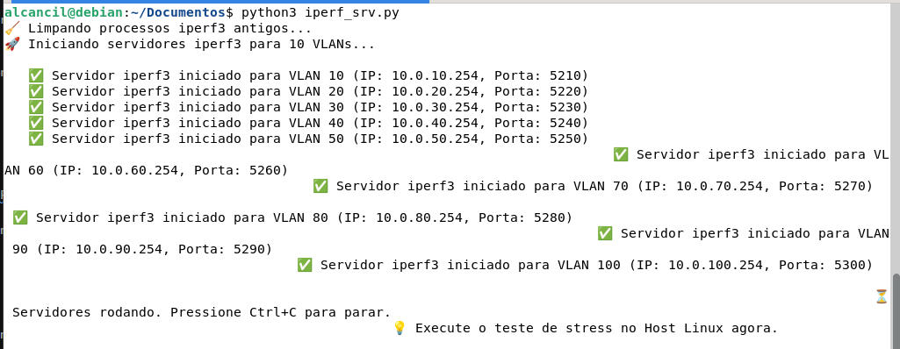

Aqui vou deixar o script que gera os 10 fluxos do iperf3.

[IPERF3_SRV](./Arquivos/scripts/srv01/iperf_srv.py)

Também vou deixar a versão comentado do script para entendimento.

[IPERF3_SRV_COMENTADO](./Arquivos/scripts/srv01/iperf_srv_comentado.py)

Após iniciar o serviço, podemos confirmar que o servidor encontra-se aguardando conexões utilizando os seguintes comandos:

```bash
ss -lnt | grep ':52'

netstat -tulnp | grep 5201
```

Também podemos validar a conectividade com o servidor utilizando:

```bash
ping -c 2 10.0.10.1
ping -c 2 10.0.20.1
ping -c 2 10.0.30.1
ping -c 2 10.0.40.1
ping -c 2 10.0.50.1
ping -c 2 10.0.60.1
ping -c 2 10.0.70.1
ping -c 2 10.0.80.1
ping -c 2 10.0.90.1
ping -c 2 10.0.100.1
```

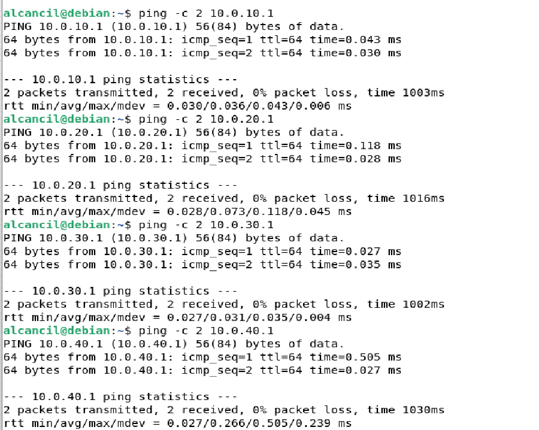  

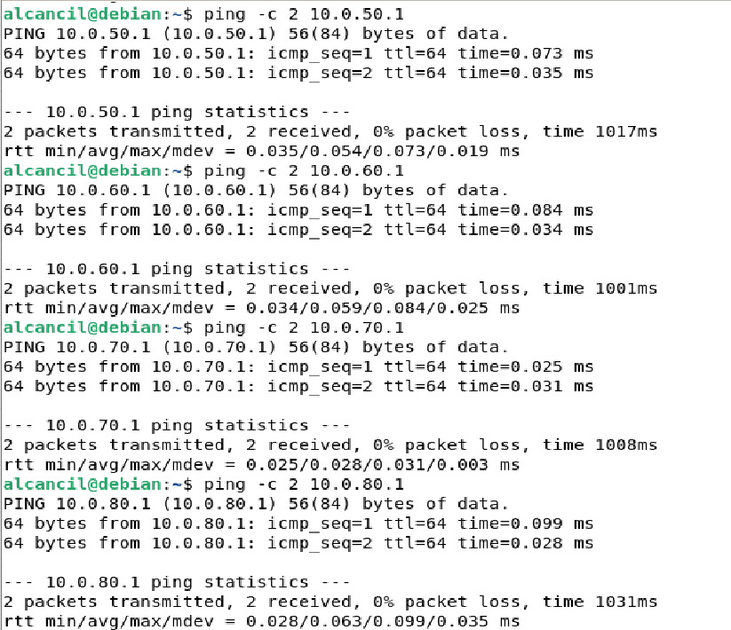  

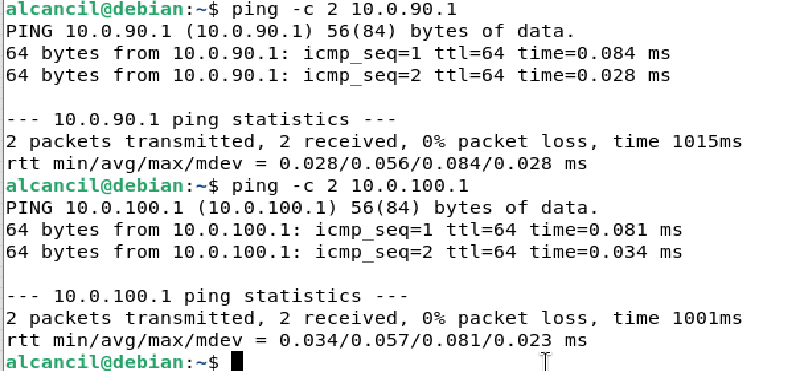  

---

## Cliente iperf3

No host cliente utilizaremos um script desenvolvido em Python responsável por iniciar automaticamente múltiplas sessões do **iperf3**.

Cada fluxo será associado a uma VLAN distinta, permitindo gerar tráfego simultâneo em todos os segmentos da rede.

Essa abordagem elimina a necessidade de iniciar manualmente cada sessão do iperf3 e garante que todos os testes sejam executados de forma padronizada e reproduzível.

[IPERF_STRESS](./Arquivos/scripts/host/iperf_stress%20.py)

Também vou deixar aqui a versão do script comentado.

[IPERF_STRESS_COMENTADO](./Arquivos/scripts/host/iperf_stress_comentado.py)

---

## Gerando 10 Fluxos Simultâneos

Neste laboratório foram configuradas dez VLANs de usuários.

O script desenvolvido para o cliente iniciará simultaneamente dez conexões independentes com o servidor iperf3.

Cada conexão será responsável por gerar tráfego correspondente a uma VLAN específica.

Dessa forma será possível reproduzir um cenário onde múltiplos usuários ou aplicações utilizam a infraestrutura ao mesmo tempo.

Após a execução do script, o servidor deverá registrar dez sessões ativas do iperf3.

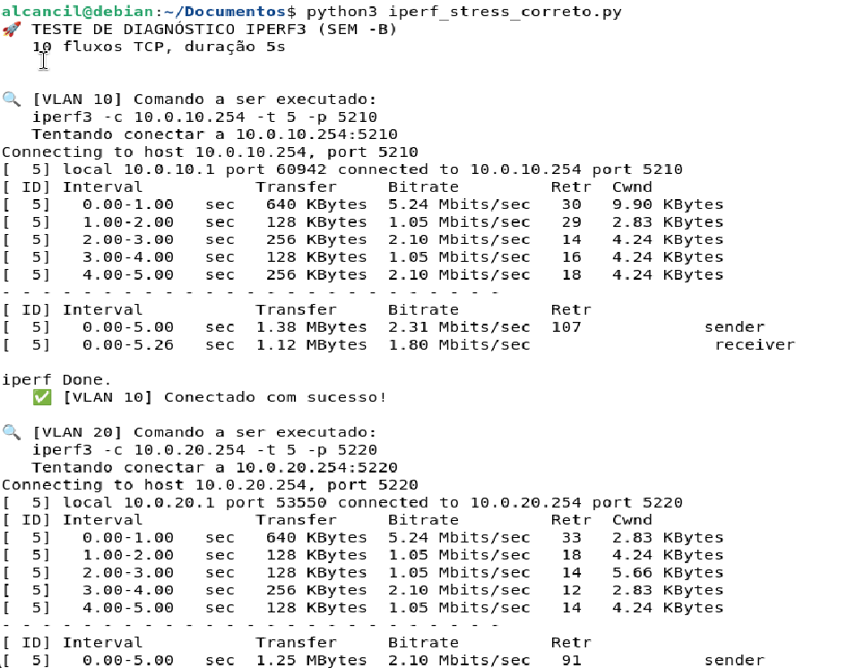  

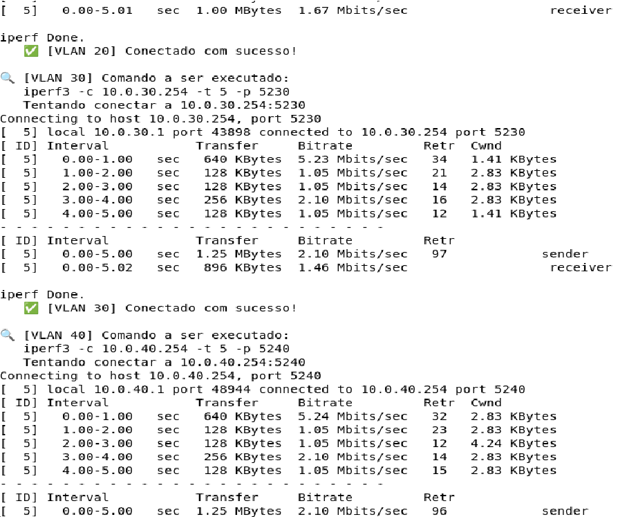  

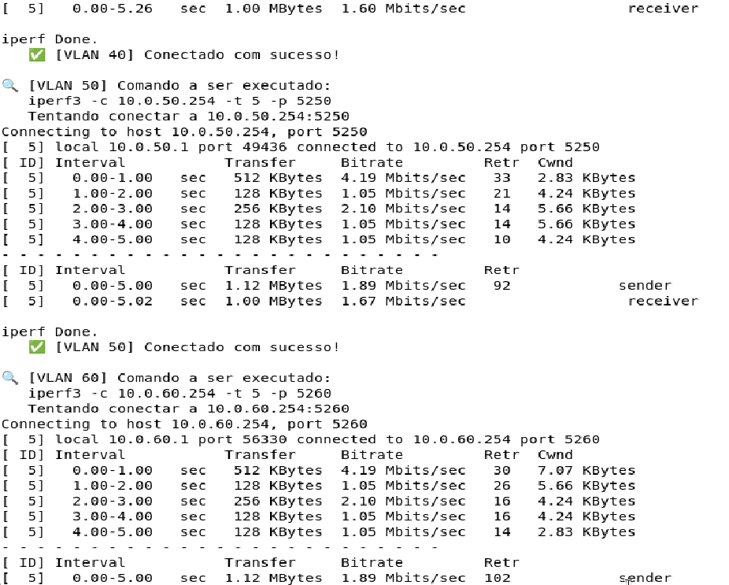  

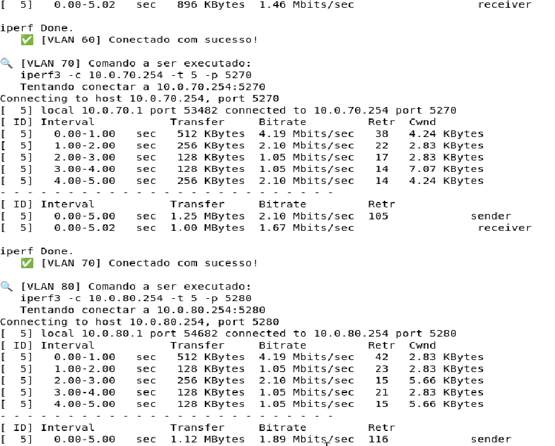  

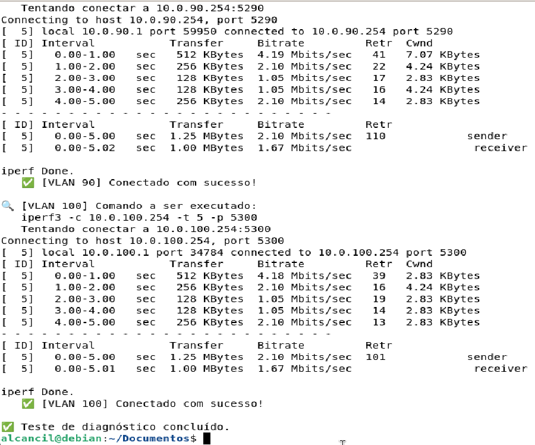  

---

## Validando o Tráfego

Após iniciar os servidores **iperf3** e executar o script responsável pela geração dos fluxos de dados, o próximo passo consiste em confirmar que o tráfego está efetivamente atravessando toda a infraestrutura.

O objetivo desta etapa não é apenas verificar se existe conectividade entre o Host e o Servidor Linux, mas reunir evidências que demonstrem que os pacotes percorrem os enlaces da topologia, são encaminhados pelos switches Cisco e alcançam corretamente o destino.

Essa validação servirá como ponto de partida para as próximas etapas, onde automatizaremos a coleta das informações da rede utilizando Python.

---

### No Servidor Linux

Inicialmente verificaremos se os servidores **iperf3** estão escutando nas portas correspondentes às VLANs configuradas.

```bash
ss -lnt
```

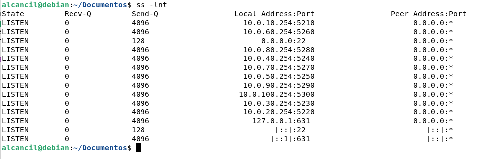  

Também confirmaremos que as conexões TCP provenientes do Host Linux foram estabelecidas corretamente.

```bash
ss -tn
```

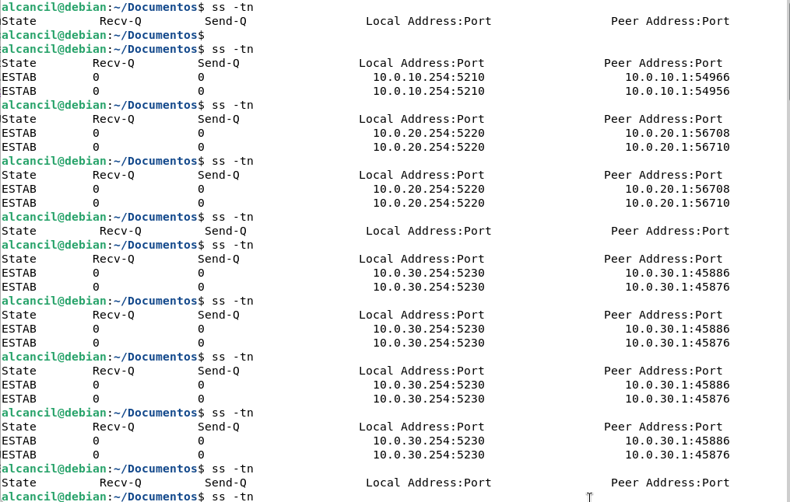  

Em seguida verificaremos o estado das interfaces de rede e os respectivos contadores de transmissão e recepção de pacotes.

```bash
ip -br address
```

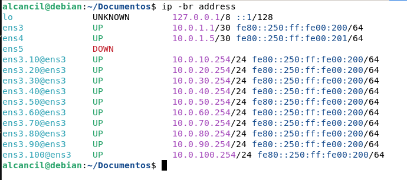  

**OBS:** para os testes do laboratório estamos com a interface ligada a Internet desligada

```bash
ip -s link
```

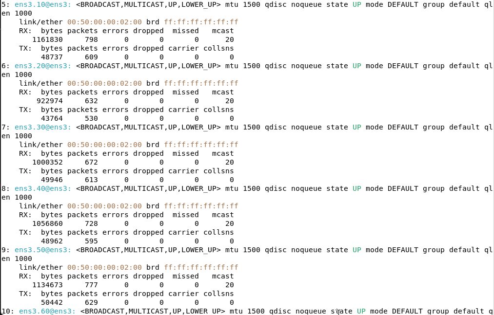  

---

### No Host Linux

No Host Linux confirmaremos que o script responsável pela geração dos fluxos encontra-se em execução.

```bash
ps aux | grep iperf3
```

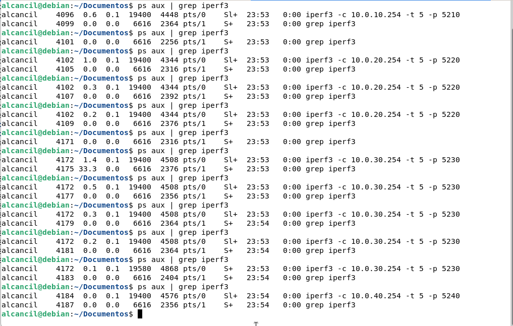  

Também validaremos a conectividade com o Servidor Linux.

```bash
ping <IP_DO_SERVIDOR>
```

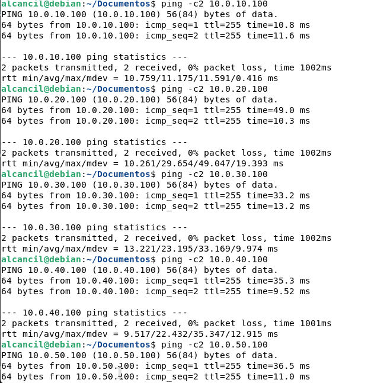  

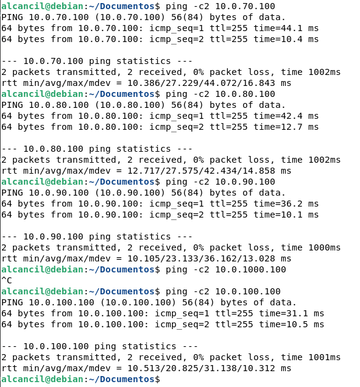

---

### Nos Switches Cisco

Como demonstrado no **Laboratório 17**, a análise manual do protocolo PVST+ exige a execução de diversos comandos em todos os switches da topologia para identificar o **Root Bridge**, as **Root Ports**, as **Designated Ports** e reconstruir a árvore lógica de cada VLAN.

Embora essa abordagem seja fundamental para compreender o funcionamento do protocolo, ela torna-se pouco prática em ambientes com dezenas de switches e centenas de VLANs, onde a coleta manual de informações passa a consumir tempo e aumenta a probabilidade de erros operacionais.

Por esse motivo, nesta etapa realizaremos uma validação pontual apenas no switch **SW_DST01**, equipamento que, na configuração atual da topologia, foi eleito **Root Bridge** para todas as instâncias do protocolo PVST+.

O objetivo desta verificação não é reconstruir novamente toda a topologia, mas confirmar que os fluxos gerados pelo **iperf3** estão atravessando a infraestrutura e que o protocolo encontra-se operando normalmente antes da implementação da coleta automatizada.

Inicialmente analisaremos as interfaces troncadas responsáveis pelo encaminhamento do tráfego entre os switches.

```text
show interfaces GigabitEthernet0/0

show interfaces GigabitEthernet0/1
```

```ios
SW_DST01#show interfaces GigabitEthernet 0/0
GigabitEthernet0/0 is up, line protocol is up (connected)
  Hardware is iGbE, address is 5000.0003.0000 (bia 5000.0003.0000)
  MTU 1500 bytes, BW 1000000 Kbit/sec, DLY 10 usec,
     reliability 255/255, txload 1/255, rxload 1/255
  Encapsulation ARPA, loopback not set
  Keepalive set (10 sec)
  Auto Duplex, Auto Speed, link type is auto, media type is unknown media type
  output flow-control is unsupported, input flow-control is unsupported
  Full-duplex, Auto-speed, link type is auto, media type is RJ45
  input flow-control is off, output flow-control is unsupported
  ARP type: ARPA, ARP Timeout 04:00:00
  Last input 00:00:00, output 00:00:00, output hang never
  Last clearing of "show interface" counters never
  Input queue: 0/75/0/0 (size/max/drops/flushes); Total output drops: 342
  Queueing strategy: fifo
  Output queue: 0/0 (size/max)
  5 minute input rate 0 bits/sec, 0 packets/sec
  5 minute output rate 96000 bits/sec, 4 packets/sec
     43397 packets input, 3270153 bytes, 0 no buffer
     Received 0 broadcasts (0 multicasts)
     0 runts, 0 giants, 0 throttles
     0 input errors, 0 CRC, 0 frame, 0 overrun, 0 ignored
     0 watchdog, 0 multicast, 0 pause input
     75803 packets output, 82585422 bytes, 0 underruns
     0 output errors, 0 collisions, 2 interface resets
     0 unknown protocol drops
     0 babbles, 0 late collision, 0 deferred
     0 lost carrier, 0 no carrier, 0 pause output
     0 output buffer failures, 0 output buffers swapped out
SW_DST01#show interfaces GigabitEthernet 0/1
GigabitEthernet0/1 is up, line protocol is up (connected)
  Hardware is iGbE, address is 5000.0003.0001 (bia 5000.0003.0001)
  MTU 1500 bytes, BW 1000000 Kbit/sec, DLY 10 usec,
     reliability 255/255, txload 1/255, rxload 1/255
  Encapsulation ARPA, loopback not set
  Keepalive set (10 sec)
  Auto Duplex, Auto Speed, link type is auto, media type is unknown media type
  output flow-control is unsupported, input flow-control is unsupported
  Full-duplex, Auto-speed, link type is auto, media type is RJ45
  input flow-control is off, output flow-control is unsupported
  ARP type: ARPA, ARP Timeout 04:00:00
  Last input 00:00:22, output 00:00:00, output hang never
  Last clearing of "show interface" counters never
  Input queue: 0/75/0/0 (size/max/drops/flushes); Total output drops: 12
  Queueing strategy: fifo
  Output queue: 0/0 (size/max)
  5 minute input rate 0 bits/sec, 0 packets/sec
  5 minute output rate 3000 bits/sec, 6 packets/sec
     254 packets input, 42514 bytes, 0 no buffer
     Received 0 broadcasts (0 multicasts)
     0 runts, 0 giants, 0 throttles
     0 input errors, 0 CRC, 0 frame, 0 overrun, 0 ignored
     0 watchdog, 0 multicast, 0 pause input
     24694 packets output, 1693083 bytes, 0 underruns
     0 output errors, 0 collisions, 2 interface resets
     0 unknown protocol drops
     0 babbles, 0 late collision, 0 deferred
     0 lost carrier, 0 no carrier, 0 pause output
     0 output buffer failures, 0 output buffers swapped out
SW_DST01#

```

A partir da saída desses comandos podemos verificar diversas informações importantes para a análise da infraestrutura, como:

- estado operacional da interface;
- taxa de transmissão e recepção de dados;
- quantidade de pacotes transmitidos e recebidos;
- carga da interface (`txload` e `rxload`);
- erros de transmissão e recepção.

Em seguida, confirmaremos o estado atual do protocolo PVST+ antes da implementação do balanceamento de VLANs.

```text
show spanning-tree summary

show spanning-tree root
```

```ios
SW_DST01#show spanning-tree summary
Switch is in pvst mode
Root bridge for: VLAN0010, VLAN0020, VLAN0030, VLAN0040, VLAN0050, VLAN0060
  VLAN0070, VLAN0080, VLAN0090, VLAN0100
Extended system ID                      is enabled
Portfast Default                        is disabled
Portfast Edge BPDU Guard Default        is disabled
Portfast Edge BPDU Filter Default       is disabled
Loopguard Default                       is disabled
PVST Simulation Default                 is enabled but inactive in pvst mode
Bridge Assurance                        is enabled but inactive in pvst mode
EtherChannel misconfig guard            is enabled
Configured Pathcost method used is short
UplinkFast                              is disabled
BackboneFast                            is disabled

Name                   Blocking Listening Learning Forwarding STP Active
---------------------- -------- --------- -------- ---------- ----------
VLAN0001                     1         0        0         15         16
VLAN0010                     0         0        0          6          6
VLAN0020                     0         0        0          6          6
VLAN0030                     0         0        0          6          6
VLAN0040                     0         0        0          6          6

Name                   Blocking Listening Learning Forwarding STP Active
---------------------- -------- --------- -------- ---------- ----------
VLAN0050                     0         0        0          6          6
VLAN0060                     0         0        0          6          6
VLAN0070                     0         0        0          6          6
VLAN0080                     0         0        0          6          6
VLAN0090                     0         0        0          6          6
VLAN0100                     0         0        0          6          6
---------------------- -------- --------- -------- ---------- ----------
11 vlans                     1         0        0         75         76
SW_DST01#

SW_DST01#show spanning-tree root

                                        Root    Hello Max Fwd
Vlan                   Root ID          Cost    Time  Age Dly  Root Port
---------------- -------------------- --------- ----- --- ---  ------------
VLAN0001         24577 5000.000a.0000         4    2   20  15  Gi0/0
VLAN0010         32778 5000.0003.0000         0    2   20  15
VLAN0020         32788 5000.0003.0000         0    2   20  15
VLAN0030         32798 5000.0003.0000         0    2   20  15
VLAN0040         32808 5000.0003.0000         0    2   20  15
VLAN0050         32818 5000.0003.0000         0    2   20  15
VLAN0060         32828 5000.0003.0000         0    2   20  15
VLAN0070         32838 5000.0003.0000         0    2   20  15
VLAN0080         32848 5000.0003.0000         0    2   20  15
VLAN0090         32858 5000.0003.0000         0    2   20  15
VLAN0100         32868 5000.0003.0000         0    2   20  15
SW_DST01#
```

Esses comandos permitem verificar a quantidade de instâncias do protocolo em execução e confirmar que todas as VLANs utilizam o **SW_DST01** como **Root Bridge**, evidenciando a ausência de balanceamento entre as árvores do Spanning Tree.

Por fim, analisaremos a utilização da CPU durante a execução do experimento.

```text
show processes cpu history
```

```ios
SW_DST01# show processes cpu history

      111111111111111111111111111111111111111111111111111111111111
      447777744444555553333366666555556666644444777774444444444222
  100
   90
   80
   70
   60
   50
   40
   30
   20   *****     *****     ***************     *****
   10 **********************************************************
     0....5....1....1....2....2....3....3....4....4....5....5....6
               0    5    0    5    0    5    0    5    0    5    0
               CPU% per second (last 60 seconds)


      122111112211111112122121111111111111111111111111111121111111
      714543581445444452734914334434543353453435355456845458544544
  100
   90
   80
   70
   60
   50
   40
   30                                                     *
   20 *#**  *### *    *#*##*#       *   *  *   * ** *** * #**  *
   10 ##########################################################
     0....5....1....1....2....2....3....3....4....4....5....5....6
               0    5    0    5    0    5    0    5    0    5    0
               CPU% per minute (last 60 minutes)
              * = maximum CPU%   # = average CPU%


      9
      8
  100 *
   90 *
   80 *
   70 *
   60 *
   50 *
   40 *
   30 *
   20 *
   10 #
     0....5....1....1....2....2....3....3....4....4....5....5....6....6....7..
               0    5    0    5    0    5    0    5    0    5    0    5    0
                   CPU% per hour (last 72 hours)
                  * = maximum CPU%   # = average CPU%


SW_DST01#
```

Embora essa validação seja suficiente para comprovar o comportamento atual da rede, ela evidencia uma das principais limitações da análise manual: repetir esse mesmo procedimento em todos os switches e para todas as VLANs rapidamente se torna uma tarefa repetitiva, demorada e suscetível a erros.

Na próxima etapa utilizaremos **Python** e **Netmiko** para automatizar completamente esse processo, coletando as mesmas informações de todos os equipamentos da topologia em poucos segundos. A partir dessa coleta automatizada, utilizaremos **TextFSM** e **NTC Templates** para transformar a saída textual da CLI em dados estruturados, que servirão de base para reconstruir automaticamente as árvores do protocolo PVST+ e comparar os cenários antes e depois da implementação do balanceamento de VLANs.

### Correlacionando as Evidências

Observe que, durante esta etapa, não estamos coletando apenas informações isoladas da infraestrutura. Nosso objetivo é correlacionar evidências provenientes de diferentes planos da rede.

As informações obtidas no **Plano de Dados (Data Plane)** demonstram que os pacotes estão sendo efetivamente transmitidos entre o Host e o Servidor Linux. Já as informações obtidas no **Plano de Controle (Control Plane)** explicam como o protocolo PVST+ está tomando as decisões de encaminhamento que determinam o caminho percorrido por esses pacotes.

Essa correlação será fundamental nas próximas etapas do laboratório, quando automatizaremos a coleta dessas informações utilizando Python e reconstruiremos automaticamente as árvores do protocolo Spanning Tree.

| **Plano**         | **Evidência**     | **Comando**                          | **Objetivo**                                                                                 |
| :---              | :---              | :---                                 | :---                                                                                         |
| **Data Plane**    | Fluxos do iperf3  | `show interfaces GigabitEthernet0/0` | Confirmar que os enlaces estão transportando o tráfego gerado durante os testes.             |
| **Data Plane**    | Sessões TCP       | `ss -tn`                             | Validar que os fluxos TCP foram estabelecidos corretamente entre o Host e o Servidor Linux.  |
| **Control Plane** | Root Bridge       | `show spanning-tree root`            | Identificar o switch eleito como Root Bridge para cada instância do PVST+.                   |
| **Control Plane** | Instâncias STP    | `show spanning-tree summary`         | Verificar a quantidade de instâncias do protocolo em execução e seu estado operacional.      |
| **Control Plane** | Utilização da CPU | `show processes cpu`                 | Avaliar o impacto do processamento do protocolo durante a geração de tráfego.                |

Observe que nenhuma dessas evidências, isoladamente, é suficiente para explicar o comportamento da rede. Somente a análise conjunta das informações do **Data Plane** e do **Control Plane** permite compreender por onde o tráfego está fluindo e por que esse caminho foi escolhido pelo protocolo PVST+.

---

Ao concluir essas verificações reunimos evidências suficientes para confirmar que:

- os servidores **iperf3** encontram-se operacionais;
- os fluxos TCP foram estabelecidos corretamente;
- o tráfego está atravessando a infraestrutura;
- os enlaces troncados estão encaminhando os pacotes;
- o protocolo PVST+ encontra-se em operação;
- o **SW_DST01** permanece como Root Bridge para todas as instâncias do protocolo;
- a topologia está pronta para a coleta automatizada das informações.

Embora essas verificações sejam suficientes para validar o funcionamento da infraestrutura, elas ainda dependem da execução manual de diversos comandos e da interpretação individual de cada equipamento.

Em ambientes corporativos, essa abordagem torna-se inviável à medida que o número de switches, VLANs e instâncias do protocolo aumenta.

Na próxima etapa utilizaremos **Python**, **Netmiko**, **TextFSM** e **NTC Templates** para automatizar completamente a coleta das informações da topologia, estruturando os dados em tabelas que permitirão reconstruir automaticamente as árvores do protocolo PVST+ e comparar os cenários antes e depois da implementação do balanceamento de VLANs.

## 2. Observando o Comportamento da Rede

Após confirmar que os fluxos de tráfego estão sendo gerados corretamente, iniciaremos a fase de observação da infraestrutura.

O objetivo desta etapa é compreender como o protocolo PVST+ está influenciando o encaminhamento do tráfego e identificar evidências que justifiquem a necessidade da implementação do balanceamento de VLANs.

Ao contrário do **Laboratório 17**, onde o foco foi compreender manualmente o funcionamento do protocolo, nesta etapa nosso objetivo é reunir evidências que servirão como base para a coleta automatizada, a análise dos dados e a comparação entre os cenários antes e depois da implementação do balanceamento de VLANs.

---

## O que iremos observar?

Durante esta etapa analisaremos diferentes aspectos da infraestrutura para compreender como a topologia está se comportando durante a geração simultânea dos fluxos de tráfego.

Os principais pontos de observação serão:

- utilização dos enlaces troncados;
- distribuição do tráfego entre os switches Core;
- caminhos ativos definidos pelo protocolo PVST+;
- portas bloqueadas pelo protocolo Spanning Tree;
- concentração do tráfego em um único Root Bridge;
- utilização da CPU durante a execução do experimento;
- quantidade de instâncias do protocolo em execução.

Essas observações servirão como referência para comparação após a implementação do balanceamento de VLANs.

---

## Evidências Coletadas

Conforme apresentado na seção anterior, as evidências coletadas abrangem informações provenientes tanto do **Data Plane** quanto do **Control Plane** da infraestrutura.

Essa correlação é fundamental para compreender não apenas **como** o tráfego está sendo encaminhado pela rede, mas também **por que** o protocolo PVST+ tomou determinadas decisões durante a construção da árvore lógica da topologia.

Enquanto as evidências do **Data Plane** demonstram que os pacotes estão efetivamente atravessando a infraestrutura, as evidências do **Control Plane** permitem identificar o Root Bridge, as portas em estado **Forwarding** e **Blocking**, a quantidade de instâncias do protocolo em execução e o impacto dessas decisões sobre a utilização dos enlaces e o processamento dos equipamentos.

---

## Hipóteses Iniciais

Com base nas evidências coletadas até o momento, espera-se observar um comportamento típico de uma topologia PVST+ sem qualquer estratégia de balanceamento entre as VLANs.

Como todas as instâncias do protocolo utilizam o **SW_DST01** como **Root Bridge**, é esperado que a maior parte do tráfego seja concentrada em um único conjunto de enlaces, enquanto caminhos redundantes permanecem bloqueados ou subutilizados.

Essa condição pode resultar em uma distribuição desigual do tráfego, reduzindo o aproveitamento da redundância física da infraestrutura e aumentando a carga sobre o switch Root Bridge.

Nas próximas etapas deixaremos de executar comandos manualmente e iniciaremos a coleta automatizada dessas mesmas informações utilizando **Python**, **Netmiko**, **TextFSM** e **NTC Templates**.

Os dados obtidos serão estruturados em tabelas, permitindo reconstruir automaticamente as árvores do protocolo PVST+, comparar os cenários antes e depois da implementação do balanceamento de VLANs e validar, de forma objetiva, os benefícios obtidos com essa técnica.

---

## PARTE III — COLETANDO EVIDÊNCIAS AUTOMATICAMENTE

Até este momento, todas as verificações foram realizadas manualmente utilizando a CLI dos equipamentos Cisco. Essa abordagem é extremamente importante para compreender o funcionamento do protocolo PVST+ e interpretar corretamente as informações fornecidas pelo sistema operacional.

Entretanto, em ambientes corporativos essa metodologia rapidamente se torna inviável. A coleta manual de informações em dezenas de switches e centenas de VLANs demanda tempo, aumenta a probabilidade de erros operacionais e dificulta a comparação entre diferentes momentos da infraestrutura.

Nesta parte do laboratório iniciaremos o processo de automação da coleta de dados utilizando Python. O objetivo não é substituir o conhecimento adquirido nas etapas anteriores, mas automatizar tarefas repetitivas para que possamos concentrar nossos esforços na análise das informações coletadas.

Ao final desta etapa teremos um conjunto completo de arquivos contendo o estado da infraestrutura, que servirá como base para o parsing utilizando **TextFSM** e **NTC Templates**.

---

## 3. Automatizando a Coleta

A primeira etapa da automação consiste em estabelecer conexões SSH com todos os switches da topologia e executar automaticamente os mesmos comandos que, até então, eram realizados manualmente.

Essa abordagem garante que todas as informações sejam coletadas de forma padronizada, reduzindo o tempo necessário para a execução das análises e eliminando a necessidade de acessar individualmente cada equipamento.

---

## Por que automatizar?

Embora nossa topologia possua apenas oito switches e dez VLANs, ela representa um cenário semelhante ao encontrado em ambientes corporativos.

Imagine realizar manualmente os mesmos procedimentos em uma infraestrutura contendo:

- dezenas de switches;
- centenas de VLANs;
- milhares de portas;
- múltiplas janelas de manutenção.

Além do tempo necessário para executar todos os comandos, seria preciso organizar centenas de arquivos de saída e garantir que todas as informações fossem coletadas exatamente da mesma maneira.

A automação elimina esse problema, permitindo que a coleta seja executada de forma rápida, padronizada e reproduzível.

Mais importante do que reduzir o tempo de execução, a automação transforma um procedimento operacional em um processo repetível e escalável, permitindo que as mesmas coletas sejam realizadas sempre que necessário.

---

## Netmiko x Paramiko

Existem diversas bibliotecas Python capazes de estabelecer conexões SSH com equipamentos de rede.

Duas das mais utilizadas são o **Paramiko** e o **Netmiko**.

O **Paramiko** é uma biblioteca genérica para conexões SSH e oferece baixo nível de abstração. Embora extremamente flexível, exige que o desenvolvedor implemente manualmente diversas operações, como sincronização do terminal, envio de comandos, tratamento das respostas e controle das sessões SSH.

O **Netmiko**, por outro lado, foi desenvolvido especificamente para automação de equipamentos de rede. Além de utilizar o Paramiko internamente, fornece uma camada de abstração voltada para dispositivos de infraestrutura, simplificando significativamente a implementação dos scripts.

Neste laboratório utilizaremos o **Netmiko**, pois ele reduz a quantidade de código necessária, facilita a manutenção dos scripts e oferece suporte nativo para diversos fabricantes, incluindo Cisco IOS, IOS-XE, NX-OS, Juniper, Arista e Huawei.

---

## Estrutura do Projeto

Antes de iniciarmos a implementação dos scripts, organizaremos o projeto em uma estrutura modular.

Essa organização facilita a reutilização de código, simplifica a manutenção dos scripts e permite que novas funcionalidades sejam adicionadas ao laboratório sem a necessidade de reescrever componentes já desenvolvidos.

Nesta etapa serão criados diretórios específicos para armazenar:

- inventário dos equipamentos;
- scripts de automação;
- arquivos coletados;
- dados estruturados;
- relatórios gerados.

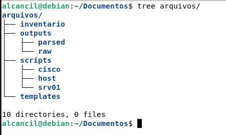

---

## Inventário da Rede

Antes de automatizar a coleta das informações, precisamos definir um inventário contendo todos os dispositivos que participarão do processo.

Esse inventário armazenará informações como:

- nome do equipamento;
- endereço IP;
- plataforma;
- usuário;
- senha;
- tipo de dispositivo.

Durante a execução dos scripts, esse inventário será percorrido automaticamente para estabelecer conexão com cada switch da topologia.

Antes de implementar os scripts de automação, definiremos um inventário contendo todos os dispositivos da topologia. Esse inventário centralizará as informações necessárias para o estabelecimento das conexões SSH e será reutilizado ao longo de todo o laboratório.


Conteúdo do arquivo .env

```text
NET_USERNAME=cisco
NET_PASSWORD=cisco
NET_SECRET=cisco
```

**Observação:** As credenciais utilizadas pelos scripts serão armazenadas em um arquivo **`.env`**, que deverá ser adicionado ao **`.gitignore`** para evitar o envio de informações sensíveis ao repositório. Em ambientes corporativos, é recomendável utilizar soluções mais robustas, como gerenciadores de segredos (Secrets Managers), porém esse não é o foco deste laboratório.

---

## Script 01 — Conectando a um Switch

Antes de automatizar toda a infraestrutura, validaremos a comunicação com apenas um equipamento da topologia.

Para isso utilizaremos o protocolo **SSH**, que já foi configurado nos laboratórios anteriores. Neste laboratório serão utilizadas as credenciais **cisco/cisco**, armazenadas em um arquivo **`.env`**, evitando que informações sensíveis sejam inseridas diretamente no código-fonte.

Deixo aqui as configurações do ssh nos equipamentos cisco caso seja necessário.  

```ios
username cisco priv 15 secret cisco
line vty 0 15
login local
transport input ssh
exec-timeout 0 0

exit

ip domain-name cisco.com
crypto key generate rsa modulus 2048
ip ssh version 2
ip ssh authentication-retries 3
ip ssh logging events
ip ssh time-out 60

do wr
```

Em vez de desenvolver um único script monolítico, adotaremos uma arquitetura modular, separando as diferentes responsabilidades da aplicação. Essa abordagem facilita a reutilização do código, melhora a organização do projeto e simplifica a manutenção dos scripts que serão desenvolvidos nas próximas etapas do laboratório.

A implementação será composta pelos seguintes módulos:

| Arquivo               | Responsabilidade                                                                                               |
| :---                  | :---                                                                                                           |
| `inventory_loader.py` | Carrega o inventário dos dispositivos e as credenciais armazenadas no arquivo `.env`.                          |
| `connection.py`       | Estabelece e encerra conexões SSH utilizando a biblioteca Netmiko.                                             |
| `script_01.py`        | Utiliza os módulos anteriores para conectar-se a um único switch e validar a comunicação com a infraestrutura. |

---

## Módulo `inventory_loader.py`

O primeiro módulo da aplicação é responsável por carregar o inventário dos dispositivos a partir do arquivo **`inventario.yaml`** e combinar essas informações com as credenciais armazenadas no arquivo **`.env`**. Dessa forma, os demais scripts podem utilizar um inventário centralizado sem a necessidade de armazenar usuários e senhas diretamente no código-fonte.

A seguir é apresentada a implementação completa do módulo. Logo após, o mesmo código será analisado linha a linha por meio de uma versão totalmente comentada, facilitando a compreensão de cada instrução utilizada.

[MÓDULO_INVENTORY_LOADER](./Arquivos/scripts/cisco/inventory_loader.py)

### Explicando o Código

Para facilitar o entendimento, a seguir é apresentada uma versão do módulo com comentários em todas as linhas do código, descrevendo a finalidade de cada instrução e como ela contribui para o funcionamento da automação.


---

## `connection.py`

O segundo módulo é responsável por encapsular todas as operações relacionadas à comunicação SSH com os equipamentos Cisco. Nele estão implementadas as funções responsáveis por estabelecer a conexão, executar comandos na CLI e encerrar corretamente a sessão SSH utilizando a biblioteca **Netmiko**.

Ao concentrar essas funcionalidades em um único módulo, evitamos a duplicação de código e facilitamos a reutilização dessas rotinas em diferentes scripts de automação desenvolvidos ao longo deste laboratório.

A seguir é apresentada a implementação completa do módulo. Logo após, o mesmo código será analisado linha a linha por meio de uma versão totalmente comentada, permitindo compreender o funcionamento de cada instrução utilizada durante o processo de conexão com os dispositivos.

[MÓDULO_CONNECTION](./Arquivos/scripts/cisco/connection.py)

### Explicando o Código

Para facilitar o entendimento, a seguir é apresentada uma versão do módulo com comentários em todas as linhas do código, descrevendo a finalidade de cada instrução, o fluxo de execução e o papel de cada função no estabelecimento e gerenciamento das conexões SSH com os equipamentos Cisco.


---

## `script_01.py`

O módulo `inventory_loader.py` foi responsável por carregar o inventário dos dispositivos e as credenciais de acesso, enquanto o módulo `connection.py` implementou todas as funções necessárias para estabelecer e gerenciar as conexões SSH com os equipamentos Cisco.

Neste terceiro arquivo reuniremos esses dois módulos em um único script, cujo objetivo é validar toda a infraestrutura de automação. Para isso, estabeleceremos uma conexão SSH com um único switch da topologia, executaremos um comando simples na CLI, exibiremos sua saída e encerraremos corretamente a sessão.

Esse primeiro teste representa um importante ponto de validação do ambiente, pois confirma que o inventário, as credenciais, a comunicação SSH, a biblioteca **Netmiko** e o ambiente Python estão funcionando corretamente antes de expandirmos a automação para toda a infraestrutura.

A seguir é apresentada a implementação completa do script. Logo após, o mesmo código será analisado linha a linha por meio de uma versão totalmente comentada, permitindo compreender como os módulos desenvolvidos anteriormente trabalham em conjunto para automatizar o acesso aos equipamentos.

[MÓDULO_SCRIPT_01](./Arquivos/scripts/cisco/script_01_conectar_switch.py)

### Explicando o Código

Para facilitar o entendimento, a seguir é apresentada uma versão do script com comentários em todas as linhas do código, descrevendo a finalidade de cada instrução, o fluxo de execução da aplicação e a interação entre os módulos responsáveis pelo inventário, pela conexão SSH e pela execução dos comandos no equipamento.


## Executando o Script

Após implementar os módulos e o script principal, executaremos o **Script 01** para validar a comunicação com o switch **SW_DST01**. Durante a execução, o programa carregará o inventário, lerá as credenciais armazenadas no arquivo **`.env`**, estabelecerá uma conexão SSH utilizando o **Netmiko**, executará um comando simples na CLI e encerrará corretamente a sessão.

A execução bem-sucedida desse teste confirma que o ambiente Python, as dependências instaladas, o inventário, as credenciais e a comunicação SSH estão funcionando corretamente, preparando a infraestrutura para a automação da coleta em todos os switches da topologia.

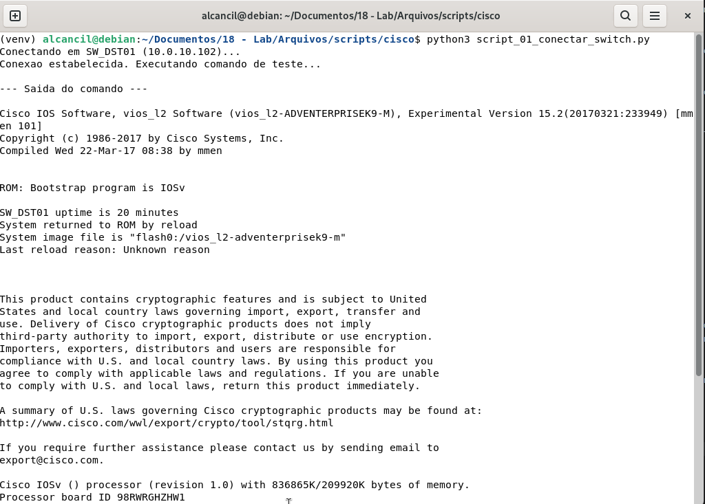  
  
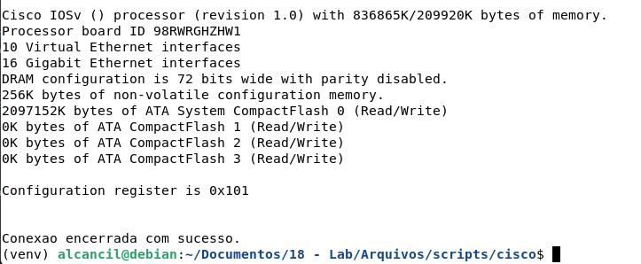  

> Execução do `script_01.py` estabelecendo conexão SSH com o switch **SW_DST01** e exibindo a saída do comando executado.

---

## Script 02 — Automatizando Toda a Topologia

Após validar a comunicação com um único equipamento, expandiremos o processo para toda a infraestrutura.

Assim como no **Script 01**, adotaremos uma arquitetura modular para separar as diferentes responsabilidades da aplicação. Essa abordagem facilita a manutenção do código, incentiva a reutilização dos módulos desenvolvidos anteriormente e torna a automação mais organizada e escalável.

Nesta etapa, o objetivo deixa de ser apenas validar a comunicação com um único switch e passa a realizar a coleta automatizada das informações em todos os dispositivos da topologia.

A implementação será composta pelos seguintes módulos:

| Arquivo                              | Responsabilidade                                                                                                                     |
| :---                                 | :---                                                                                                                                 |
| `connection.py`                      | Reutiliza as funções responsáveis por estabelecer, utilizar e encerrar as conexões SSH com os equipamentos Cisco.                    |
| `coleta.py`                          | Define os comandos que serão executados em cada switch e organiza a gravação das saídas em arquivos individuais.                     |
| `script_02_automatizar_topologia.py` | Percorre automaticamente o inventário da rede, conecta-se a todos os switches, executa os comandos definidos e armazena os resultados da coleta. |

---

## `connection.py`

Neste laboratório continuaremos reutilizando o módulo `connection.py`, desenvolvido anteriormente, responsável por encapsular todas as operações relacionadas às conexões SSH utilizando a biblioteca **Netmiko**.

Como nenhuma alteração foi necessária nesta etapa, utilizaremos exatamente a mesma implementação apresentada no **Script 01**.

---

## `coleta.py`

O segundo módulo é responsável por definir os comandos que serão executados em cada equipamento e organizar a coleta das informações. Além de executar automaticamente os comandos especificados, ele também grava as respectivas saídas em arquivos individuais, permitindo que essas informações sejam reutilizadas nas próximas etapas do laboratório.

A seguir é apresentada a implementação completa do módulo. Logo após, o mesmo código será analisado linha a linha por meio de uma versão totalmente comentada, facilitando a compreensão de cada instrução utilizada durante o processo de coleta automatizada.

[COLETA](./Arquivos/scripts/cisco/coleta.py)

### Explicando o Código

Para facilitar o entendimento, a seguir é apresentada uma versão do módulo com comentários em todas as linhas do código, descrevendo a finalidade de cada instrução e como ela contribui para a coleta automatizada das informações da infraestrutura.


---

## `script_02_automatizar_topologia.py`

O módulo `connection.py` fornece todas as funções necessárias para estabelecer as conexões SSH com os equipamentos Cisco, enquanto o módulo `coleta.py` é responsável por executar os comandos definidos e armazenar suas respectivas saídas.

Neste terceiro arquivo integraremos esses módulos em um único script, responsável por percorrer automaticamente todo o inventário da rede, conectar-se a cada switch da topologia, executar a sequência de comandos especificada e organizar os arquivos gerados durante a coleta.

Ao final da execução teremos uma visão completa do estado da infraestrutura, eliminando completamente a necessidade de executar manualmente os mesmos comandos em cada equipamento.

A seguir é apresentada a implementação completa do script. Logo após, o mesmo código será analisado linha a linha por meio de uma versão totalmente comentada, permitindo compreender como os módulos desenvolvidos anteriormente trabalham em conjunto para automatizar a coleta das informações.

[SCRIPT02](./Arquivos/scripts/cisco/script_02_automatizar_topologia.py)

### Explicando o Código

Para facilitar o entendimento, a seguir é apresentada uma versão do script com comentários em todas as linhas do código, descrevendo a finalidade de cada instrução, o fluxo de execução da aplicação e a interação entre os módulos responsáveis pela conexão SSH, pela coleta dos comandos e pela organização dos arquivos gerados.


---

## Executando a Coleta

Após concluir a implementação dos scripts, executaremos o processo completo de coleta.

Durante a execução, o sistema percorrerá automaticamente todos os switches da topologia, executando os comandos definidos e armazenando suas respectivas saídas.

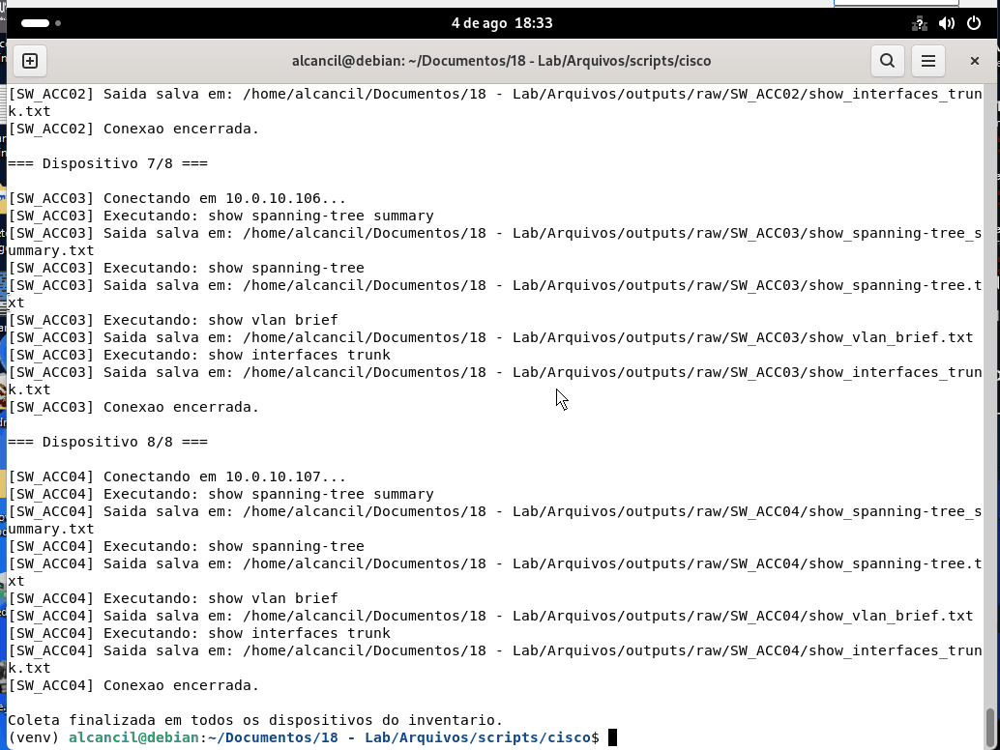

Os principais comandos coletados serão:

```ios
show spanning-tree root

show spanning-tree summary

show spanning-tree vlan

show spanning-tree vlan detail

show interfaces trunk

show interfaces

show processes cpu
```

---

## Organizando os Arquivos Coletados

Ao término da execução, todas as saídas serão armazenadas automaticamente em uma estrutura padronizada de diretórios.

Essa organização facilitará as próximas etapas do laboratório, permitindo que os arquivos sejam processados automaticamente pelo TextFSM e pelos NTC Templates.

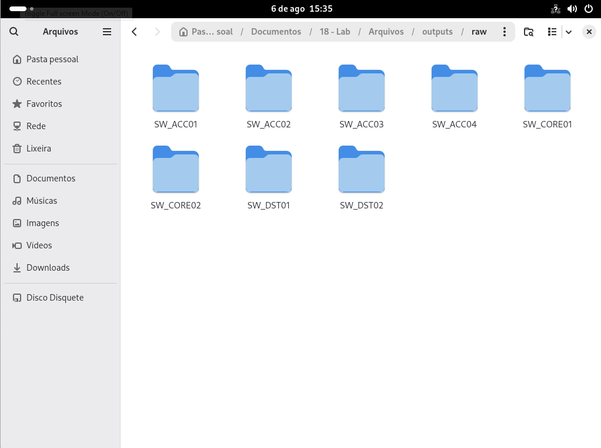  

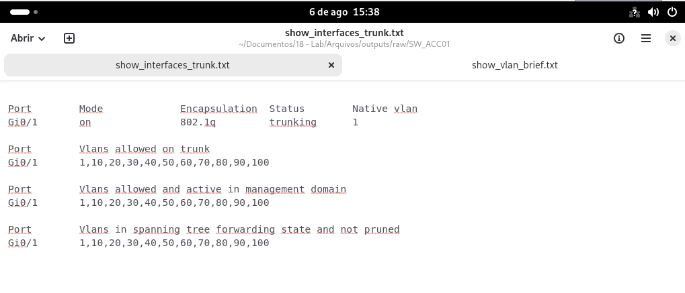  

---

## Fluxo da Automação

A figura abaixo resume todo o processo desenvolvido até esta etapa.

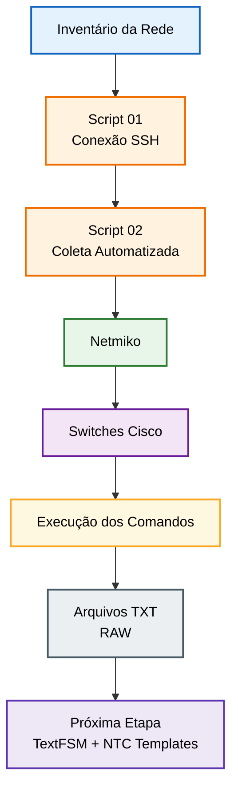

Ao final desta etapa teremos um conjunto padronizado de arquivos contendo todas as informações da infraestrutura.

Na próxima parte do laboratório esses arquivos deixarão de ser apenas saídas textuais da CLI e passarão a ser transformados em dados estruturados, possibilitando a geração automática de tabelas, relatórios e das árvores do protocolo PVST+.

---

## PARTE IV — TRANSFORMANDO TEXTO EM DADOS

Até este momento, nossa automação foi capaz de acessar todos os switches da topologia, executar os comandos desejados e armazenar automaticamente suas respectivas saídas em arquivos de texto.

Embora essa etapa elimine completamente a necessidade de acessar manualmente cada equipamento, ainda existe uma limitação importante: as informações continuam armazenadas como texto puro, exatamente da mesma forma que são exibidas pela CLI do Cisco IOS.

Para que esses dados possam ser pesquisados, filtrados, comparados e utilizados na geração de tabelas, gráficos e relatórios, é necessário convertê-los para um formato estruturado.

Nesta etapa utilizaremos as bibliotecas **TextFSM** e **NTC Templates** para transformar automaticamente a saída textual da CLI em estruturas de dados Python, preparando as informações para as análises realizadas nas próximas fases do laboratório.

---

## 4. Parsing com TextFSM e NTC Templates

O processo de parsing consiste em interpretar automaticamente a saída textual dos comandos executados na CLI e extrair apenas as informações relevantes para a aplicação.

Em vez de manipular grandes blocos de texto, passaremos a trabalhar com objetos estruturados, permitindo que os dados sejam processados facilmente utilizando Python.

---

## O problema da CLI

Embora a interface de linha de comando (CLI) seja extremamente eficiente para interação humana, ela não foi projetada para ser consumida diretamente por aplicações.

Considere, por exemplo, a saída do comando:

```ios
show spanning-tree root
```

Para um administrador de redes, localizar informações como o **Root Bridge**, a **Root Port** ou a **Bridge Priority** é relativamente simples.

Entretanto, para um programa de computador, essas mesmas informações encontram-se misturadas em centenas de linhas de texto, exigindo um processo adicional para identificar, separar e organizar cada campo.

Essa limitação torna inviável a realização de análises automatizadas utilizando apenas a saída bruta da CLI.

---

## O que é o TextFSM

O **TextFSM** é uma biblioteca desenvolvida pelo Google para transformar saídas textuais de equipamentos de rede em dados estruturados.

Seu funcionamento é baseado em modelos (templates) contendo expressões regulares que identificam automaticamente os campos de interesse em uma determinada saída da CLI.

Após o processamento, as informações deixam de ser tratadas como texto simples e passam a ser organizadas em registros estruturados, facilitando sua manipulação por aplicações Python.

Documentação oficial:

https://github.com/google/textfsm

---

## O que são os NTC Templates

Embora seja possível criar templates manualmente para cada comando da CLI, essa tarefa pode se tornar trabalhosa em ambientes com grande quantidade de dispositivos e comandos diferentes.

Os **NTC Templates** disponibilizam uma extensa coleção de templates prontos para diversos fabricantes, incluindo Cisco IOS, IOS-XE, NX-OS, Juniper, Arista, Huawei e outros.

Ao utilizar essa biblioteca, basta informar o fabricante e o comando executado para que o parsing seja realizado automaticamente, eliminando a necessidade de desenvolver templates do zero.

Repositório oficial:

https://github.com/networktocode/ntc-templates

---

## Fluxo do Parsing

Após concluir a coleta automatizada, os arquivos passam por uma sequência de transformações até se tornarem dados estruturados.

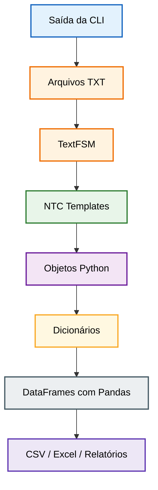

Ao final desse processo, as informações deixam de ser apenas texto e passam a ser representadas por estruturas de dados que podem ser filtradas, agrupadas, comparadas e analisadas automaticamente utilizando Python.

Esses dados estruturados serão utilizados nas próximas etapas do laboratório para reconstruir automaticamente as árvores do protocolo PVST+, comparar o comportamento da infraestrutura antes e depois do balanceamento de VLANs e gerar tabelas e relatórios de forma totalmente automatizada.

---

## 5. Consolidando os Dados Coletados

Após realizar a coleta automatizada das informações e converter as saídas da CLI em estruturas de dados utilizando **TextFSM** e **NTC Templates**, o próximo passo consiste em consolidar essas informações em uma base única de dados.

Até este momento, cada comando executado gera um conjunto independente de registros. Embora essas informações já estejam estruturadas, ainda encontram-se distribuídas em diferentes arquivos e representam apenas partes isoladas do estado da infraestrutura.

Nesta etapa reuniremos todos esses dados em uma única estrutura, facilitando sua consulta, comparação e utilização nas análises realizadas nas próximas fases do laboratório.

> **Dependências:** Antes de prosseguir, instale as bibliotecas utilizadas nesta etapa do laboratório.
>
> ```bash
> pip install textfsm ntc-templates
> ```

---

## Script 03 — Parsing das Saídas da CLI

O primeiro passo consiste em percorrer todos os arquivos gerados durante a coleta automatizada e aplicar os respectivos templates do **TextFSM**.

Cada saída da CLI será convertida automaticamente em objetos Python contendo apenas as informações relevantes para a análise.

Ao final da execução teremos um conjunto de registros estruturados, eliminando completamente a necessidade de manipular texto puro.

[MÓDULO03](./Arquivos/scripts/cisco/script_03_parsing.py)

### Explicando o Código


Executando o **script_03_parsing.py**

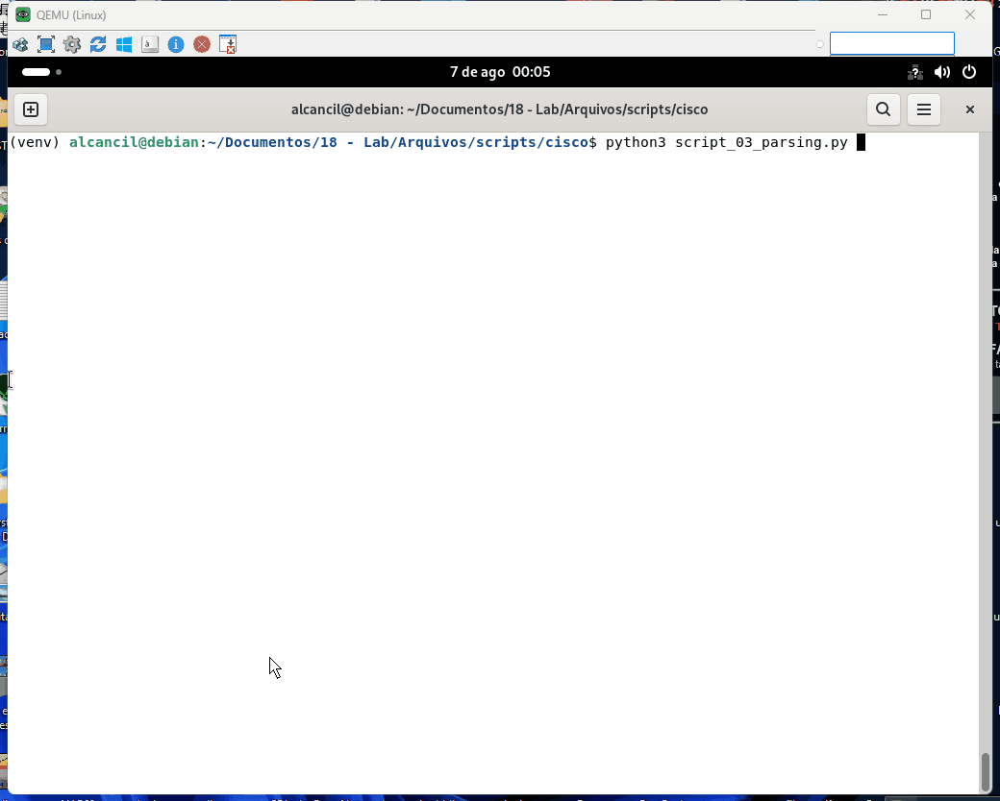

---

## Script 04 — Consolidando os Dados

Após concluir o parsing, desenvolveremos um segundo script responsável por reunir todas as informações produzidas pelos diferentes comandos da CLI em uma única estrutura de dados.

Esse processo permitirá correlacionar informações provenientes de múltiplos comandos executados em cada switch, produzindo uma visão consolidada da infraestrutura.

Ao final da execução será gerada uma tabela contendo, entre outras, as seguintes informações:

| Campo             | Descrição                      |
| :---              | :---                           |
| Switch            | Equipamento analisado          |
| VLAN              | Instância do PVST+             |
| Root Bridge       | Root Bridge da VLAN            |
| Root Port         | Porta raiz                     |
| Root Cost         | Custo acumulado até o Root     |
| Bridge Priority   | Prioridade da Bridge           |
| Bridge MAC        | Endereço MAC da Bridge         |
| Interface         | Interface analisada            |
| Role              | Papel desempenhado pela porta  |
| State             | Estado operacional da porta    |
| Designated Bridge | Bridge Designada               |
| Designated Port   | Porta Designada                |
| CPU               | Utilização da CPU              |
| Trunk             | Interface Trunk correspondente |

[MÓDULO04](./Arquivos/scripts/cisco/script_04_consolidacao.py)

### Explicando o Código


---

## Consolidando Todos os Switches

Com todas as informações já estruturadas, consolidaremos automaticamente os dados provenientes de todos os switches da topologia.

Essa etapa elimina completamente a necessidade de comparar manualmente dezenas de arquivos, permitindo visualizar toda a infraestrutura em uma única tabela.

Ao final da consolidação, cada linha representará uma combinação entre um switch e uma instância do protocolo PVST+, contendo todas as informações necessárias para as análises subsequentes.

[CONSOLIDANDO](./Arquivos/scripts/cisco/consolidador.py)

### Explicando o Código


---

## Validando os Dados

Antes de prosseguir para as análises automatizadas, é importante verificar se todas as informações foram corretamente interpretadas pelos templates e consolidadas pelo processo de parsing.

Nesta etapa realizaremos uma validação da base de dados produzida, conferindo a quantidade de switches processados, o número de VLANs identificadas e a integridade dos principais campos extraídos da CLI.

Essa verificação garante que os dados utilizados nas próximas etapas do laboratório representem fielmente o estado da infraestrutura coletado durante os testes.

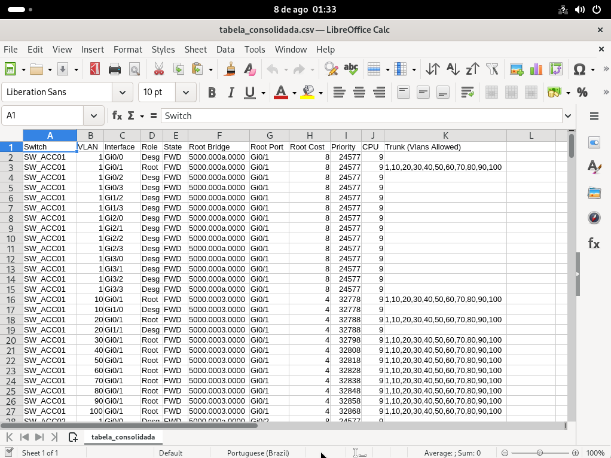

## 6. Descobrindo a Topologia com CDP

Até este momento conseguimos coletar e estruturar as informações relacionadas ao protocolo PVST+ e consolidá-las em uma tabela.

Esses dados permitem identificar informações importantes como **Root Bridge, Root Port, Root Cost, Role e State** de cada interface. Entretanto, ainda existe uma limitação: sabemos quais portas participam da árvore STP, mas ainda não temos informações suficientes para determinar de forma automatizada **qual equipamento está conectado a cada interface**.

Para reconstruir graficamente os caminhos percorridos pelo tráfego e relacioná-los com as decisões tomadas pelo Spanning Tree, precisamos conhecer também a topologia de vizinhança entre os switches.

Para isso utilizaremos o **CDP (Cisco Discovery Protocol)**, que permitirá identificar os dispositivos Cisco diretamente conectados a cada switch da topologia.

---

## Habilitando o CDP

O CDP já é suportado pelo Cisco IOS e permite descobrir informações sobre equipamentos Cisco diretamente conectados.

Antes de realizar a nova coleta, verificaremos o estado atual do CDP. Vamos analisar somente **S_DST01**.

```ios
SW_DST01#show cdp
Global CDP information:
        Sending CDP packets every 60 seconds
        Sending a holdtime value of 180 seconds
        Sending CDPv2 advertisements is  enabled
```

Caso o protocolo esteja desabilitado globalmente, podemos habilitá-lo com:

```ios
configure terminal
cdp run
end
```

Também podemos verificar os vizinhos descobertos utilizando:

```ios
SW_DST01#show cdp neighbors
Capability Codes: R - Router, T - Trans Bridge, B - Source Route Bridge
                  S - Switch, H - Host, I - IGMP, r - Repeater, P - Phone,
                  D - Remote, C - CVTA, M - Two-port Mac Relay

Device ID        Local Intrfce     Holdtme    Capability  Platform  Port ID
SW_ACC02.cisco.com
                 Gig 0/2           159              S I             Gig 0/2
SW_DST02.cisco.com
                 Gig 1/3           160              S I             Gig 1/3
SW_DST02.cisco.com
                 Gig 1/2           166              S I             Gig 1/2
SW_ACC01.cisco.com
                 Gig 0/1           159              S I             Gig 0/1
SW_CORE01.cisco.com
                 Gig 0/3           166             R S I            Gig 0/3
SW_CORE01.cisco.com
                 Gig 0/0           164             R S I            Gig 0/0

Total cdp entries displayed : 6
SW_DST01#
```

Para obter informações mais detalhadas sobre cada vizinho:

```ios
SW_DST01#show cdp neighbors detail
-------------------------
Device ID: SW_ACC02.cisco.com
Entry address(es):
  IP address: 10.0.10.105
Platform: Cisco ,  Capabilities: Switch IGMP
Interface: GigabitEthernet0/2,  Port ID (outgoing port): GigabitEthernet0/2
Holdtime : 179 sec

Version :
Cisco IOS Software, vios_l2 Software (vios_l2-ADVENTERPRISEK9-M), Experimental Version 15.2(20170321:233949) [mmen 101]
Copyright (c) 1986-2017 by Cisco Systems, Inc.
Compiled Wed 22-Mar-17 08:38 by mmen

advertisement version: 2
VTP Management Domain: ''
Native VLAN: 1
Duplex: full
Management address(es):
  IP address: 10.0.10.105

-------------------------
Device ID: SW_DST02.cisco.com
Entry address(es):
  IP address: 10.0.10.103
Platform: Cisco ,  Capabilities: Switch IGMP
Interface: GigabitEthernet1/3,  Port ID (outgoing port): GigabitEthernet1/3
Holdtime : 125 sec

Version :
Cisco IOS Software, vios_l2 Software (vios_l2-ADVENTERPRISEK9-M), Experimental Version 15.2(20170321:233949) [mmen 101]
Copyright (c) 1986-2017 by Cisco Systems, Inc.
Compiled Wed 22-Mar-17 08:38 by mmen

advertisement version: 2
VTP Management Domain: ''
Native VLAN: 1
Duplex: full
Management address(es):
  IP address: 10.0.10.103

-------------------------
Device ID: SW_DST02.cisco.com
Entry address(es):

....

```

Neste laboratório utilizaremos principalmente o comando:

```ios
show cdp neighbors
```

pois ele fornece as informações necessárias para relacionar as interfaces locais aos dispositivos diretamente conectados.

---

## Integrando o CDP à Coleta Automatizada

Como nosso objetivo é construir uma automação reutilizável, não criaremos um novo mecanismo de coleta específico para o CDP.

Em vez disso, adicionaremos o comando:

```ios
show cdp neighbors detail
```

à lista de comandos já utilizada pelo **Script 02**.

Essa alteração demonstra uma característica importante da arquitetura desenvolvida até aqui: os scripts foram construídos de forma modular para que novos comandos possam ser incorporados ao processo de coleta sem a necessidade de desenvolver novamente toda a automação.

A partir dessa alteração, o Script 02 passará a coletar tanto informações relacionadas ao **PVST+** quanto informações relacionadas à **topologia de vizinhança dos switches**.

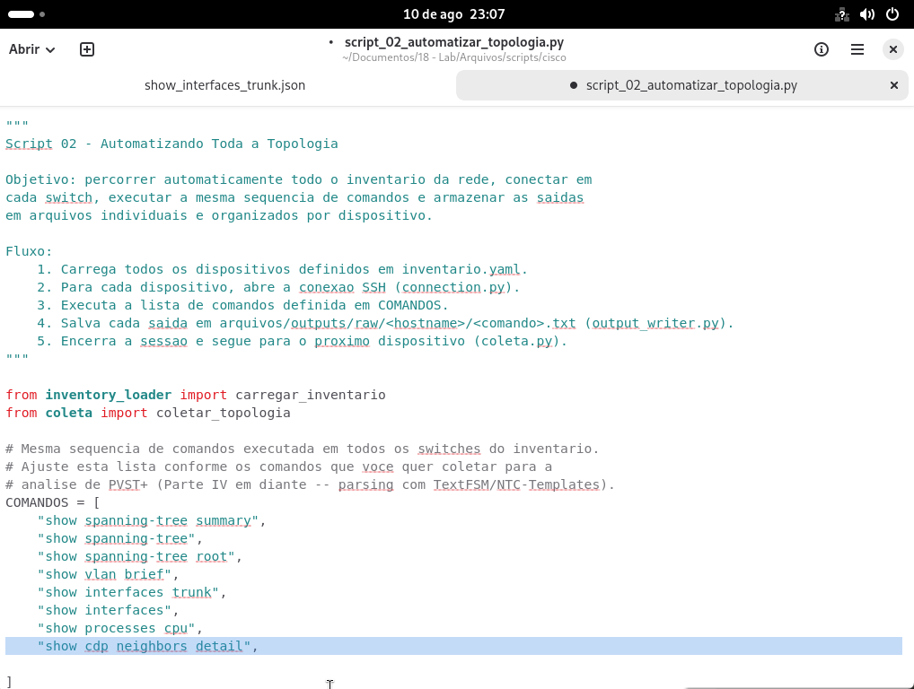

### Reutilizando o Script 02

Após adicionar o novo comando, executaremos novamente o Script 02.

Não será necessário criar um novo script.

O mesmo processo de automação desenvolvido anteriormente será reutilizado para acessar todos os switches da topologia e coletar novamente as informações.

A diferença é que, desta vez, cada equipamento também produzirá uma saída contendo seus vizinhos CDP.

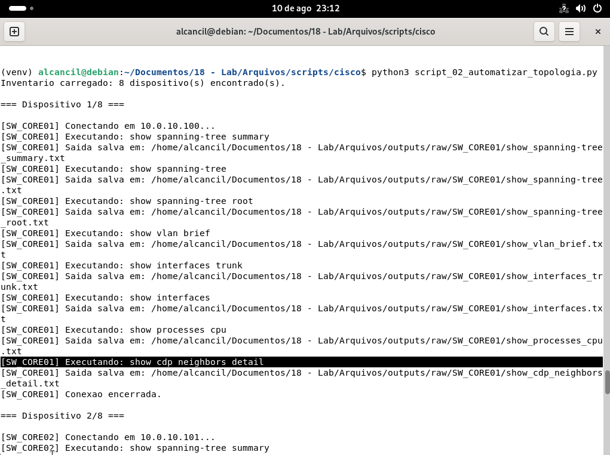

---

## Nova Coleta de Dados

Após a execução do Script 02, teremos novamente os arquivos RAW contendo as saídas da CLI.

Além dos arquivos utilizados anteriormente, passaremos a possuir também:

```text
show cdp neighbors detail.txt
```

Essas informações serão utilizadas para identificar:

- dispositivo vizinho;
- interface local;
- interface remota;
- relação entre os equipamentos da topologia.


---

## Reutilizando o Parsing

Com os novos arquivos RAW disponíveis, não será necessário desenvolver uma nova estrutura de parsing.

O **Script 03** será executado novamente para processar as novas informações coletadas.

Para isso, adicionaremos ao processo de parsing o template correspondente ao comando:

```text
show cdp neighbors detail
```

O TextFSM e os **NTC Templates** serão responsáveis por transformar a saída textual do CDP em dados estruturados, da mesma maneira que fizemos anteriormente com as informações do PVST+.

Como o `script_03_parsing.py` já foi construído de forma genérica — ele não conhece os comandos previamente, apenas consulta a lista `COMANDOS` do Script 02 e delega o parsing ao `parser.py` — nenhuma linha de código precisou ser alterada para suportar o CDP. O mesmo arquivo apresentado anteriormente continua válido. 

### Executando o Script 03 Novamente

Após atualizar o processo de parsing, executaremos novamente o Script 03 para processar os arquivos RAW gerados pela nova coleta.

O resultado será uma nova estrutura de dados contendo as informações dos vizinhos CDP.

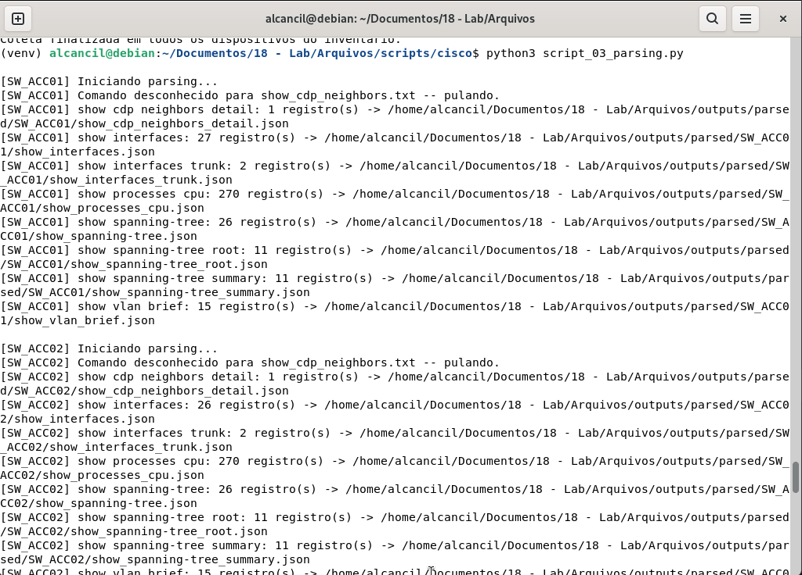

---

## Reutilizando a Consolidação

Após realizar o parsing das informações do CDP, executaremos novamente o **Script 04**.

O processo de consolidação será responsável por incorporar as novas informações aos dados já estruturados anteriormente.

Dessa forma, nossa base passará a relacionar dois conjuntos de informações:

```text
PVST+
 │
 ├── Root Bridge
 ├── Root Port
 ├── Root Cost
 ├── Role
 └── State

CDP
 │
 ├── Local Interface
 ├── Neighbor
 └── Remote Interface
```

A combinação dessas informações permitirá relacionar as decisões do protocolo Spanning Tree com a topologia física dos switches.

O `script_04_consolidacao.py` em si não muda — ele continua apenas chamando `consolidar_topologia()`. Quem incorpora o CDP é o `consolidador.py`, o módulo que faz o cruzamento de fato: ele ganha uma função para indexar os vizinhos CDP por interface local (normalizando `GigabitEthernet0/1` para o mesmo formato abreviado `Gi0/1` usado no restante da tabela) e duas colunas novas no resultado final, `Neighbor` e `Neighbor Interface`.


### Executando o Script 04 Novamente

Após atualizar o processo de consolidação, executaremos novamente o Script 04 para gerar a nova tabela contendo as informações combinadas de **PVST+ e CDP**.

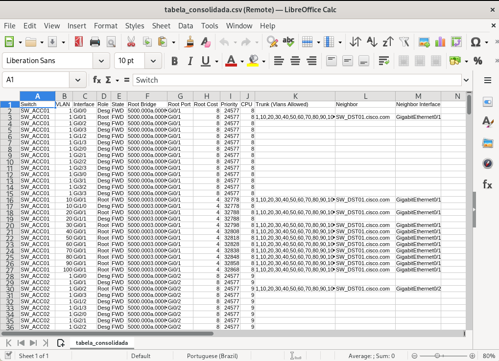

---

## PVST+ + CDP

A partir deste momento passamos a possuir as duas informações necessárias para reconstruir a topologia lógica do laboratório.

O **CDP** permite descobrir quem está conectado a quem, enquanto o **PVST+** permite determinar qual papel cada interface desempenha dentro da árvore de cada VLAN.

Podemos então estabelecer a seguinte relação:

```text
CDP
   │
   └── Descobre a topologia física
                │
                ▼
PVST+
   │
   └── Determina a topologia lógica
                │
                ▼
        Árvore STP por VLAN
```

Essa correlação será utilizada na próxima etapa para reconstruir automaticamente as árvores do PVST+ e representar graficamente os caminhos ativos e as interfaces bloqueadas em cada VLAN.

---

## O Poder da Reutilização

Esta etapa também demonstra uma característica importante da arquitetura de automação desenvolvida neste laboratório.

Não foi necessário criar um novo processo completo para coletar, processar e consolidar as informações.

O fluxo original foi simplesmente estendido:

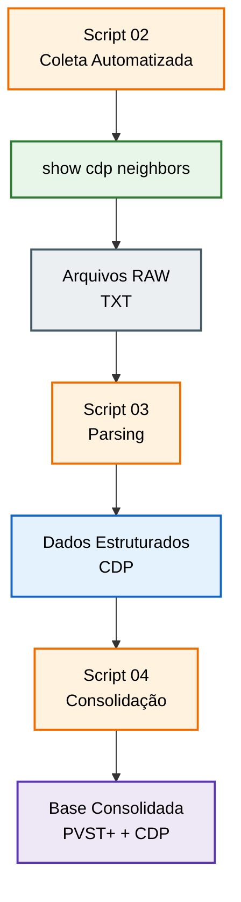

Essa capacidade de reutilizar e estender os mesmos módulos é justamente uma das vantagens de desenvolver scripts de automação de forma **modular**, em vez de criar scripts independentes para cada necessidade.

---

## PARTE V — ANÁLISE AUTOMATIZADA

## 7. Reconstruindo Automaticamente as Árvores STP

Até este momento conseguimos coletar e estruturar automaticamente duas fontes importantes de informação:

- os dados do protocolo PVST+, obtidos por meio dos comandos **show spanning-tree**;
- as relações de vizinhança entre os switches, obtidas por meio do **CDP**.

A combinação dessas informações permite avançar de uma simples tabela de dados para uma representação gráfica da topologia.

O objetivo desta etapa é utilizar os dados estruturados para reconstruir automaticamente as árvores do protocolo PVST+, identificando o Root Bridge, as Root Ports, as Designated Ports, as portas bloqueadas e os enlaces que participam do caminho ativo de cada VLAN.

Essa etapa também permitirá comparar automaticamente o resultado obtido pelo código com a análise manual realizada no Laboratório 17.

**Observação sobre a VLAN 1**  

> No Laboratório 17, utilizamos a VLAN 1 para realizar a análise manual do PVST+ com finalidade exclusivamente didática. Essa escolha permitiu simplificar a explicação inicial do protocolo e facilitar a compreensão da formação da árvore STP.
>
> Na automação deste laboratório, entretanto, não utilizaremos a VLAN 1 como parte do processo de balanceamento.
>
> Em ambientes de produção, a VLAN 1 não deve ser utilizada como VLAN de usuário e, seguindo boas práticas de projeto, o laboratório foi estruturado utilizando as VLANs 10 a 100 para representar as diferentes instâncias do PVST+.

Como temos dez VLANs distribuídas em dois switches Core, o objetivo será posteriormente realizar um balanceamento de cinco VLANs para cada Core:

```text
SW_CORE01
├── VLAN 10
├── VLAN 30
├── VLAN 50
├── VLAN 70
└── VLAN 90

SW_CORE02
├── VLAN 20
├── VLAN 40
├── VLAN 60
├── VLAN 80
└── VLAN 100
```

Dessa forma, a automação desta etapa será construída diretamente considerando as VLANs 10 a 100, preparando os dados para a comparação entre o cenário atual e o cenário após o balanceamento.

### Como representar uma árvore STP

Antes de automatizar a geração dos diagramas, precisamos definir como os dados coletados serão transformados em uma representação gráfica.

Cada switch será representado como um nó da topologia, enquanto as conexões identificadas pelo CDP serão representadas como enlaces entre os equipamentos.

Sobre essa topologia física serão aplicadas as informações obtidas pelo PVST+, permitindo identificar o papel desempenhado por cada interface.

Conceitualmente, teremos:

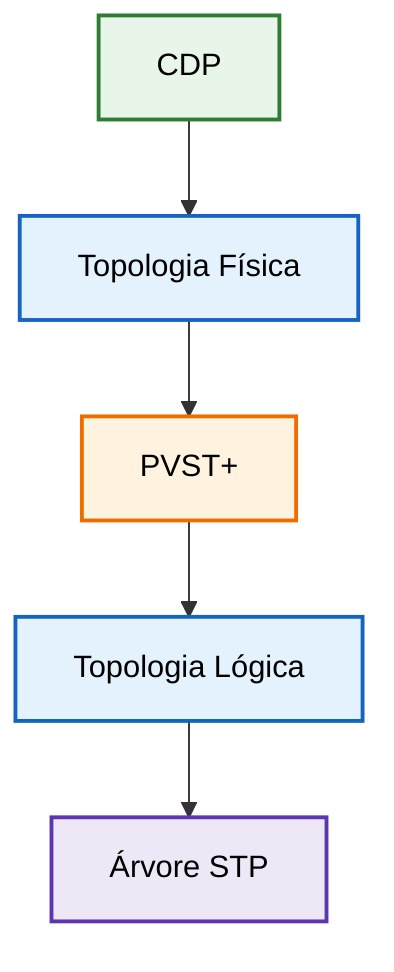

A representação deverá permitir identificar visualmente:

- Root Bridge;
- Root Ports;
- Designated Ports;
- Alternate/Blocked Ports;
- enlaces ativos;
- enlaces bloqueados;
- VLAN associada à árvore.

Dessa forma, o diagrama deixa de ser apenas uma representação da topologia física e passa a representar a topologia lógica construída pelo PVST+ para uma determinada VLAN.

Reconstruindo as VLANs 10–100

Como a análise manual da VLAN 1 já foi realizada no Laboratório 17, nesta etapa partiremos diretamente para as VLANs utilizadas no cenário de automação:

- VLAN 10
- VLAN 20
- VLAN 30
- VLAN 40
- VLAN 50
- VLAN 60
- VLAN 70
- VLAN 80
- VLAN 90
- VLAN 100

Em vez de executar manualmente o processo para cada VLAN, o script percorrerá automaticamente os dados estruturados e produzirá uma árvore independente para cada instância do PVST+.

O processo utilizará os dados previamente coletados:

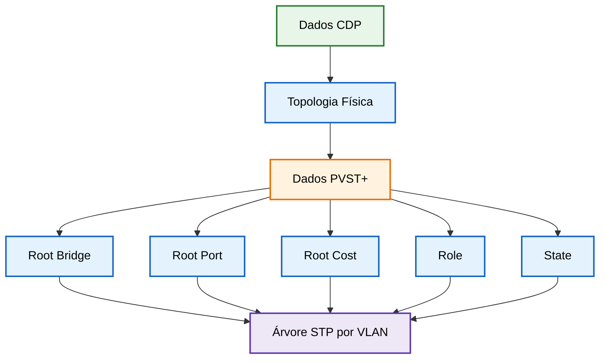

O fluxo será:

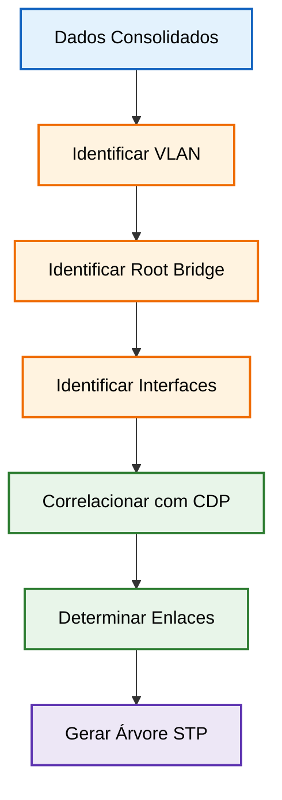

Ao final dessa etapa teremos uma representação gráfica individual para cada uma das dez instâncias PVST+ utilizadas no laboratório.

Aqui temos o módulo 5 que gera uma represntação gráfica da árvore stp por vlan

[MÒDULO05](./Arquivos/scripts/cisco/script_05_reconstrucao_arvore_comentado.py)

Deixo também a versão comentada para entendimento.


Aqui deixo as outras partes desse módulo. Primeiro temos a visualização da árvore.

[ÁRVORE](./Arquivos/scripts/cisco/visualizacao_arvore.py)

Versão comentada do script de visualização das árvores.


Aqui deixo o script que gera as árvores e os html interativos com as imagens.

[ÁRVORE](./Arquivos/scripts/cisco/arvore_stp.py)

Versão comentada do script que gera as árvores.


Aqui temos um exemplo da imagem da árvore gerada.

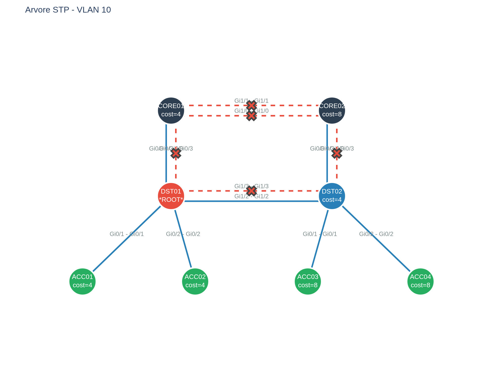

## Comparando com a Análise Manual

Uma das principais finalidades desta etapa é demonstrar que a automação não substitui o conhecimento adquirido durante a análise manual.

Pelo contrário: o conhecimento obtido no Laboratório 17 é utilizado como referência para validar o resultado produzido pelo código.

No laboratório anterior, a VLAN 1 foi utilizada para compreender manualmente a formação da árvore. Agora, utilizaremos esse conhecimento para interpretar e validar automaticamente as árvores das VLANs 10 a 100.

A comparação será realizada entre:

- Análise Manual x Análise Automatizada
- Root Bridge identificado manualmente x Root Bridge identificado pelos dados estruturados
- Root Port identificada manualmente x Root Port identificada pelo parser
- Portas Designated manual x Portas Designated automatizado
- Portas bloqueadas manual x Portas bloqueadas automatizado
- Caminhos STP x Caminhos reconstruídos automaticamente
- Árvore desenhada manualmente x Árvores geradas automaticamente
  
O objetivo não é apenas gerar um gráfico, mas comprovar que as informações extraídas da CLI e processadas pelo pipeline de automação são suficientes para reproduzir o comportamento observado durante a análise manual.

## Validando os Resultados

Antes de utilizar as árvores geradas automaticamente nas próximas etapas do laboratório, realizaremos uma validação dos resultados.
  
Serão verificadas principalmente:
  
- quantidade de switches presentes em cada árvore;
- Root Bridge identificado;
- Root Port de cada switch;
- estado das interfaces;
- correspondência entre interfaces locais e vizinhos CDP;
- enlaces bloqueados;
- quantidade de árvores geradas;
- correspondência com os resultados observados durante a análise manual.

Também verificaremos se todas as dez VLANs foram processadas corretamente:
  
- VLAN 10
- VLAN 20
- VLAN 30
- VLAN 40
- VLAN 50
- VLAN 60
- VLAN 70
- VLAN 80
- VLAN 90
- VLAN 100
  
Caso exista alguma divergência, o processo deverá ser investigado desde a origem dos dados:
  
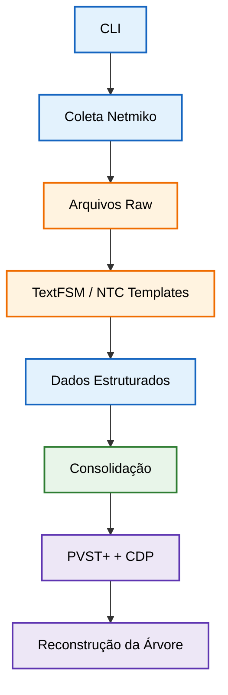

Essa abordagem permite identificar se uma eventual inconsistência está relacionada à coleta, ao parsing, à consolidação dos dados ou à lógica utilizada para reconstrução da árvore.

Após a validação, teremos uma representação automatizada das dez árvores PVST+ utilizadas no cenário.

Preparando o Balanceamento

Com as árvores atuais devidamente reconstruídas e validadas, teremos finalmente uma representação automatizada do cenário antes da intervenção.

Nesse momento, todas as VLANs encontram-se sujeitas à mesma estrutura de Root Bridge definida na configuração atual da topologia.

A próxima etapa será modificar essa condição implementando o balanceamento entre os dois switches Core.

A distribuição planejada será:

```text
              PVST+
                │
        ┌───────┴───────┐
        │               │
   SW_CORE01        SW_CORE02
        │               │
   VLANs ímpares    VLANs pares
        │               │
   10 30 50 70 90   20 40 60 80 100
```

Após a alteração, repetiremos o processo de coleta e análise para verificar se as árvores foram modificadas conforme o esperado e se a utilização dos enlaces passou a ser distribuída de maneira mais equilibrada.

Assim, a reconstrução automatizada das árvores servirá como a linha de base do cenário original, permitindo realizar posteriormente uma comparação objetiva entre ANTES × DEPOIS do balanceamento de VLANs.

---

## PARTE VI — DECISÃO DE ENGENHARIA & BALANCEAMENTO DE CARGA

## 8. Implementando o Balanceamento de PVST+

Com o diagnóstico obtido na coleta automatizada, identificamos que o **SW_DST01** assumiu a condição de Root Bridge para todas as VLANs devido à prioridade padrão (*default* `32768`) combinada ao menor endereço MAC da rede.

Essa condição resulta em um **subaproveitamento da topologia**, pois concentrou o encaminhamento em um único switch de distribuição, mantendo links redundantes dos demais switches bloqueados para todas as instâncias do STP.

Para corrigir o afunilamento de tráfego, aplicaremos o balanceamento de carga dividindo o controle do Control Plane entre os switches **SW_CORE01** e **SW_CORE02**.

---

## Planos de Priorização e Matriz de Eleição

A estratégia consiste em alternar os papéis de **Root Primary** e **Root Secondary** entre os dois switches de Core para garantir simetria e alta disponibilidade:

- **SW_CORE01:** Root Primary para VLANs Ímpares / Root Secondary para VLANs Pares.
- **SW_CORE02:** Root Primary para VLANs Pares / Root Secondary para VLANs Ímpares.

### Matriz de Prioridades STP

| Switch        | Bloco de VLANs               | Função STP         | Prioridade Base Configurada | Prioridade Efetiva (Base + Sys-ID) |
| :---          | :---                         | :---               | :---                        | :---                               |
| **SW_CORE01** | Ímpares (10, 30, 50, 70, 90) | **Root Primary**   | `24576`                     | $24576 + \text{VLAN\_ID}$          |
| **SW_CORE01** | Pares (20, 40, 60, 80, 100)  | **Root Secondary** | `28672`                     | $28672 + \text{VLAN\_ID}$          |
| **SW_CORE02** | Pares (20, 40, 60, 80, 100)  | **Root Primary**   | `24576`                     | $24576 + \text{VLAN\_ID}$          |
| **SW_CORE02** | Ímpares (10, 30, 50, 70, 90) | **Root Secondary** | `28672`                     | $28672 + \text{VLAN\_ID}$          |

> **Nota Técnica sobre a Matemática do PVST+:**  
> A prioridade do Spanning Tree é configurada em múltiplos de $4096$. O valor exibido no comando `show spanning-tree` será sempre a soma da **Prioridade Base + System ID Extension (ID da VLAN)**. Por exemplo, para a VLAN 10 no `SW_CORE01`, a prioridade vista na CLI será $24576 + 10 = 24586$.

---

**OBSERVAÇÂO:** antes de continuarmos, vamos ajustar o relógio de todos os equipamentos. Também será necessário ativar o serviço de **timestamps** para podermos marcar os tempos nos logs. Executar os comandos em todos os equipamentos.
  
**Ajuste de relógio - Ajustar sempre pirmeiro o Fuso Horário**  

```ios
SW_CORE01>ena
SW_CORE01#conf t
SW_CORE01(config)#clock timezone BR -3
SW_CORE01(config)#exit
SW_CORE01#
*Oct  3 23:50:17.460: %SYS-5-CONFIG_I: Configured from console by consoleset clo
SW_CORE01#clock set 20:52:00 03 OCT 2026
SW_CORE01#
*Oct  3 23:52:00.000: %SYS-6-CLOCKUPDATE: System clock has been updated from 20:51:23 BR Sat Oct 3 2026 to 20:52:00 BR Sat Oct 3 2026, configured from console by console.
SW_CORE01#show clock
20:52:09.728 BR Sat Oct 3 2026
SW_CORE01#
```
  
**Ajuste do service timestamps**  
  
```ios
SW_CORE01#conf t
SW_CORE01(config)#service timestamps log datetime msec localtime show-timezone year
SW_CORE01(config)#service timestamps debug datetime msec localtime show-timezone year
SW_CORE01(config)#
```

Nesso ponto foi escolhido aplicar as configurações de balanceamento de vlans de forma manual pois o objtivo principal é gerar evidências e analisar o funcionamento do protocolo PVST+. Agora vamos ajustar o comando **DEBUG** nos switches **SW_CORE01 e SWCORE02** para analisarmos as saídas.

**OBS:** muito cuidado ao aplicar os comando de DEBUG em produção, dependendo do que for feito e como for aplicao eles podem travar os aparelhos. Também é bom lembrar que parar todos os comandos de DEBUG de forma simultânia seria aplicando o comando **undebug all**.

```ios
SW_CORE01# debug spanning-tree events
```

## Aplicação das Configurações

### 1. Configuração no SW_CORE01

```ios
SW_CORE01(config)# ! Definindo Root Primary para VLANs Impares
SW_CORE01(config)# spanning-tree vlan 10,30,50,70,90 root primary
SW_CORE01(config)# !
SW_CORE01(config)# ! Definindo Root Secondary para VLANs Pares
SW_CORE01(config)# spanning-tree vlan 20,40,60,80,100 root secondary
SW_CORE01(config)# end
```

### 2. Configuração no SW_CORE02

```ios
SW_CORE02(config)# ! Definindo Root Primary para VLANs Pares
SW_CORE02(config)# spanning-tree vlan 20,40,60,80,100 root primary
SW_CORE02(config)# !
SW_CORE02(config)# ! Definindo Root Secondary para VLANs Impares
SW_CORE02(config)# spanning-tree vlan 10,30,50,70,90 root secondary
SW_CORE02(config)# end
```

### O Processo de Reconvergência do PVST+ e Medição do Tempo

Assim que as alterações são aplicadas, os switches entram no processo de reconvergência do IEEE 802.1D / PVST+:

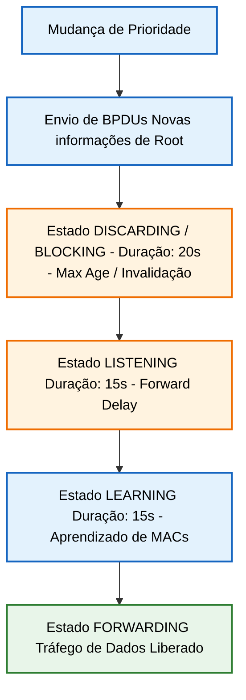

Agora observem a saída dos comandos no switch **SW_CORE01**

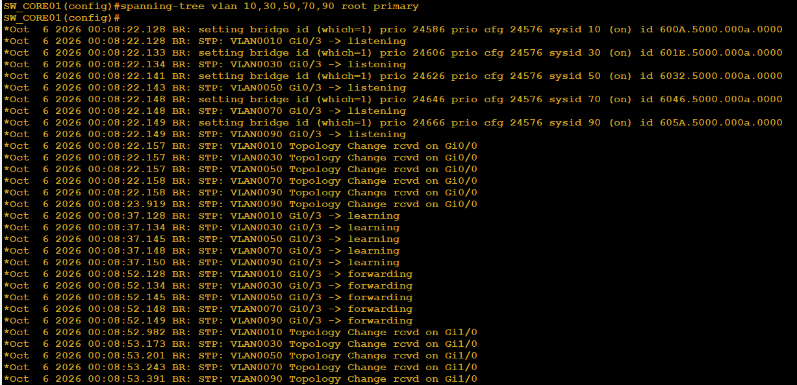

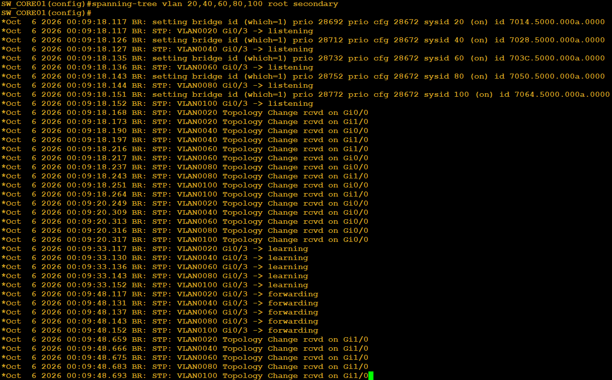

E agora vamos observar no switch **SW_CORE02**

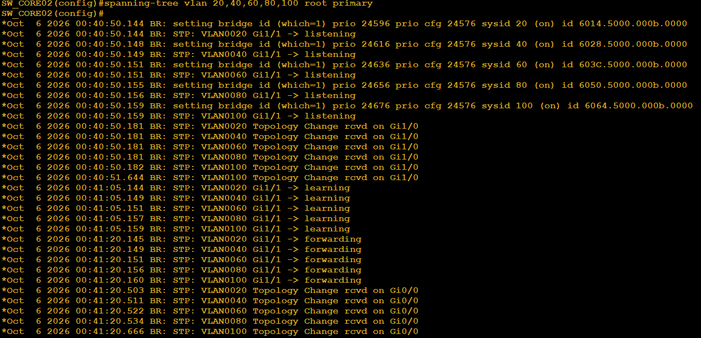

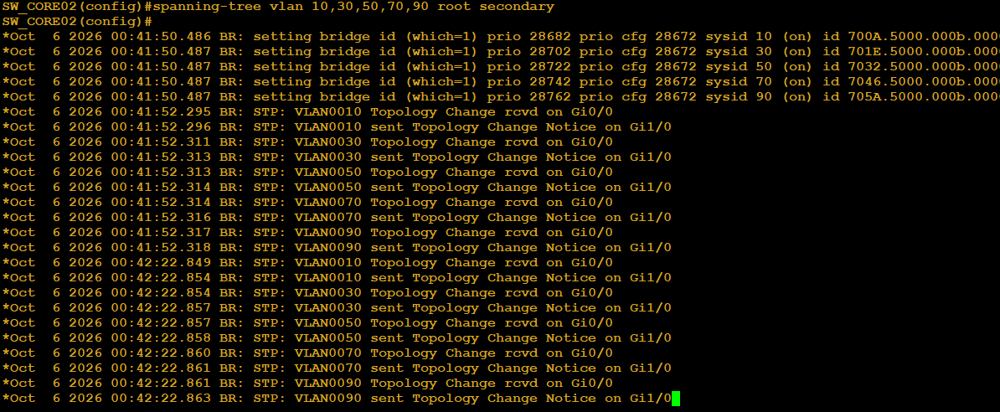

Por essas saídas podemos observar como o PVST+ pode levar de **30 a 50** segundos para convergir.

### Reconfiguração dos Gateways Padrão nos Hosts

Existe ainda um ponto crítico que precisa ser tratado **antes** do ping sweep: com o balanceamento de Root Bridges aplicado, os gateways padrão dos hosts **precisam ser realinhados** com os respectivos Root Bridges. Caso contrário, o tráfego inter-VLAN continuará sendo entregue ao Core errado, criando assimetria de caminhos e gargalos.

**Princípio aplicado:** *o gateway padrão de uma VLAN deve residir no switch que é Root Bridge dessa VLAN.*

Com base na configuração aplicada:

- **SW_CORE01** é Root Primary para as VLANs **ímpares** (10, 30, 50, 70, 90);
- **SW_CORE02** é Root Primary para as VLANs **pares** (20, 40, 60, 80, 100).

Portanto, os hosts pertencentes às **VLANs pares** devem ter seus gateways alterados de `10.0.X.100` (Core01) para `10.0.X.101` (Core02):

| Host       | VLAN | IP do Host    | Gateway Anterior | Novo Gateway     |
| :---       | :--- | :---          | :---             | :---             |
| VPC02      | 20   | 10.0.20.1/24  | 10.0.20.100      | **10.0.20.101**  |
| VPC04      | 40   | 10.0.40.1/24  | 10.0.40.100      | **10.0.40.101**  |
| VPC16      | 60   | 10.0.60.1/24  | 10.0.60.100      | **10.0.60.101**  |
| Host Linux | 80   | 10.0.80.1/24  | 10.0.80.100      | **10.0.80.101**  |
| VPC10      | 100  | 10.0.100.1/24 | 10.0.100.100     | **10.0.100.101** |

Já os hosts das **VLANs ímpares** permanecem com o gateway apontando para o Core01 (`10.0.X.100`), pois esse é o Root Primary do seu domínio:

| Host  | VLAN | IP do Host   | Gateway (mantido) |
| :---  | :--- | :---         | :---              |
| VPC01 | 10   | 10.0.10.1/24 | 10.0.10.100       |
| VPC03 | 30   | 10.0.30.1/24 | 10.0.30.100       |
| VPC05 | 50   | 10.0.50.1/24 | 10.0.50.100       |
| VPC17 | 70   | 10.0.70.1/24 | 10.0.70.100       |
| VPC09 | 90   | 10.0.90.1/24 | 10.0.90.100       |

### Reconfiguração nos VPCS

Nos VPCS, a alteração é feita com o comando `ip`, que reconfigura o endereço e o gateway simultaneamente. O comando deve ser executado **dentro de cada VPC**:

```bash
# VPC02 (VLAN 20)
ip 10.0.20.1/24 10.0.20.101

# VPC04 (VLAN 40)
ip 10.0.40.1/24 10.0.40.101

# VPC16 (VLAN 60)
ip 10.0.60.1/24 10.0.60.101

# VPC10 (VLAN 100)
ip 10.0.100.1/24 10.0.100.101
```

Após o ajuste, valide com o comando show ip dentro do VPC:

```bash
VPC02> show ip

NAME        : VPC02[1]
IP/MASK     : 10.0.20.1/24
GATEWAY     : 10.0.20.101     <- deve refletir o novo gateway
DNS         :
MAC         : 00:50:79:66:68:0c
LPORT       : 20000
RHOST:PORT  : 127.0.0.1:30000
MTU         : 1500
```

### Reconfiguração nos Hosts Linux

Nos hosts Linux com sub-interfaces VLAN, o gateway é configurado por sub-interface (eth0.X). O procedimento depende da ferramenta de gerenciamento de rede em uso. Abaixo, o método genérico via iproute2:
bash

### Remover a rota padrão antiga da sub-interface VLAN 80

```bash
sudo ip route del default via 10.0.80.100 dev eth0.80
```

### Adicionar a nova rota padrão apontando para o Core02

```bash
sudo ip route add default via 10.0.80.101 dev eth0.80
```

### Validar

```bash
ip route show
```

Caso o host use netplan, systemd-networkd ou ifupdown, o arquivo de configuração correspondente deve ser editado para refletir o novo gateway, e o serviço de rede reiniciado.

### Consequências Esperadas Após o Realinhamento  

Com os gateways realinhados aos Root Bridges das respectivas VLANs, o comportamento da topologia muda significativamente:

- Simetria de caminhos: o tráfego de uma VLAN par é roteado pelo Core02, e o tráfego de uma VLAN ímpar pelo Core01. Os caminhos de ida e volta passam a convergir no mesmo switch de Core.
- Distribuição de carga no Control Plane: ambos os switches de Core passam a processar roteamento inter-VLAN, eliminando o gargalo anteriormente concentrado no Core01.
- Ativação efetiva dos enlaces redundantes: os caminhos L2 que estavam bloqueados para as VLANs pares passam a transportar tráfego de dados real, justificando o balanceamento configurado.
- Redução de timeouts por ARP assimétrico: como o gateway e o Root Bridge coincidem, o ARP Request do gateway é inundado pela topologia correta, sem depender de caminhos cruzados.

### Impacto da Reconvergência do PVST+ nas Tabelas de Encaminhamento

Ao alterarmos as prioridades de Root Bridge nos switches `SW_CORE01` e `SW_CORE02`, disparamos um novo processo de eleição do PVST+ em **todas as 10 VLANs ativas**. Como consequência direta:

1. Novas BPDUs são propagadas por toda a topologia;
2. Portas anteriormente em estado `FORWARDING` podem transitar para `BLOCKING` (e vice-versa);
3. Caminhos lógicos de Camada 2 são **completamente recalculados** por VLAN;
4. Os tempos de convergência observados (30 a 50 segundos) correspondem aos estados `DISCARDING → LISTENING → LEARNING → FORWARDING` do IEEE 802.1D.

Entretanto, é preciso destacar um ponto crítico que **não é resolvido automaticamente pelo STP**: as **tabelas MAC (Camada 2) e ARP (Camada 3)** dos switches e hosts permanecem com entradas antigas, apontando para caminhos que já não existem. O STP não notifica a Camada 3 sobre a mudança de topologia.

Como resultado, mesmo após a convergência do PVST+, é comum observar falhas intermitentes de ping entre VLANs, timeouts em aplicações e comportamento assimétrico de encaminhamento — exatamente o fenômeno diagnosticado anteriormente neste estudo.

### Estratégia de Reaquecimento das Tabelas

Para garantir que todas as tabelas de encaminhamento reflitam a nova topologia, adotamos duas abordagens possíveis:

| Estratégia                    | Descrição                                    | Impacto                                                     | Recomendação                 |
| :---                          | :---                                         | :---                                                        | :---                         |
| **Reinício dos equipamentos** | Desligar e religar todos os switches e hosts | Garante estado limpo, mas interrompe o laboratório e mascara o comportamento real de convergência | ❌ Evitar — não é realista em produção |
| **Ping Sweep via TCL**        | Forçar a resolução ARP de todos os hosts conhecidos, disparando flooding controlado | Reconstrói MAC e ARP sem downtime, respeitando a nova topologia STP | ✅ Adotada neste estudo |

A escolha pelo **ping sweep em TCL** é didaticamente superior: além de reconstruir as tabelas, permite **observar o comportamento real do ARP** frente à nova topologia, coletar evidências de timeouts iniciais e demonstrar que a rede se estabiliza naturalmente após a resolução ARP.

### Script TCL de Reaquecimento

O script abaixo foi executado **em cada switch da topologia** (Core, Distribuição e Acesso), percorrendo todos os endereços IP conhecidos do plano de endereçamento:

```tcl
tclsh
foreach ip {
    10.0.10.1 10.0.20.1 10.0.30.1 10.0.40.1 10.0.50.1
    10.0.60.1 10.0.70.1 10.0.80.1 10.0.90.1 10.0.100.1
    10.0.10.100 10.0.20.100 10.0.30.100 10.0.40.100 10.0.50.100
    10.0.60.100 10.0.70.100 10.0.80.100 10.0.90.100 10.0.100.100
    10.0.10.101 10.0.20.101 10.0.30.101 10.0.40.101 10.0.50.101
    10.0.60.101 10.0.70.101 10.0.80.101 10.0.90.101 10.0.100.101
    10.0.10.102 10.0.20.102 10.0.30.102 10.0.40.102 10.0.50.102
    10.0.60.102 10.0.70.102 10.0.80.102 10.0.90.102 10.0.100.102
    10.0.10.103 10.0.20.103 10.0.30.103 10.0.40.103 10.0.50.103
    10.0.60.103 10.0.70.103 10.0.80.103 10.0.90.103 10.0.100.103
    10.0.10.104 10.0.20.104 10.0.30.104 10.0.40.104 10.0.50.104
    10.0.60.104 10.0.70.104 10.0.80.104 10.0.90.104 10.0.100.104
    10.0.10.105 10.0.20.105 10.0.30.105 10.0.40.105 10.0.50.105
    10.0.60.105 10.0.70.105 10.0.80.105 10.0.90.105 10.0.100.105
    10.0.10.106 10.0.20.106 10.0.30.106 10.0.40.106 10.0.50.106
    10.0.60.106 10.0.70.106 10.0.80.106 10.0.90.106 10.0.100.106
} {
    ping $ip
}
```

> **Nota:** O script foi simplificado e reorganizado em ordem lógica por VLAN. Recomenda-se executá-lo primeiro nos dois switches de Core (que concentram as SVIs de gateway) e depois nos switches de Distribuição e Acesso, garantindo que as resoluções ARP se propaguem de cima para baixo na hierarquia.  
>
> **Importante:** a alteração dos gateways deve ser feita antes da execução do ping sweep TCL, para que o flooding controlado já utilize a nova topologia simétrica. Caso contrário, as tabelas ARP dos switches seriam populadas com caminhos que serão invalidados logo em seguida, exigindo um segundo ciclo de reaquecimento.

### Observação Técnica: Limitação do VPCS na Resolução ARP

Durante a validação do cenário pós-balanceamento, os pings inter-VLAN continuavam falhando mesmo com Root Bridges, gateways, tabelas MAC/ARP e convergência do PVST+ corretos. O `trace` do VPC01 chegava ao Core01 (hop 1) e parava.

**Causa raiz:** o VPCS possui uma pilha TCP/IP minimalista que **não envia Gratuitous ARP** e **não aprende o MAC do gateway passivamente**. Ele só popula sua tabela ARP quando ele mesmo inicia a comunicação com o gateway. Assim, ao responder a um ping originado em outra VLAN, o VPCS não tem o MAC do gateway e falha silenciosamente.

**Contorno adotado:** executar, em cada VPCS, um ping explícito ao seu gateway padrão antes de qualquer teste ou coleta:

```bash
# VPC01 (VLAN 10 → Core01)
ping 10.0.10.100

# VPC02 (VLAN 20 → Core02)
ping 10.0.20.101
```

### Validação nos Hosts (VPCS e Linux)

Após o ping sweep nos switches, ainda é necessário validar a comunicação a partir dos hosts finais, pois:

- Os VPCS possuem tabela ARP independente e só a preenchem sob demanda;
- Os hosts Linux com sub-interfaces VLAN (ex: eth0.10, eth0.20) também precisam resolver ARP via ping ou arping para popular seus caches;
- Sem essa etapa, o primeiro pacote de cada fluxo pode ser perdido, gerando falsos negativos nos testes.  
  
**Comandos de validação por host:**  

```bash  
# Nos VPCS
ping 10.0.20.1
ping 10.0.30.1

# Nos hosts Linux
ping -c 4 10.0.20.1
arping -I eth0.10 10.0.20.1
```

### Conclusão do Procedimento

Somente após:

1. A aplicação das prioridades de Root Bridge;
2. A convergência do PVST+ (aguardar ~45s);
3. O ping sweep em todos os switches;
4. A validação nos hosts finais (VPCS e Linux);

é que a pipeline de automação pode ser reexecutada para gerar o cenário DEPOIS. Caso contrário, os dados coletados refletiriam um estado transitório (tabelas ARP/MAC incompletas), comprometendo a comparação ANTES × DEPOIS.

Então vamos analisar o fluxo dos testes que fizemos:

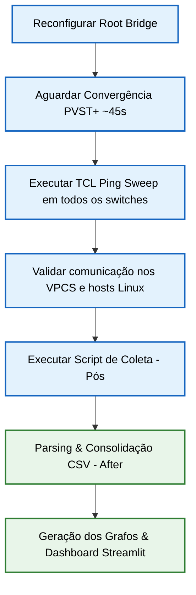

---

## PARTE VII — VALIDANDO A SOLUÇÃO

## 9. Nova Coleta Automatizada

Certo, segundo o nosso fluxograma paramos exatamente no ponto **Executar Script de Coleta - Pós**. Aqui teriamos que executar todo nosso pipeline novamente para podermos gerar a comparação do antes e depois. Só que se repararmos vamos ter um pequeno problema. O script **output_writer.py** gera as saídas em uma estrtura de pastas fixas.  
  
Se rodarmos os outros scripts vamos sobreescrever os dados gerados na primeira execuação e não teríamos como comparar o antes x depeois. Então precisamos fazer um pequeno ajuste nesse script. Aqui podemos observar a vantagem de se ter criado tudo de forma modular. Vamos somente ajustar poucas linhas no scrip **output_writer.py** e todo o restante do pipeline continuará da mesma forma sem ter que sofrer nenhuma alteração.  
  
Então vamos abrir o script e procurar o seguinte bloco dentro dele:

```python
import json
import re
from pathlib import Path

# Este arquivo mora em arquivos/scripts/cisco/ -> sobe 3 niveis para chegar
# na raiz "arquivos/" e localizar as pastas outputs/raw/ e outputs/parsed/.
BASE_DIR = Path(__file__).resolve().parent.parent.parent
RAW_OUTPUT_DIR = BASE_DIR / "outputs" / "raw"
PARSED_OUTPUT_DIR = BASE_DIR / "outputs" / "parsed"
```

Vamos comentar todas essas linhas e substituir por:

```python
import os
from datetime import datetime
import json
import re
from pathlib import Path

BASE_DIR = Path(__file__).resolve().parent.parent.parent
RUN_ID_FILE = BASE_DIR / "outputs" / ".run_id"

# Se já existe um RUN_ID gravado, usa ele (mesma rodada).
# Senão, cria um novo e grava o arquivo.
if RUN_ID_FILE.exists():
    RUN_ID = RUN_ID_FILE.read_text().strip()
else:
    RUN_ID = datetime.now().strftime("coleta_%Y-%m-%dT%H-%M-%S")
    RUN_ID_FILE.parent.mkdir(parents=True, exist_ok=True)
    RUN_ID_FILE.write_text(RUN_ID)

RUN_DIR = BASE_DIR / "outputs" / RUN_ID
RAW_OUTPUT_DIR = RUN_DIR / "raw"
PARSED_OUTPUT_DIR = RUN_DIR / "parsed"
```

**EXPLICAÇÂO:** A alteração substitui os caminhos fixos outputs/raw/ e outputs/parsed/ por uma pasta versionada (outputs/coleta_<timestamp>/). O RUN_ID é gerado uma única vez na primeira execução do pipeline e gravado no arquivo de controle outputs/.run_id; as execuções seguintes leem esse arquivo e reutilizam o mesmo identificador. Isso garante que todos os scripts da mesma rodada (coleta, parsing, consolidação e árvores) escrevam na mesma pasta, sem sobrescrever execuções anteriores. Para iniciar uma nova coleta, basta apagar o .run_id e rodar o pipeline novamente.  
  
**OBSERVAÇÂO:** em produção recomenda - se não deixar anotações ou trechos comentados. Aqui estou deixando puramente por questões didáticas e para noss entendimento do que está acontecendo.  
  
Vou deixar aqui a versão comentada do script [output_writer_comentado.py](./Arquivos/scripts/cisco/output_writer_comentado.py)

### Nova coleta

Antes de executarmos qualquer coisa, vamos copiar nossa coleta já realizada para uma pasta chamada **coleta_2026_09_14T00-49**. Vamos jogar todo o conteudo da nossa primeira coleta para essa pasta. Nas próximas coletas serão criadas novas pastas com timestamp preservando os dados coletados.

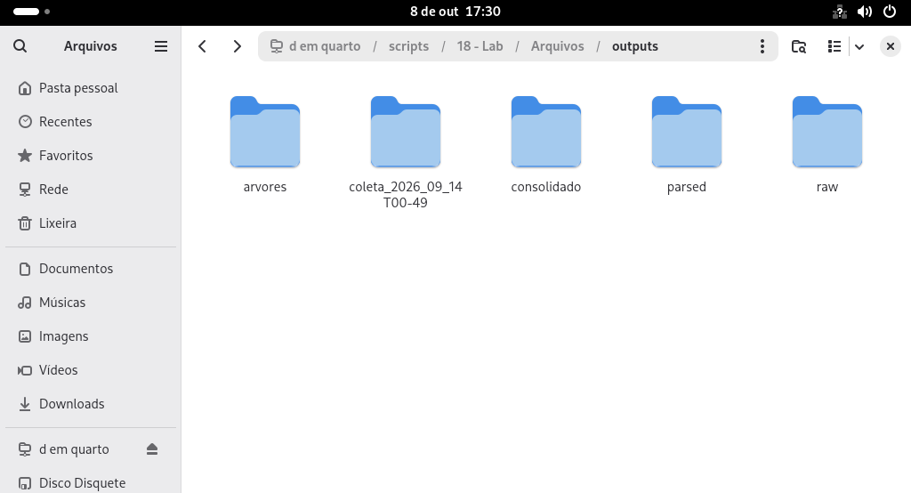

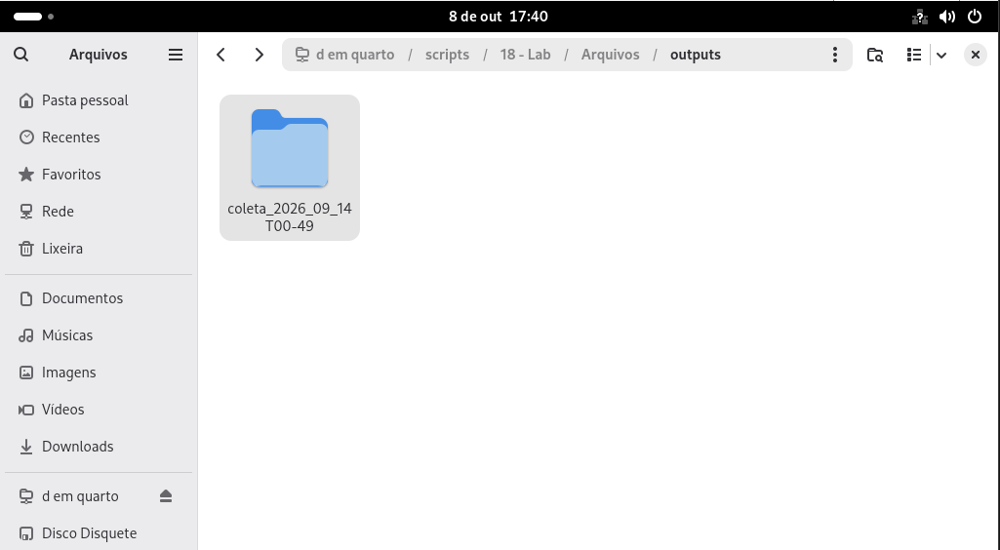

Agora temos uma única pasta com os dados da nossa primeira coleta. Após a execução do pipeline novamente vamos ter novas pastas no mesmo padrão.  
  
Com o `output_writer.py` ajustado, basta remover o arquivo de controle e executar o pipeline novamente. O `script_02_automatizar_topologia.py` gera um novo `RUN_ID` com timestamp e cria a pasta `outputs/coleta_<timestamp>/raw/`, preservando integralmente os dados da primeira execução.

```python
python script_02_automatizar_topologia.py
```

### Novo parsing

Em seguida, o `script_03_parsing.py` lê os arquivos brutos da nova pasta e gera os JSON estruturados em `outputs/coleta_<timestamp>/parsed/`. Nenhuma linha do script precisou ser alterada — ele apenas resolve os caminhos a partir do `PARSED_OUTPUT_DIR`, que agora aponta para a pasta versionada.

```python
python script_03_parsing.py
```

### Nova base de dados

Com o `script_04_consolidacao.py`, os dados parseados de todos os switches são cruzados em uma nova tabela consolidada, salva em `outputs/coleta_<timestamp>/consolidado/tabela_consolidada.csv`. Essa é a base sobre a qual a comparação ANTES × DEPOIS será feita.

```python
python script_04_consolidacao.py
```

### Nova reconstrução das árvores

Por fim, o `script_05_reconstrucao_arvore.py` reconstrói as dez árvores PVST+ (VLANs 10 a 100) a partir da nova base consolidada, gerando PNG e HTML em `outputs/coleta_<timestamp>/arvores/`. O balanceamento entre os Cores já pode ser observado nas novas topologias: VLANs ímpares enraizadas no Core01, VLANs pares no Core02.

```python
python script_05_reconstrucao_arvore.py
```

Agora temos duas pastas com as coletas realizadas que ficam em pastas separadas.  

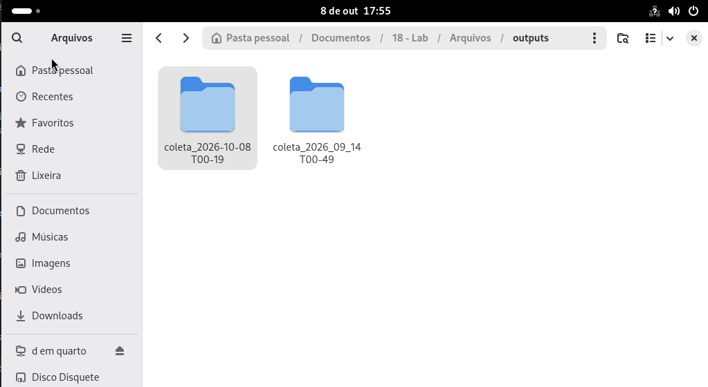

**OBSERVAÇÃO:** essa é a estrutira das pastas que deve ficar. Para não quebrar os links e imagens já mostrados aqui nos textos, somente vou copiar os arquivos para dentro da pasta correta e vamos ter uma estrtura mista.  
  
---

## 10. Comparando Antes × Depois

Com as duas coletas versionadas em disco (`outputs/` original e `outputs/coleta_<timestamp>/`), a comparação ANTES × DEPOIS deixa de ser uma inspeção manual e passa a ser uma leitura estruturada de duas bases consolidadas. As seções a seguir apresentam os principais indicadores analisados.

### Utilização dos enlaces

No cenário **ANTES**, com o `SW_DST01` eleito Root Bridge de todas as dez VLANs, todo o tráfego inter-VLAN era encaminhado por um conjunto reduzido de enlaces, enquanto os caminhos redundantes permaneciam bloqueados pelo PVST+. No cenário **DEPOIS**, com o balanceamento aplicado, os enlaces que antes estavam ociosos passaram a transportar tráfego ativo para metade das VLANs.

**Antes**  

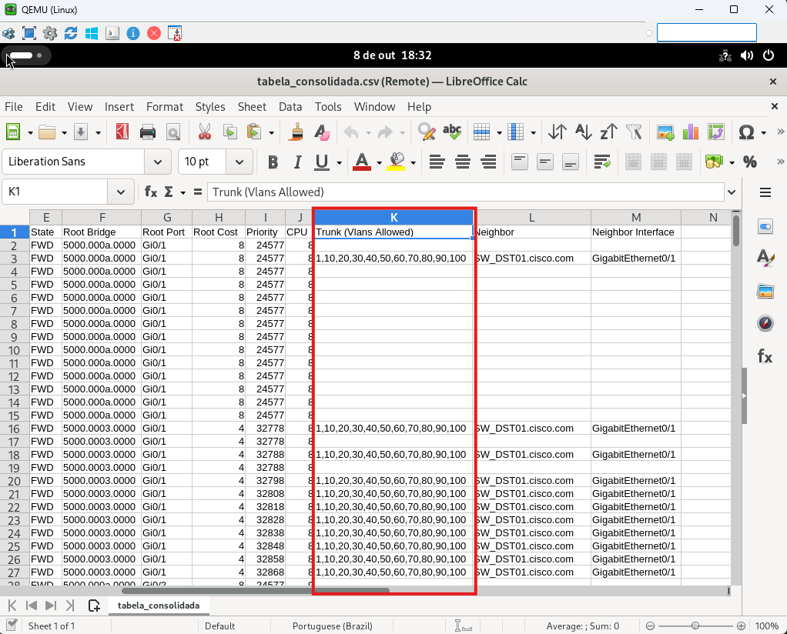

**Depois**  

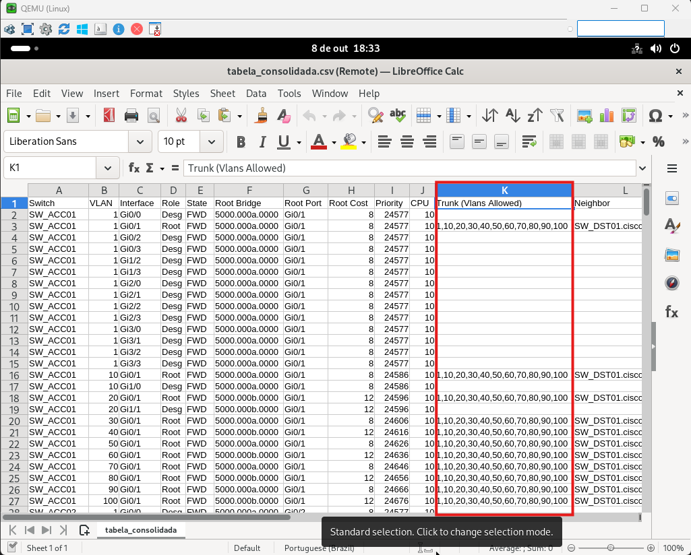

---

### Root Bridges

A eleição do Root Bridge é o indicador mais direto do balanceamento. No **ANTES**, todas as instâncias PVST+ convergiam para o `SW_DST01`. No **DEPOIS**, as VLANs ímpares passaram a ter o `SW_CORE01` como raiz e as VLANs pares o `SW_CORE02`, dividindo o controle do Control Plane entre os dois switches de Core.

**Antes**  
  
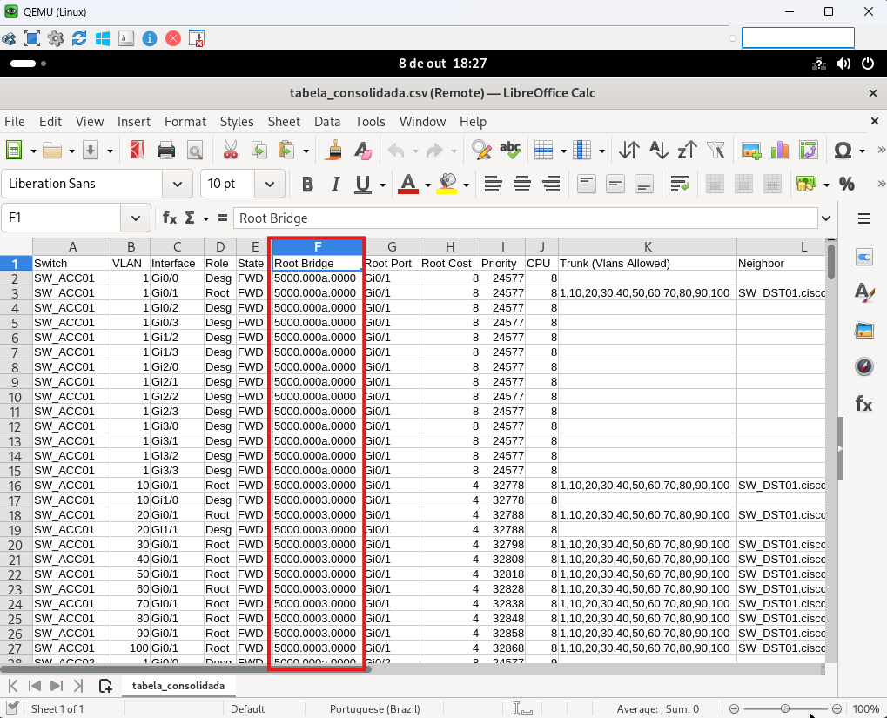
  
**Depois**  
  
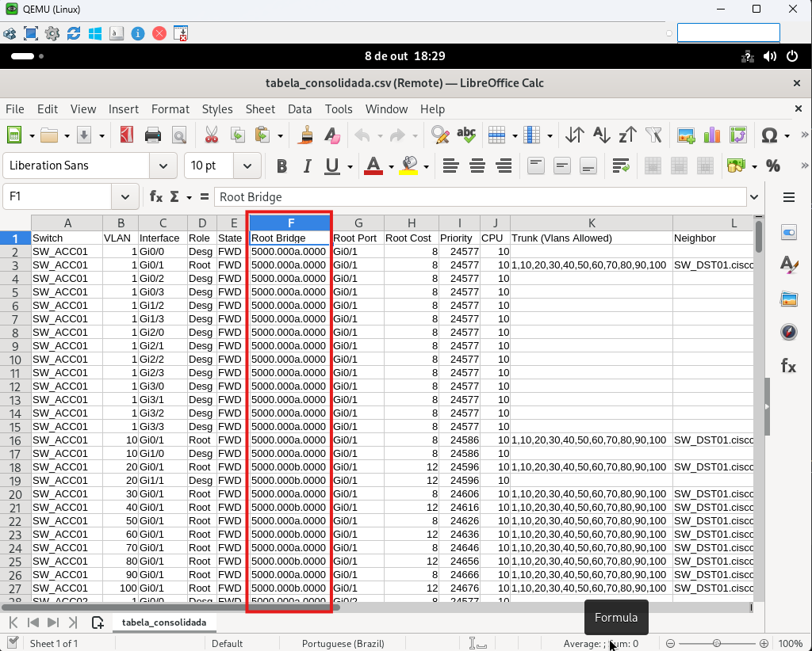
  
---
  
### CPU
  
No **ANTES**, o `SW_DST01` concentrava o processamento de BPDUs de todas as instâncias PVST+ e o roteamento inter-VLAN, elevando sua utilização de CPU em relação aos demais switches. No **DEPOIS**, a carga foi distribuída entre os dois switches de Core, reduzindo o pico de utilização em cada equipamento individualmente.
  
**Antes**  
  
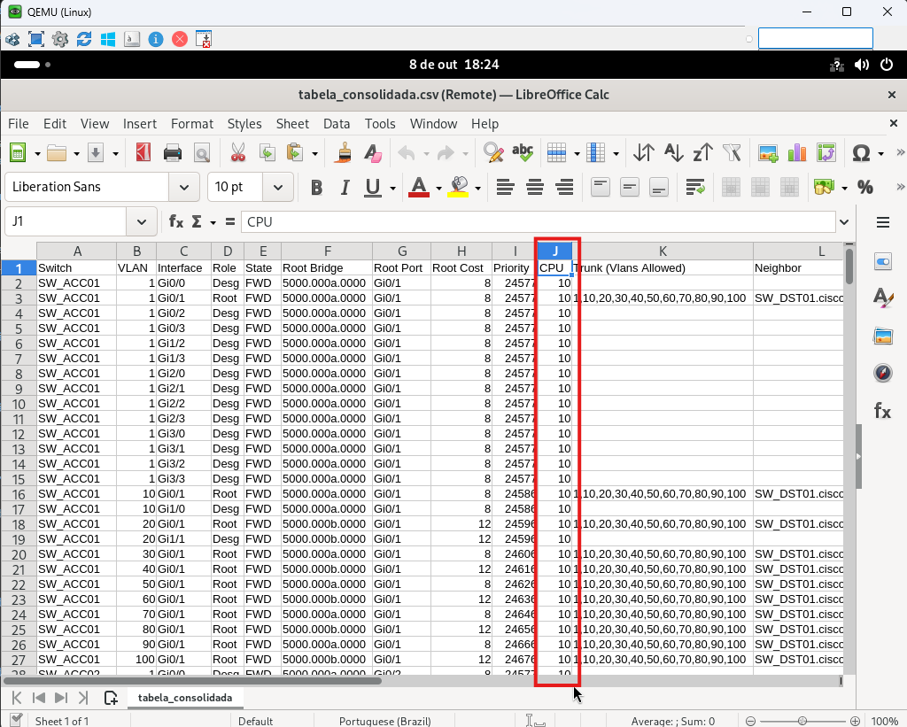
  
**Depois**  
  

  
---
  
### Distribuição das VLANs
  
A distribuição das VLANs entre os Root Bridges é o objetivo central do balanceamento. A tabela abaixo resume o mapeamento ANTES × DEPOIS.
  
| **VLAN** | **Root Bridge ANTES** | **Root Bridge DEPOIS** |
| :---     | :---                  | :---                   |
| 10       | SW_DST01              | SW_CORE01              |
| 20       | SW_DST01              | SW_CORE02              |
| 30       | SW_DST01              | SW_CORE01              |
| 40       | SW_DST01              | SW_CORE02              |
| 50       | SW_DST01              | SW_CORE01              |
| 60       | SW_DST01              | SW_CORE02              |
| 70       | SW_DST01              | SW_CORE01              |
| 80       | SW_DST01              | SW_CORE02              |
| 90       | SW_DST01              | SW_CORE01              |
| 100      | SW_DST01              | SW_CORE02              |

---

### Árvores STP

As árvores reconstruídas automaticamente pelo `script_05` evidenciam o balanceamento. No **ANTES**, as dez VLANs produziam árvores praticamente idênticas, com o mesmo conjunto de enlaces bloqueados. No **DEPOIS**, é possível observar duas topologias distintas: uma enraizada no `SW_CORE01` e outra no `SW_CORE02`.

**Antes**  

[VLAN10 - Antes](./Arquivos/outputs/coleta_2026_09_14T00-49/arvores/vlan_10.html)

[VLAN20 - Antes](./Arquivos/outputs/coleta_2026_09_14T00-49/arvores/vlan_20.html)

[VLAN30 - Antes](./Arquivos/outputs/coleta_2026_09_14T00-49/arvores/vlan_30.html)

[VLAN40 - Antes](./Arquivos/outputs/coleta_2026_09_14T00-49/arvores/vlan_40.html)

[VLAN50 - Antes](./Arquivos/outputs/coleta_2026_09_14T00-49/arvores/vlan_50.html)

[VLAN60 - Antes](./Arquivos/outputs/coleta_2026_09_14T00-49/arvores/vlan_60.html)

[VLAN70 - Antes](./Arquivos/outputs/coleta_2026_09_14T00-49/arvores/vlan_70.html)

[VLAN80 - Antes](./Arquivos/outputs/coleta_2026_09_14T00-49/arvores/vlan_80.html)

[VLAN90 - Antes](./Arquivos/outputs/coleta_2026_09_14T00-49/arvores/vlan_90.html)

[VLAN100 - Antes](./Arquivos/outputs/coleta_2026_09_14T00-49/arvores/vlan_100.html)

**Depois**  

[VLAN10 - DEPOIS](./Arquivos/outputs/coleta_2026-10-08T00-19/arvores/vlan_10.html)

[VLAN20 - DEPOIS](./Arquivos/outputs/coleta_2026-10-08T00-19/arvores/vlan_20.html)

[VLAN30 - DEPOIS](./Arquivos/outputs/coleta_2026-10-08T00-19/arvores/vlan_30.html)

[VLAN40 - DEPOIS](./Arquivos/outputs/coleta_2026-10-08T00-19/arvores/vlan_40.html)

[VLAN50 - DEPOIS](./Arquivos/outputs/coleta_2026-10-08T00-19/arvores/vlan_50.html)

[VLAN60 - DEPOIS](./Arquivos/outputs/coleta_2026-10-08T00-19/arvores/vlan_60.html)

[VLAN70 - DEPOIS](./Arquivos/outputs/coleta_2026-10-08T00-19/arvores/vlan_70.html)

[VLAN80 - DEPOIS](./Arquivos/outputs/coleta_2026-10-08T00-19/arvores/vlan_80.html)

[VLAN90 - DEPOIS](./Arquivos/outputs/coleta_2026-10-08T00-19/arvores/vlan_90.html)

[VLAN100 - DEPOIS](./Arquivos/outputs/coleta_2026-10-08T00-19/arvores/vlan_100.html)

---

### Tabela Comparativa

| Indicador               | Antes                                                | Depois                                                     |
| :---                    | :---                                                 | :---                                                       |
| Root Bridge             | SW_DST01 para todas as VLANs                         | SW_CORE01 (ímpares) e SW_CORE02 (pares)                    |
| CPU                     | Concentrada no DST01                                 | Distribuída entre os dois Cores                            |
| Interfaces Utilizadas   | Subconjunto reduzido, sempre os mesmos enlaces       | Conjunto ampliado, cobrindo caminhos antes bloqueados      |
| Interfaces Bloqueadas   | Alto número de portas em BLK em todas as VLANs       | Reduzido em cada VLAN, com bloqueios distribuídos          |
| Links Ociosos           | Enlaces redundantes permanentemente bloqueados       | Reaproveitados para as VLANs do Core oposto                |
| VLANs Balanceadas       | 0 de 10                                              | 10 de 10 (5 por Core)                                      |
| Root Ports              | Mesmas Root Ports em todas as VLANs                  | Root Ports distintas por bloco de VLAN                     |
| Designated Ports        | Concentradas nos enlaces do DST01                    | Distribuídas entre os dois caminhos de Core                |

---

A leitura conjunta desses indicadores confirma a hipótese levantada na **Parte I**: sem balanceamento, o PVST+ concentra o tráfego em uma única árvore lógica, subutilizando a redundância física da topologia. Com a distribuição das VLANs entre os dois switches de Core, a infraestrutura passa a operar com **simetria de caminhos**, **distribuição de carga no Control Plane** e **aproveitamento efetivo dos enlaces redundantes**.

---

## PARTE VIII — CONCLUSÕES

## 11. Conclusões

### O que aprendemos

✔ Como gerar tráfego controlado utilizando iperf3.

✔ Como coletar informações automaticamente utilizando Netmiko.

✔ Como transformar texto em dados estruturados utilizando TextFSM.

✔ Como utilizar os NTC Templates.

✔ Como construir uma base de dados da topologia.

✔ Como reconstruir automaticamente a árvore STP.

✔ Como identificar gargalos na infraestrutura.

✔ Como distribuir as VLANs entre múltiplos Root Bridges.

✔ Como validar tecnicamente uma alteração de projeto.

✔ Como utilizar automação para apoiar decisões de engenharia.

---

## 💼 Visão de Mercado

Neste laboratório reproduzimos um fluxo muito semelhante ao utilizado em equipes de Engenharia de Redes e Network Automation.

Observe que não utilizamos Python apenas para executar comandos.

Utilizamos Python para implementar um ciclo completo de engenharia:


Esse mesmo fluxo pode ser aplicado para diversos protocolos além do STP, como OSPF, BGP, HSRP, VRRP, EtherChannel, ACLs, QoS e inventário de infraestrutura.

---

## 🚀 Próximo Laboratório
  
Ao final deste laboratório, o pipeline de automação está funcional e versionado, mas ainda exige que cada script seja executado manualmente, em sequência, dentro de `scripts/cisco/`. Em ambientes reais, esse tipo de operação é delegado a um **orquestrador**, responsável por encadear as etapas, tratar falhas e disparar a coleta a partir de um único comando.
  
O **Laboratório 19** terá como foco exatamente essa camada de orquestração e visualização:  
  
- **Orquestrador em Python + Makefile**: um único comando (`make coletar`) executa a pipeline completa — coleta, parsing, consolidação e reconstrução das árvores — reaproveitando integralmente os scripts construídos aqui.
- **Dashboard interativo com Streamlit**: leitura automática de todas as pastas `coleta_*` geradas, plotagem das árvores STP por VLAN e comparação visual ANTES × DEPOIS, sem depender de inspeção manual das imagens PNG.
- **Visualização analítica em tempo real**: filtros por VLAN, por switch e por papel de porta, permitindo explorar a topologia de forma interativa.
  
Somente após essa etapa o ciclo estará completo: coleta automatizada, análise estruturada, decisão de engenharia, validação comparativa e **apresentação dos resultados em uma interface única**.
  
A infraestrutura construída neste laboratório também será reaproveitada no estudo do **Rapid Spanning Tree Protocol (RSTP)**. Como o pipeline já estará orquestrado e o dashboard já estará pronto, a comparação entre **IEEE 802.1D (PVST+)** e **IEEE 802.1w (RSTP)** será uma extensão natural: bastará executar o pipeline em modo RSTP, gerar uma nova pasta `coleta_<timestamp>` e carregá-la no dashboard para comparar convergência, papéis de porta, estados operacionais e desempenho entre os dois protocolos.
  
O foco do próximo laboratório deixa, portanto, de ser a construção das ferramentas e passa a ser a **exploração dos dados** que elas produzem.  
  