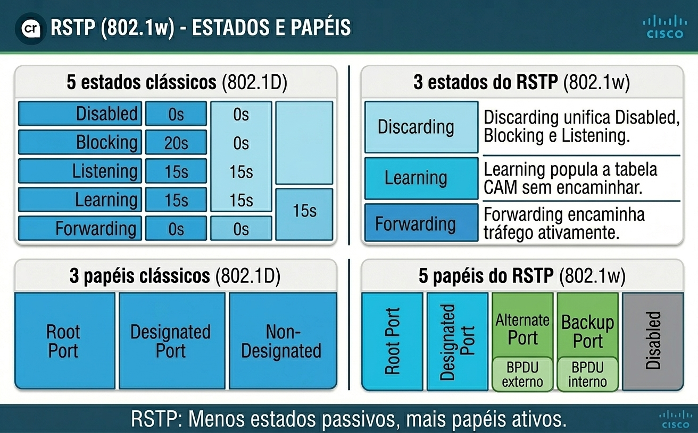
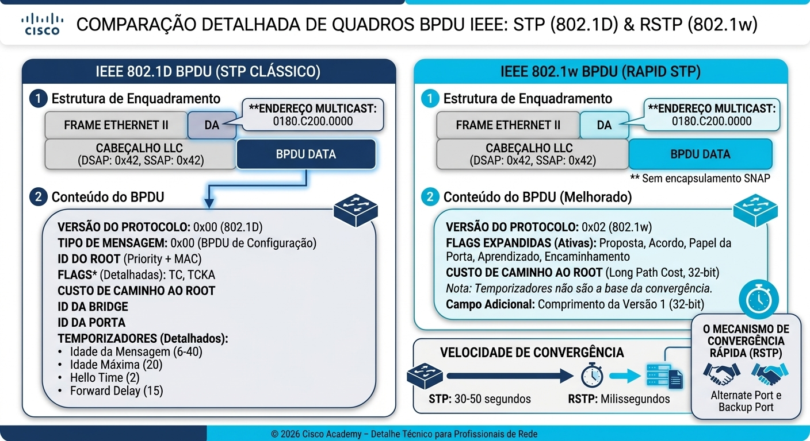
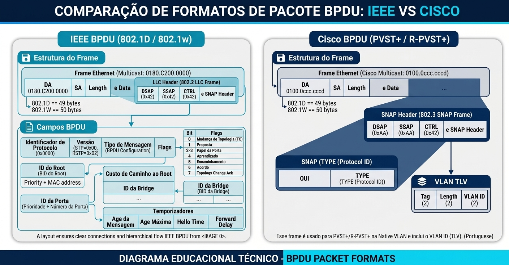
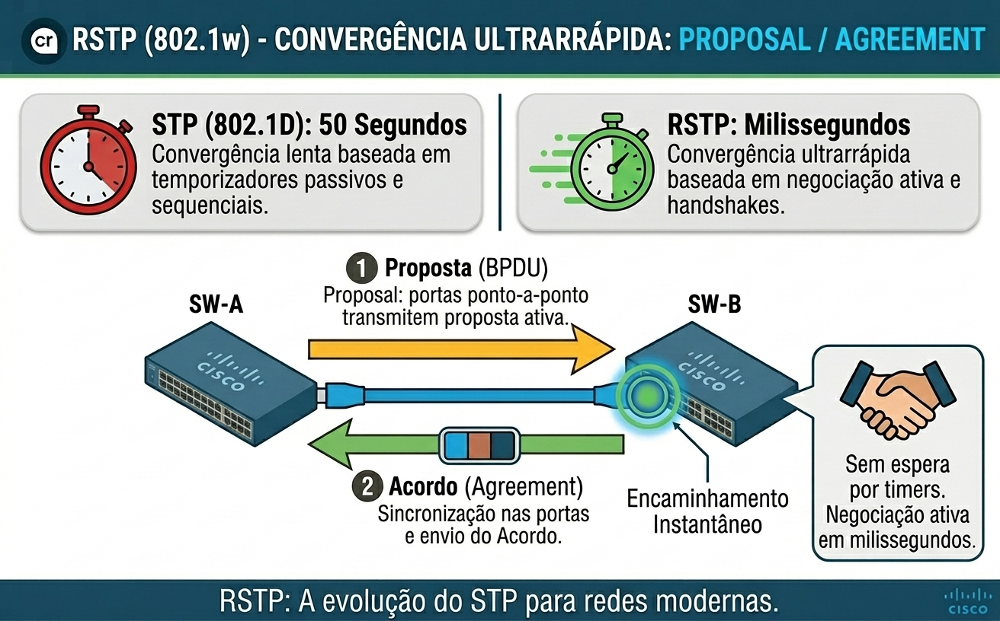

# 20: RSTP (802.1w) e Rapid-PVST+: o que muda no 802.1D/PVST+

- [20: RSTP (802.1w) e Rapid-PVST+: o que muda no 802.1D/PVST+](#20-rstp-8021w-e-rapid-pvst-o-que-muda-no-8021dpvst)
  - [🎯 Objetivo e como ler](#-objetivo-e-como-ler)
  - [Glossário Técnico do RSTP (Dicionário de Camada 2 Avançado)](#glossário-técnico-do-rstp-dicionário-de-camada-2-avançado)
  - [Por que o 802.1D é lento](#por-que-o-8021d-é-lento)
    - [Por que essa tecnologia surgiu? (O contexto do RSTP)](#por-que-essa-tecnologia-surgiu-o-contexto-do-rstp)
  - [Padrão x Implementação](#padrão-x-implementação)
  - [O que NÃO muda](#o-que-não-muda)
  - [O que muda](#o-que-muda)
    - [Estados: 5 → 3 (tabela comparativa)](#estados-5--3-tabela-comparativa)
    - [Papéis: 3 → 5 (Root, Designated, Alternate, Backup, Disabled)](#papéis-3--5-root-designated-alternate-backup-disabled)
    - [Estados x Papéis](#estados-x-papéis)
    - [BPDU](#bpdu)
    - [Convergência](#convergência)
      - [Fluxo com mais de dois switches (exemplo prático)](#fluxo-com-mais-de-dois-switches-exemplo-prático)
      - [Verificação rápida (comandos úteis)](#verificação-rápida-comandos-úteis)
      - [Classificação de Tipos de Link](#classificação-de-tipos-de-link)
    - [Timers](#timers)
    - [Topology Change Change (TC)](#topology-change-change-tc)
    - [Custos](#custos)
    - [Compatibilidade com 802.1D](#compatibilidade-com-8021d)
  - [Tabela-resumo: 802.1D x RSTP / Rapid-PVST+](#tabela-resumo-8021d-x-rstp--rapid-pvst)
  - [Bloco de decisão + impacto de negócio](#bloco-de-decisão--impacto-de-negócio)
    - [Quando usar, quando não usar e impacto de negócio](#quando-usar-quando-não-usar-e-impacto-de-negócio)
    - [Quando usar Rapid-PVST+](#quando-usar-rapid-pvst)
    - [Quando preferir MST (802.1s) - Discutiremos mais adiante](#quando-preferir-mst-8021s---discutiremos-mais-adiante)
    - [Quando o RSTP “recua” para comportamento clássico](#quando-o-rstp-recua-para-comportamento-clássico)
    - [Impacto de negócio](#impacto-de-negócio)
    - [🧪 Pronto para Testar seu Conhecimento?](#-pronto-para-testar-seu-conhecimento)

## 🎯 Objetivo e como ler

Até aqui, revisamos o funcionamento do Spanning Tree clássico (802.1D) e sua evolução por instância no PVST+, compreendendo como os switches bloqueiam caminhos físicos para eliminar loops de Camada 2. No entanto, o modelo tradicional apresenta uma limitação crítica para as redes corporativas modernas: a lentidão drástica em sua convergência.  

Nesta seção, introduzimos a evolução natural com o **RSTP (Rapid Spanning Tree Protocol - IEEE 802.1w)** e sua implementação baseada em instâncias por VLAN da Cisco (**Rapid-PVST+**), desenhados para entregar convergência típica de **1 a 2 segundos** (sub-segundo em cenários ideais de links point-to-point).

---

## Glossário Técnico do RSTP (Dicionário de Camada 2 Avançado)

Para dominar a operação do RSTP e não se confundir com a transição do modelo clássico, é essencial compreender os novos termos introduzidos pelo padrão 802.1w:

| Termo           | Significado Técnico | Analogia Didática |
| :---            | :--- | :--- |
| **Rapid-PVST+** | Implementação proprietária da Cisco que roda uma instância independente de RSTP por VLAN. | Várias "autoestradas rápidas" independentes para cada VLAN da empresa. |
| **Edge Port**   | Porta de borda conectada diretamente a um dispositivo final (computador, servidor), sem switches vizinhos. | Uma saída direta da autoestrada para a garagem de uma casa. |
| **Point-to-Point** | Link Full-Duplex conectado diretamente entre dois switches (geralmente via cabos dedicados ou trunks). | Uma via de mão dupla exclusiva entre duas cidades. |
| **Shared Link** | Link Half-Duplex operando via hubs ou ambientes legados compartilhados. | Uma praça de trânsito antiga onde todos disputam o mesmo espaço. |
| **Alternate Port** | Papel de porta que fornece um caminho alternativo para o Root Bridge, recebendo BPDUs superiores de outro switch. | Um "desvio oficial" pronto para assumir imediatamente se a via principal cair. |
| **Backup Port** | Papel de porta que fornece um caminho alternativo em um segmento compartilhado (hub), recebendo BPDUs do próprio switch. | Uma cancela de emergência operada pelo mesmo guarda no mesmo portão. |
| **Proposal / Agreement** | Mecanismo de handshake ativo baseado em propostas e concordâncias para transição instantânea de portas. | Uma confirmação imediata de "está liberado por aí?" respondida com "sim, pode passar!". |

---

## Por que o 802.1D é lento

O protocolo Spanning Tree clássico (802.1D) sofre de um grave gargalo operacional: a lentidão extrema para convergir após uma mudança de topologia. Devido à sua dependência estrita de temporizadores passivos e sequenciais, como os estados de *Listening* (15s) e *Learning* (15s) somados ao *Max Age* (20s), a rede demora tipicamente entre **30 a 50 segundos** para restabelecer o tráfego. Durante todo esse intervalo, as portas permanecem inaptas a encaminhar pacotes, gerando interrupções inaceitáveis para ambientes modernos.  

*Para relembrar o cálculo detalhado desses temporizadores e o comportamento clássico, consulte a [Revisão 01](https://github.com/alcancil/Cisco/tree/main/CCNP%20350-401%20ENCOR/03%20-%20Infrastructure/02%20-%20STP%20(Spanning%20Tree%20Protocol)/01%20-%20Revisao)*.

### Por que essa tecnologia surgiu? (O contexto do RSTP)

O 802.1D foi concebido em uma era onde as mudanças de topologia eram esporádicas e a tolerância a falhas permitia dezenas de segundos de inatividade. Com a explosão de aplicações em tempo real (VoIP, streaming, transações financeiras e virtualização), uma queda de 50 segundos na rede tornou-se inviável. O RSTP (802.1w) surgiu para eliminar a dependência dos temporizadores passivos, substituindo-os por uma convergência baseada em negociação ativa.

---

## Padrão x Implementação

É fundamental distinguir o padrão aberto da indústria da sua implementação específica nos equipamentos Cisco:

* **IEEE 802.1w (RSTP - Rapid Spanning Tree):** É o padrão internacional padronizado pelo IEEE que define as melhorias de velocidade, novos papéis de porta e o mecanismo de *Proposal/Agreement* para uma única instância global de spanning tree (semelhante ao STP comum).
* **Rapid-PVST+ (Rapid Per-VLAN Spanning Tree Plus):** É a implementação proprietária da Cisco. Ela combina a velocidade de convergência do 802.1w com a flexibilidade do PVST+, executando uma instância independente de RSTP para cada VLAN configurada na rede. Isso permite engenharia de tráfego avançada (balanceamento de carga por VLAN entre os switches de Core), mas consome mais recursos de CPU e memória dos switches.

---

## O que NÃO muda

Apesar da revolução na velocidade, a base matemática e lógica da arquitetura Spanning Tree permanece intacta. Os seguintes pilares fundamentais do 802.1D **continuam idênticos no RSTP**:

1. **A Eleição do Root Bridge:** O princípio de que o switch com o menor Bridge ID (Prioridade + MAC) se torna o centro da árvore lógica da rede não mudou.
2. **O Cálculo de Caminhos (Path Cost):** Os conceitos de custo acumulado até o Root Bridge e a necessidade de eleger uma única Root Port por switch Non-Root continuam rigorosamente os mesmos.
3. **A Definição de Designated Ports:** A regra de que cada segmento de rede possui apenas uma porta designada para encaminhar tráfego permanece inalterada.
4. **Os Critérios de Desempate (Tie-breakers):** A hierarquia de 4 níveis (Menor Custo $\rightarrow$ Menor Sender BID $\rightarrow$ Menor Sender Port Priority $\rightarrow$ Menor Sender Port ID) continua a ser a base de decisão da arquitetura.

## O que muda

### Estados: 5 → 3 (tabela comparativa)

No STP clássico (802.1D), a transição de uma porta até o encaminhamento de dados exigia uma jornada longa por cinco estados distintos (*Disabled*, *Blocking*, *Listening*, *Learning* e *Forwarding*), projetados para eliminar loops temporários, mas que penalizavam a rede com temporizadores de dezenas de segundos. 

O RSTP (802.1w) redesenhou essa lógica unificando papéis e estados operacionais. Como o mecanismo de segurança agora é ativo via negociação (*Proposal/Agreement*), os estados intermediários passivos deixaram de existir. O modelo foi reduzido a apenas **três estados operacionais**, focados exclusivamente no comportamento do plano de dados da porta:

| Estado RSTP    | Equivalente no 802.1D               | Aprende MAC? | Encaminha Dados? | Função Operacional                                                                |
| :---           | :---                                | :---:        | :---:            | :---                                                                              |
| **Discarding** | *Disabled*, *Blocking*, *Listening* | Não          | Não              | Estado inicial ou de bloqueio. A porta descarta quadros de dados, mas monitora a rede e processa BPDUs. |
| **Learning**   | *Learning*                          | Sim          | Não              | Porta preparando-se para abrir. Popula a tabela CAM com endereços MAC para evitar *flooding* inicial, mas ainda não encaminha tráfego de utilizadores. |
| **Forwarding** | *Forwarding*                        | Sim          | Sim              | Operação normal. A porta encaminha tráfego de dados e participa plenamente da topologia ativa. |

---

### Papéis: 3 → 5 (Root, Designated, Alternate, Backup, Disabled)

Enquanto o 802.1D utilizava essencialmente três papéis lógicos (*Root Port*, *Designated Port* e *Non-Designated/Blocking*), o RSTP expande essa granularidade para **cinco papéis de porta**. Essa divisão permite que caminhos redundantes saibam exatamente qual a sua função de contingência sem precisar recalcular a topologia do zero em caso de falha:

1. **Root Port (RP):** O caminho principal de menor custo em direção ao Root Bridge (presente em todos os switches não-raiz). Continua idêntico ao 802.1D, mas com capacidade de transição rápida.
2. **Designated Port (DP):** A porta responsável por responder pelo segmento de rede ou link, enviando tráfego e BPDUs para a frente.
3. **Alternate Port:** O novo substituto oficial da porta bloqueada clássica (*Non-Designated*). Trata-se de uma porta que recebe BPDUs superiores vindos de **outro switch**, posicionando-se como um caminho alternativo imediato (*desvio*) caso a Root Port caia.
4. **Backup Port:** Um papel exclusivo para ambientes compartilhados (como hubs legados ou segmentos *half-duplex*). Trata-se de uma porta que recebe BPDUs superiores vindos do **próprio switch**, agindo como cópia de segurança de uma Designated Port.
5. **Disabled:** Porta administrativamente desligada (*shutdown*) ou inativa no plano de controlo do Spanning Tree.

---

### Estados x Papéis  



🧠 **Ponto Crítico para Provas:**  

- **Estados respondem:** "O que a porta está fazendo?" (Discarding, Learning, Forwarding)
- **Papéis respondem:** "Qual a função da porta na topologia?" (Root, Designated, Alternate, Backup)
- Uma porta pode estar em **Discarding com papel de Alternate.** São conceitos independentes!

---

### BPDU

No RSTP, o formato e o comportamento do BPDU sofreram alterações profundas para suportar o mecanismo de convergência rápida:

- **Versão do Protocolo:** O RSTP utiliza o **BPDU Versão 2** (o 802.1D clássico usava a Versão 0).
- **Uso Completo do Campo Flags (8 bits):** Enquanto o 802.1D usava basicamente apenas os bits de Topology Change (TC) e Topology Change Acknowledgment (TCA), o RSTP utiliza todos os 8 bits do byte de flags para codificar o handshake em tempo real:
  - Bits dedicados para indicar a proposta (*Proposal*) e o acordo (*Agreement*).
  - Bits que informam explicitamente o papel (*Port Role*) e o estado (*Learning* / *Forwarding*) da porta remetente no momento do envio.
- **Comportamento Ativo de Keepalive (*Hello* por Porta):** No 802.1D, apenas o Root Bridge gerava BPDUs ativamente (e os switches intermediários apenas os repassavam de forma passiva). No RSTP, **todo switch gera BPDUs a cada intervalo de *Hello* (2 segundos)** de forma autónoma pelas suas Designated Ports.
- **Detecção de Falha Agressiva:** Como os BPDUs são emitidos de forma bidirecional e constante por ambos os lados de um link, a perda de **3 BPDUs consecutivos** (equivalente a 6 segundos por defeito) é suficiente para declarar a falha imediata daquele vizinho, sem precisar aguardar o antigo temporizador *Max Age*.

  
  

  
---

### Convergência

A convergência no RSTP deixa de ser baseada na contagem passiva de temporizadores e passa a ser operada por um processo lógico de **handshake ativo de largura de banda** conhecido como **Proposal/Agreement**:

1. **O Gatilho da Proposta (*Proposal*):** Quando um link sobe ou muda de estado, a porta designada de um switch envia um BPDU com a flag *Proposal* ativa, exigindo uma resposta síncrona do vizinho.
2. **A Sincronização (*Sync*):** O switch vizinho recebe a proposta e, para garantir que não criará um loop temporário, coloca temporariamente as suas próprias portas não-edge em estado de *Discarding* (*Sync*).
3. **O Acordo (*Agreement*):** Uma vez sincronizado, o vizinho devolve um BPDU com a flag *Agreement* marcada, respondendo à proposta inicial.
4. **Transição Rápida:** Ao receber o *Agreement*, a porta original transita para o estado de *Forwarding*. Em links point-to-point o processo completo (Proposal → Sync → Agreement) ocorre tipicamente em **1 a 2 segundos** (pode chegar a sub-segundo em condições ideais). Não depende mais dos temporizadores clássicos de 15/20/30 s.



#### Fluxo com mais de dois switches (exemplo prático)

Imagine a topologia Root (SW-A) — SW-B — SW-C (onde SW-C tem um link alternativo para o Root).

1. SW-B sobe um novo link point-to-point com SW-A e envia **Proposal**.
2. SW-B coloca suas portas não-Edge em *Discarding* (Sync) e responde com **Agreement**.
3. A porta de SW-B vai para *Forwarding* imediatamente.
4. SW-B agora propaga a nova informação de topologia. Se SW-C precisar reagir (ex.: sua Root Port antiga falhou), ele usa sua **Alternate Port** e também realiza handshake local se necessário.

O mecanismo é “em cascata”: cada hop realiza seu próprio Proposal/Agreement de forma independente e rápida.

#### Verificação rápida (comandos úteis)

```ios
# Ver papéis e estados RSTP
show spanning-tree
show spanning-tree vlan <id> detail

# Observar se a porta está em Alternate (pronta para assumir)
show spanning-tree interface <interface> detail

# Confirmar modo Rapid-PVST+
show spanning-tree summary
```

#### Classificação de Tipos de Link

Para que o mecanismo de *Proposal/Agreement* funcione com segurança máxima, o RSTP categoriza as interfaces físicas em três comportamentos de link:  

- **Point-to-Point:** Links *full-duplex* (como cabos dedicados e Trunks entre switches). Permitem a transição instantânea via *Proposal/Agreement*.
- **Shared:** Links *half-duplex* (geralmente envolvendo hubs legados). O RSTP comporta-se de forma semelhante ao 802.1D clássico nesses segmentos para evitar colisões e loops de camada 2.
- **Edge Port:** Portas de acesso conectadas a computadores e servidores (equivalente conceitual ao *PortFast*). Como não existem switches do outro lado, a porta transita para *Forwarding* de forma imediata, sem passar por estados de bloqueio e sem disparar alterações de topologia.

---

### Timers

No ecossistema do 802.1D, os temporizadores (*Max Age* de 20s e *Forward Delay* de 15s) ditavam o ritmo obrigatório de espera da rede. No RSTP, **o papel desses temporizadores muda radicalmente**:

- **De Temporizadores Ativos para Mecanismos de Fallback:** O *Max Age* e o *Forward Delay* deixam de ser a engrenagem principal de funcionamento da rede. Eles passam a atuar puramente como mecanismos de segurança de retaguarda (*fallback*) para o caso de a porta comunicar-se com um switch antigo que ainda utilize o padrão 802.1D.
- **Eliminação de Esperas Desnecessárias:** Como a convergência passa a ser impulsionada pelo diálogo ativo de *Proposal/Agreement* e pela presença das portas *Alternate*, os tempos de espera baseados em contagem regressiva desaparecem na operação normal de uma rede puramente RSTP.

---

### Topology Change Change (TC)

No 802.1D clássico, uma mudança de topologia exigia a propagação lenta de quadros especiais chamados TCN (Topology Change Notification) em direção ao Root Bridge, que depois respondia espalhando o aviso para toda a rede.

No RSTP, o processo foi simplificado e tornado agressivo:  

- **Fim do TCN BPDU:** O quadro TCN puro deixa de existir.
- **Geração Direta de TC:** Qualquer alteração relevante na topologia (como uma porta não-edge que transita para o estado de *Forwarding* ou uma porta que cai inesperadamente) é tratada diretamente como um evento de mudança de topologia (*Topology Change*).
- **Flush Imediato de Endereços MAC:** O switch que deteta a mudança envia BPDUs com a flag *TC* ativa para os seus vizinhos, forçando a **limpeza imediata (*flush*) das entradas da tabela CAM** nas portas afetadas. Isso evita que pacotes continuem a ser encaminhados para caminhos mortos, redirecionando o tráfego instantaneamente para os caminhos de *Alternate Port* que assumiram a liderança.

---

### Custos

Com o aumento vertiginoso da largura de banda nas redes corporativas modernas (passando de Megabits para Gigabits e Terabits), o sistema antigo de custos de 16 bits do 802.1D tornou-se obsoleto (já que múltiplos tipos de links rápidos convergiam para o valor mínimo de custo igual a 1).

- **A Adoção do Método Long (32-bit):** O RSTP padroniza e recomenda amplamente a utilização de métricas de custos expandidas de 32 bits (*long path cost*).

| **Velocidade do Link (Bandwidth)** | **Custo Padrão RSTP (32 bits)** | **Faixa Recomendada pela IEEE** |
| :----------------------------------| :-------------------------------| :-------------------------------|
| 10 Mbps                            | 2.000.000                       | 200.000 a 20.000.000            |
| 100 Mbps (Fast Ethernet)           | 200.000                         | 20.000 a 2.000.000              |
| 1 Gbps (Gigabit Ethernet)          | 20.000                          | 2.000 a 200.000                 |
| 10 Gbps                            | 2.000                           | 200 a 20.000                    |
| 40 Gbps                            | 500                             | 50 a 5.000                      |
| 100 Gbps                           | 200                             | 20 a 2.000                      |
| 1 Terabit/s                        | 20                              | 2 a 200                         |

- *Nota de Projeto:* Essa granularidade aprimorada permite que o algoritmo de Spanning Tree calcule com precisão matemática caminhos complexos em redes de alta velocidade, diferenciando com eficácia links de 10G e 40G.

---

### Compatibilidade com 802.1D

Como a transição de uma infraestrutura legada para o RSTP raramente ocorre de forma simultânea em todos os switches da rede, o padrão 802.1w foi desenhado com inteligência de retrocompatibilidade:

- **Detecção Automática de Legado:** Uma porta operando em RSTP envia BPDUs da versão 2. No entanto, se ela começar a receber BPDUs clássicos da versão 0 (802.1D) vindos de um switch antigo no mesmo segmento, a porta compreende que há um equipamento legado na ponta oposta.
- **Comportamento de Fallback por Porta:** A interface do switch moderno degrada automaticamente o seu comportamento, passando a falar o protocolo 802.1D clássico naquela ligação específica, enquanto as demais portas da rede continuam a operar com toda a velocidade do RSTP.
- **Recuperação de Estado:** Se o switch legado for removido da rede, a porta moderna consegue retornar automaticamente ao modo rápido (*Rapid*) após um período de timeout ou intervenção de reinicialização do protocolo na interface.

---

## Tabela-resumo: 802.1D x RSTP / Rapid-PVST+

Para consolidar a teoria da transição tecnológica, a tabela abaixo resume o contraste direto entre o modelo clássico e a sua evolução de alta velocidade:

| Critério de Comparação                 | STP Clássico (802.1D)                                                     | RSTP / Rapid-PVST+ (802.1w)                            |
| :---                                   | :---                                                                      | :---                                                   |
| **Tempo de Convergência**              | Lento (30 a 50 segundos)                                                  | Ultrarrápido (1 a 2 segundos / Sub-segundo)            |
| **Estados de Porta**                   | 5 estados (*Disabled*, *Blocking*, *Listening*, *Learning*, *Forwarding*) | 3 estados (*Discarding*, *Learning*, *Forwarding*)     |
| **Papéis de Porta**                    | 3 papéis (*Root*, *Designated*, *Non-Designated*)                         | 5 papéis (*Root*, *Designated*, *Alternate*, *Backup*, *Disabled*) |
| **Mecanismo de Negociação**            | Passivo, baseado em temporizadores estáticos                              | Ativo, baseado em *Handshake Proposal/Agreement*       |
| **Geração de BPDUs**                   | Apenas o Root Bridge gera ativamente (*Hello*)                            | Todos os switches geram ativamente a cada *Hello*      |
| **Detecção de Falhas**                 | Lenta (aguarda expiração de temporizadores / *Max Age*)                   | Agressiva (perda de 3 BPDUs consecutivos / ~6 segundos) |
| **Tratamento de Portas Finais**        | Exigia configurações adicionais (*PortFast*)                              | Nativo através do conceito de *Edge Ports*             |
| **Custos de Caminho**                  | Padrão curto (16-bit), limitativo para links modernos                     | Padrão longo (32-bit), ideal para 1G, 10G, 40G e 100G  |
| **Tratamento de Mudança de Topologia** | Envio lento de quadros TCN em direção ao Root                             | Envio direto de flags TC com *flush* imediato da tabela MAC |

---

## Bloco de decisão + impacto de negócio

### Quando usar, quando não usar e impacto de negócio
  
### Quando usar Rapid-PVST+

- Ambiente predominantemente Cisco.
- Necessidade de engenharia de tráfego por VLAN (balanceamento de carga diferente por VLAN).
- Número moderado de VLANs (dezenas, não centenas).
- Prioridade máxima em convergência rápida em links point-to-point e edge.

### Quando preferir MST (802.1s) - Discutiremos mais adiante

- Grande quantidade de VLANs (centenas) → Rapid-PVST+ consome muita CPU/memória (uma instância por VLAN).
- Ambiente multi-vendor (MST é padrão IEEE).
- Deseja agrupar VLANs em poucas instâncias (regions) para reduzir carga e simplificar.

### Quando o RSTP “recua” para comportamento clássico  

- Link **Shared** (half-duplex / hub) → Proposal/Agreement não é usado; cai no comportamento de temporizadores do 802.1D.
- Porta recebe BPDU versão 0 (switch legado 802.1D) → a porta específica opera em modo compatibilidade (fallback).
- Edge Port que recebe BPDU inesperado (possível loop ou switch conectado) → perde o status de Edge e passa a seguir o processo normal.

### Impacto de negócio

| **Cenário**                      | **STP clássico (30-50 s)**    | **RSTP / Rapid-PVST+ (1-2 s)**  | **Impacto típico**                              |
| :--------------------------------| :-----------------------------| :-------------------------------| :-----------------------------------------------|
| VoIP / Video / Trading           | Chamadas caem, sessões perdem | Quase imperceptível             | SLA de disponibilidade e experiência do usuário |
| Aplicações transacionais         | Timeouts e retrabalho         | Continuidade quase total        | Custo de downtime e produtividade               |
| Virtualização / Storage iSCSI    | Paths falham, VMs “congelam”  | Failover rápido                 | Continuidade de serviço                         |
| Redes com muitos links de acesso | PortFast era obrigatório      | Edge Port nativo                | Menos configuração e menos erros                |

Em resumo: o RSTP não muda a lógica de prevenção de loops; ele elimina a principal dor de negócio do Spanning Tree clássico — o tempo de convergência inaceitável para aplicações modernas.

---

### 🧪 Pronto para Testar seu Conhecimento?

Antes de avançar para o próximo capítulo, valide sua compreensão dos fundamentos do **Spanning Tree Protocol (STP)**.

Os simulados foram planejados para reforçar os conceitos estudados, testar seu raciocínio sobre os cenários apresentados e identificar pontos que precisam de revisão antes de avançar para os protocolos seguintes.

👉 **Acesse os simulados de STP — Parte 01**

🔗 [Abrir Simulados STP — Parte 01](https://alcancil.github.io/Cisco/CCNP%20350-401%20ENCOR/03%20-%20Infrastructure/02%20-%20STP%20(Spanning%20Tree%20Protocol)/20%20-%20RSTP/Arquivos/Simulado/)  

**Simulados temáticos:**  

1. [Frame Ethernet e Loops de Camada 2](https://alcancil.github.io/Cisco/CCNP%20350-401%20ENCOR/03%20-%20Infrastructure/02%20-%20STP%20(Spanning%20Tree%20Protocol)/20%20-%20RSTP/Arquivos/Simulado/01.html)
2. [BPDU, Bridge ID e Eleição do Root Bridge](https://alcancil.github.io/Cisco/CCNP%20350-401%20ENCOR/03%20-%20Infrastructure/02%20-%20STP%20(Spanning%20Tree%20Protocol)/20%20-%20RSTP/Arquivos/Simulado/02.html)
3. [Port Roles e Port States](https://alcancil.github.io/Cisco/CCNP%20350-401%20ENCOR/03%20-%20Infrastructure/02%20-%20STP%20(Spanning%20Tree%20Protocol)/20%20-%20RSTP/Arquivos/Simulado/03.html)
4. [Timers e Convergência](https://alcancil.github.io/Cisco/CCNP%20350-401%20ENCOR/03%20-%20Infrastructure/02%20-%20STP%20(Spanning%20Tree%20Protocol)/20%20-%20RSTP/Arquivos/Simulado/04.html)
5. [TCN, Mudanças de Topologia e Falhas](https://alcancil.github.io/Cisco/CCNP%20350-401%20ENCOR/03%20-%20Infrastructure/02%20-%20STP%20(Spanning%20Tree%20Protocol)/20%20-%20RSTP/Arquivos/Simulado/05.html)

**Simulado completo de STP:** [50 questões — 75 minutos](https://alcancil.github.io/Cisco/CCNP%20350-401%20ENCOR/03%20-%20Infrastructure/02%20-%20STP%20(Spanning%20Tree%20Protocol)/20%20-%20RSTP/Arquivos/Simulado/completo.html)

**📊 Painel de Estatísticas:** [Acompanhe seu desempenho](https://alcancil.github.io/Cisco/CCNP%20350-401%20ENCOR/03%20-%20Infrastructure/02%20-%20STP%20(Spanning%20Tree%20Protocol)/20%20-%20RSTP/Arquivos/Simulado/dashboard.html)

**Próxima etapa:** avançar na evolução do Spanning Tree, comparando o STP/PVST+ com o Rapid Spanning Tree Protocol (RSTP), com foco nas diferenças de funcionamento, nos mecanismos de convergência e no comportamento das portas.  
