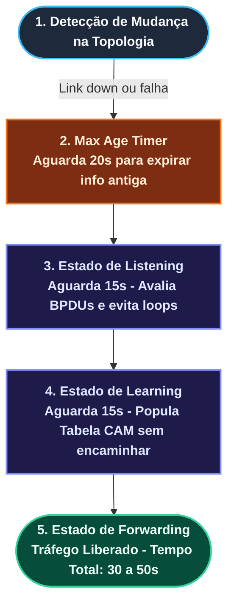
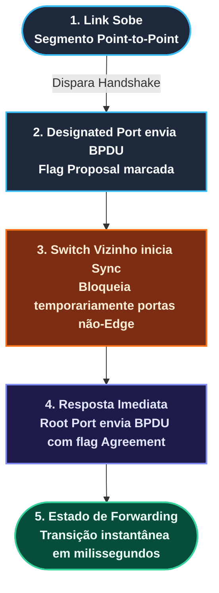
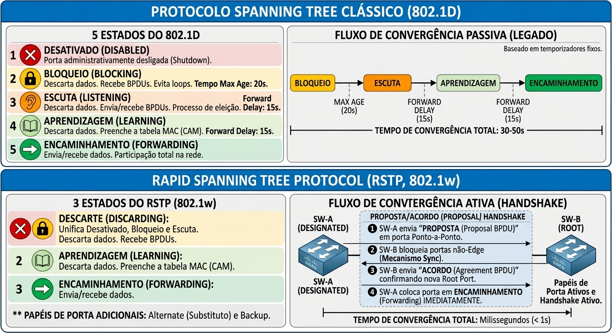
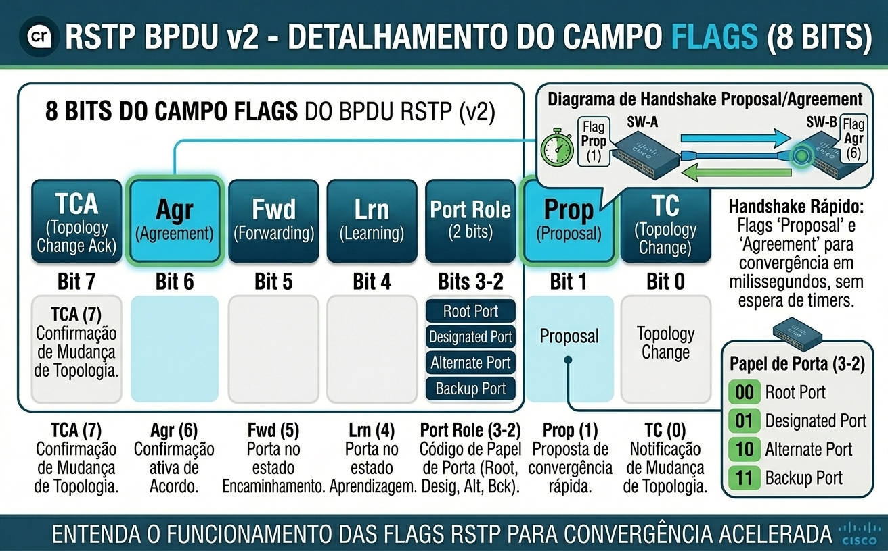

# 21: RSTP (802.1w) e Rapid-PVST+: Algoritmos, Configuração, Troubleshooting e Análise de Pacotes

- [21: RSTP (802.1w) e Rapid-PVST+: Algoritmos, Configuração, Troubleshooting e Análise de Pacotes](#21-rstp-8021w-e-rapid-pvst-algoritmos-configuração-troubleshooting-e-análise-de-pacotes)
  - [🎯 Objetivo](#-objetivo)
  - [1. Comparativo de Algoritmos de Tomada de Decisão: STP (802.1D) x RSTP (802.1w)](#1-comparativo-de-algoritmos-de-tomada-de-decisão-stp-8021d-x-rstp-8021w)
    - [1.1 Fluxo do Algoritmo Passivo (802.1D Clássico)](#11-fluxo-do-algoritmo-passivo-8021d-clássico)
    - [1.2 Fluxo do Algoritmo Ativo e Mecanismo de Sincronização (802.1w RSTP)](#12-fluxo-do-algoritmo-ativo-e-mecanismo-de-sincronização-8021w-rstp)
    - [1.3 Diagrama de Transição de Estados Lógicos](#13-diagrama-de-transição-de-estados-lógicos)
  - [2. Bloco de Comandos de Configuração (Cisco IOS / IOS-XE)](#2-bloco-de-comandos-de-configuração-cisco-ios--ios-xe)
    - [2.1 Como ativar e migrar do STP Clássico para Rapid-PVST+](#21-como-ativar-e-migrar-do-stp-clássico-para-rapid-pvst)
    - [2.2 Ajustes de Prioridade e Engenharia de Tráfego por VLAN](#22-ajustes-de-prioridade-e-engenharia-de-tráfego-por-vlan)
    - [2.3 Configuração de Portas de Borda (Edge Ports / PortFast)](#23-configuração-de-portas-de-borda-edge-ports--portfast)
    - [2.4 Forçando o Tipo de Link (Point-to-Point x Shared)](#24-forçando-o-tipo-de-link-point-to-point-x-shared)
  - [3. Comandos de Verificação, Validação e Troubleshooting](#3-comandos-de-verificação-validação-e-troubleshooting)
    - [3.1 Comandos de Inspeção (show)](#31-comandos-de-inspeção-show)
    - [3.2 Análise Dinâmica e Depuração (debug)](#32-análise-dinâmica-e-depuração-debug)
  - [4. Análise de Captura de Pacotes (Wireshark)](#4-análise-de-captura-de-pacotes-wireshark)
    - [4.1 Filtros Úteis no Wireshark](#41-filtros-úteis-no-wireshark)
    - [4.2 Análise dos Campos da Flag do BPDU 802.1w (Proposal \& Agreement)](#42-análise-dos-campos-da-flag-do-bpdu-8021w-proposal--agreement)
  - [5. Limitações e Quando NÃO Utilizar o RSTP](#5-limitações-e-quando-não-utilizar-o-rstp)
    - [🧪 Pronto para Testar seu Conhecimento?](#-pronto-para-testar-seu-conhecimento)

---

## 🎯 Objetivo

Dominar a operação, a lógica algorítmica e a implementação prática do Rapid Spanning Tree Protocol (RSTP / 802.1w) e do Rapid-PVST+ da Cisco. Nesta etapa, vamos destrinchar os estados, o mecanismo ativo de Proposal/Agreement, os comandos essenciais de configuração, o troubleshooting cirúrgico (show e debug) e a análise de quadros reais no Wireshark para garantir resiliência em redes corporativas de alta performance.

---

## 1. Comparativo de Algoritmos de Tomada de Decisão: STP (802.1D) x RSTP (802.1w)

O RSTP introduziu dois novos papéis: **Alternate (Alternativa) e Backup (Reserva)**. A Alternate é a porta que fica bloqueada, mas pronta para assumir como Root Port caso o link principal caia. A Backup é a porta reserva em links compartilhados (Shared) para a mesma Designated Port

### 1.1 Fluxo do Algoritmo Passivo (802.1D Clássico)

- **Critério de Seleção:** Eleição de Root Bridge, Root Ports e Designated Ports via 4 tie-breakers (Menor Root BID $\rightarrow$ Menor Custo ao Root $\rightarrow$ Menor Sender BID $\rightarrow$ Menor Sender Port ID).
- **Ciclo de Espera Tradicional:** O modelo depende estritamente de temporizadores passivos para garantir a ausência de loops, resultando em uma convergência lenta de **30 a 50 segundos**.

  1. Detecta mudança na interface.
  2. Aguarda *Max Age* (20s) se a informação anterior precisar expirar.
  3. Transita para *Listening* (15s - aguarda BPDUs para garantir ausência de loops).
  4. Transita para *Learning* (15s - popula tabela CAM sem encaminhar tráfego).
  5. Transita para *Forwarding* (Tempo total: **30 a 50 segundos**)



### 1.2 Fluxo do Algoritmo Ativo e Mecanismo de Sincronização (802.1w RSTP)

* **Critério de Seleção:** Mantém os mesmos 4 tie-breakers, mas altera a execução da transição.
* **Handshake Proposal / Agreement:**
  1. O link sobe em um segmento *Point-to-Point*.
  2. A Designated Port envia um BPDU com a flag **Proposal** marcada.
  3. O switch vizinho inicia o processo de **Sync** (bloqueia temporariamente suas portas não-Edge para evitar loops).
  4. O vizinho responde imediatamente com a flag **Agreement** marcada pela sua Root Port.
  5. A Designated Port do switch transmissor vai para **Forwarding instantaneamente** (Tempo total: **milissegundos / 1-2s**).



### 1.3 Diagrama de Transição de Estados Lógicos



---

## 2. Bloco de Comandos de Configuração (Cisco IOS / IOS-XE)

### 2.1 Como ativar e migrar do STP Clássico para Rapid-PVST+

```ios
! Alterar o modo global de Spanning Tree para Rapid-PVST+
Switch(config)# spanning-tree mode rapid-pvst
```

### 2.2 Ajustes de Prioridade e Engenharia de Tráfego por VLAN

```ios
! Definir o Root Bridge primário para a VLAN 10 (define prioridade em 24576 ou menor)
Switch(config)# spanning-tree vlan 10 root primary

! Definir o Root Bridge secundário para a VLAN 20
Switch(config)# spanning-tree vlan 20 root secondary

! Configurar manualmente a prioridade do Bridge ID (múltiplos de 4096)
Switch(config)# spanning-tree vlan 10 priority 4096
```

### 2.3 Configuração de Portas de Borda (Edge Ports / PortFast)

```ios
! Habilitar Edge Port em todas as portas de acesso por padrão (Global)
Switch(config)# spanning-tree portfast default

! Habilitar Edge Port em uma interface específica (Servidor / Host)
Switch(config-if)# interface gigabitethernet 0/1
Switch(config-if)# switchport mode access
Switch(config-if)# spanning-tree portfast
```

### 2.4 Forçando o Tipo de Link (Point-to-Point x Shared)

```ios
! Por padrão, links Full-Duplex são considerados Point-to-Point.
! Para alterar/forçar manualmente caso o autodetect falhe:
Switch(config-if)# interface gigabitethernet 0/2
Switch(config-if)# spanning-tree link-type point-to-point
```

## 3. Comandos de Verificação, Validação e Troubleshooting

### 3.1 Comandos de Inspeção (show)

```ios
! Exibir resumo geral do modo operante do Spanning Tree
show spanning-tree summary

! Exibir detalhes do RSTP para uma VLAN específica
show spanning-tree vlan 10

! Exibir detalhes de papéis, estados, temporizadores e tipo de link de uma interface
show spanning-tree interface gigabitethernet 0/1 detail

! Verificar contadores de BPDUs enviados/recebidos e transições de topologia
show spanning-tree interface gigabitethernet 0/1 detail | include BPDU|number of topology
```

### 3.2 Análise Dinâmica e Depuração (debug)

> ⚠️ Atenção: Utilize comandos debug em ambiente de laboratório para evitar sobrecarga de CPU em produção.  
  
```ios
! Monitorar alterações de topologia e eventos do Spanning Tree
debug spanning-tree events

! Depurar o envio e recebimento de BPDUs em tempo real
debug spanning-tree bpdu receive
debug spanning-tree bpdu transmit

! Desativar todos os debugs
undebug all
```

## 4. Análise de Captura de Pacotes (Wireshark)

### 4.1 Filtros Úteis no Wireshark

- Filtrar todos os quadros de Spanning Tree:

```wireshark  
stp
```

- Filtrar apenas BPDUs RSTP (Versão 2 / 802.1w):

```wireshark  
stp.version == 2
```

- Filtrar BPDUs com a flag Proposal ativa:

```wireshark
stp.flags.proposal == 1
```

- Filtrar BPDUs com a flag Agreement ativa:

```wireshark  
stp.flags.agreement == 1
```

- Filtrar eventos de Topology Change no RSTP:
  
```wireshark
stp.flags.tc == 1
```

### 4.2 Análise dos Campos da Flag do BPDU 802.1w (Proposal & Agreement)

No RSTP (IEEE 802.1w / BPDU Versão 2), o antigo campo de Flags do STP clássico de 8 bits foi totalmente reaproveitado para suportar o mecanismo de convergência ativa (Proposal/Agreement) e a troca instantânea de estados entre switches adjacentes.
  
O byte de Flags é composto por 8 bits estruturados da seguinte forma:

```Plaintext

 Bit:      7     6     5     4       3      2     1     0
         +-----+-----+-----+-----+-------+-----+------+-----+
 Flags:  | TCA | Agr | Fwd | Lrn |  Port Role  | Prop |  TC |
         +-----+-----+-----+-----+-------+-----+------+-----+
```



Detalhamento Funcional de Cada Bit:

- **Bit 0 — TC (Topology Change):**
  - **Função:** Sinaliza que ocorreu uma mudança de topologia na rede. Quando ativo, força o flush imediato da tabela CAM (MAC address table) nas portas afetadas para evitar encaminhamento para caminhos mortos.
  
- **Bit 1 — Proposal (Proposta):**
  - **Função:** Utilizado ativamente por uma Designated Port em um link Point-to-Point para iniciar o processo de convergência rápida. Exige que o switch vizinho sincronize suas portas e responda com um acordo.

- **Bits 2 e 3 — Port Role (Papel da Porta):**
  - **Função:** Informam explicitamente o papel da porta que está a transmitir o BPDU. Os valores binários indicam:
    **00** = Papel desconhecido (Unknown)
    **01** = Alternate Port ou Backup Port
    **10** = Root Port
    **11** = Designated Port

- **Bit 4 — Learning (Aprendizado):**
  - **Função:** Indica que a porta remetente está no estado de Learning (preenchendo a tabela CAM sem encaminhar tráfego de dados).

- **Bit 5 — Forwarding (Encaminhamento):**
  - **Função:** Indica que a porta remetente está no estado de Forwarding (encaminhando tráfego de dados ativamente).

- **Bit 6 — Agreement (Acordo):**
  - **Função:** Resposta síncrona à Proposal recebida. Confirma que o switch vizinho concluiu o seu processo de sincronização (Sync), permitindo que a porta transmissora abra instantaneamente para o estado de Forwarding.

- **Bit 7 — TCA (Topology Change Acknowledgment):**
  - **Função:** Herdado por motivos de compatibilidade retroativa com o STP clássico (802.1D) para confirmar o recebimento de notificações de mudança de topologia.

## 5. Limitações e Quando NÃO Utilizar o RSTP

Apesar de ser o padrão recomendado para redes modernas, o RSTP possui cenários onde seu uso não é indicado ou exige cuidados extremos:

- **Links Compartilhados (Shared Media / Hubs):** O RSTP depende do handshake Proposal/Agreement em links *Point-to-Point* para convergir em milissegundos. Se o link for Shared (ex: presença de hubs ou links Half-Duplex), o RSTP detecta isso e cai para um comportamento similar ao STP clássico (baseado em timers), perdendo seu principal benefício.
- **Equipamentos Legados (Interoperabilidade):** Se a sua rede possui switches muito antigos que não suportam o padrão 802.1w (BPDU Versão 2), o RSTP tentará negociar e, ao encontrar um switch 802.1D, precisará manter compatibilidade retroativa. Isso pode causar instabilidade ou lentidão na convergência da VLAN onde o switch antigo está inserido.
- **Links WAN ou Rádio Instáveis:** Em links de longa distância ou wireless que sofrem com alta latência ou perda de pacotes, o RSTP pode sofrer com *flapping* (mudanças constantes de topologia), pois ele espera receber BPDUs a cada 2 segundos (Hello Time) e pode interpretar a perda de pacotes como queda de link.
- **Falta de BPDU Guard em Portas Edge:** Se você habilita PortFast/Edge Ports (onde não há switches, apenas PCs/servidores), mas *esquece* de habilitar o `BPDU Guard`, um usuário pode plugar um switch doméstico na tomada, gerar um loop e derrubar a rede inteira. O RSTP não resolve loops gerados por loops de usuários se não estiver protegido.

### 🧪 Pronto para Testar seu Conhecimento?

Antes de avançar para o próximo capítulo, valide sua compreensão dos fundamentos do **Spanning Tree Protocol (STP)**.

Os simulados foram planejados para reforçar os conceitos estudados, testar seu raciocínio sobre os cenários apresentados e identificar pontos que precisam de revisão antes de avançar para os protocolos seguintes.

👉 **Acesse os simulados de RSTP — Parte 01**

🔗 [Abrir Simulados RSTP — Parte 02](https://alcancil.github.io/Cisco/CCNP%20350-401%20ENCOR/03%20-%20Infrastructure/02%20-%20STP%20(Spanning%20Tree%20Protocol)/20%20-%20RSTP/Arquivos/Simulado/)  

**Simulados temáticos:**  

1. [Fluxo de Convergência: STP Passivo vs RSTP Ativo](https://alcancil.github.io/Cisco/CCNP%20350-401%20ENCOR/03%20-%20Infrastructure/02%20-%20STP%20(Spanning%20Tree%20Protocol)/20%21-%20RSTP/Arquivos/Simulado/01.html)
2. [BPDU v2 e Novos Papéis de Porta (Alternate e Backup)](https://alcancil.github.io/Cisco/CCNP%20350-401%20ENCOR/03%20-%20Infrastructure/02%20-%20STP%20(Spanning%20Tree%20Protocol)/20%21-%20RSTP/Arquivos/Simulado/02.html)
3. [Handshake Proposal/Agreement e Mecanismo de Sync](https://alcancil.github.io/Cisco/CCNP%20350-401%20ENCOR/03%20-%20Infrastructure/02%20-%20STP%20(Spanning%20Tree%20Protocol)/20%21-%20RSTP/Arquivos/Simulado/03.html)
4. [Configuração Prática: Rapid-PVST+, Edge Ports e Link-Type](https://alcancil.github.io/Cisco/CCNP%20350-401%20ENCOR/03%20-%20Infrastructure/02%20-%20STP%20(Spanning%20Tree%20Protocol)/20%21-%20RSTP/Arquivos/Simulado/04.html)
5. [Wireshark: Análise das Flags do BPDU e Troubleshooting](https://alcancil.github.io/Cisco/CCNP%20350-401%20ENCOR/03%20-%20Infrastructure/02%20-%20STP%20(Spanning%20Tree%20Protocol)/20%21-%20RSTP/Arquivos/Simulado/05.html)

**Simulado completo de STP:** [50 questões — 75 minutos](https://alcancil.github.io/Cisco/CCNP%20350-401%20ENCOR/03%20-%20Infrastructure/02%20-%20STP%20(Spanning%20Tree%20Protocol)/20%21-%20RSTP/Arquivos/Simulado/completo.html)

**📊 Painel de Estatísticas:** [Acompanhe seu desempenho](https://alcancil.github.io/Cisco/CCNP%20350-401%20ENCOR/03%20-%20Infrastructure/02%20-%20STP%20(Spanning%20Tree%20Protocol)/20%21-%20RSTP/Arquivos/Simulado/dashboard.html)