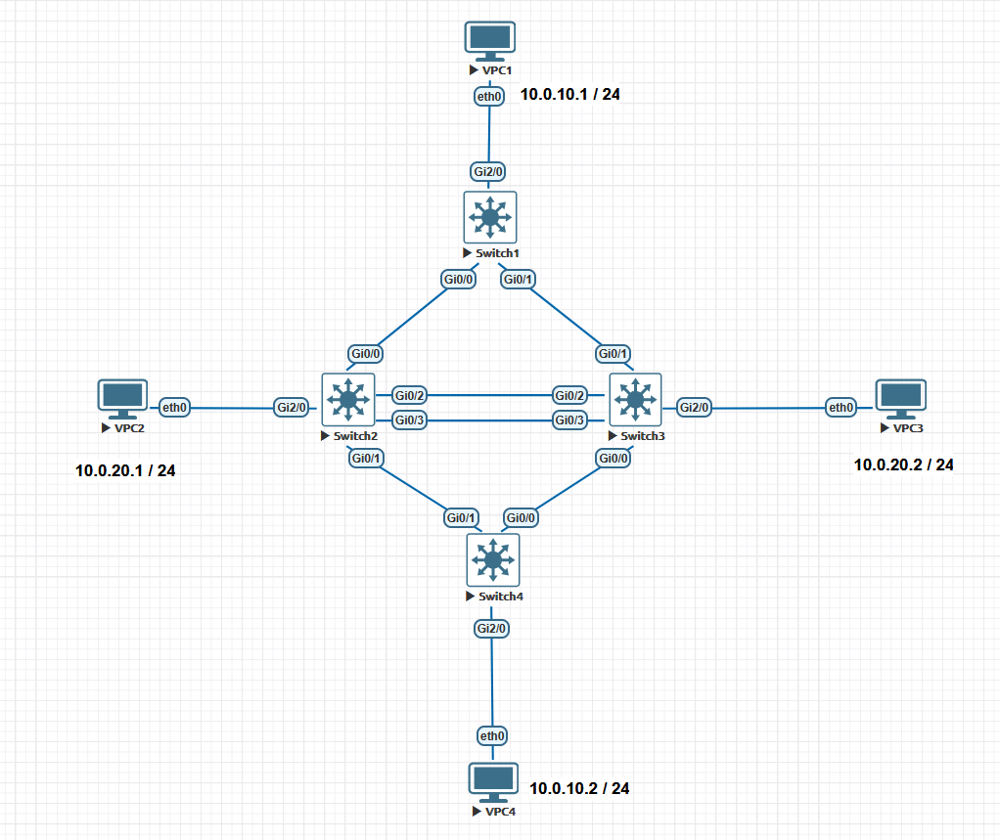
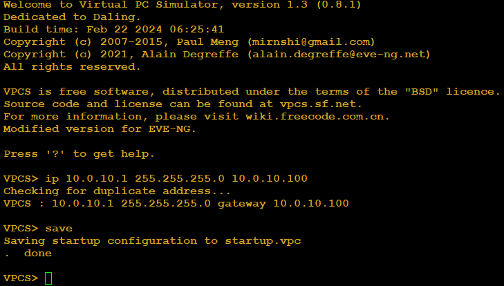
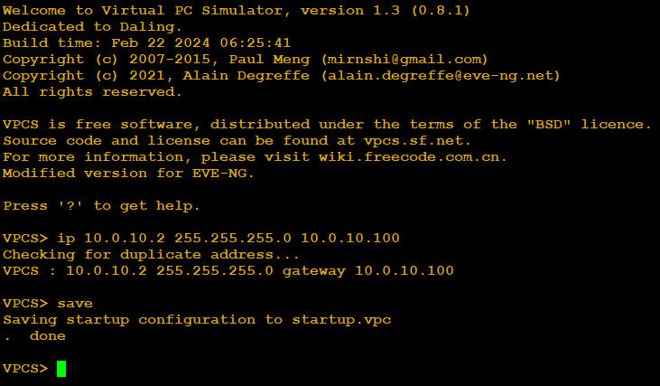
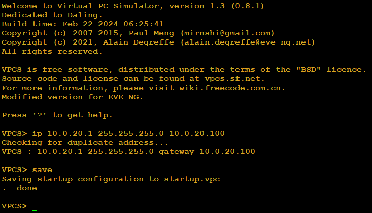
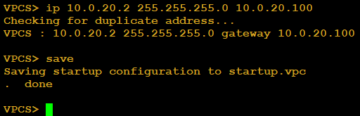
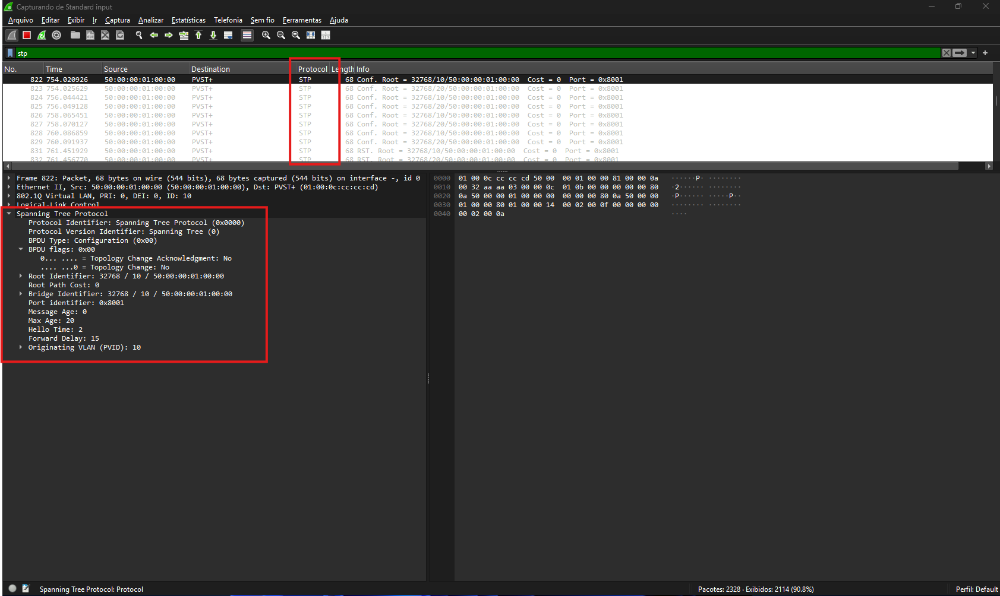
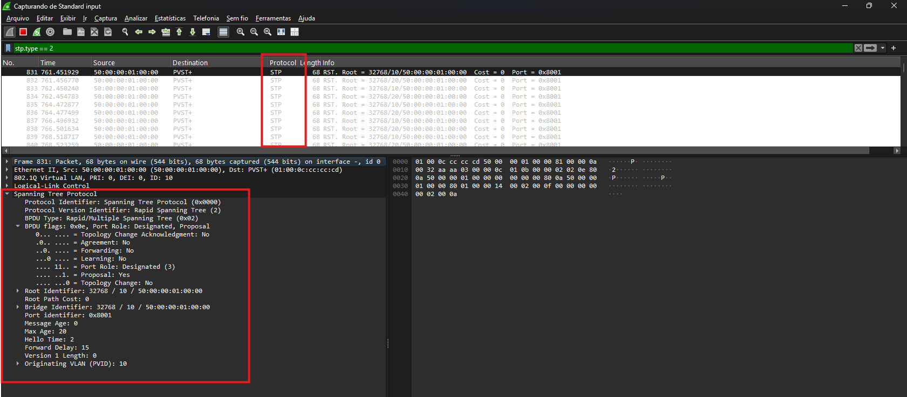
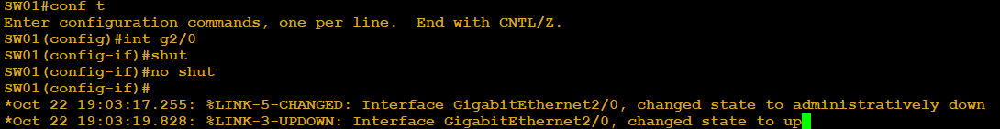
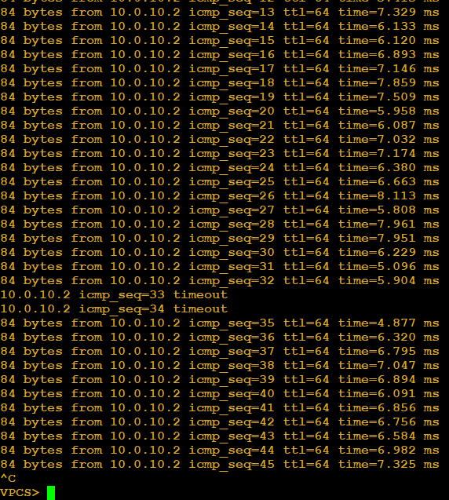

# 🧪 Arquivo — STP: Configuração e Verificação do RSTP (Rapid Spanning Tree Protocol)

---

## 📌 Sumário

- [🧪 Arquivo — STP: Configuração e Verificação do RSTP (Rapid Spanning Tree Protocol)](#-arquivo--stp-configuração-e-verificação-do-rstp-rapid-spanning-tree-protocol)
  - [📌 Sumário](#-sumário)
  - [🎯 Objetivo do Documento](#-objetivo-do-documento)
  - [🏗️ Contexto: Por Que Este Laboratório Importa no Mercado](#️-contexto-por-que-este-laboratório-importa-no-mercado)
  - [📖 Glossário Técnico](#-glossário-técnico)
  - [🖥️ Ambiente de Laboratório](#️-ambiente-de-laboratório)
    - [Topologia da Rede](#topologia-da-rede)
    - [Endereçamento IP e VLANs](#endereçamento-ip-e-vlans)
  - [🧪 Laboratório — Migração, Configuração e Convergência do RSTP](#-laboratório--migração-configuração-e-convergência-do-rstp)
    - [Objetivo](#objetivo)
  - [Parte 1 — Configurações Básicas](#parte-1--configurações-básicas)
  - [Verificações](#verificações)
  - [Ativando o Rapid Spanning Tree (RSTP)](#ativando-o-rapid-spanning-tree-rstp)
    - [Parte 2 — Portas Edge (O Fim do Atraso nos Terminais)](#parte-2--portas-edge-o-fim-do-atraso-nos-terminais)
    - [Parte 3 — Verificação Avançada do RSTP (O que muda em relação ao STP clássico)](#parte-3--verificação-avançada-do-rstp-o-que-muda-em-relação-ao-stp-clássico)
    - [Parte 5 — Teste Prático de Convergência (Failover Instantâneo)](#parte-5--teste-prático-de-convergência-failover-instantâneo)
  - [📋 Resumo de Comandos: Configuração e Verificação do RSTP](#-resumo-de-comandos-configuração-e-verificação-do-rstp)
    - [O que aprendemos com esse laboratório](#o-que-aprendemos-com-esse-laboratório)
    - [Habilidades adquiridas](#habilidades-adquiridas)

---

## 🎯 Objetivo do Documento

Este laboratório tem como objetivo demonstrar a transição do STP clássico (IEEE 802.1D) para o Rapid Spanning Tree Protocol (RSTP / IEEE 802.1w), cobrindo sua configuração correta em ambientes Cisco e os comandos essenciais de verificação para o exame CCNP ENCOR.

Ao final deste documento, você será capaz de:

- Configurar o modo Rapid-PVST+ em múltiplos switches interligados em anel.
- Implementar boas práticas de camada 2 (VLAN Nativa dedicada, Portas Edge/PortFast).
- Realizar balanceamento de carga de camada 2 utilizando múltiplas VLANs.
- Interpretar os novos papéis de porta (*Alternate*, *Backup*, *Edge*) e estados (*Discarding*, *Learning*, *Forwarding*).
- Validar a convergência rápida baseada no mecanismo de *Proposal/Agreement*.

---

## 🏗️ Contexto: Por Que Este Laboratório Importa no Mercado

Enquanto o STP clássico pode demorar de 30 a 50 segundos para convergir após uma alteração na topologia — causando indisponibilidade perceptível para aplicações em tempo real —, o **RSTP** reduz esse tempo para **poucos milissegundos**.

No mercado corporativo atual, utilizar o STP clássico em ambientes de produção é considerado um risco operacional crítico. O engenheiro de redes moderno precisa dominar:

- A correta identificação dos tipos de enlace (*Point-to-Point* vs *Shared*).
- A verificação de papéis de porta que evitam o atraso de temporizadores antigos.
- A capacidade de projetar redundâncias simétricas e assimétricas (Load Balancing por VLAN).

---

## 📖 Glossário Técnico

| **Termo**            | **O que significa na prática**                                                                                                                       |
| :---                 | :---                                                                                                                                                 |
| **RSTP (802.1w)**    | Evolução do STP que introduz convergência rápida baseada em troca de propostas e acordos                                                             |
| **Rapid-PVST+**      | Implementação proprietária da Cisco que roda uma instância independente de RSTP por VLAN                                                             |
| **Discarding State** | Novo estado do RSTP que unifica os antigos estados de *Disabled*, *Blocking* e *Listening*                                                           |
| **Edge Port**        | Porta conectada a terminais finais (hosts/servidores), equivalente ao PortFast, que transita imediatamente para Forwarding                           |
| **Alternate Port**   | Porta bloqueada que possui um caminho alternativo para o Root Bridge, assumindo o tráfego instantaneamente em caso de falha da porta principal       |
| **Backup Port**      | Porta bloqueada que fornece redundância para um segmento compartilhado (comum em conexões redundantes diretas entre dois switches).                  |

---

## 🖥️ Ambiente de Laboratório

### Topologia da Rede

O laboratório consiste em 4 switches interligados em uma topologia redundante em anel/losango, com links redundantes diretos entre os switches centrais e terminais (VPCs) conectados nas pontas.

- **SW1 e SW4:** Switches de borda/núcleo.
- **SW2 e SW3:** Switches de distribuição intermediários com conexão dupla entre si (`Gi0/2` e `Gi0/3`)[cite: 2].
- **VPCs (1 a 4):** Hosts simulados para validação de tráfego de ponta a ponta.



### Endereçamento IP e VLANs

- **VLAN 10:** Rede `10.0.10.0/24` (VPC1 e VPC4)
- **VLAN 20:** Rede `10.0.20.0/24` (VPC2 e VPC3)
- **VLAN 50:** VLAN Nativa dedicada para os enlaces Trunk

---

## 🧪 Laboratório — Migração, Configuração e Convergência do RSTP

### Objetivo

Configurar o ambiente com o protocolo RSTP ativo, estabelecer redundância segura com VLAN Nativa customizada, configurar portas de acesso e validar o balanceamento de carga entre instâncias.

## Parte 1 — Configurações Básicas

A primeira coisa a se fazer é configurar os hosts e vlans. Então vamos começar as configurações. Vamos começar a configurar os vpcs.  

  







**VLANS**  

Agora precisamos configurar as vlans nos 4 switches. Então vamos entrar nos 4 switches e vamos configurar as vlans.  

- **SW01**

```ios
ena
conf t
hostname SW01
vlan 10
name VLAN_10
vlan 20
name VLAN_20
end
copy running-config startup-config
```

- **SW02**

```ios
ena
conf t
hostname SW02
vlan 10
name VLAN_10
vlan 20
name VLAN_20
end
copy running-config startup-config
```

- **SW03**

```ios
ena
conf t
hostname SW03
vlan 10
name VLAN_10
vlan 20
name VLAN_20
end
copy running-config startup-config
```

- **SW04**

```ios
ena
conf t
hostname SW04
vlan 10
name VLAN_10
vlan 20
name VLAN_20
end
copy running-config startup-config
```

**Portas Tronco**  

- **SW01**

```ios
ena
conf t
interface range g0/0-1
switchport trunk encapsulation dot1q
switchport mode trunk
do wr
```

- **SW02**

```ios
ena
conf t
interface range g0/0-3
switchport trunk encapsulation dot1q
switchport mode trunk
do wr
```

- **SW03**

```ios
ena
conf t
interface range g0/0-3
switchport trunk encapsulation dot1q
switchport mode trunk
do wr
```

- **SW04**

```ios
ena
conf t
int range g0/0-1
switchport trunk encapsulation dot1q
switchport mode trunk
do wr
```

Agora que configuramos as vlans, precisamos associar as portas com as vlans. Então vamos acessar os equipamentos e associar as portas as devidas vlans.

- **SW01**

```ios
ena
conf t
int g2/0
switchport mode access
switchport access vlan 10
do wr
```

- **SW02**

```ios
ena
conf t
int g2/0
switchport mode access
switchport access vlan 20
do wr
```

- **SW03**

```ios
ena
conf t
int g2/0
switchport mode access
switchport access vlan 20
do wr
```

- **SW04**

```ios
ena
conf t
int g2/0
switchport mode access
switchport access vlan 10
do wr
```

**Nota de design:** Os VPCs foram distribuídos em VLANs diferentes (VPC1/4 na VLAN 10 e VPC2/3 na VLAN 20) para viabilizar o load balancing por VLAN na, onde cada VLAN terá um Root Bridge primário distinto, otimizando o tráfego no anel.
  
Agora estamos quase prontos para poder analisar o protocolo RSTP. Antes temos que nos atentar para o seguinte: como temos interfaces tronco, elas estão configuradas no padrão. Então as boas práticas nos falam para não utilizarmos a **vlan nativa 1** pois como a vlan nativa sempre é a 1, é onde a maioria dos ataques vão acontecer. A segunda boa prática seria fazer o prune manual, ou seja, permitir passar somente as vlans que vão ser utilizadas. Então vamos entrar em todos os equipamentos e realizar as alterações:

- **SW01**

```ios
ena
conf t
interface range g0/0-1
switchport trunk allowed vlan 10,20,50
switchport trunk native vlan 50
do wr
```

- **SW02**

```ios
ena
conf t
interface range g0/0-3
switchport trunk allowed vlan 10,20,50
switchport trunk native vlan 50
do wr
```

- **SW03**
  
```ios
ena
conf t
int range g0/0-3
switchport trunk allowed vlan 10,20,50
switchport trunk native vlan 50
do wr
```

- **SW04**

```ios
ena
conf t
int range g0/0-1
switchport trunk allowed vlan 10,20,50
switchport trunk native vlan 50
do wr
```

## Verificações

Agora que terminamos de configurar a base do nosso laboratório precisamos verificar se tudo está correto antes de seguirmos em frente. Então para verificarmos as vlans e troncos temos dois comandos importantes:

- **show vlan brief**

Vamos observar a saída wm **SW01**

```ios
SW01#show vlan brief

VLAN Name                             Status    Ports
---- -------------------------------- --------- -------------------------------
1    default                          active    Gi0/2, Gi0/3, Gi1/0, Gi1/1
                                                Gi1/2, Gi1/3, Gi2/1, Gi2/2
                                                Gi2/3, Gi3/0, Gi3/1, Gi3/2
                                                Gi3/3
10   VLAN_10                          active    Gi2/0
20   VLAN_20                          active
1002 fddi-default                     act/unsup
1003 token-ring-default               act/unsup
1004 fddinet-default                  act/unsup
1005 trnet-default                    act/unsup
SW01#
```

- **show interfaces trunk**

Novamente vamos observar a saída wm **SW01**

```ios
SW01#show interface trunk

Port        Mode             Encapsulation  Status        Native vlan
Gi0/0       on               802.1q         trunking      50
Gi0/1       on               802.1q         trunking      50

Port        Vlans allowed on trunk
Gi0/0       10,20,50
Gi0/1       10,20,50

Port        Vlans allowed and active in management domain
Gi0/0       10,20
Gi0/1       10,20

Port        Vlans in spanning tree forwarding state and not pruned
Gi0/0       10,20
Gi0/1       10,20
SW01#
```

**OBS:** realizar a verificação em todas as caixas e observar se todas as vlans necessárias para o laboratório foram criadas e liberadas nas portas tronco. Também é importante observar se a vlan nativa está configurada corretamente em todas as portas tronco.

**⚠️ Observação sobre a VLAN 50 (VLAN Nativa):**

Repare na saída do `show interfaces trunk` que a VLAN 50 aparece em *"Vlans allowed on trunk"*, mas **não** aparece em *"allowed and active in management domain"* nem em *"forwarding state and not pruned"*. Isso acontece porque configuramos `switchport trunk native vlan 50` nas portas tronco, mas **nunca criamos a VLAN 50** nos switches. O IOS aceita o comando mesmo assim, só que a VLAN fica liberada no trunk e **inativa**.

- Por que isso é um problema?

  - **Sem instância de STP:** a VLAN 50 não existe no banco de dados, então não roda nenhuma instância Spanning Tree para ela (lembre-se de que o STP roda uma instância por VLAN no PVST+/Rapid-PVST+).
  - **Tráfego descartado em silêncio:** qualquer quadro sem tag que chegue ao trunk pertence à VLAN nativa. Se ela não existe, o switch não tem onde encaminhar esse tráfego, e o problema é difícil de diagnosticar.
  - **Falta de documentação:** uma VLAN nativa sem nome e sem registro no `show vlan brief` esconde a intenção do projeto.

- A criação da VLAN é o que protege contra VLAN Hopping?

  Não diretamente. A proteção contra *double tagging* vem de **trocar a nativa da VLAN 1** e de **não colocar nenhuma porta de acesso na VLAN nativa**. Isso já foi feito. Criar a VLAN 50 é uma boa prática de **higiene e operação**: ela deixa a VLAN ativa, visível e rastreável.

**Correção (aplicar nos 4 switches):**

```ios
ena
conf t
vlan 50                  
name NATIVE_UNUSED
end
copy running-config startup-config
```

> 💡 **Boa prática:** mantenha a VLAN nativa **sem portas de acesso e sem SVI (interface VLAN)**. Ela existe apenas para o tráfego sem tag dos trunks.

**O que muda nas verificações após a criação:**

- No `show vlan brief`: a VLAN 50 passa a aparecer com status `active`, sem portas associadas.
- No `show interfaces trunk`: a VLAN 50 passa a constar em *"allowed and active in management domain"* e *"forwarding state and not pruned"* (`10,20,50`).
- No `show spanning-tree`: passa a existir a instância **VLAN0050**.

## Ativando o Rapid Spanning Tree (RSTP)

É aqui que vamos começar a nos diferenciar do STP. Por padrão, a maioria dos switches vem com o STP (ou PVST+ na Cisco) ativado. Como vimos até aqui, ele tem o comportamento de bloquear portas e caminhos e pode levar até 50 segundos para convergir.

Vamos começar uma captura no switch **SW01** na porta **G0/0**. Vamos observar o comportamento do protocolo e vamos utilizar o filtro: 

- **stp**



Observe que o BPDU é do tipo Configuration (0x00) e não possui os bits de Proposal/Agreement ativados. Ele usa os temporizadores clássicos (Hello 2s, Max Age 20s, Forward Delay 15s).  
  
Também vamos executar o comando de verificação em **sw01**

- **show spanning-tree**

```ios
SW01#show spanning-tree

VLAN0001
  Spanning tree enabled protocol ieee
  Root ID    Priority    32769
             Address     5000.0001.0000
             This bridge is the root
             Hello Time   2 sec  Max Age 20 sec  Forward Delay 15 sec

  Bridge ID  Priority    32769  (priority 32768 sys-id-ext 1)
             Address     5000.0001.0000
             Hello Time   2 sec  Max Age 20 sec  Forward Delay 15 sec
             Aging Time  300 sec

Interface           Role Sts Cost      Prio.Nbr Type
------------------- ---- --- --------- -------- --------------------------------
Gi0/2               Desg FWD 4         128.3    P2p
Gi0/3               Desg FWD 4         128.4    P2p
Gi1/0               Desg FWD 4         128.5    P2p
Gi1/1               Desg FWD 4         128.6    P2p
Gi1/2               Desg FWD 4         128.7    P2p
Gi1/3               Desg FWD 4         128.8    P2p
Gi2/1               Desg FWD 4         128.10   P2p
Gi2/2               Desg FWD 4         128.11   P2p
Gi2/3               Desg FWD 4         128.12   P2p
Gi3/0               Desg FWD 4         128.13   P2p
Gi3/1               Desg FWD 4         128.14   P2p
Gi3/2               Desg FWD 4         128.15   P2p
Gi3/3               Desg FWD 4         128.16   P2p


VLAN0010
  Spanning tree enabled protocol ieee
  Root ID    Priority    32778
             Address     5000.0001.0000
             This bridge is the root
             Hello Time   2 sec  Max Age 20 sec  Forward Delay 15 sec

  Bridge ID  Priority    32778  (priority 32768 sys-id-ext 10)
             Address     5000.0001.0000
             Hello Time   2 sec  Max Age 20 sec  Forward Delay 15 sec
             Aging Time  300 sec

Interface           Role Sts Cost      Prio.Nbr Type
------------------- ---- --- --------- -------- --------------------------------
Gi0/0               Desg FWD 4         128.1    P2p
Gi0/1               Desg FWD 4         128.2    P2p
Gi2/0               Desg FWD 4         128.9    P2p


VLAN0020
  Spanning tree enabled protocol ieee
  Root ID    Priority    32788
             Address     5000.0001.0000
             This bridge is the root
             Hello Time   2 sec  Max Age 20 sec  Forward Delay 15 sec

  Bridge ID  Priority    32788  (priority 32768 sys-id-ext 20)
             Address     5000.0001.0000
             Hello Time   2 sec  Max Age 20 sec  Forward Delay 15 sec
             Aging Time  300 sec

Interface           Role Sts Cost      Prio.Nbr Type
------------------- ---- --- --------- -------- --------------------------------
Gi0/0               Desg FWD 4         128.1    P2p
Gi0/1               Desg FWD 4         128.2    P2p


SW01#
```

Por essas saídas podemos confirmar que temos o **PVST+** ativado, com uma instância rodando por vlan.  
  
**OBS:** temos 3 instâncias pois temos a vlan 1, antiga vlan nativa que não pode ser apagada e depois as vlans 10 e 20 que foram configuradas. Como não criamos a vlan 50, não temos a instância do **PVSTP+** para ela.  
  
Agora vamos voltar ao wireshark e ajustar o filtro para:  
  
- **stp.type == 2**

Agora temos que entrar em todos os switches e alterar o nosso protocolo de PVSTP+ para **RSTP**.  
  
1. Em **todos os 4 switches (SW1, SW2, SW3, SW4)**, garanta que o modo Spanning Tree esteja configurado como Rapid-PVST+:

```ios
configure terminal
 spanning-tree mode rapid-pvst
end
```

Vamos agora analisar o nosso wireshark.



Nessa saída conseguimos constatar que o Wireshark captura o BPDU RSTP (802.1w), permitindo identificar a versão do STP. Agora, o BPDU é do tipo Rapid/Multiple Spanning Tree (0x02). O campo Flags mudou: agora temos os bits de Proposal e Agreement, que permitem a convergência rápida sem depender dos temporizadores.  

Vamos analisar agora a saída no switch **SW01**

```ios
SW01#show spanning-tree

VLAN0001
  Spanning tree enabled protocol rstp
  Root ID    Priority    32769
             Address     5000.0001.0000
             This bridge is the root
             Hello Time   2 sec  Max Age 20 sec  Forward Delay 15 sec

  Bridge ID  Priority    32769  (priority 32768 sys-id-ext 1)
             Address     5000.0001.0000
             Hello Time   2 sec  Max Age 20 sec  Forward Delay 15 sec
             Aging Time  300 sec

Interface           Role Sts Cost      Prio.Nbr Type
------------------- ---- --- --------- -------- --------------------------------
Gi0/2               Desg FWD 4         128.3    P2p
Gi0/3               Desg FWD 4         128.4    P2p
Gi1/0               Desg FWD 4         128.5    P2p
Gi1/1               Desg FWD 4         128.6    P2p
Gi1/2               Desg FWD 4         128.7    P2p
Gi1/3               Desg FWD 4         128.8    P2p
Gi2/1               Desg FWD 4         128.10   P2p
Gi2/2               Desg FWD 4         128.11   P2p

Interface           Role Sts Cost      Prio.Nbr Type
------------------- ---- --- --------- -------- --------------------------------

Gi2/3               Desg FWD 4         128.12   P2p
Gi3/0               Desg FWD 4         128.13   P2p
Gi3/1               Desg FWD 4         128.14   P2p
Gi3/2               Desg FWD 4         128.15   P2p
Gi3/3               Desg FWD 4         128.16   P2p


VLAN0010
  Spanning tree enabled protocol rstp
  Root ID    Priority    32778
             Address     5000.0001.0000
             This bridge is the root
             Hello Time   2 sec  Max Age 20 sec  Forward Delay 15 sec

  Bridge ID  Priority    32778  (priority 32768 sys-id-ext 10)
             Address     5000.0001.0000
             Hello Time   2 sec  Max Age 20 sec  Forward Delay 15 sec
             Aging Time  300 sec

Interface           Role Sts Cost      Prio.Nbr Type
------------------- ---- --- --------- -------- --------------------------------
Gi0/0               Desg FWD 4         128.1    P2p Peer(STP)
Gi0/1               Desg FWD 4         128.2    P2p Peer(STP)
Gi2/0               Desg FWD 4         128.9    P2p


VLAN0020
  Spanning tree enabled protocol rstp
  Root ID    Priority    32788
             Address     5000.0001.0000
             This bridge is the root
             Hello Time   2 sec  Max Age 20 sec  Forward Delay 15 sec

  Bridge ID  Priority    32788  (priority 32768 sys-id-ext 20)
             Address     5000.0001.0000
             Hello Time   2 sec  Max Age 20 sec  Forward Delay 15 sec
             Aging Time  300 sec

Interface           Role Sts Cost      Prio.Nbr Type
------------------- ---- --- --------- -------- --------------------------------
Gi0/0               Desg FWD 4         128.1    P2p Peer(STP)
Gi0/1               Desg FWD 4         128.2    P2p Peer(STP)


SW01#
```

Pelas saídas podemos notar que agora conseguimos trocar o modo do protocolo.  
  
**OBS:** Verificar em todos os equipamentos para ter a certeza que todos estão rodando o **RSTP**.

**⚠️ Observação sobre P2p Peer(STP) e Convergência:**

Na saída do show spanning-tree do SW01, as interfaces Gi0/0 e Gi0/1 (que conectam ao SW02) aparecem como P2p Peer(STP). Esse campo indica que a porta é um link ponto a ponto (P2p), mas o switch vizinho ainda está enviando BPDUs do STP clássico (versão 0), ou seja, a migração para RSTP não foi concluída naquele momento.

- Por que isso acontece?
  
Se um switch vizinho ainda não foi alterado para rapid-pvst, ele continua enviando BPDUs do STP tradicional. O RSTP, por compatibilidade, degrada a porta para o modo STP clássico.
  
Mesmo após alterar todos os switches, se você executar o show spanning-tree antes da convergência completa, a porta pode exibir Peer(STP) temporariamente. Aguarde alguns segundos (ou até o próximo Hello) para que os BPDUs RSTP sejam trocados e o campo volte a ser apenas P2p.
  
**Lição para o CCNP ENCOR:**
  
- O RSTP só entrega convergência em milissegundos se todos os switches do domínio estiverem configurados para RSTP.
- Em ambientes de produção, a migração de STP/PVST+ para RSTP deve ser planejada em janela de manutenção, pois a mudança de modo causa uma breve interrupção na rede (a topologia é recalculada e as portas podem passar por estados de transição).
- Sempre valide com show spanning-tree em todos os switches após a mudança e aguarde a convergência antes de assumir que o RSTP está operando corretamente.

### Parte 2 — Portas Edge (O Fim do Atraso nos Terminais)

Até agora, vimos como o RSTP acelera a convergência entre switches (links P2p). No entanto, por padrão, o Spanning Tree ainda coloca todas as portas em modo de aprendizado (Learning) antes de passá-las para o modo de encaminhamento (Forwarding), mesmo que sejam portas conectadas a computadores.  
  
Se uma porta de acesso for reiniciada, o computador conectado a ela ficará sem rede por alguns segundos (tempo do Forward Delay). Para resolver isso, o RSTP introduziu (ou herdou do PortFast da Cisco) o conceito de Edge Port.  
  
**O que é uma Edge Port?**  
  
É uma porta configurada para ser conectada exclusivamente a dispositivos finais (VPCs, desktops, servidores). Ela transita imediatamente para o estado Forwarding, ignorando os estágios de aprendizado do STP.
  
> ⚠️ A Regra de Ouro da Edge Port:  
> Se uma Edge Port receber um BPDU (Bridge Protocol Data Unit) do vizinho, ela perde automaticamente a sua condição de Edge e volta a participar do STP normalmente. Isso evita que um switch mal configurado (ou um ataque) seja conectado a uma porta de acesso e crie um loop na rede.
  
Antes de mais nada, vamos acessar o switch **SW01** e verificar como está a porta **G2/0** que stá ligada a um VPC.

```ios
SW01#show spanning-tree interface g2/0

Vlan                Role Sts Cost      Prio.Nbr Type
------------------- ---- --- --------- -------- --------------------------------
VLAN0010            Desg FWD 4         128.9    P2p
```

Vamos observar o campo Type. Aqui só temos o marcador **P2p** que significa **point-to-point** como visto até aqui. Então estamos com a porta no padrão.
  
**Configuração**  
  
Vamos aplicar a configuração de Edge Port nas portas de acesso dos 4 switches (onde os VPCs estão conectados):

```ios

configure terminal
 interface GigabitEthernet2/0
  spanning-tree portfast edge
  exit
end
```

**Nota de Design:** Na Cisco, o comando spanning-tree portfast edge é equivalente ao antigo spanning-tree portfast. A palavra-chave edge é a recomendação para ambientes que rodam RSTP (802.1w), pois deixa explícito o papel da porta no protocolo.
Verificação
  
Para confirmar que a configuração foi aplicada corretamente, vamos verificar a interface no SW01:

```ios
SW01#show spanning-tree interface GigabitEthernet2/0
```

- O que observar:  

No campo Type, você deverá ver algo como P2p Edge. Isso indica que a porta é um link ponto a ponto (o VPC negocia full-duplex) e que está configurada como borda.

```ios
SW01#show spanning-tree interface g2/0

Vlan                Role Sts Cost      Prio.Nbr Type
------------------- ---- --- --------- -------- --------------------------------
VLAN0010            Desg FWD 4         128.9    P2p Edge
```

Observe que agora no campo Type aparecem os termos **P2p Edge**, o que confirma nossa configuração.
  
**⚠️ Observação:** quando aplicamos a configuração de **Edge Porte** na interface, recebemos o seguinte aviso:

```ios
%Warning: portfast should only be enabled on ports connected to a single
 host. Connecting hubs, concentrators, switches, bridges, etc... to this
 interface  when portfast is enabled, can cause temporary bridging loops.
 Use with CAUTION
```

Então tome cuidado, esse comando só deve ser aplicado onde dispositivos finais serão ligados. Se for em portas que estão interligadas a outros switches isso podem gerar loops na rede.  

### Parte 3 — Verificação Avançada do RSTP (O que muda em relação ao STP clássico)

Agora vamos realizar algumas verificações para validar nosso cenário. Vou utilizar o switch **SW01** como exemplo.
  
Execute os comandos de verificação nos switches para inspecionar o comportamento do protocolo:

1. Visão geral do resumo do Spanning Tree:

- **show spanning-tree summary**  

```ios
SW01#show spanning-tree summary
Switch is in rapid-pvst mode
Root bridge for: VLAN0001, VLAN0010, VLAN0020, VLAN0050
Extended system ID                      is enabled
Portfast Default                        is disabled
Portfast Edge BPDU Guard Default        is disabled
Portfast Edge BPDU Filter Default       is disabled
Loopguard Default                       is disabled
PVST Simulation Default                 is enabled but inactive in rapid-pvst mode
Bridge Assurance                        is enabled
EtherChannel misconfig guard            is enabled
Configured Pathcost method used is short
UplinkFast                              is disabled
BackboneFast                            is disabled

Name                   Blocking Listening Learning Forwarding STP Active
---------------------- -------- --------- -------- ---------- ----------
VLAN0001                     0         0        0         13         13
VLAN0010                     0         0        0          3          3
VLAN0020                     0         0        0          2          2
VLAN0050                     0         0        0          2          2
---------------------- -------- --------- -------- ---------- ----------

Name                   Blocking Listening Learning Forwarding STP Active
---------------------- -------- --------- -------- ---------- ----------
4 vlans                      0         0        0         20         20
SW01#
```

**O que observar:** Confirme se o modo ativo exibe Rapid-PVST+ e verifique que os temporizadores lentos (Max Age / Forward Delay) deixam de ser gargalos na operação normal.

2. Inspeção detalhada de uma porta específica (ex: porta em estado Alternate ou Backup):

- **show spanning-tree interface GigabitEthernet2/0**

```ios
SW01#show spanning-tree interface GigabitEthernet2/0

Vlan                Role Sts Cost      Prio.Nbr Type
------------------- ---- --- --------- -------- --------------------------------
VLAN0010            Desg FWD 4         128.9    P2p Edge
SW01#
```

- **show spanning-tree interface g2/0 detail**

```ios
SW01#show spanning-tree interface g2/0 detail
 Port 9 (GigabitEthernet2/0) of VLAN0010 is designated forwarding
   Port path cost 4, Port priority 128, Port Identifier 128.9.
   Designated root has priority 32778, address 5000.0001.0000
   Designated bridge has priority 32778, address 5000.0001.0000
   Designated port id is 128.9, designated path cost 0
   Timers: message age 0, forward delay 0, hold 0
   Number of transitions to forwarding state: 1
   The port is in the portfast edge mode
   Link type is point-to-point by default
   BPDU: sent 513, received 0
```

**O que observar:** Diferente do STP clássico onde a porta ficaria apenas como Blocking, no RSTP você visualizará papéis claros como P2p Alternate ou P2p Backup, além do estado operacional Discarding.

### Parte 5 — Teste Prático de Convergência (Failover Instantâneo)

Inicie um teste de conectividade contínua de um dos VPCs:

```Plaintext
ping 10.0.10.2 -t
```



- Desative temporariamente a interface principal de uplink de um dos switches (shutdown).

    Observe o comportamento no terminal: a porta que estava atuando como Alternate assume o papel de encaminhamento (Forwarding) em menos de 1 segundo, sem queda perceptível ou com perda mínima de pacotes, comprovando a eficiência do mecanismo de Proposal/Agreement do RSTP.



## 📋 Resumo de Comandos: Configuração e Verificação do RSTP

Para facilitar o seu dia a dia e servir como um guia de consulta rápida (*cheat sheet*) para o exame CCNP ENCOR e para o mercado de trabalho, a tabela abaixo consolida os principais comandos utilizados na implementação e verificação do RSTP (Rapid-PVST+):

| **Objetivo**                          | **Comando (Cisco IOS)**                    | **Descrição / O que verificar**                                                        |
| :---                                  | :---                                       | :---                                                                                   |
| **Habilitar o RSTP**                  | `spanning-tree mode rapid-pvst`            | Ativa o Rapid Spanning Tree (por VLAN) globalmente no switch.                          |
| **Definir Root Bridge Primário**      | `spanning-tree vlan <ID> root primary`     | Define o switch como raiz primária, ajustando automaticamente a prioridade para 24576 (ou menor se necessário). |
| **Definir Root Bridge Secundário**    | `spanning-tree vlan <ID> root secondary`   | Define o switch como raiz secundária, ajustando a prioridade para 28672 para atuar como redundância. |
| **Configurar Porta de Borda**         | `spanning-tree portfast edge`              | Aplica o comportamento de porta de borda em interfaces de acesso (terminais/hosts), fazendo-a transitar instantaneamente para Forwarding. |
| **Verificar Resumo do STP**           | `show spanning-tree summary`               | Exibe o modo Spanning Tree ativo (Rapid-PVST+), status de BPDU Guard, PortFast padrão e instâncias ativas. |
| **Verificar Instâncias por VLAN**     | `show spanning-tree`                       | Apresenta o Bridge ID, Root ID, temporizadores e o papel/estado (*Role/Sts*) de todas as portas na respectiva VLAN. |
| **Verificar Porta Específica**        | `show spanning-tree interface <interface>` | Mostra detalhes avançados de uma interface específica, incluindo o tipo de link (*P2p*, *Shared*, *P2p Edge*) e o custo. |
| **Verificar Portas Trunk**            | `show interfaces trunk`                    | Valida quais portas estão operando como trunk, encapsulamento, VLANs permitidas, ativas e a VLAN nativa configurada. |
| **Verificar Banco de Dados de VLANs** | `show vlan brief`                          | Lista todas as VLANs criadas no switch, seus status (active/suspended) e as portas de acesso associadas. |

> 💡 **Dica de Engenharia:** Sempre utilize os comandos de verificação (`show spanning-tree` e `show spanning-tree interface`) após alterações de topologia ou falhas simuladas para garantir que o mecanismo de *Proposal/Agreement* convergiu corretamente e que os papéis de porta (*Root*, *Designated*, *Alternate*) estão distribuídos conforme o planejado.

### O que aprendemos com esse laboratório

- A ativação do modo rapid-pvst substitui os lentos estados de transição do IEEE 802.1D.
- O uso de portas Edge elimina o atraso em portas de terminais finais.
- A separação de instâncias por VLAN permite engenharia de tráfego de Camada 2 eficiente (Load Balancing).

### Habilidades adquiridas

- Configuração e troubleshooting avançado de RSTP em ambientes Cisco.
- Validação de papéis de porta (Root, Designated, Alternate, Backup).
- Implementação de boas práticas de segurança e estruturação de Camada 2 para o CCNP ENCOR.