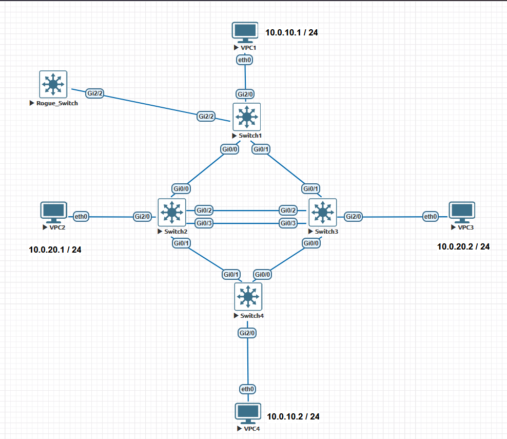
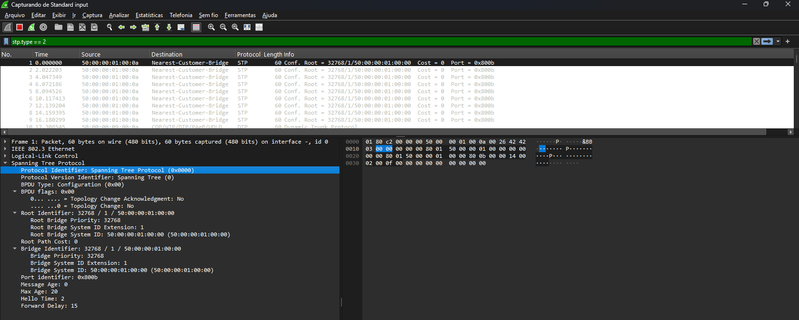
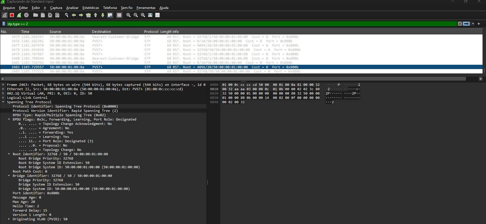

# 🧪 Arquivo — STP: Proteções de Camada 2 (Root Guard, BPDU Guard), EtherChannel e Failover no RSTP

---

## 📌 Sumário

- [🧪 Arquivo — STP: Proteções de Camada 2 (Root Guard, BPDU Guard), EtherChannel e Failover no RSTP](#-arquivo--stp-proteções-de-camada-2-root-guard-bpdu-guard-etherchannel-e-failover-no-rstp)
  - [📌 Sumário](#-sumário)
  - [🎯 Objetivo do Documento](#-objetivo-do-documento)
  - [🏗️ Contexto do Laboratório](#️-contexto-do-laboratório)
  - [🖥️ Topologia e Mapeamento de Interfaces](#️-topologia-e-mapeamento-de-interfaces)
  - [Parte 1 — Agregação de Enlaces (EtherChannel) e Comportamento do RSTP](#parte-1--agregação-de-enlaces-etherchannel-e-comportamento-do-rstp)
    - [Configuração no SW02 e SW03](#configuração-no-sw02-e-sw03)
    - [Verificação do EtherChannel no Spanning Tree](#verificação-do-etherchannel-no-spanning-tree)
      - [Configuração Prática (Aplicar em SW02 e SW03):](#configuração-prática-aplicar-em-sw02-e-sw03)
    - [💡 Por que o RSTP converge em menos de um segundo?](#-por-que-o-rstp-converge-em-menos-de-um-segundo)
  - [Parte 2 — Balanceamento de Carga por VLAN (Per-VLAN Load Balancing)](#parte-2--balanceamento-de-carga-por-vlan-per-vlan-load-balancing)
  - [Parte 3 — Mecanismos de Proteção do STP (Root Guard \& BPDU Guard)](#parte-3--mecanismos-de-proteção-do-stp-root-guard--bpdu-guard)
    - [3.1 BPDU Guard nas Portas Edge](#31-bpdu-guard-nas-portas-edge)
    - [Teste Prático e Validação do BPDU Guard](#teste-prático-e-validação-do-bpdu-guard)
    - [3.2 Root Guard — onde usar e onde NÃO usar](#32-root-guard--onde-usar-e-onde-não-usar)
    - [Teste Prático e Validação do Root Guard](#teste-prático-e-validação-do-root-guard)
    - [Correção](#correção)
  - [📋 Resumo de Comandos: Proteções e Troubleshooting Avançado](#-resumo-de-comandos-proteções-e-troubleshooting-avançado)

---

## 🎯 Objetivo do Documento

Este laboratório é a continuação direta do ambiente RSTP (802.1w), focado em aplicar as proteções essenciais de Camada 2 para o exame CCNP ENCOR (350-401) e para ambientes corporativos de alta disponibilidade.

Ao final deste documento, você será capaz de:

- Configurar e validar **EtherChannel (LACP)** integrado ao RSTP, identificando como o algoritmo reduz múltiplos links lógicos a uma única porta lógica para o cálculo do STP.
- Validar o **balanceamento de carga determinístico por VLAN** alterando a prioridade dos Root Bridges.
- Implementar e testar o **BPDU Guard** em portas de acesso/borda para prevenção de loops induzidos por usuários/rogue switches.
- Implementar e testar o **Root Guard** para assegurar a autoridade do Root Bridge na topologia.
- Analisar a convergência sub-segundo durante uma falha real de link (*link flap/failover*) utilizando captura de pacotes via Wireshark.

---

## 🏗️ Contexto do Laboratório

Apenas migrar de STP para RSTP não garante uma rede de Camada 2 totalmente segura e otimizada. Sem os mecanismos adicionais (*Enhancements*):

1. **Injeção de BPDUs maliciosos** ou switches não autorizados podem sequestrar o papel de *Root Bridge*, redirecionando o tráfego da empresa.
2. **Conexões inadvertidas de switches em portas de acesso** podem criar loops locais instantâneos antes da convergência do STP.
3. **Links redundantes paralelos** em vez de agregados consomem portas ativas mantendo interfaces desnecessariamente em estado de bloqueio (*Discarding*).

---

## 🖥️ Topologia e Mapeamento de Interfaces

Mantemos a mesma topologia em anel/losango do laboratório anterior com 4 switches Cisco IOS:

- **SW01 (Root Primary VLAN 10 / Secondary VLAN 20)**
- **SW04 (Root Primary VLAN 20 / Secondary VLAN 10)**
- **SW02 & SW03:** Switches intermediários interligados por um enlace duplo redundante (`Gi0/2` e `Gi0/3`).

---

## Parte 1 — Agregação de Enlaces (EtherChannel) e Comportamento do RSTP

Atualmente, entre o **SW02** e o **SW03**, existem duas conexões físicas (`Gi0/2` e `Gi0/3`). O RSTP coloca uma das portas em estado *Discarding* (Alternate) para evitar loop.

Vamos observar como estão os links nos switches.  

- **SW02**  
  
```ios
SW02#show spanning-tree int g0/2

Vlan                Role Sts Cost      Prio.Nbr Type
------------------- ---- --- --------- -------- --------------------------------
VLAN0010            Desg FWD 4         128.3    P2p
VLAN0020            Desg FWD 4         128.3    P2p
VLAN0050            Desg FWD 4         128.3    P2p
SW02#show spanning-tree int g0/3

Vlan                Role Sts Cost      Prio.Nbr Type
------------------- ---- --- --------- -------- --------------------------------
VLAN0010            Desg FWD 4         128.4    P2p
VLAN0020            Desg FWD 4         128.4    P2p
VLAN0050            Desg FWD 4         128.4    P2p
SW02#
```
  
- **SW03**

```ios
SW03#show spanning-tree int g0/2

Vlan                Role Sts Cost      Prio.Nbr Type
------------------- ---- --- --------- -------- --------------------------------
VLAN0010            Altn BLK 4         128.3    P2p
VLAN0020            Altn BLK 4         128.3    P2p
VLAN0050            Altn BLK 4         128.3    P2p
SW03#show spanning-tree int g0/3

Vlan                Role Sts Cost      Prio.Nbr Type
------------------- ---- --- --------- -------- --------------------------------
VLAN0010            Altn BLK 4         128.4    P2p
VLAN0020            Altn BLK 4         128.4    P2p
VLAN0050            Altn BLK 4         128.4    P2p
SW03#
```

Aqui podemos notar que os links não estão em uso. Do lado do switch **sw02**, as portas estão em **Desg FWD**, ou seja, estão encaminhando. Porém no outro lado do link, no switch **sw03**, as portas estão **Altn BLK**, ou seja bloqueadas.  

**O Impacto Técnico (O Desperdício)**  
  
- **Desperdício de Link:** Conforme podemos notar, os links físicos não estão em uso para tráfego de dados. Eles estão lá apenas recebendo BPDUs (ouvindo a rede), enquanto todo o tráfego de produção escoa por apenas um lado (ou o STP decide o descarte). O segundo link fica ocioso, servindo estritamente como redundância fria/em espera (standby).

A boa prática recomenda agregar esses links via **LACP (802.3ad)** em uma única interface lógica `Port-Channel 1`.

### Configuração no SW02 e SW03

- **SW02**

```ios
ena
configure terminal
 interface range GigabitEthernet0/2 - 3
  channel-group 1 mode active
  exit
end
```

- **SW03**  

```ios
ena
configure terminal
 interface range GigabitEthernet0/2 - 3
  channel-group 1 mode passive
  exit
end
```

Observe os logs que aparecem na ordem:

- **SW02**

```ios
*Oct 23 02:54:38.680: %LINEPROTO-5-UPDOWN: Line protocol on Interface GigabitEthernet0/2, changed state to down
*Oct 23 02:54:38.690: %LINEPROTO-5-UPDOWN: Line protocol on Interface GigabitEthernet0/3, changed state to down
*Oct 23 02:54:45.998: %EC-5-L3DONTBNDL2: Gi0/3 suspended: LACP currently not enabled on the remote port.
*Oct 23 02:54:46.542: %EC-5-L3DONTBNDL2: Gi0/2 suspended: LACP currently not enabled on the remote port.
```

- **SW03**  
  
```ios
SW03#
*Oct 23 02:55:35.504: %LINEPROTO-5-UPDOWN: Line protocol on Interface GigabitEthernet0/2, changed state to down
*Oct 23 02:55:35.509: %LINEPROTO-5-UPDOWN: Line protocol on Interface GigabitEthernet0/3, changed state to down
*Oct 23 02:55:36.060: %SYS-5-CONFIG_I: Configured from console by console
SW03#
*Oct 23 02:55:42.715: %EC-5-L3DONTBNDL2: Gi0/2 suspended: LACP currently not enabled on the remote port.
*Oct 23 02:55:43.249: %EC-5-L3DONTBNDL2: Gi0/3 suspended: LACP currently not enabled on the remote port.
SW03#
*Oct 23 02:55:58.221: %LINEPROTO-5-UPDOWN: Line protocol on Interface GigabitEthernet0/3, changed state to up
*Oct 23 02:56:00.992: %LINEPROTO-5-UPDOWN: Line protocol on Interface GigabitEthernet0/2, changed state to up
*Oct 23 02:56:05.845: %LINK-3-UPDOWN: Interface Port-channel1, changed state to up
*Oct 23 02:56:06.845: %LINEPROTO-5-UPDOWN: Line protocol on Interface Port-channel1, changed state to up
```

- **SW02**

```ios
SW02#
*Oct 23 02:56:04.825: %LINEPROTO-5-UPDOWN: Line protocol on Interface GigabitEthernet0/3, changed state to up
*Oct 23 02:56:05.749: %LINEPROTO-5-UPDOWN: Line protocol on Interface GigabitEthernet0/2, changed state to up
*Oct 23 02:56:08.732: %LINK-3-UPDOWN: Interface Port-channel1, changed state to up
*Oct 23 02:56:09.733: %LINEPROTO-5-UPDOWN: Line protocol on Interface Port-channel1, changed state to up
```

Só por esses logs podemos observar que as portas caem, o protocolo inicia a negociação até que quando terminam, elas sobem fechando o bundle. Agora temos uma porta lógica **Po1**. Vamos executar o comando de verificação do bundle:

- **show etherchannel summary**

**SW02**  

```ios
SW02#show etherchannel summary
Flags:  D - down        P - bundled in port-channel
        I - stand-alone s - suspended
        H - Hot-standby (LACP only)
        R - Layer3      S - Layer2
        U - in use      N - not in use, no aggregation
        f - failed to allocate aggregator

        M - not in use, minimum links not met
        m - not in use, port not aggregated due to minimum links not met
        u - unsuitable for bundling
        w - waiting to be aggregated
        d - default port

        A - formed by Auto LAG


Number of channel-groups in use: 1
Number of aggregators:           1

Group  Port-channel  Protocol    Ports
------+-------------+-----------+-----------------------------------------------
1      Po1(SU)         LACP      Gi0/2(P)    Gi0/3(P)

SW02#
```

**SW03**  

```ios
SW03#show etherchannel summary
Flags:  D - down        P - bundled in port-channel
        I - stand-alone s - suspended
        H - Hot-standby (LACP only)
        R - Layer3      S - Layer2
        U - in use      N - not in use, no aggregation
        f - failed to allocate aggregator

        M - not in use, minimum links not met
        m - not in use, port not aggregated due to minimum links not met
        u - unsuitable for bundling
        w - waiting to be aggregated
        d - default port

        A - formed by Auto LAG


Number of channel-groups in use: 1
Number of aggregators:           1

Group  Port-channel  Protocol    Ports
------+-------------+-----------+-----------------------------------------------
1      Po1(SU)         LACP      Gi0/2(P)    Gi0/3(P)

SW03#
```

Com isso conseguimos confirmar que conseguimos agrupar as portas G0/2 e G0/3 nos dois switches em uma porta logica que está em Layer2.  
  
### Verificação do EtherChannel no Spanning Tree

Agora que fizemos essa agregação de portas, é a hora de verificarmos como o spanning-tree vai tratar isso.
  
Após criar o Port-Channel 1, execute o comando de verificação para observar como o RSTP enxerga o novo enlace:

```ios
show spanning-tree interface Port-channel 1
```

- **SW02**

```ios
SW02#show spanning-tree interface Port-channel 1

Vlan                Role Sts Cost      Prio.Nbr Type
------------------- ---- --- --------- -------- --------------------------------
VLAN0010            Desg FWD 3         128.65   P2p
VLAN0020            Desg FWD 3         128.65   P2p
VLAN0050            Desg FWD 3         128.65   P2p
SW02#
```

- **SW03**

```ios
SW03#show spanning-tree interface Port-channel 1

Vlan                Role Sts Cost      Prio.Nbr Type
------------------- ---- --- --------- -------- --------------------------------
VLAN0010            Altn BLK 3         128.65   P2p
VLAN0020            Altn BLK 3         128.65   P2p
VLAN0050            Altn BLK 3         128.65   P2p
SW03#
```

**⚠️ Observação sobre a Configuração do EtherChannel (Port-Channel 1):**

Quando criamos a interface lógica `Port-channel 1` agrupando as portas físicas (`Gi0/2` e `Gi0/3`), é fundamental lembrar que **o Cisco IOS não herda automaticamente as configurações de Camada 2** que estavam aplicadas nas interfaces individuais. 

- **O que acontece se esquecermos?** As portas físicas agrupadas podem voltar ao comportamento padrão (cair na VLAN nativa 1 ou permitir todas as VLANs), quebrando a segmentação de segurança do laboratório.
- **A Regra de Ouro:** Sempre aplique os parâmetros de Camada 2 (modo trunk, encapsulamento dot1q, VLAN nativa dedicada e o *pruning* manual das VLANs permitidas) **diretamente na interface lógica (`interface Port-channel 1`)**. O próprio sistema operacional se encarrega de propagar e aplicar essas configurações em todas as portas físicas que compõem o bundle.

#### Configuração Prática (Aplicar em SW02 e SW03):

```ios
ena
configure terminal
 interface Port-channel 1
  switchport trunk encapsulation dot1q
  switchport mode trunk
  switchport trunk native vlan 50
  switchport trunk allowed vlan 10,20,50
  exit
end
```

### 💡 Por que o RSTP converge em menos de um segundo?

Diferente do STP 802.1D, o **RSTP** não espera o timer de Forward Delay. Ele usa dois bits de flag no BPDU — Proposal (Proposta) e Agreement (Concordância) — para completar uma sincronização rápida entre switches vizinhos. O switch upstream envia Proposal, o downstream sincroniza outras portas e responde com Agreement, e então a porta upstream entra imediatamente em Forwarding. Todo o processo leva apenas alguns poucos segundos.

## Parte 2 — Balanceamento de Carga por VLAN (Per-VLAN Load Balancing)

Como vimos até aqui, não é uma boa prática não escolher o root da nossa rede. Pode ser que o protocolo não escolha o equipamento ideal.
  
Com as instâncias do Rapid-PVST+ ativas, configuramos a hierarquia dos Root Bridges de forma cruzada:

- SW01: Raiz para VLAN 10.
- SW04: Raiz para VLAN 20.
  
Primeiro vamos verificar quem é o root por vlan. Vamos entrar no switch **SW01** e executar o comando:

- **show spanning-tree root**

```ios
SW01#show spanning-tree root

                                        Root    Hello Max Fwd
Vlan                   Root ID          Cost    Time  Age Dly  Root Port
---------------- -------------------- --------- ----- --- ---  ------------
VLAN0001         32769 5000.0001.0000         0    2   20  15
VLAN0010         32778 5000.0001.0000         0    2   20  15
VLAN0020         32788 5000.0001.0000         0    2   20  15
VLAN0050         32818 5000.0001.0000         0    2   20  15
```

```ios
SW01#show spanning-tree

VLAN0001
  Spanning tree enabled protocol rstp
  Root ID    Priority    32769
             Address     5000.0001.0000
             This bridge is the root
             Hello Time   2 sec  Max Age 20 sec  Forward Delay 15 sec

  Bridge ID  Priority    32769  (priority 32768 sys-id-ext 1)
             Address     5000.0001.0000
             Hello Time   2 sec  Max Age 20 sec  Forward Delay 15 sec
             Aging Time  300 sec

Interface           Role Sts Cost      Prio.Nbr Type
------------------- ---- --- --------- -------- --------------------------------
Gi0/2               Desg FWD 4         128.3    P2p
Gi0/3               Desg FWD 4         128.4    P2p
Gi1/0               Desg FWD 4         128.5    P2p
Gi1/1               Desg FWD 4         128.6    P2p
Gi1/2               Desg FWD 4         128.7    P2p
Gi1/3               Desg FWD 4         128.8    P2p
Gi2/1               Desg FWD 4         128.10   P2p
Gi2/2               Desg FWD 4         128.11   P2p
...
```

Comparando os mac-address, podemos notar que o switch **SW01** é o root de todas as vlans. Precisamos alterar isso para podermos aproveitar melhor o uso de links.

- **SW01**

```ios
ena
conf t
spanning-tree vlan 10 priority 0
spanning-tree vlan 20 priority 4096
end
```

- **SW04**

```ios
ena
conf t
spanning-tree vlan 10 priority 4096
spanning-tree vlan 20 priority 0
end
```

Agora vamos verificar como ficou a situação.

- **SW01**  

```ios
SW01#show spanning-tree vlan 10

VLAN0010
  Spanning tree enabled protocol rstp
  Root ID    Priority    10
             Address     5000.0001.0000
             This bridge is the root
             Hello Time   2 sec  Max Age 20 sec  Forward Delay 15 sec

  Bridge ID  Priority    10     (priority 0 sys-id-ext 10)
             Address     5000.0001.0000
             Hello Time   2 sec  Max Age 20 sec  Forward Delay 15 sec
             Aging Time  300 sec

Interface           Role Sts Cost      Prio.Nbr Type
------------------- ---- --- --------- -------- --------------------------------
Gi0/0               Desg FWD 4         128.1    P2p
Gi0/1               Desg FWD 4         128.2    P2p
Gi2/0               Desg FWD 4         128.9    P2p Edge


SW01#show spanning-tree vlan 20

VLAN0020
  Spanning tree enabled protocol rstp
  Root ID    Priority    20
             Address     5000.0004.0000
             Cost        8
             Port        1 (GigabitEthernet0/0)
             Hello Time   2 sec  Max Age 20 sec  Forward Delay 15 sec

  Bridge ID  Priority    4116   (priority 4096 sys-id-ext 20)
             Address     5000.0001.0000
             Hello Time   2 sec  Max Age 20 sec  Forward Delay 15 sec
             Aging Time  300 sec

Interface           Role Sts Cost      Prio.Nbr Type
------------------- ---- --- --------- -------- --------------------------------
Gi0/0               Root FWD 4         128.1    P2p
Gi0/1               Altn BLK 4         128.2    P2p


SW01#
```

- **SW04**  

```ios
SW04#show spanning-tree vlan 10

VLAN0010
  Spanning tree enabled protocol rstp
  Root ID    Priority    10
             Address     5000.0001.0000
             Cost        8
             Port        2 (GigabitEthernet0/1)
             Hello Time   2 sec  Max Age 20 sec  Forward Delay 15 sec

  Bridge ID  Priority    4106   (priority 4096 sys-id-ext 10)
             Address     5000.0004.0000
             Hello Time   2 sec  Max Age 20 sec  Forward Delay 15 sec
             Aging Time  300 sec

Interface           Role Sts Cost      Prio.Nbr Type
------------------- ---- --- --------- -------- --------------------------------
Gi0/0               Altn BLK 4         128.1    P2p
Gi0/1               Root FWD 4         128.2    P2p
Gi2/0               Desg FWD 4         128.9    P2p Edge


SW04#show spanning-tree vlan 20

VLAN0020
  Spanning tree enabled protocol rstp
  Root ID    Priority    20
             Address     5000.0004.0000
             This bridge is the root
             Hello Time   2 sec  Max Age 20 sec  Forward Delay 15 sec

  Bridge ID  Priority    20     (priority 0 sys-id-ext 20)
             Address     5000.0004.0000
             Hello Time   2 sec  Max Age 20 sec  Forward Delay 15 sec
             Aging Time  300 sec

Interface           Role Sts Cost      Prio.Nbr Type
------------------- ---- --- --------- -------- --------------------------------
Gi0/0               Desg FWD 4         128.1    P2p
Gi0/1               Desg FWD 4         128.2    P2p


SW04#
```

Com isso podemos verificar que conseguimos atingir o nosso objetivo.

## Parte 3 — Mecanismos de Proteção do STP (Root Guard & BPDU Guard)

### 3.1 BPDU Guard nas Portas Edge
  
O BPDU Guard previne que dispositivos não autorizados ou switches trazidos por usuários (rogue switches) sejam conectados em portas de acesso onde o **portfast edge** está ativo.  
  
Se qualquer BPDU for recebido em uma porta com BPDU Guard ativo, a interface é imediatamente colocada no estado err-disable.  
  
> **⚠️ Atenção: Portas Edge e BPDU Guard não são a mesma coisa**
>
> Uma porta configurada como Edge perde essa condição operacional ao receber uma BPDU e passa a participar do processo normal do STP. Isso, por si só, não significa que a porta será bloqueada.
>
> Já o **BPDU Guard** é um mecanismo de proteção que, quando habilitado, coloca a porta em estado *err-disabled* ao receber uma BPDU, exigindo uma ação de recuperação conforme a configuração do equipamento.

### Teste Prático e Validação do BPDU Guard

No mundo real, um erro comum de projeto é aplicar proteções como o *BPDU Guard* ou alterar VLANs nativas em apenas algumas portas específicas (como em uma porta Edge isolada), esquecendo-se de que portas de distribuição/acesso adjacentes mantidas no padrão de fábrica representam uma porta de entrada vulnerável.  

Para demonstrar este cenário de risco, vamos manter o nosso VPC conectado de forma segura na interface `Gi2/0` e utilizar uma porta adjacente não protegida (`Gi2/2`) do **SW01** conectada diretamente ao nosso switch rogue, deixando ambas com as configurações padrão de fábrica (sem portfast, com VLAN nativa 1 e sem proteções ativas).  
  
Não vou demonstrar aqui as configurações do switch **sw_rogue** para nosso laboratório não ficar grande. Mas o que vou fazer é o seguinte:

- Ligar o switch **sw_rogue** no switch **SW01**, ambos na porta `Gi2/2` com as configurações padrão
- Criar as vlans 10, 20 e 50 no switch **sw_rogue**
- Diminuir as prioridades das vlans 10, 20 e 50 para **0** em **sw_rogue**
- Trocar a versão do **PVSTP+** para **RAPID-PVSTP+**

Nosso cenário ficou assim agora:


  
Como o protocolo **DTP** vem ativo por padrão, as duas portas começam a negociação automaticamente e formam o tronco. Com isso, as instâncias de stp para todas as vlans ficam ativas.

Vou demonstrar com algumas capturas via wireshark na porta Gi2/2 de **SW02**.



Podemos observar que estamos no **PVST+**.



Agora podemos ver que mudamos para o **RSTP**.

>💡 **Anatomia do BPDU RSTP:** O segredo da convergência rápida
>
> Observe a captura do Wireshark acima. Diferente do STP tradicional, o BPDU do RSTP (Versão 2) adiciona novos bits de flag que permitem uma negociação ativa entre os switches.
>
> Na imagem, veja os campos Agreement (Acordo) e Proposal (Proposta). Eles são o coração do RSTP. Em vez de esperar os timers de 30 segundos, o switch upstream envia um BPDU com o bit Proposal ativo; o switch downstream recebe, sincroniza suas portas e responde com o bit Agreement ativo. Com essa simples "conversa", a porta entra em estado de Forwarding (Encaminhamento) em milissegundos.
>
> Note também o campo Port Role indicando Designated (3), que dita o papel daquela porta na topologia. É através desses bits que o RSTP calcula a topologia de forma muito mais ágil.

Vamos analisar as interfaces tronco no switch **sw_rogue**.

```ios
rogue#show int trunk

Port        Mode             Encapsulation  Status        Native vlan
Gi2/2       on               802.1q         trunking      1

Port        Vlans allowed on trunk
Gi2/2       1-4094

Port        Vlans allowed and active in management domain
Gi2/2       1,10,20,50

Port        Vlans in spanning tree forwarding state and not pruned
Gi2/2       1,10,20,50
rogue#
```

Com isso podemos confirmar que o DTP forma o tronco automáticamente. Isso é um **risco alto**. Como já escolhemos os roots, agora se eu alterar as prioridades das instâncias para 0, vamos causar uma nova eleição e pode ser que o switch rogue se torne o **root** da rede.  
  
```ios
rogue(config)#spanning-tree vlan 10 priority 0
rogue(config)#spanning-tree vlan 20 priority 0
rogue(config)#spanning-tree vlan 50 priority 0
rogue(config)#end
rogue#
*Oct 23 19:00:51.389: %SYS-5-CONFIG_I: Configured from console by console
rogue#show spanning-tree

VLAN0001
  Spanning tree enabled protocol rstp
  Root ID    Priority    32769
             Address     5000.0001.0000
             Cost        4
             Port        11 (GigabitEthernet2/2)
             Hello Time   2 sec  Max Age 20 sec  Forward Delay 15 sec

  Bridge ID  Priority    32769  (priority 32768 sys-id-ext 1)
             Address     5000.0009.0000
             Hello Time   2 sec  Max Age 20 sec  Forward Delay 15 sec
             Aging Time  300 sec

Interface           Role Sts Cost      Prio.Nbr Type
------------------- ---- --- --------- -------- --------------------------------
Gi0/0               Desg FWD 4         128.1    P2p
Gi0/1               Desg FWD 4         128.2    P2p
Gi0/2               Desg FWD 4         128.3    P2p
Gi0/3               Desg FWD 4         128.4    P2p
Gi1/0               Desg FWD 4         128.5    P2p
Gi1/1               Desg FWD 4         128.6    P2p
Gi1/2               Desg FWD 4         128.7    P2p

Interface           Role Sts Cost      Prio.Nbr Type
------------------- ---- --- --------- -------- --------------------------------

Gi1/3               Desg FWD 4         128.8    P2p
Gi2/0               Desg FWD 4         128.9    P2p
Gi2/1               Desg FWD 4         128.10   P2p
Gi2/2               Root FWD 4         128.11   P2p
Gi2/3               Desg FWD 4         128.12   P2p
Gi3/0               Desg FWD 4         128.13   P2p
Gi3/1               Desg FWD 4         128.14   P2p
Gi3/2               Desg FWD 4         128.15   P2p
Gi3/3               Desg FWD 4         128.16   P2p


VLAN0010
  Spanning tree enabled protocol rstp
  Root ID    Priority    10
             Address     5000.0001.0000
             Cost        4
             Port        11 (GigabitEthernet2/2)
             Hello Time   2 sec  Max Age 20 sec  Forward Delay 15 sec

  Bridge ID  Priority    10     (priority 0 sys-id-ext 10)
             Address     5000.0009.0000
             Hello Time   2 sec  Max Age 20 sec  Forward Delay 15 sec
             Aging Time  300 sec

Interface           Role Sts Cost      Prio.Nbr Type
------------------- ---- --- --------- -------- --------------------------------
Gi2/2               Root FWD 4         128.11   P2p


VLAN0020
  Spanning tree enabled protocol rstp
  Root ID    Priority    20
             Address     5000.0009.0000
             This bridge is the root
             Hello Time   2 sec  Max Age 20 sec  Forward Delay 15 sec

  Bridge ID  Priority    20     (priority 0 sys-id-ext 20)
             Address     5000.0009.0000
             Hello Time   2 sec  Max Age 20 sec  Forward Delay 15 sec
             Aging Time  300 sec

Interface           Role Sts Cost      Prio.Nbr Type
------------------- ---- --- --------- -------- --------------------------------
Gi2/2               Desg FWD 4         128.11   P2p


VLAN0050
  Spanning tree enabled protocol rstp
  Root ID    Priority    50
             Address     5000.0009.0000
             This bridge is the root
             Hello Time   2 sec  Max Age 20 sec  Forward Delay 15 sec

  Bridge ID  Priority    50     (priority 0 sys-id-ext 50)
             Address     5000.0009.0000
             Hello Time   2 sec  Max Age 20 sec  Forward Delay 15 sec
             Aging Time  300 sec

Interface           Role Sts Cost      Prio.Nbr Type
------------------- ---- --- --------- -------- --------------------------------
Gi2/2               Desg FWD 4         128.11   P2p


rogue#
```

Vamos desligar um pouco o switch rogue e ativar o **BPDU GUARD** no switch **SW01**.

```ios
SW01(config)#spanning-tree portfast edge default
%Warning: this command enables portfast by default on all interfaces. You
 should now disable portfast explicitly on switched ports leading to hubs,
 switches and bridges as they may create temporary bridging loops.

SW01(config)#
```

Vamos ligar o switch **SW_ROGUE**. Assim que ligarmos o switch rogue injetando BPDUs ou fechando um loop nessa porta sem proteção, observe o comportamento imediato da rede e as mensagens de log geradas pelo IOS:

```ios
%SPANTREE-2-BLOCK_BPDUGUARD: Received BPDU on port Gi2/2 with BPDU Guard enabled. Disabling port.
%LINK-3-UPDOWN: Interface GigabitEthernet2/2, changed state to administratively down
```

No nosso cenário, eu tive que ligar e desligar a interface. Mas podemos notar que a proteção funcionou.

```ios
SW01#conf t
Enter configuration commands, one per line.  End with CNTL/Z.
SW01(config)#int g2/0
SW01(config-if)#int g2/2
SW01(config-if)#shut
SW01(config-if)#
*Oct 23 19:23:44.002: %LINK-5-CHANGED: Interface GigabitEthernet2/2, changed state to administratively down
*Oct 23 19:23:45.002: %LINEPROTO-5-UPDOWN: Line protocol on Interface GigabitEthernet2/2, changed state to down
SW01(config-if)#no shut
SW01(config-if)#
*Oct 23 19:23:52.336: %SPANTREE-2-BLOCK_BPDUGUARD: Received BPDU on port GigabitEthernet2/2 with BPDU Guard enabled. Disabling port.end
SW01#
*Oct 23 19:23:52.336: %PM-4-ERR_DISABLE: bpduguard error detected on Gi2/2, putting Gi2/2 in err-disable state
*Oct 23 19:23:53.561: %SYS-5-CONFIG_I: Configured from console by console
*Oct 23 19:23:53.749: %LINK-3-UPDOWN: Interface GigabitEthernet2/2, changed state to down
```

Vamos analisar como ficou o estado da porta **G2/2** no switch **SW01**

```ios
SW01#show ip int br
Interface              IP-Address      OK? Method Status                Protocol
....
GigabitEthernet2/0     unassigned      YES unset  up                    up
GigabitEthernet2/1     unassigned      YES unset  up                    up
GigabitEthernet2/2     unassigned      YES unset  down                  down
GigabitEthernet2/3     unassigned      YES unset  up                    up
.....

SW01#show int g2/2
GigabitEthernet2/2 is down, line protocol is down (err-disabled)
  Hardware is iGbE, address is 5000.0001.000a (bia 5000.0001.000a)
  MTU 1500 bytes, BW 1000000 Kbit/sec, DLY 10 usec,
     reliability 255/255, txload 1/255, rxload 1/255
  Encapsulation ARPA, loopback not set
  Keepalive set (10 sec)
  Auto Duplex, Auto Speed, link type is auto, media type is unknown media type
  output flow-control is unsupported, input flow-control is unsupported
  Auto-duplex, Auto-speed, link type is auto, media type is RJ45
  input flow-control is off, output flow-control is unsupported
....
```

```ios
SW01#show interfaces status err-disabled

Port      Name               Status       Reason               Err-disabled Vlans
Gi2/2                        err-disabled bpduguard
SW01#
```

A porta entra em **err-disable** e **down**.

### 3.2 Root Guard — onde usar e onde NÃO usar

O Root Guard garante que o Root Bridge legítimo, configurado no centro da rede, não perca a posição para um switch externo ou mal configurado que anuncie uma prioridade melhor (valor menor). Se a porta receber um BPDU superior, ela entra em **root-inconsistent**: fica **bloqueada naquela VLAN**, com o link ainda *up*, e volta sozinha quando os BPDUs superiores deixam de chegar.

> 💡 **Regra de aplicação:** use o Root Guard em **portas designadas, em todas as VLANs, que apontem para longe do root**. Antes de aplicar, pergunte: *"por esta porta, o root legítimo pode chegar até mim em alguma VLAN?"* Se a resposta for sim, **não use**.

| ✅ **Onde usar**                                                            | ❌ **Onde NÃO usar**                                                                         |
| :---                                                                        | :---                                                                                          |
| Downlinks da distribuição/core para os switches de acesso (access ou trunk) | Uplinks e **root ports**, ou seja, portas que levam ao root                                   |
| Links para switches de terceiros ou de outra área                           | Portas designadas em uma VLAN e **root port em outra** (balanceamento de VLANs, MST)          |
| Portas onde alguém pode plugar um switch (nesse caso o BPDU Guard costuma ser a proteção mais forte) | Links entre o root primário e o secundário (podem bloquear o failover projetado) |
|                                                                             | Portas com **Loop Guard** (os dois não convivem na mesma porta)                               |

> ⚠️ **Neste lab:** como as VLANs estão balanceadas (SW01 root das VLANs 10/50 e SW04 root da VLAN 20), as portas `Gi0/0-1` de cada um são *root port* na VLAN do outro. Vou aplicar o Root Guard nelas **de propósito**, contrariando a regra, para mostrar o que acontece e como corrigir.

**Configuração aplicada no SW01 e SW04 (propositalmente ampla — anti-padrão)**  

```ios
ena
configure terminal
 interface range GigabitEthernet0/0 - 1
  spanning-tree guard root
  exit
end
```

### Teste Prático e Validação do Root Guard

Não houve injeção de BPDU por um switch invasor. O bloqueio apareceu **assim que o comando foi aplicado**. Os BPDUs "superiores" vinham do **root legítimo** de cada VLAN, e o Root Guard os tratou como intrusos. Vamos analisar os logs nos switches.

- **SW01**

```ios
ena
conf t
configure terminal
interface range gigabitEthernet 0/0-1
SW01(config-if-range)#spanning-tree guard root

*Oct 23 20:10:52.740: %SPANTREE-2-ROOTGUARD_CONFIG_CHANGE: Root guard enabled on port GigabitEthernet0/0.
*Oct 23 20:10:52.749: %SPANTREE-2-ROOTGUARD_CONFIG_CHANGE: Root guard enabled on port GigabitEthernet0/1.
*Oct 23 20:10:52.754: %SPANTREE-2-ROOTGUARD_BLOCK: Root guard blocking port GigabitEthernet0/0 on VLAN0020.
*Oct 23 20:11:24.400: %SPANTREE-2-ROOTGUARD_UNBLOCK: Root guard unblocking port GigabitEthernet0/1 on VLAN0020.
```

- **SW04**

```ios
ena
configure terminal
interface range GigabitEthernet0/0 - 1
spanning-tree guard root
exit

*Oct 23 20:11:12.436: %SPANTREE-2-ROOTGUARD_CONFIG_CHANGE: Root guard enabled on port GigabitEthernet0/0.
*Oct 23 20:11:12.441: %SPANTREE-2-ROOTGUARD_CONFIG_CHANGE: Root guard enabled on port GigabitEthernet0/1.
*Oct 23 20:11:12.594: %SPANTREE-2-ROOTGUARD_BLOCK: Root guard blocking port GigabitEthernet0/1 on VLAN0020.
*Oct 23 20:11:14.120: %SPANTREE-2-ROOTGUARD_BLOCK: Root guard blocking port GigabitEthernet0/0 on VLAN0010.
```

**Verificação no SW01:**

```ios
SW01#show spanning-tree inconsistentports

Name                 Interface                Inconsistency
-------------------- ------------------------ ------------------
VLAN0020             GigabitEthernet0/0       Root Inconsistent
VLAN0020             GigabitEthernet0/1       Root Inconsistent

Number of inconsistent ports (segments) in the system : 2
```

**Verificação no SW04:**

```ios
SW04#show spanning-tree inconsistentports

Name                 Interface                Inconsistency
-------------------- ------------------------ ------------------
VLAN0010             GigabitEthernet0/0       Root Inconsistent
VLAN0010             GigabitEthernet0/1       Root Inconsistent
VLAN0050             GigabitEthernet0/0       Root Inconsistent
VLAN0050             GigabitEthernet0/1       Root Inconsistent

Number of inconsistent ports (segments) in the system : 4
```

Na saída do SW04, o `show spanning-tree` mostra as portas como `BKN*` com `*ROOT_Inc` (Broken / root-inconsistent), e o switch passa a se declarar root das VLANs 10 e 50 por ter descartado os BPDUs do SW01. Resultado: o **VPC4 perde o caminho para o VPC1**.

### Correção

O Root Guard está nas portas erradas. Removemos nas duas pontas:

- **SW01**

```ios
SW01(config)# interface range GigabitEthernet0/0 - 1
SW01(config-if-range)# no spanning-tree guard root

*Oct 25 03:11:19.559: %SPANTREE-2-ROOTGUARD_CONFIG_CHANGE: Root guard disabled on port GigabitEthernet0/0.
*Oct 25 03:11:19.559: %SPANTREE-2-ROOTGUARD_UNBLOCK: Root guard unblocking port GigabitEthernet0/0 on VLAN0020.
*Oct 25 03:11:19.564: %SPANTREE-2-ROOTGUARD_CONFIG_CHANGE: Root guard disabled on port GigabitEthernet0/1.
*Oct 25 03:11:20.934: %SYS-5-CONFIG_I: Configured from console by console
```

- **SW04**

```ios
SW04(config)# interface range GigabitEthernet0/0 - 1
SW04(config-if-range)# no spanning-tree guard root

*Oct 25 03:13:10.388: %SPANTREE-2-ROOTGUARD_CONFIG_CHANGE: Root guard disabled on port GigabitEthernet0/0.
*Oct 25 03:13:10.388: %SPANTREE-2-ROOTGUARD_UNBLOCK: Root guard unblocking port GigabitEthernet0/0 on VLAN0010.
*Oct 25 03:13:10.393: %SPANTREE-2-ROOTGUARD_CONFIG_CHANGE: Root guard disabled on port GigabitEthernet0/1.
*Oct 25 03:13:11.642: %SYS-5-CONFIG_I: Configured from console by console
SW04#
```

As portas voltam sozinhas em alguns segundos. Verificação:

```ios
SW04#show spanning-tree inconsistentports

Name                 Interface                Inconsistency
-------------------- ------------------------ ------------------

Number of inconsistent ports (segments) in the system : 0

SW04#
```

> 💡 **Lição:** o Root Guard foi aplicado em portas que levam ao root legítimo, e por isso bloqueou a rede que deveria proteger. O lugar correto seria uma porta designada voltada para fora, como a que liga um switch de terceiro. No lab, essa porta é a `Gi2/2` do SW01, que já é protegida pelo BPDU Guard.

## 📋 Resumo de Comandos: Proteções e Troubleshooting Avançado
  
| **Objetivo**                        | **Comando (Cisco IOS)**                          | **Descrição / O que verificar**                                                    |
| :---                                | :---                                             | :---                                                                               |
| **Ativar BPDU Guard Global**      | `spanning-tree portfast edge bpduguard default`  | Ativa a proteção automaticamente em todas as portas configuradas como Edge/PortFast. |
| **Ativar Root Guard na Interface**  | `spanning-tree guard root`                       | Bloqueia a porta caso ela receba BPDUs superiores tentando assumir o Root Bridge.  |
| **Verificar Portas Inconsistentes** | `show spanning-tree inconsistentports`           | Lista portas bloqueadas por Root Guard ou Loop Guard.                              |
| **Verificar Portas em Err-Disable** | `show interfaces status err-disabled`            | Lista interfaces desativadas pelo BPDU Guard ou outras proteções.                  |
| **Recuperar Porta Err-Disable**     | `shutdown` / `no shutdown`                       | Restaura manualmente uma interface desativada (ou via `errdisable recovery`).      |
| **Verificar EtherChannel no STP**   | `show spanning-tree interface Port-channel <ID>` | Valida o custo e o papel atribuído ao grupo lógico de interfaces agregadas.        |
