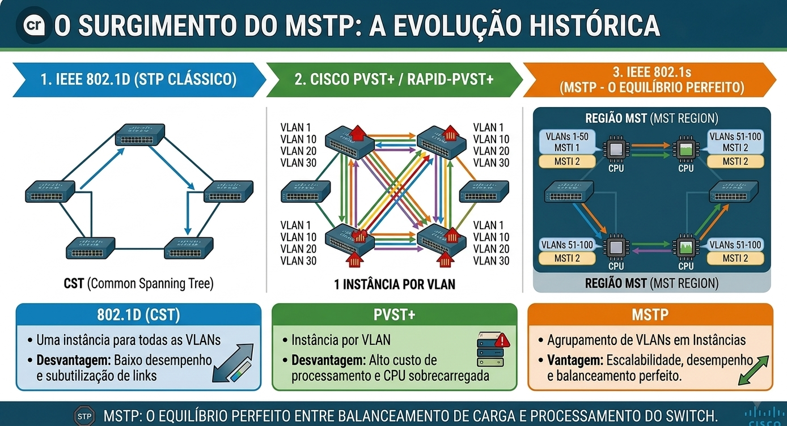
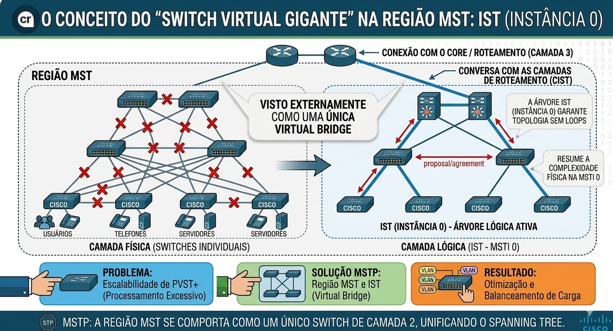
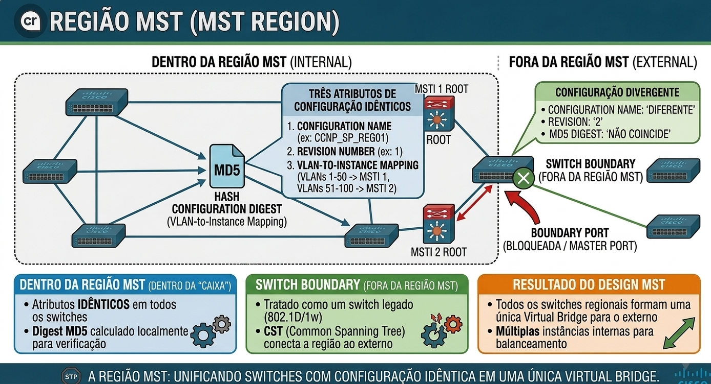
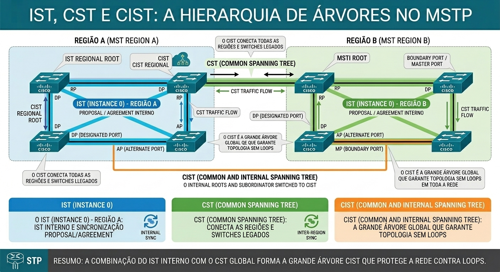
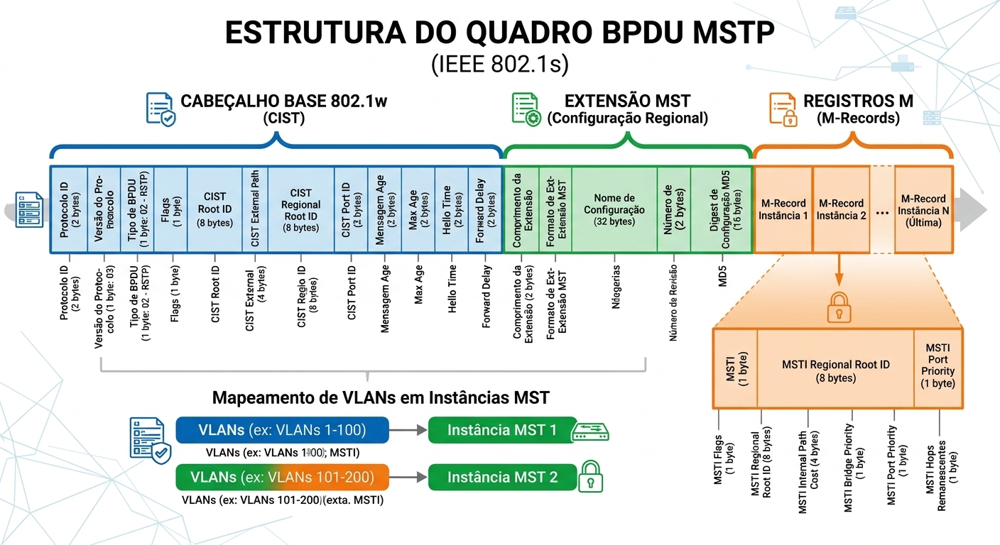
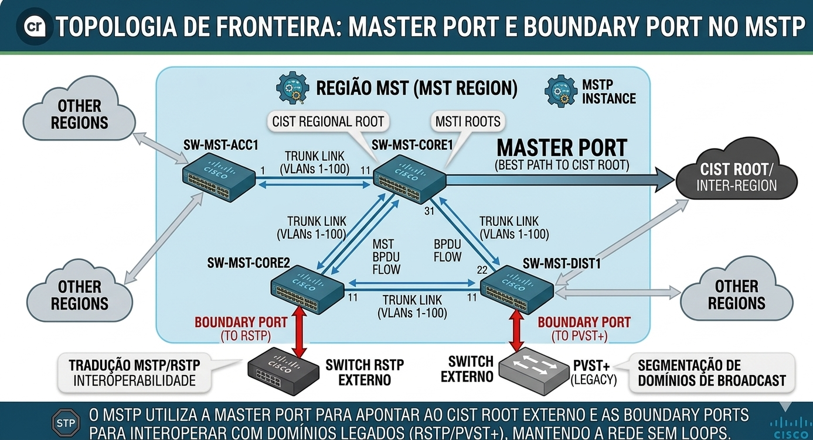
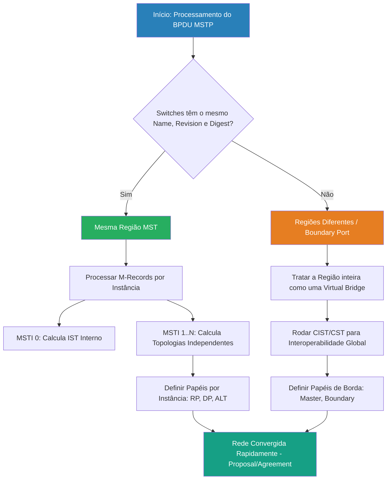

# 🌐 MSTP (IEEE 802.1s): Arquitetura, Regiões e Engenharia de Instâncias

---

## 📋 Sumário

- [🌐 MSTP (IEEE 802.1s): Arquitetura, Regiões e Engenharia de Instâncias](#-mstp-ieee-8021s-arquitetura-regiões-e-engenharia-de-instâncias)
  - [📋 Sumário](#-sumário)
  - [🎯 Objetivo deste Documento](#-objetivo-deste-documento)
  - [🧠 Antes de Começar: O Problema de Escala L2](#-antes-de-começar-o-problema-de-escala-l2)
  - [📖 Glossário Técnico de Engenharia MSTP](#-glossário-técnico-de-engenharia-mstp)
  - [🏗️ O Surgimento do MSTP: A Evolução Histórica](#️-o-surgimento-do-mstp-a-evolução-histórica)
    - [1. IEEE 802.1D — STP Clássico / CST](#1-ieee-8021d--stp-clássico--cst)
    - [2. Cisco PVST+ / Rapid-PVST+](#2-cisco-pvst--rapid-pvst)
    - [3. IEEE 802.1s — MSTP (Multiple Spanning Tree Protocol)](#3-ieee-8021s--mstp-multiple-spanning-tree-protocol)
  - [💥 Problemas que o MSTP Resolve (e Onde Usar)](#-problemas-que-o-mstp-resolve-e-onde-usar)
    - [✅ Onde o MSTP DEVE ser Utilizado](#-onde-o-mstp-deve-ser-utilizado)
    - [🚫 Onde o MSTP NÃO Deve ser Utilizado](#-onde-o-mstp-não-deve-ser-utilizado)
  - [⚡ Quadro Comparativo: STP vs. RSTP vs. PVST+ vs. MSTP](#-quadro-comparativo-stp-vs-rstp-vs-pvst-vs-mstp)
  - [🧩 A Anatomia do MSTP: Conceitos Fundamentais](#-a-anatomia-do-mstp-conceitos-fundamentais)
    - [💡 **Analogia de Arquitetura: O Conceito do "Switch Virtual Gigante"**](#-analogia-de-arquitetura-o-conceito-do-switch-virtual-gigante)
    - [1. Região MST (MST Region)](#1-região-mst-mst-region)
    - [2. Instâncias MST (MSTI - Multiple Spanning Tree Instance)](#2-instâncias-mst-msti---multiple-spanning-tree-instance)
    - [3. IST, CST e CIST: Entendendo as Árvores Globais](#3-ist-cst-e-cist-entendendo-as-árvores-globais)
  - [🧬 Anatomia do BPDU no MSTP (M-Record)](#-anatomia-do-bpdu-no-mstp-m-record)
  - [🔄 Papéis (Roles) e Estados das Portas no MSTP](#-papéis-roles-e-estados-das-portas-no-mstp)
    - [Estados de Porta (Herdados do RSTP)](#estados-de-porta-herdados-do-rstp)
    - [Novas Nomenclaturas e Papéis de Porta no MSTP](#novas-nomenclaturas-e-papéis-de-porta-no-mstp)
  - [🎨 Algoritmo Operacional e Fluxograma de Decisão MSTP](#-algoritmo-operacional-e-fluxograma-de-decisão-mstp)
    - [💼 Tradução Técnica → Valor para o Negócio](#-tradução-técnica--valor-para-o-negócio)
  - [🧪 Pronto para Testar seu Conhecimento?](#-pronto-para-testar-seu-conhecimento)

---

## 🎯 Objetivo deste Documento

Este documento detalha a arquitetura do **Multiple Spanning Tree Protocol (MSTP / IEEE 802.1s)**, cobrindo os conceitos exigidos no exame **CCNP ENCOR 350-401**. O objetivo é compreender como o MSTP combina o alto desempenho de convergência do RSTP (802.1w) com a otimização de recursos de processamento e memória via agrupamento flexível de VLANs em instâncias lógicas.

---

## 🧠 Antes de Começar: O Problema de Escala L2

Se você tem 1.000 VLANs em uma rede enterprise rodando Cisco Rapid-PVST+:

- O switch precisa processar **1.000 instâncias independentes de Spanning Tree**.
- Ele envia e processa **1.000 BPDUs a cada 2 segundos**.
- A CPU e a memória do switch consomem recursos massivos apenas no **Plano de Controle**.

👉 **O MSTP resolve isso agrupando milhares de VLANs em poucas instâncias lógicas (ex: 2 ou 3 instâncias), mantendo o balanceamento de carga sem sobrecarregar o hardware.**

---

## 📖 Glossário Técnico de Engenharia MSTP

| **Termo** | **Definição Técnica** | **Aplicação CCNP** |
| :--- | :--- | :--- |
| **MSTP (802.1s)** | Multiple Spanning Tree Protocol. Padrão IEEE que mapeia múltiplas VLANs em instâncias de árvore reduzidas. | Solução definitiva para escalabilidade L2 em redes de grande porte e multivendor. |
| **MST Region** | Conjunto de switches adjacentes que compartilham exatamente o mesmo Nome, Digest e Revisão. | Fronteira operacional. Switches fora da região veem a região inteira como uma única Virtual Bridge. |
| **Configuration Name** | Nome de identificação da região MST (String de até 32 caracteres). | Deve ser rigorosamente idêntico em todos os switches da mesma região. |
| **Revision Number** | Número de revisão de 16 bits configurado manualmente. | Enviado no BPDU junto com o Nome e comparado diretamente. **Não** entra no cálculo do Digest. Deve ser idêntico em toda a região. |
| **Configuration Digest** | Hash MD5 gerado automaticamente a partir do mapeamento VLAN-para-Instância. | Garante que os switches têm o mesmo mapeamento sem enviar a tabela de VLANs inteira no BPDU. |
| **IST (Instance 0)** | Internal Spanning Tree. Instância padrão (MSTI 0) dentro de uma região MST. | Contém todas as VLANs não mapeadas para uma MSTI. Calcula a topologia interna da região e estende o CST para dentro dela. Seu BPDU transporta os M-Records das demais MSTIs. |
| **MSTI** | Multiple Spanning Tree Instance. Instâncias criadas pelo usuário (IDs de 1 a 4094) para agrupar VLANs. O padrão limita a 64 MSTIs simultâneas, além do IST. | Usado para fazer balanceamento de carga atrelando blocos de VLANs a diferentes Root Bridges. |
| **CST** | Common Spanning Tree. Árvore lógica que conecta todas as regiões MST e switches 802.1D/1w externos. | Conecta regiões entre si e com a rede legada. |
| **CIST** | Common and Internal Spanning Tree. A combinação do IST dentro das regiões com o CST fora das regiões. | A grande árvore global da rede. |
| **Master Port** | Porta na borda de uma Região MST que conecta a região ao CIST Root externo. | Representa o caminho da região inteira em direção ao CIST Root. |
| **Boundary Port** | Porta localizada na borda da Região MST que se conecta a um switch fora da região ou de outra região. | Ponto de tradução e compatibilidade com PVST+ ou RSTP. |

---

## 🏗️ O Surgimento do MSTP: A Evolução Histórica

Para entender o MSTP, precisamos observar os dois extremos que existiam antes dele:

### 1. IEEE 802.1D — STP Clássico / CST

- **Como funciona:** O Common Spanning Tree (CST) mantém uma única árvore lógica de spanning tree compartilhada pelas VLANs, conforme o modelo clássico considerado aqui.
- **Vantagem:** Modelo operacional simples, com uma única topologia lógica compartilhada.
- **Limitação:** Não permite escolher árvores independentes por VLAN para distribuir o tráfego entre links redundantes. Um link bloqueado pelo CST não encaminha tráfego de dados enquanto permanecer nesse estado.
- **Referência histórica IEEE:** [IEEE 802.1D — histórico de retirada e incorporação ao 802.1Q](https://www.ieee802.org/1/files/public/docs2020/liaison-upnp-8021D-withdrawal-1120-v01.pdf).
- **RFC IETF — MIB de bridges:** [RFC 4188 — Definitions of Managed Objects for Bridges](https://www.rfc-editor.org/rfc/rfc4188.html). Substitui a RFC 1493 e define objetos de gerenciamento, não o protocolo STP em si.
- **Padrão consolidado:** O conteúdo técnico relevante de IEEE 802.1D foi incorporado ao IEEE 802.1Q.

### 2. Cisco PVST+ / Rapid-PVST+

- **Como funciona:** O PVST+ mantém uma instância de spanning tree por VLAN. O Rapid-PVST+ mantém o modelo por VLAN, utilizando mecanismos de convergência rápida baseados no RSTP.
- **Vantagem:** Permite definir raízes e caminhos ativos diferentes por VLAN, possibilitando distribuir o tráfego entre links redundantes quando a topologia e a configuração permitem.
- **Limitação:** Manter uma instância por VLAN aumenta a quantidade de estado de spanning tree e o processamento exigido dos switches conforme cresce o número de VLANs. O impacto depende da plataforma e da escala da rede.
- **Natureza do PVST+:** Implementação Cisco baseada no IEEE 802.1D, com extensões proprietárias.
- **Documentação oficial Cisco:** [STP Configuration Guide — Cisco IOS XE](https://www.cisco.com/c/en/us/td/docs/switches/lan/c9000/lyr2-fwd/stp/stp-configuration-guide/m-stp.html).
- **Padrão IEEE relacionado ao RSTP:** [IEEE 802.1w — Rapid Reconfiguration of Spanning Tree](https://www.ieee802.org/1/pages/802.1w.html). O suplemento foi incorporado ao IEEE 802.1D-2004, cujo conteúdo relevante foi posteriormente incorporado ao IEEE 802.1Q.
- **RFC IETF — MIB de RSTP:** [RFC 4318 — Definitions of Managed Objects for Bridges with Rapid Spanning Tree Protocol](https://www.rfc-editor.org/rfc/rfc4318.html). Trata de objetos de gerenciamento SNMP relacionados ao RSTP; não padroniza o PVST+ da Cisco.

### 3. IEEE 802.1s — MSTP (Multiple Spanning Tree Protocol)

- **Como funciona:** Permite mapear grupos de VLANs para diferentes instâncias de spanning tree, reduzindo a necessidade de manter uma instância independente para cada VLAN.
- **Exemplo:** VLANs 1–100 mapeadas para a instância 1 e VLANs 101–200 mapeadas para a instância 2. A distribuição de raízes e caminhos pode permitir o uso de links redundantes por diferentes grupos de VLANs.
- **Vantagem:** Pode reduzir o número de instâncias em comparação com PVST+/Rapid-PVST+, mantendo a possibilidade de utilizar topologias diferentes para grupos de VLANs.
- **Limitação:** O resultado depende do mapeamento de VLANs, da configuração de raízes, da topologia e da consistência da região MST. O número de instâncias não corresponde simplesmente ao número de VLANs nem garante balanceamento perfeito.
- **Referência histórica IEEE:** [IEEE 802.1s — Multiple Spanning Trees](https://www.ieee802.org/1/pages/802.1s.html).
- **Padrão consolidado:** O conteúdo de MSTP foi incorporado ao IEEE 802.1Q, padrão de bridges e VLANs: [IEEE 802.1Q — página oficial do grupo IEEE 802.1](https://www.ieee802.org/1/pages/802.1Q.html).

---

## 💥 Problemas que o MSTP Resolve (e Onde Usar)

### ✅ Onde o MSTP DEVE ser Utilizado

- **Redes Enterprise de Grande Porte:** Ambientes com centenas ou milhares de VLANs configuradas nos trunks.
- **Ambientes Multivendor:** Redes mistas (Cisco, HP, Aruba, Juniper, Extreme). O MSTP é um padrão aberto IEEE (diferente do PVST+ proprietário).
- **Data Centers com Camada 2 Tradicional:** Onde a CPU dos switches precisa ser preservada para roteamento e serviços críticos.

### 🚫 Onde o MSTP NÃO Deve ser Utilizado

- **Redes Pequenas (< 20 VLANs):** O ganho de CPU é insignificante frente à complexidade de configuração e manutenção.
- **Topologias L3 no Acesso (Routed Access):** Se a rede usa roteamento até o switch de acesso, o STP/MSTP é irrelevante no core.
- **Ambientes de Equipes Não-Especializadas:** A má configuração do Digest/Revisão pode quebrar a região e causar loops ou caminhos sub-ótimos difíceis de diagnosticar.

---

## ⚡ Quadro Comparativo: STP vs. RSTP vs. PVST+ vs. MSTP

| **Atributo**                   | **STP (802.1D)**     | **RSTP (802.1w)**    | **PVST+ / R-PVST+**             | **MSTP (802.1s)**                  |
| :---                           | :---                 | :---                 | :---                            | :---                               |
| **Padrão**                     | IEEE Aberto          | IEEE Aberto          | Proprietário Cisco              | IEEE Aberto                        |
| **Instâncias**                 | 1 (para toda a rede) | 1 (para toda a rede) | 1 por VLAN                      | N Instâncias (Agrupadas)           |
| **Tempo de Convergência**      | Lento (30s - 50s)    | Rápido (< 2s)        | Lento / Rápido                  | Rápido (< 2s - herdado do RSTP)    |
| **Uso de CPU / Memória**       | Muito Baixo          | Muito Baixo          | Proporcional ao número de VLANs | Muito Baixo (Apenas por Instância) |
| **Balanceamento de Carga**     | Não                  | Não                  | Sim                             | Sim                                |
| **Mecanismo de Sincronização** | Timers (Passive)     | Proposal / Agreement | Proposal / Agreement            | Proposal / Agreement               |

---

## 🧩 A Anatomia do MSTP: Conceitos Fundamentais

### 💡 **Analogia de Arquitetura: O Conceito do "Switch Virtual Gigante"**

Antes de destrinchar as regras, pense em uma **Região MST** como uma grande caixa fechada em uma rede hierárquica de 3 camadas (Core, Distribuição e Acesso):

1. **Para o Mundo Externo:** Toda a malha de switches físicos dentro da região é resumida e enxergada externamente como se fosse **um único switch gigante de Camada 2** (uma *Virtual Bridge* unificada).
2. **Por dentro da Região (O IST / MSTI 0):** O protocolo IST roda por baixo dos panos interconectando todos os switches da hierarquia, eliminando loops internos e elegendo a raiz regional.
3. **Fatiando o Tráfego (As MSTIs):** Em vez de criar instâncias separadas por VLAN (o que sobrecarregaria a CPU), você mantém a mesma caixa (a Região) e fatia o tráfego interno usando **Instâncias (MSTIs)**, permitindo o balanceamento de carga ativo-ativo entre os links de distribuição e acesso.

### 1. Região MST (MST Region)

Uma **Região MST** é o conjunto de switches sob o mesmo domínio administrativo. Para que dois switches pertençam à **MESMA** região, eles precisam ter obrigatoriamente **TRÊS ATRIBUTOS IDÊNTICOS**:

1. **Configuration Name** (Nome da região, ex: `REGION_SP`).
2. **Revision Number** (Número de revisão, ex: `1`).
3. **VLAN-to-Instance Mapping** (A tabela exata de qual VLAN pertence a qual instância).

> ⚠️ **IMPACTO EM PRODUÇÃO:**  
> Se um único switch tiver uma VLAN mapeada de forma diferente ou um número de revisão divergente, ele **NÃO** fará parte da região. Ele será tratado como um switch externo (Boundary), quebrando o balanceamento interno!

---

### 2. Instâncias MST (MSTI - Multiple Spanning Tree Instance)

Dentro de uma região, temos as instâncias:

- **MSTI 0 (IST - Internal Spanning Tree):** Instância obrigatória existente por padrão. Por padrão, TODAS as VLANs pertencem à MSTI 0 até que você as remapeie.
- **MSTI 1 a 4094 (IDs):** Instâncias configuradas pelo engenheiro. O padrão limita a **64 MSTIs simultâneas** (+ o IST), pois cada uma ocupa um M-Record no BPDU. Na prática, criam-se apenas **2 ou 3 instâncias** para toda a empresa.

---

### 3. IST, CST e CIST: Entendendo as Árvores Globais

O MSTP trabalha com o conceito de "árvores dentro de árvores":

- **IST (Internal Spanning Tree):** Calcula a topologia lógica **DENTRO** de uma região específica.
- **CST (Common Spanning Tree):** Conecta todas as Regiões MST e switches não-MST (802.1D/1w) na rede global. Trata cada região inteira como se fosse um "único switch gigante" (Virtual Bridge).
- **CIST (Common and Internal Spanning Tree):** É a junção do IST dentro das regiões + CST fora das regiões. Garante a topologia sem loops em **toda a empresa**.

---

## 🧬 Anatomia do BPDU no MSTP (M-Record)

O MSTP otimiza o envio de quadros de controle usando uma estrutura inteligente:

👉 **O MSTP transmite APENAS UM BPDU no link, independentemente da quantidade de instâncias!**

O BPDU base do MSTP carrega as informações da MSTI 0 (IST). No final deste BPDU, o protocolo anexa estruturas chamadas **M-Records (MST Records)** para cada instância adicional (MSTI 1, MSTI 2, etc.).

📌 **Benefício:** Redução brutal do consumo de banda e CPU no envio de mensagens de controle.

---

## 🔄 Papéis (Roles) e Estados das Portas no MSTP

### Estados de Porta (Herdados do RSTP)

- **Discarding:** Descarta dados, não aprende MACs, apenas processa BPDUs.
- **Learning:** Popula a tabela CAM/MAC, mas não encaminha tráfego de dados.
- **Forwarding:** Operação normal (encaminha dados e aprende MACs).

### Novas Nomenclaturas e Papéis de Porta no MSTP

Além dos papéis clássicos do RSTP (**Root Port**, **Designated Port**, **Alternate Port**, **Backup Port**), o MSTP introduz papéis para a comunicação entre regiões:

| **Papel da Porta** | **Significado Operacional**                                                                                                               |
| :---               | :---                                                                                                                                      |
| **Master Port**    | Porta localizada na borda da Região MST que fornece o melhor caminho interno em direção ao **CIST Root** (localizado fora da região).     |
| **Boundary Port**  | Interface localizada na borda da região que se conecta a um switch de outra região MST ou a um switch rodando STP/RSTP/PVST+ tradicional. |

---

## 🎨 Algoritmo Operacional e Fluxograma de Decisão MSTP

### 💼 Tradução Técnica → Valor para o Negócio

A adoção do MSTP impacta diretamente a eficiência e o TCO (Total Cost of Ownership) da infraestrutura:

- Redução de CAPEX/OPEX: Permite utilizar equipamentos de marcas diferentes (multivendor) sem depender de protocolos proprietários.
  
- Estabilidade da CPU dos Core Switches: Evita quedas por overload de processador causadas por milhares de instâncias de PVST+ durante flutuações de rede.
  
- Alta Disponibilidade (SLA): Herda a convergência rápida (sub-segundo a poucos segundos) do RSTP e otimiza a banda com balanceamento de carga ativo-ativo por instância.

## 🧪 Pronto para Testar seu Conhecimento?

Esta Parte 11 estabeleceu toda a fundação conceitual e arquitetural do MSTP.

Antes de avançar para o próximo capítulo, valide sua compreensão dos fundamentos do **Multiple Spanning Tree Protocol (MSTP / IEEE 802.1s)**.

Os simulados foram planejados para reforçar os conceitos estudados, testar seu raciocínio sobre os cenários apresentados e identificar pontos que precisam de revisão antes de avançar para os protocolos seguintes.

👉 **Acesse os simulados de MSTP — Parte 01**

🔗 [Abrir Simulados MSTP — Parte 11](https://alcancil.github.io/Cisco/CCNP%20350-401%20ENCOR/03%20-%20Infrastructure/02%20-%20STP%20(Spanning%20Tree%20Protocol)/24%20-%20MSTP/Arquivos/Simulado/)  

**Simulados temáticos:**  

1. [Evolução do STP ao MSTP: CST, PVST+ e O Equilíbrio Perfeito](https://alcancil.github.io/Cisco/CCNP%20350-401%20ENCOR/03%20-%20Infrastructure/02%20-%20STP%20(Spanning%20Tree%20Protocol)/24%20-%20MSTP/Arquivos/Simulado/01.html)
2. [Anatomia da Região MST: Atributos, Name, Revision e Digest MD5](https://alcancil.github.io/Cisco/CCNP%20350-401%20ENCOR/03%20-%20Infrastructure/02%20-%20STP%20(Spanning%20Tree%20Protocol)/24%20-%20MSTP/Arquivos/Simulado/02.html)
3. [Hierarquia de Árvores: IST, CST e a Grande Árvore CIST](https://alcancil.github.io/Cisco/CCNP%20350-401%20ENCOR/03%20-%20Infrastructure/02%20-%20STP%20(Spanning%20Tree%20Protocol)/22%20-%20MSTP/Arquivos/Simulado/03.html)
4. [Anatomia do BPDU MSTP: Cabeçalho Base e M-Records](https://alcancil.github.io/Cisco/CCNP%20350-401%20ENCOR/03%20-%20Infrastructure/02%20-%20STP%20(Spanning%20Tree%20Protocol)/24%20-%20MSTP/Arquivos/Simulado/04.html)
5. [Topologia de Fronteira: Master Ports e Boundary Ports](https://alcancil.github.io/Cisco/CCNP%20350-401%20ENCOR/03%20-%20Infrastructure/02%20-%20STP%20(Spanning%20Tree%20Protocol)/24%20-%20MSTP/Arquivos/Simulado/05.html)

**Simulado completo de MSTP:** [50 questões — 75 minutos](https://alcancil.github.io/Cisco/CCNP%20350-401%20ENCOR/03%20-%20Infrastructure/02%20-%20STP%20(Spanning%20Tree%20Protocol)/24%20-%20MSTP/Arquivos/Simulado/completo.html)

**📊 Painel de Estatísticas:** [Acompanhe seu desempenho](https://alcancil.github.io/Cisco/CCNP%20350-401%20ENCOR/03%20-%20Infrastructure/02%20-%20STP%20(Spanning%20Tree%20Protocol)/24%20-%20MSTP/Arquivos/Simulado/dashboard.html)

👉 Próximo Passo: Na Parte 12, avançaremos para a Engenharia Avançada de MSTP, cobrindo a Interoperabilidade com PVST+, a dinâmica de TCN no MSTP, o Hardening completo e o Guia de Comandos e Análise de Captura (CLI + Wireshark)!