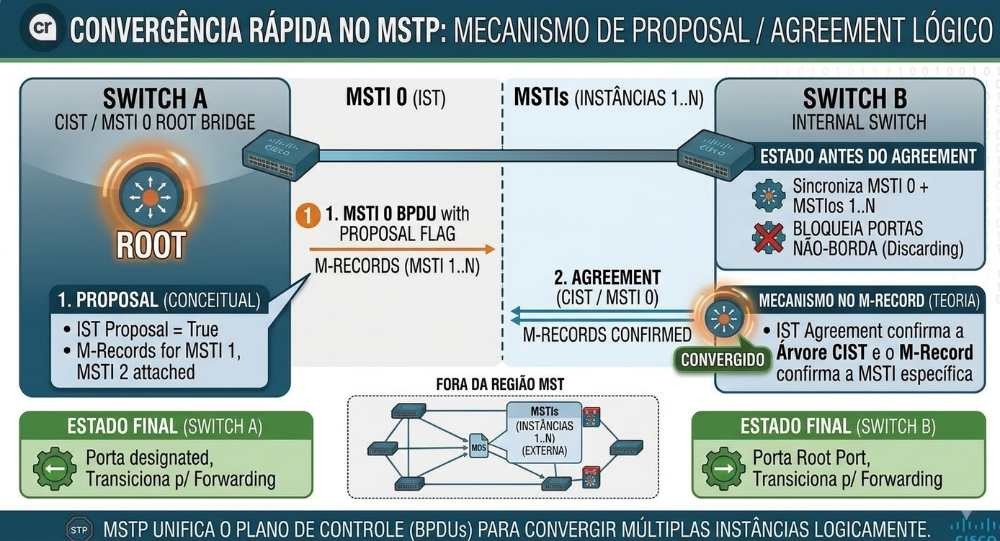
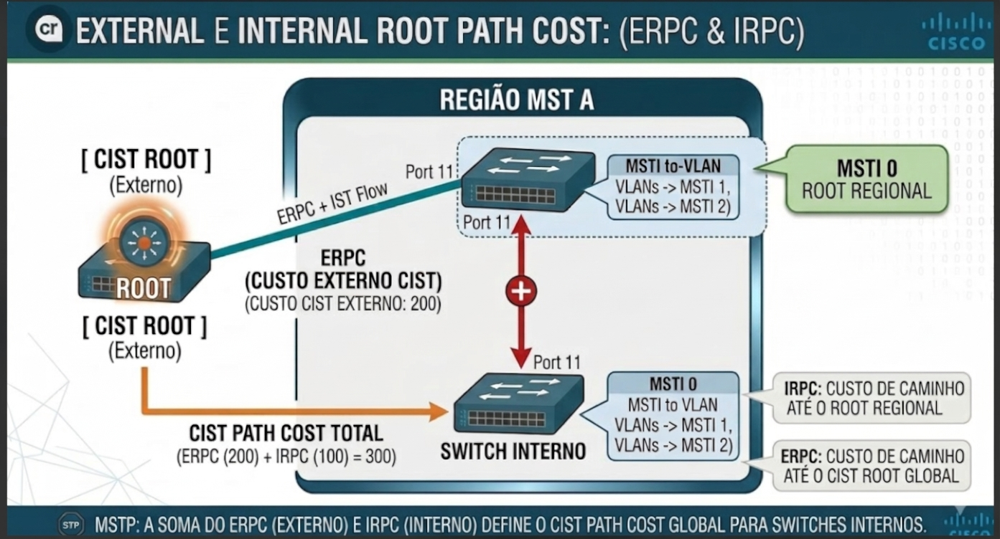
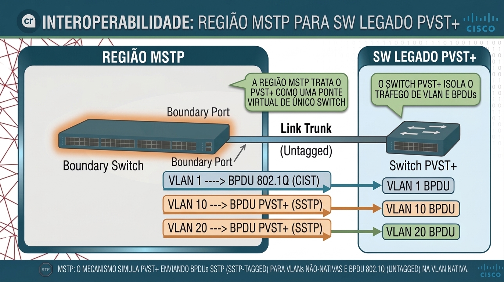

# 🔬 MSTP (IEEE 802.1s): Engenharia de Protocolo, Mecanismos de Convergência e Referência de Operação

---

## 📋 Sumário

- [🔬 MSTP (IEEE 802.1s): Engenharia de Protocolo, Mecanismos de Convergência e Referência de Operação](#-mstp-ieee-8021s-engenharia-de-protocolo-mecanismos-de-convergência-e-referência-de-operação)
  - [📋 Sumário](#-sumário)
  - [🎯 Objetivo deste Documento](#-objetivo-deste-documento)
  - [⚙️ Engenharia Interna e Mecanismos de Convergência](#️-engenharia-interna-e-mecanismos-de-convergência)
    - [1. Sincronização e o Mecanismo Proposal / Agreement Estendido](#1-sincronização-e-o-mecanismo-proposal--agreement-estendido)
    - [2. Cálculo de Caminho: ERPC, IRPC e Hop Count](#2-cálculo-de-caminho-erpc-irpc-e-hop-count)
      - [A. ERPC (External Root Path Cost)](#a-erpc-external-root-path-cost)
      - [B. IRPC (Internal Root Path Cost)](#b-irpc-internal-root-path-cost)
      - [C. Hop Count (Contador de Saltos)](#c-hop-count-contador-de-saltos)
    - [3. Dinâmica de Topology Change Notification (TCN) no MSTP](#3-dinâmica-de-topology-change-notification-tcn-no-mstp)
  - [🔀 Engenharia de Interoperabilidade: O Mecanismo PVST Simulation](#-engenharia-de-interoperabilidade-o-mecanismo-pvst-simulation)
    - [1. Anatomia da Comunicação de Borda](#1-anatomia-da-comunicação-de-borda)
    - [2. Regras de Inconsistência do PVST Simulation](#2-regras-de-inconsistência-do-pvst-simulation)
    - [3. Deteção de Vizinhos e o Migration Delay Timer](#3-deteção-de-vizinhos-e-o-migration-delay-timer)
  - [📜 Catalogo Conceitual de Comandos CLI (Cisco IOS XE)](#-catalogo-conceitual-de-comandos-cli-cisco-ios-xe)
    - [1. Comandos de Configuração do Plano de Controle](#1-comandos-de-configuração-do-plano-de-controle)
    - [2. Comandos de Diagnóstico e Inspeção (Show Commands)](#2-comandos-de-diagnóstico-e-inspeção-show-commands)
      - [A. Auditoria da Tabela de Região e Hash MD5](#a-auditoria-da-tabela-de-região-e-hash-md5)
      - [B. Inspeção Direta do Hash MD5 Calculated](#b-inspeção-direta-do-hash-md5-calculated)
      - [C. Diagnóstico Detalhado por Instância MSTI](#c-diagnóstico-detalhado-por-instância-msti)
      - [D. Visão Geral do Domínio MSTP (Summary)](#d-visão-geral-do-domínio-mstp-summary)
  - [🛠️ Cenários Teóricos de Diagnóstico e Troubleshooting](#️-cenários-teóricos-de-diagnóstico-e-troubleshooting)
    - [Cenário 1: Partitioning da Região por Inconsistência de Mapeamento](#cenário-1-partitioning-da-região-por-inconsistência-de-mapeamento)
    - [Cenário 2: Inconsistência no PVST Simulation (\*pvt-incons)](#cenário-2-inconsistência-no-pvst-simulation-pvt-incons)
  - [🧪 Pronto para Testar seu Conhecimento?](#-pronto-para-testar-seu-conhecimento)
  - [🧪 Conclusão e Próximos Passos](#-conclusão-e-próximos-passos)

---

## 🎯 Objetivo deste Documento

Este documento complementa a arquitetura teórica do **Multiple Spanning Tree Protocol (MSTP / IEEE 802.1s)** focando nos tópicos **45 e 46 do blueprint do CCNP ENCOR 350-401**. 

O objetivo é aprofundar os mecanismos internos de decisão do protocolo — como os cálculos de custo interno e externo, o impacto de notificações de mudança de topologia (TCN), o funcionamento da simulação de PVST+ em portas de borda — e mapear a sintaxe dos comandos de CLI e troubleshooting antes da execução de laboratórios práticos.

---

## ⚙️ Engenharia Interna e Mecanismos de Convergência

### 1. Sincronização e o Mecanismo Proposal / Agreement Estendido

O MSTP herda a convergência rápida do RSTP (IEEE 802.1w) baseada na negociação **Proposal / Agreement** (P/A) realizada de forma *point-to-point* e *full-duplex*, dispensando a espera por timers fixos como *Forward Delay* (15 segundos) para colocar uma porta em *Forwarding*.

No entanto, no MSTP essa negociação é **estendida para tratar múltiplas instâncias dentro de uma única PDU**:

1. **Escopo Único do P/A:** O handshake Proposal/Agreement ocorre **exclusivamente dentro do CIST (MSTI 0)**. 
2. **Sincronização em Cascata:** Quando um switch envia um BPDU com a flag *Proposal* marcada na MSTI 0, o switch receptor coloca em bloqueio (*sync*) as portas designadas não-borda para evitar loops.
3. **Validação das MSTIs:** Assim que a topologia da MSTI 0 é bloqueada e sincronizada, os estados de encaminhamento das demais MSTIs (1 a 64) são recalculados em lote.
4. **Envio do Agreement:** O switch receptor envia o *Agreement* de volta. As instâncias MSTI assumem os seus papéis correspondentes (Root, Designated, Alternate) de forma síncrona com a MSTI 0.



---

### 2. Cálculo de Caminho: ERPC, IRPC e Hop Count

Diferente do 802.1D ou PVST+, o MSTP utiliza duas métricas de custo distintas para eleger a melhor rota até o Root Bridge, distinguindo o caminho **fora** e **dentro** da região:



#### A. ERPC (External Root Path Cost)

- É o custo acumulado de caminho para alcançar o **CIST Root Global** (que pode estar dentro ou fora da região).
- O ERPC **não é alterado** enquanto o BPDU trafega dentro da região MST. Todos os switches internos enxergam exatamente o mesmo ERPC reportado pelo *Boundary Switch* que conecta a região ao resto da rede.

#### B. IRPC (Internal Root Path Cost)

- É o custo acumulado de caminho para alcançar o **Regional Root** (a raiz local da região para a MSTI 0 ou para uma MSTI específica).
- O IRPC aumenta a cada salto dentro da região com base nos custos das portas internas (utilizando por padrão a tabela de custos estendida de 32 bits do IEEE 802.1t, onde 1 Gbps = 20.000).

#### C. Hop Count (Contador de Saltos)

Dentro de uma região MST, os timers tradicionais do Spanning Tree (*Max Age*, *Hello Time*, *Forward Delay*) **não são modificados** a cada salto no cálculo interno. Em seu lugar, o MSTP introduz o campo **Hop Count** (ou *Remaining Hops*):  
  
- O *Regional Root* insere o valor do Hop Count no BPDU (o valor padrão no Cisco IOS XE é **20**).
- Cada switch interno que retransmite o BPDU decrementa o Hop Count em **1**.
- Se o valor do Hop Count atingir **0**, o BPDU é descartado e as informações daquela porta expiram, prevenindo loops causados por tempestades de BPDUs sem convergência.

---

### 3. Dinâmica de Topology Change Notification (TCN) no MSTP

No PVST+, quando ocorre um TCN em uma VLAN, o switch envia BPDUs de TCN dedicados naquela VLAN, causando *flush* da tabela MAC apenas para essa VLAN.

No MSTP, a engenharia de TCN opera com escopo regional e por instância:

1. **Geração do TCN:** O TCN só é gerado quando uma porta **não-borda (non-edge)** transiciona para o estado *Forwarding*. A queda de um link não gera TCN se houver um caminho alternativo imediato via RSTP.
2. **Escopo por MSTI:** Se uma mudança de topologia afeta apenas um conjunto de VLANs pertencentes à **MSTI 1**, a notificação de TCN é enviada no **M-Record correspondente à MSTI 1**. 
3. **Comportamento do Flush:**
   * Switches dentro da mesma região que recebem o TCN na **MSTI 1** limpam a tabela MAC **apenas para as VLANs mapeadas para a MSTI 1**.
   * O tráfego das VLANs pertencentes à MSTI 2 ou MSTI 0 não sofre *flush*, preservando a comutação de quadros e eliminando o flooding desnecessário na rede.
4. **Propagação Externa:** Se o TCN atingir a borda da região, ele é convertido pelo *Boundary Switch* em um TCN do CIST (ou BPDU de TCN do PVST+), notificando os domínios externos.

---

## 🔀 Engenharia de Interoperabilidade: O Mecanismo PVST Simulation

A coexistência entre switches operando MSTP (IEEE 802.1s) e switches Cisco legados operando PVST+ ou Rapid-PVST+ é garantida por um mecanismo interno chamado **PVST Simulation Engine**.

### 1. Anatomia da Comunicação de Borda

Quando uma interface de um switch MSTP detecta que está conectada a um switch PVST+:

1. **Tratamento da VLAN 1 (CST):** O switch MSTP envia e recebe BPDUs sem tag ($802.1Q$) para a VLAN 1 no endereço multicast padrão IEEE `01:80:C2:00:00:00`. Isso mapeia a topologia global da região ao **CST/CIST**.
2. **Tratamento das Demais VLANs (PVST+ BPDUs):** Para cada VLAN tagged ativa no trunk, o switch MSTP gera BPDUs em formato PVST+ (PVID BPDUs), endereçados ao grupo multicast proprietário da Cisco `01:00:0C:CC:CC:CD`.
3. **Replicação de Conteúdo:** Os BPDUs PVST+ gerados pelo switch MSTP para as demais VLANs contêm **exatamente as mesmas informações do CIST (MSTI 0)**. O MSTP lê o domínio legado como se todas as VLANs fossem unificadas pela decisão do CIST.



---

### 2. Regras de Inconsistência do PVST Simulation

Para evitar loops causados pela divergência de decisão entre as instâncias lógicas do MSTP e o modelo por VLAN do PVST+, o mecanismo de **PVST Simulation** aplica verificações rigorosas na borda. 

Se qualquer uma das condições abaixo for violada, o switch MSTP bloqueia a porta no estado **PVST Simulation Inconsistent** (`*pvt-incons`):

* **Regra 1: O CIST deve ser a Root absoluta ou o PVST+ deve ser a Root absoluta para TODAS as VLANs.**
  * *Violação:* Se o switch PVST+ for eleito Root para a VLAN 10, mas a região MSTP for eleita Root para a VLAN 20 na mesma trunk, o MSTP detecta topologias concorrentes e bloqueia a porta.
* **Regra 2: BPDUs recebidos superior em VLANs específicas.**
  * Se o switch MSTP receber em uma porta de borda um BPDU PVST+ com informações melhores (menor Bridge ID) para uma VLAN individual do que as informações que o MSTP possui para o CIST, a simulação falha e a porta é bloqueada.

---

### 3. Deteção de Vizinhos e o Migration Delay Timer

As portas MSTP utilizam o **Migration Delay Timer** (com valor fixo de **3 segundos**) para negociar a transição de protocolo com equipamentos vizinhos.

1. **Detecção Inicial:** Ao subir a interface, o switch MSTP assume que o vizinho fala MSTP e envia BPDUs no formato 802.1s.
2. **Fallback Automático:** Se durante o *Migration Delay* a interface receber um BPDU em formato IEEE 802.1D clássico ou PVST+, o hardware da porta chaveia para o modo de compatibilidade e passa a emitir BPDUs no formato antigo.
3. **Fixação do Modo:** Uma vez chaveada para modo de compatibilidade, a porta **permanece operando em modo legado** mesmo se o switch antigo for substituído por um equipamento MSTP, exigindo uma intervenção manual no plano de controle (`clear spanning-tree detected-protocols`) para forçar a re-negociação do protocolo.

---

## 📜 Catalogo Conceitual de Comandos CLI (Cisco IOS XE)

Abaixo encontra-se a referência completa dos comandos de configuração e diagnóstico do MSTP.

### 1. Comandos de Configuração do Plano de Controle

| Comando CLI | Submodo de Execução | Ação Operacional no Plano de Controle |
| :--- | :--- | :--- |
| `spanning-tree mode mst` | Global | Altera o mecanismo do Spanning Tree do switch de (R-)PVST+ para MSTP. Reinicia o processo global de STP. |
| `spanning-tree mst configuration` | Global | Entra no submodo de edição interativa da Região MST. As alterações não entram em vigor imediatamente. |
| `name <STRING>` | `config-mst` | Define o *Configuration Name* da região (string de até 32 caracteres). Deve ser idêntico em toda a região. |
| `revision <0-65535>` | `config-mst` | Define o *Revision Number* da região (inteiro de 16 bits). Deve ser idêntico em toda a região. |
| `instance <ID> vlan <RANGE>` | `config-mst` | Mapeia uma VLAN ou faixa de VLANs para uma MSTI específica (IDs de 1 a 4094). Atualiza a matriz que gera o Digest MD5. |
| `show pending` | `config-mst` | Exibe a tabela de mapeamento em memória que ainda não foi aplicada ao plano de encaminhamento. |
| `exit` | `config-mst` | **Commita** as alterações feitas no submodo, recalcula o Hash MD5 e aplica a nova configuração à região. |
| `spanning-tree mst <INST> priority <VALOR>` | Global | Define a prioridade do Bridge ID para uma MSTI específica. Aceita valores em incrementos de **4096** (0, 4096, 8192, ... 61440). |
| `spanning-tree mst <INST> root {primary \| secondary}` | Global | Macro do IOS XE que lê a prioridade do Root atual e ajusta a prioridade do switch local para um valor inferior (24576 para primary / 28672 para secondary). |
| `spanning-tree mst max-hops <SALTOS>` | Global | Modifica o valor inicial do contador *Hop Count* inserido nos BPDUs pela Root da região (Padrão: 20, Limites: 1 a 40). |
| `clear spanning-tree detected-protocols` | EXEC Privilegiado | Reinicia o *Migration Delay Timer* em uma ou todas as interfaces, forçando a re-negociação de compatibilidade MSTP no link. |

---

### 2. Comandos de Diagnóstico e Inspeção (Show Commands)

#### A. Auditoria da Tabela de Região e Hash MD5

```plaintext
SW-CORE-01# show spanning-tree mst configuration
Name      [REGION_HQ]
Revision  1
Instance  VLANs Mapped
--------  -------------------------------------------------------------------------------
0         1-9, 11-19, 21-29, 31-39, 41-49, 51-59, 61-4094
1         10, 20, 30
2         40, 50, 60
-----------------------------------------------------------------------------------------
```

- **O que analisar:** Confirme se todas as VLANs criadas no switch estão mapeadas corretamente nas instâncias desejadas e se o número de revisão é exatamente o mesmo dos demais switches da região.

#### B. Inspeção Direta do Hash MD5 Calculated

```plaintext
SW-CORE-01# show spanning-tree mst configuration digest
Name      [REGION_HQ]
Revision  1
Digest    0xAC4B8E11D92E310FA8710BC921004A23
```

- **O que analisar:** Compare este valor hexadecimal de 16 bytes (`Digest`) com o valor exibido nos switches vizinhos. Se a string for diferente por um único caractere, a região está fragmentada (*partitioned*).

#### C. Diagnóstico Detalhado por Instância MSTI

```plaintext
SW-CORE-01# show spanning-tree mst 1

##### MST1        vlans mapped:   10,20,30
Bridge        address 5254.0011.2233  priority      4097  (4096 sysid 1)
Root          this switch is the root

Interface           Role Sts Cost      Prio.Nbr Type
------------------- ---- --- --------- -------- --------------------------------
Gi0/1               DESG FWD 20000     128.2    P2p 
Gi0/2               DESG FWD 20000     128.3    P2p 
```

- **O que analisar:**  
  - `sysid 1`: Confirma a inclusão automática do ID da instância na prioridade do Bridge ID (System ID Extension).
  - `Type P2p`: Indica que a porta opera em Full-Duplex e consegue realizar o handshake rápido Proposal/Agreement. Se exibir `P2p Bound(PVST)`, indica que a porta é uma *Boundary Port* conectada a um switch PVST+ legado.

#### D. Visão Geral do Domínio MSTP (Summary)

```plaintext
SW-CORE-01# show spanning-tree mst summary
Switch is in mst mode
Instance      Role Switch Identity            Priority Path-cost   Root Ident
------------- ---- -------------------------- -------- ----------- --------------------------
MST0          ROOT 5254.0011.2233             8192     0           5254.0011.2233
MST1          ROOT 5254.0011.2233             4096     0           5254.0011.2233
MST2          SUBN 5254.0011.2233             8192     20000       5254.0022.4455
```

- **O que analisar:** Permite verificar rapidamente o papel do switch em cada instância (`ROOT` para Root Bridge local / `SUBN` para nó subordinado) e o custo de caminho total até a raiz daquela instância.

---

## 🛠️ Cenários Teóricos de Diagnóstico e Troubleshooting

### Cenário 1: Partitioning da Região por Inconsistência de Mapeamento

```plaintext
 [ SW-DIST-01 ] ----------------------------- [ SW-DIST-02 ]
  Region: HQ                                   Region: HQ
  Revision: 1                                  Revision: 1
  VLAN 10 -> MSTI 1                            VLAN 10 -> MSTI 1
  VLAN 20 -> MSTI 1                            VLAN 20 -> MSTI 2  <-- MISMATCH!
  
  Digest MD5: 0xAAAA...                        Digest MD5: 0xBBBB...
  
  ==========================================================
  RESULTADO: O link entre os switches cai para BOUNDARY PORT.
  As instâncias MSTI 1 e 2 são ISOLADAS entre os switches.
  ==========================================================
```

- **Mecanismo de Falha:** Embora o `Name` (HQ) e o `Revision` (1) sejam iguais, o mapeamento divergente da VLAN 20 faz com que o algoritmo gere Hashes MD5 diferentes.
- **Comportamento no Plano de Controle:** Os switches leem a divergência no campo *Digest* da extensão do BPDU. A interface de interconexão entre eles deixa de processar os M-Records das MSTIs e passa a tratar o link como se estivesse conectado a uma região externa, degradando o balanceamento de carga e a convergência.
- **Comando de Identificação:** `show spanning-tree mst configuration digest` executado em ambos os dispositivos.

---

### Cenário 2: Inconsistência no PVST Simulation (*pvt-incons)

```plaintext
                       +-----------------------+
                       | Região MSTP           |
                       | CIST Root = SW-MST-01 |
                       +-----------+-----------+
                                   |
                             Boundary Link
                                   |
                       +-----------+-----------+
                       | Switch PVST+ Legado   |
                       | Root VLAN 10 = SW-LEG | <-- Tenta impor Root na VLAN 10!
                       +-----------------------+
```

- **Mecanismo de Falha:** O switch legado PVST+ envia um BPDU na VLAN 10 com um Bridge ID menor do que o Bridge ID do CIST Root reportado pela região MSTP.
- **Comportamento no Plano de Controle:** O switch MSTP de borda detecta que o domínio legado está tentando fragmentar a topologia e assumir uma raiz diferente para uma VLAN isolada na trunk. Para evitar a formação de um loop invisível entre as instâncias MST e as VLANs PVST+, o motor de PVST Simulation insere a porta de borda no estado de bloqueio **PVST Simulation Inconsistent**.
- **Mensagem de Log Típica:**
  
  ```text
  %SPANTREE-2-PVSTSIM_FAIL: Blocking boundary port Gi0/1 on MST1 - PVST simulation inconsistency.
  ```

- **Comando de Identificação:** `show spanning-tree interface GigabitEthernet 0/1` exibirá a porta no estado `BLK` com a razão `*pvt-incons`.

---

## 🧪 Pronto para Testar seu Conhecimento?

Esta Parte 11 estabeleceu toda a fundação conceitual e arquitetural do MSTP.

Antes de avançar para o próximo capítulo, valide sua compreensão dos fundamentos do **Multiple Spanning Tree Protocol (MSTP / IEEE 802.1s)**.

Os simulados foram planejados para reforçar os conceitos estudados, testar seu raciocínio sobre os cenários apresentados e identificar pontos que precisam de revisão antes de avançar para os protocolos seguintes.

👉 **Acesse os simulados de MSTP — Parte 02**

🔗 [Abrir Simulados MSTP — Parte 02](https://alcancil.github.io/Cisco/CCNP%20350-401%20ENCOR/03%20-%20Infrastructure/02%20-%20STP%20(Spanning%20Tree%20Protocol)/25%20-%20MSTP/Arquivos/Simulado/)  

**Simulados temáticos:**  

1. [Convergência Rápida no MSTP: O Mecanismo de Proposal e Agreement em Lote](https://alcancil.github.io/Cisco/CCNP%20350-401%20ENCOR/03%20-%20Infrastructure/02%20-%20STP%20(Spanning%20Tree%20Protocol)/25%20-%20MSTP/Arquivos/Simulado/01.html)
2. [Dinâmica de TCN e Isolamento de Falhas por Instância (MSTI)](https://alcancil.github.io/Cisco/CCNP%20350-401%20ENCOR/03%20-%20Infrastructure/02%20-%20STP%20(Spanning%20Tree%20Protocol)/25%20-%20MSTP/Arquivos/Simulado/02.html)
3. [Engenharia de Custos: Avaliando ERPC, IRPC e o Limite de Saltos (Hop Count)](https://alcancil.github.io/Cisco/CCNP%20350-401%20ENCOR/03%20-%20Infrastructure/02%20-%20STP%20(Spanning%20Tree%20Protocol)/25%20-%20MSTP/Arquivos/Simulado/03.html)
4. [Interoperabilidade e Simulação PVST+: O Papel do Boundary Port e SSTP](https://alcancil.github.io/Cisco/CCNP%20350-401%20ENCOR/03%20-%20Infrastructure/02%20-%20STP%20(Spanning%20Tree%20Protocol)/25%20-%20MSTP/Arquivos/Simulado/04.html)
5. [Comandos de Diagnóstico, CLI e Análise de Captura de BPDUs no Wireshark](https://alcancil.github.io/Cisco/CCNP%20350-401%20ENCOR/03%20-%20Infrastructure/02%20-%20STP%20(Spanning%20Tree%20Protocol)/25%20-%20MSTP/Arquivos/Simulado/05.html)

**Simulado completo de MSTP:** [50 questões — 75 minutos](https://alcancil.github.io/Cisco/CCNP%20350-401%20ENCOR/03%20-%20Infrastructure/02%20-%20STP%20(Spanning%20Tree%20Protocol)/25%20-%20MSTP/Arquivos/Simulado/completo.html)

**📊 Painel de Estatísticas:** [Acompanhe seu desempenho](https://alcancil.github.io/Cisco/CCNP%20350-401%20ENCOR/03%20-%20Infrastructure/02%20-%20STP%20(Spanning%20Tree%20Protocol)/25%20-%20MSTP/Arquivos/Simulado/dashboard.html)

👉 Próximo Passo: Na Parte 12, avançaremos para a Engenharia Avançada de MSTP, cobrindo a Interoperabilidade com PVST+, a dinâmica de TCN no MSTP, o Hardening completo e o Guia de Comandos e Análise de Captura (CLI + Wireshark)!

---

## 🧪 Conclusão e Próximos Passos

Esta segunda parte consolidou toda a fundação teórica avançada exigida pelo exame **CCNP ENCOR 350-401**:

1. A mecânica de sincronização rápida via **Proposal/Agreement estendido** nas MSTIs.
2. Os cálculos de custo distintos para caminhos internos (**IRPC**) e externos (**ERPC**), além do controle por **Hop Count**.
3. O isolamento de falhas e limitação de flushes MAC através do **TCN por MSTI**.
4. As regras de proteção e interoperabilidade com domínios legados via **PVST Simulation**.
5. O catálogo completo da sintaxe de comandos CLI e cenários avançados de troubleshooting.

👉 **Próxima Etapa:** Com a teoria do MSTP 100% concluída, os tópicos seguintes abrem os cenários práticos de laboratório hands-on, seguidos pelo estudo dos mecanismos de proteção e hardening de Spanning Tree (**Root Guard, BPDU Guard, Loop Guard e UDLD — itens 47 a 49 do blueprint**).