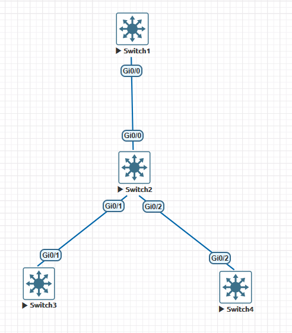
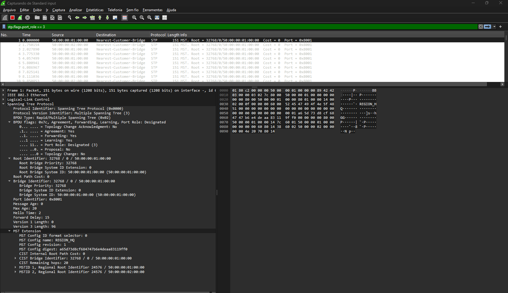
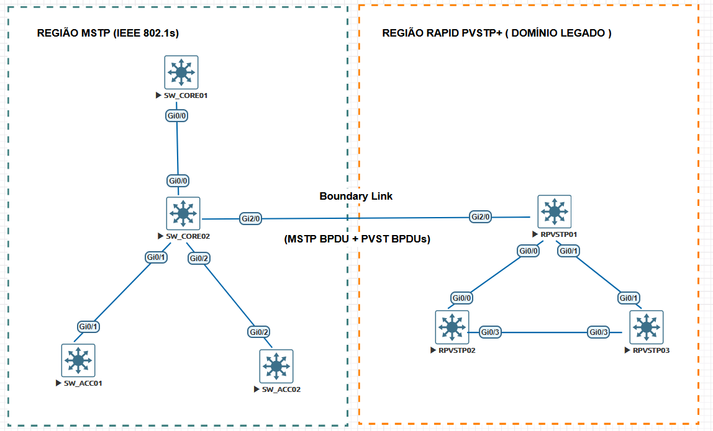
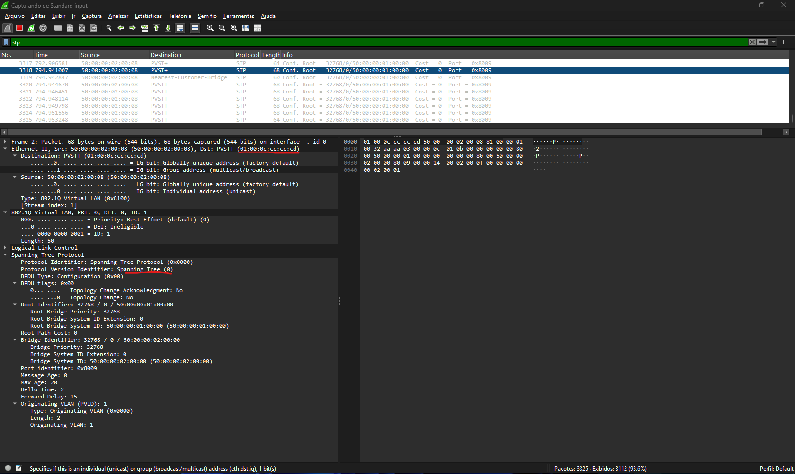

# 🛠️ MSTP (IEEE 802.1s): Guia Prático de Configuração, Interoperabilidade e Troubleshooting Avançado

---

## 📋 Sumário

- [🛠️ MSTP (IEEE 802.1s): Guia Prático de Configuração, Interoperabilidade e Troubleshooting Avançado](#️-mstp-ieee-8021s-guia-prático-de-configuração-interoperabilidade-e-troubleshooting-avançado)
  - [📋 Sumário](#-sumário)
  - [🎯 Objetivo Desta Seção](#-objetivo-desta-seção)
  - [📐 Topologia de Referência para Laboratório](#-topologia-de-referência-para-laboratório)
  - [⚙️ Implementação Passo a Passo na CLI (Cisco IOS XE)](#️-implementação-passo-a-passo-na-cli-cisco-ios-xe)
    - [Preparação do ambiente](#preparação-do-ambiente)
    - [1. Ativação Global do Modo MST](#1-ativação-global-do-modo-mst)
    - [2. Bloco de Configuração de Região e Mapeamento VLAN-Instância](#2-bloco-de-configuração-de-região-e-mapeamento-vlan-instância)
    - [3. Engenharia de Tráfego: Ajuste de Prioridades e Eleição de Root](#3-engenharia-de-tráfego-ajuste-de-prioridades-e-eleição-de-root)
      - [Configuração via Macro de Macro Root](#configuração-via-macro-de-macro-root)
      - [Configuração Manual de Prioridade (Recomendada em Produção)](#configuração-manual-de-prioridade-recomendada-em-produção)
    - [4. Script Unificado Replicável](#4-script-unificado-replicável)
  - [🔍 Verificação Operacional e Análise de Digest MD5](#-verificação-operacional-e-análise-de-digest-md5)
    - [1. Validação do Hash MD5 da Região](#1-validação-do-hash-md5-da-região)
    - [2. Auditoria da Tabela de Instâncias](#2-auditoria-da-tabela-de-instâncias)
    - [3. Inspeção de Estado por Interface e Instância](#3-inspeção-de-estado-por-interface-e-instância)
      - [Interpretando o Output Operacional:](#interpretando-o-output-operacional)
      - [Verificando no Wireshark](#verificando-no-wireshark)
  - [🔀 Interoperabilidade: MSTP vs. PVST+ / Rapid-PVST+ na Prática](#-interoperabilidade-mstp-vs-pvst--rapid-pvst-na-prática)
    - [1. Como Funciona a Comunicação na Borda (Boundary Ports)](#1-como-funciona-a-comunicação-na-borda-boundary-ports)
    - [Preparação do Cenário](#preparação-do-cenário)
    - [2. Interação com PVST+ e Mapeamento de VLAN 1](#2-interação-com-pvst-e-mapeamento-de-vlan-1)
    - [3. Mecanismo de Migração de Protocolo e o Migration Delay Timer](#3-mecanismo-de-migração-de-protocolo-e-o-migration-delay-timer)
  - [🚨 Cenários Reais de Troubleshooting no CCNP ENCOR](#-cenários-reais-de-troubleshooting-no-ccnp-encor)
    - [Cenário A: Partitioning de Região MST por Mismatch de Configuração](#cenário-a-partitioning-de-região-mst-por-mismatch-de-configuração)
    - [Cenário B: Falha na Convergência de Borda com Switches PVST+ Legados](#cenário-b-falha-na-convergência-de-borda-com-switches-pvst-legados)
  - [🧪 Checkpoint de Validação Prática](#-checkpoint-de-validação-prática)

---

## 🎯 Objetivo Desta Seção

Esta segunda parte da documentação foca no **Blueprint do CCNP ENCOR 350-401** (3.1.c Configure and verify common Spanning Tree Protocols (RSTP, MST) and Spanning Tree enhancements such as root guard and BPDU guard). Aqui, saímos do plano puramente teórico para a engenharia de configuração no Cisco IOS XE, auditoria de planos de controle, validação do MD5 Configuration Digest, estratégias de interoperabilidade com domínios Rapid-PVST+ legados e troubleshooting sistemático.

---

## 📐 Topologia de Referência para Laboratório

Para os cenários práticos e comandos de validação descritos neste documento, utilizamos a seguinte arquitetura com 4 switches em malha redundante, divididos em dois blocos de tráfego:



- **VLANs Mapeadas:**
  - **MSTI 1:** VLANs 10, 20, 30 (Bloco Corporativo / Voz)
  - **MSTI 2:** VLANs 40, 50, 60 (Bloco de Servidores / Gestão)
  - **MSTI 0 (IST):** VLANs 1, 999 (Infraestrutura e VLANs não alocadas explicitamente)

---

## ⚙️ Implementação Passo a Passo na CLI (Cisco IOS XE)

### Preparação do ambiente

Para começarmos a configurar o protocolo **MSTP**, precisamos criar primeiro as vlans e depois configurar o link entre os switches. Então vamos lá:  

```ios
! ===============================
!    CRIANDO AS VLANS
!================================
!
vlan 10,20,30,40,50,60
exit
```

Agora vamos configurar o link ente os switches **SW_CORE01 e SW_CORE02**. Então devemos aplicar as configurações nas portas `Gi0/0` dos 2 switches. Depois devemos configurar mais dois links tronco que são os links que ligam os switches **SW_CORE02 e SW_ACC01** nas portas `Gi0/1` dos 2 switches. O último link que falta é o link entre os switches **SW_CORE02 e SW_ACC02** nas portas `Gi0/2`.

```ios
! ===================================
!   CONFIGURANDO A INTERFACE TRUNK
! ===================================
!
int g0/0
switchport trunk encapsulation dot1q
switchport mode trunk
switchport trunk native vlan 60
switchport trunk allowed vlan 1,10,20,30,40,50,60
exit
```

Para verificar as configurações, podemos utilizar os comandos:  

- **`show vlan brief`**
- **`show int trunk`**

```ios
SW_CORE01#show vlan br

VLAN Name                             Status    Ports
---- -------------------------------- --------- -------------------------------
1    default                          active    Gi0/1, Gi0/2, Gi0/3, Gi1/0
                                                Gi1/1, Gi1/2, Gi1/3, Gi2/0
                                                Gi2/1, Gi2/2, Gi2/3, Gi3/0
                                                Gi3/1, Gi3/2, Gi3/3
10   VLAN0010                         active
20   VLAN0020                         active
30   VLAN0030                         active
40   VLAN0040                         active
50   VLAN0050                         active
60   VLAN0060                         active
70   VLAN0070                         active
80   VLAN0080                         active
1002 fddi-default                     act/unsup
1003 token-ring-default               act/unsup
1004 fddinet-default                  act/unsup
1005 trnet-default                    act/unsup
SW_CORE01#
```

```ios
SW_CORE01#show int trunk

Port        Mode             Encapsulation  Status        Native vlan
Gi0/0       on               802.1q         trunking      60

Port        Vlans allowed on trunk
Gi0/0       1,10,20,30,40,50,60

Port        Vlans allowed and active in management domain
Gi0/0       1,10,20,30,40,50,60

Port        Vlans in spanning tree forwarding state and not pruned
Gi0/0       1,10,20,30,40,50,60
```

### 1. Ativação Global do Modo MST

A alteração do modo Spanning Tree afeta todas as interfaces do switch. Em dispositivos rodando Cisco IOS XE, a mudança desativa temporariamente o processo de Spanning Tree anterior antes de inicializar o MSTP.

```ios
SW-CORE-01(config)# spanning-tree mode mst
```

---

### 2. Bloco de Configuração de Região e Mapeamento VLAN-Instância

A edição de parâmetros da região ocorre dentro do submodo `spanning-tree mst configuration`. As alterações feitas dentro do submodo entram em um estado pendente e **só são commitadas e aplicadas após sair do modo com o comando `exit`**.

```ios
SW-CORE-01(config)# spanning-tree mst configuration
SW-CORE-01(config-mst)# name REGION_HQ
SW-CORE-01(config-mst)# revision 1
SW-CORE-01(config-mst)# instance 1 vlan 10,20,30
SW-CORE-01(config-mst)# instance 2 vlan 40,50,60
SW-CORE-01(config-mst)# show pending
SW-CORE-01(config-mst)# exit
```

> 💡 **Nota de Campo:** O comando `show pending` permite auditar a tabela de mapeamento antes de efetivar as mudanças no plano de controle do switch, evitando discrepâncias temporárias de estado entre equipamentos vizinhos.

---

### 3. Engenharia de Tráfego: Ajuste de Prioridades e Eleição de Root

Assim como no STP/RSTP, a prioridade do Bridge ID no MSTP é configurada em múltiplos de $4096$. No MSTP, a prioridade é ajustada **individualmente por instância**.

#### Configuração via Macro de Macro Root

O Cisco IOS XE oferece comandos utilitários que calculam a prioridade em função da topologia atual:

```ios
! SW-CORE-01 assume como Root Primário para MSTI 1 e Secundário para MSTI 2
SW-CORE-01(config)# spanning-tree mst 1 root primary
SW-CORE-01(config)# spanning-tree mst 2 root secondary

! SW-CORE-02 assume como Root Primário para MSTI 2 e Secundário para MSTI 1
SW-CORE-02(config)# spanning-tree mst 2 root primary
SW-CORE-02(config)# spanning-tree mst 1 root secondary
```

#### Configuração Manual de Prioridade (Recomendada em Produção)

Para um controle determinístico sem depender de macros em runtime:

```ios
! Configuração no SW-CORE-01
SW-CORE-01(config)# spanning-tree mst 0 priority 8192
SW-CORE-01(config)# spanning-tree mst 1 priority 4096
SW-CORE-01(config)# spanning-tree mst 2 priority 8192

! Configuração no SW-CORE-02
SW-CORE-02(config)# spanning-tree mst 0 priority 8192
SW-CORE-02(config)# spanning-tree mst 1 priority 8192
SW-CORE-02(config)# spanning-tree mst 2 priority 4096
```

---

### 4. Script Unificado Replicável

Para fins de padronização, utilize os blocos abaixo para subir um laboratório simétrico de 4 switches:

```ios
! ==========================================
! TEMPLATE DE CONFIGURAÇÃO BASE - SW-CORE-01
! ==========================================
vlan 10,20,30,40,50,60,999
!
spanning-tree mode mst
!
spanning-tree mst configuration
 name REGION_HQ
 revision 1
 instance 1 vlan 10,20,30
 instance 2 vlan 40,50,60
 exit
!
spanning-tree mst 0 priority 8192
spanning-tree mst 1 priority 4096
spanning-tree mst 2 priority 8192
```

---

## 🔍 Verificação Operacional e Análise de Digest MD5

### 1. Validação do Hash MD5 da Região

Para que dois switches pertençam à mesma região MST, o **Digest MD5** deve coincidir bit a bit. O Digest não é configurado diretamente; ele é o produto direto do mapeamento estático de todas as $4094$ VLANs para as instâncias MSTI.

Para validar o hash gerado localmente, utilize o comando `show spanning-tree mst configuration digest`:

```ios
SW_CORE01#show spanning-tree mst configuration digest
Name      [REGION_HQ]
Revision  1     Instances configured 3
Digest          0xA65D73D8CF684747B6E4DEAA83119FF0
Pre-std Digest  0xE8C02DB5EABEB971241B71504D77282E
SW_CORE01#
```

```text
SW_CORE02#show spanning-tree mst configuration digest
Name      [REGION_HQ]
Revision  1     Instances configured 3
Digest          0xA65D73D8CF684747B6E4DEAA83119FF0
Pre-std Digest  0xE8C02DB5EABEB971241B71504D77282E
SW_CORE02#
```

📌 **Regra de Ouro:** Se o campo `Digest` diferir entre dois switches adjacentes, a porta de interconexão entrará automaticamente em modo **Boundary Port**, isolando a comunicação das instâncias 1..N e unificando apenas a MSTI 0 através do CIST.

---

### 2. Auditoria da Tabela de Instâncias

O comando `show spanning-tree mst configuration` exibe o nome, a revisão e a tabela ativa de mapeamento de VLANs:

```text
SW_CORE01#show spanning-tree mst configuration
Name      [REGION_HQ]
Revision  1     Instances configured 3

Instance  Vlans mapped
--------  ---------------------------------------------------------------------
0         1-9,11-19,21-29,31-39,41-49,51-59,61-4094
1         10,20,30
2         40,50,60
-------------------------------------------------------------------------------
```

---

### 3. Inspeção de Estado por Interface e Instância

Para verificar a saúde dos papéis e estados das portas dentro de uma instância específica (ex: MSTI 1), utilize o comando `show spanning-tree mst`:

```text
SW_CORE01#show spanning-tree mst

##### MST0    vlans mapped:   1-9,11-19,21-29,31-39,41-49,51-59,61-4094
Bridge        address 5000.0001.0000  priority      32768 (32768 sysid 0)
Root          this switch for the CIST
Operational   hello time 2 , forward delay 15, max age 20, txholdcount 6
Configured    hello time 2 , forward delay 15, max age 20, max hops    20

Interface        Role Sts Cost      Prio.Nbr Type
---------------- ---- --- --------- -------- --------------------------------
Gi0/0            Desg FWD 20000     128.1    P2p
Gi0/1            Desg FWD 20000     128.2    P2p
Gi0/2            Desg FWD 20000     128.3    P2p
Gi0/3            Desg FWD 20000     128.4    P2p
Gi1/0            Desg FWD 20000     128.5    P2p
Gi1/1            Desg FWD 20000     128.6    P2p
Gi1/2            Desg FWD 20000     128.7    P2p
Gi1/3            Desg FWD 20000     128.8    P2p
Gi2/0            Desg FWD 20000     128.9    P2p
Gi2/1            Desg FWD 20000     128.10   P2p
Gi2/2            Desg FWD 20000     128.11   P2p
Gi2/3            Desg FWD 20000     128.12   P2p
Gi3/0            Desg FWD 20000     128.13   P2p
Gi3/1            Desg FWD 20000     128.14   P2p
Gi3/2            Desg FWD 20000     128.15   P2p
Gi3/3            Desg FWD 20000     128.16   P2p

##### MST1    vlans mapped:   10,20,30
Bridge        address 5000.0001.0000  priority      24577 (24576 sysid 1)
Root          this switch for MST1

Interface        Role Sts Cost      Prio.Nbr Type
---------------- ---- --- --------- -------- --------------------------------
Gi0/0            Desg FWD 20000     128.1    P2p

##### MST2    vlans mapped:   40,50,60
Bridge        address 5000.0001.0000  priority      28674 (28672 sysid 2)
Root          address 5000.0002.0000  priority      24578 (24576 sysid 2)
              port    Gi0/0           cost          20000     rem hops 19

Interface        Role Sts Cost      Prio.Nbr Type
---------------- ---- --- --------- -------- --------------------------------
Gi0/0            Root FWD 20000     128.1    P2p

SW_CORE01#
```

E no **SW-ACC-01** (switch de acesso):

```text
SW_ACC01#show spanning-tree mst 1

##### MST1    vlans mapped:   10,20,30
Bridge        address 5000.0003.0000  priority      32769 (32768 sysid 1)
Root          this switch for MST1

Interface        Role Sts Cost      Prio.Nbr Type
---------------- ---- --- --------- -------- --------------------------------
Gi0/0            Desg FWD 20000     128.1    P2p

SW_ACC01#
```

**OBS:** Se utilizarmos o comando **`show spanning-tree`** ele trará todas as informações e todas as instâncias criadas.

#### Interpretando o Output Operacional:

1. **Bridge Priority ($4097$):** Composta pela prioridade base ($4096$) + o System ID Extension (ID da instância = $1$).
2. **Cost ($20000$):** O MSTP utiliza a tabela de custos de link de 32 bits estendida conforme o padrão IEEE 802.1t (ex: Link Gigabit Ethernet = $20000$).
3. **Type P2p:** Indica operação em Full-Duplex utilizando o mecanismo de convergência rápida Proposal/Agreement.

#### Verificando no Wireshark

Para podermos analisar o comportamento do **MSTP**, podemos ligar u wireshark em alguma porta dos equipamentos e realizar a captura utilizando o seguinte filtro:

- **`stp.flags.port_role == 3`**



---

## 🔀 Interoperabilidade: MSTP vs. PVST+ / Rapid-PVST+ na Prática

### 1. Como Funciona a Comunicação na Borda (Boundary Ports)

Quando uma região MST se conecta a um domínio de rede rodando **PVST+** ou **Rapid-PVST+**, o MSTP estende a interoperabilidade sem exigir a alteração do protocolo no core da rede.

- A porta do switch MSTP conectada ao domínio legado é classificada como **Boundary Port**.
- Para o switch legado externamente, a região MST inteira responde como se fosse **um único switch gigante (Virtual Bridge)** executando CST (Common Spanning Tree).



---

### Preparação do Cenário

Nesta etapa, vamos conectar ao nosso cenário mais 3 switches que estão interligados na forma clássica de triângulo para representar um domínio **RSTP**.  Só iremos configurar agora esses novos equipamentos.

- **Nomenclatura adotada**  
  - RPVSTP01
  - RPVSTP02
  - RPVSTP03

Então vamos começar criando as vlans nos 3 switches.  

```ios
! ===============================
!    CRIANDO AS VLANS
!================================
!
vlan 10,20,30,40,50,60
exit
```

Agora precisamos ativar o modo **RSTP** no domínio legado:

```ios
spanning-tree mode rapid-pvst
```

Por fim precisamos configurar o link tronco entre os domínios **MSTP** e **RSTP**. Para isso vamos configurar a interface **`Gi2/0`** nos switches **SW_CORE02 e RPVSTP01**

```ios
! ===================================
!   CONFIGURANDO A INTERFACE TRUNK
! ===================================
!
int g2/0
switchport trunk encapsulation dot1q
switchport mode trunk
switchport trunk native vlan 60
switchport trunk allowed vlan 1,10,20,30,40,50,60
exit
```

### 2. Interação com PVST+ e Mapeamento de VLAN 1

O PVST+ envia um BPDU por VLAN (endereçado ao grupo multicast `01:00:0C:CC:CC:CD` com tag $802.1Q$), enquanto o MSTP transmite apenas BPDUs puros de $802.1Q$ (endereçados a `01:80:C2:00:00:00`).

Para garantir a coerência de topologia sem criar loops no domínio legado:

1. O switch de borda MSTP envia o **BPDU do CIST na VLAN 1** destagada (untagged).
2. Para todas as outras VLANs ativas na trunk, o switch de borda replica o BPDU do CIST encapsulado em formato **PVST+ (PVID BPDUs)**.
3. Se o switch de borda MSTP receber BPDUs de PVST+ para VLANs diferentes cujas topologias sejam inconsistentes com a do CIST, a interface de borda entrará em estado **PVST Simulation Inconsistent** para bloquear o tráfego e evitar a formação de loops.

Para podermos analisar essa cituação, vamos realizar uma captura do wireshark no switche **RPVSTP01** na interface **Gi2/0**, ou seja, vamos olha o dominio **RSTP** enviando BPDUS para o domínio MSTP.



> **Análise da Captura:** Ao analisar a transmissão do lado Rapid-PVST+ para o MSTP, observa-se que os quadros são direcionados ao MAC multicast proprietário Cisco (`01:00:0c:cc:cc:cd`) com encapsulamento SSTP por VLAN. Embora o switch opere em modo Rapid-PVST+, o campo *Protocol Version Identifier* reporta **Spanning Tree (0)** no cabeçalho base por compatibilidade estrutural. O comportamento veloz é garantido internamente pelas flags e pelo envio de BPDUs individuais por VLAN, permitindo que a porta de borda MSTP identifique o domínio legado e assuma o estado `Bound(PVST)`.

---

### 3. Mecanismo de Migração de Protocolo e o Migration Delay Timer

As portas MSTP detectam automaticamente se o vizinho direto fala MSTP ou STP/RSTP legado monitorando os BPDUs recebidos na interface.

- **Detecção Automática:** Ao receber um BPDU no formato IEEE 802.1D clássico ou PVST+, a interface ajusta sua operação para o modo de compatibilidade e passa a enviar BPDUs no formato legado.
- **Migration Delay Timer:** É um timer interno (padrão de $3$ segundos). Durante esse intervalo, o switch de borda força a transmissão no modo legado para estabilizar a negociação no link.
- **Forçar Remigração Manual:** Se você substituir um switch legado adjacente por um switch MSTP na mesma interface, o switch MSTP pode manter a porta em modo de compatibilidade até que você force a nova checagem com o comando de CLI:

```text
SW-CORE-01# clear spanning-tree detected-protocols interface GigabitEthernet 0/2
```

---

## 🚨 Cenários Reais de Troubleshooting no CCNP ENCOR

### Cenário A: Partitioning de Região MST por Mismatch de Configuração

**Sintoma:** Dois switches de distribuição deveriam estar no mesmo domínio de convergência rápida MST, mas os links entre eles estão caindo no papel de Boundary Ports e apresentando convergência lenta.

Vamos entrar no switche **SW_CORE02** e vamos digitar assim:

```ios
ena
conf t
spanning-tree mst configuration
instance 1 vlan 10, 20
instance 2 vlan 30, 40, 50, 60
exit
SW_CORE02(config)#end
```

Aqui estou alterando deliberadamente o mapeamento das Vlans nas instâncias MST para podermos observar o comportamento do MSTP. Vamos analisar a saída do comando **`show spanning-tree`**

```ios
SW_CORE02#show spanning-tree

MST0
  Spanning tree enabled protocol mstp
  Root ID    Priority    32768
             Address     5000.0001.0000
             Cost        20000
             Port        1 (GigabitEthernet0/0)
             Hello Time   2 sec  Max Age 20 sec  Forward Delay 15 sec

  Bridge ID  Priority    32768  (priority 32768 sys-id-ext 0)
             Address     5000.0002.0000
             Hello Time   2 sec  Max Age 20 sec  Forward Delay 15 sec

Interface           Role Sts Cost      Prio.Nbr Type
------------------- ---- --- --------- -------- --------------------------------
Gi0/0               Root FWD 20000     128.1    P2p Bound(RSTP)
Gi0/1               Desg FWD 20000     128.2    P2p
Gi0/2               Desg FWD 20000     128.3    P2p
Gi0/3               Desg FWD 20000     128.4    P2p
Gi1/0               Desg FWD 20000     128.5    P2p
Gi1/1               Desg FWD 20000     128.6    P2p
Gi1/2               Desg FWD 20000     128.7    P2p
Gi1/3               Desg FWD 20000     128.8    P2p

Interface           Role Sts Cost      Prio.Nbr Type
------------------- ---- --- --------- -------- --------------------------------

Gi2/0               Desg FWD 20000     128.9    P2p
Gi2/1               Desg FWD 20000     128.10   P2p
Gi2/2               Desg FWD 20000     128.11   P2p
Gi2/3               Desg FWD 20000     128.12   P2p
Gi3/0               Desg FWD 20000     128.13   P2p
Gi3/1               Desg FWD 20000     128.14   P2p
Gi3/2               Desg FWD 20000     128.15   P2p
Gi3/3               Desg FWD 20000     128.16   P2p


MST1
  Spanning tree enabled protocol mstp
  Root ID    Priority    28673
             Address     5000.0002.0000
             This bridge is the root
             Hello Time   2 sec  Max Age 20 sec  Forward Delay 15 sec

  Bridge ID  Priority    28673  (priority 28672 sys-id-ext 1)
             Address     5000.0002.0000
             Hello Time   2 sec  Max Age 20 sec  Forward Delay 15 sec

Interface           Role Sts Cost      Prio.Nbr Type
------------------- ---- --- --------- -------- --------------------------------
Gi0/0               Mstr FWD 20000     128.1    P2p Bound(RSTP)
Gi2/0               Desg FWD 20000     128.9    P2p


MST2
  Spanning tree enabled protocol mstp
  Root ID    Priority    24578
             Address     5000.0002.0000
             This bridge is the root
             Hello Time   2 sec  Max Age 20 sec  Forward Delay 15 sec

  Bridge ID  Priority    24578  (priority 24576 sys-id-ext 2)
             Address     5000.0002.0000
             Hello Time   2 sec  Max Age 20 sec  Forward Delay 15 sec

Interface           Role Sts Cost      Prio.Nbr Type
------------------- ---- --- --------- -------- --------------------------------
Gi0/0               Mstr FWD 20000     128.1    P2p Bound(RSTP)
Gi2/0               Desg FWD 20000     128.9    P2p


SW_CORE02#
```

Pela saída podemos notar que o MSTP na porta **`Gi0/0`** classifica a porta como Bound

```ios
Gi0/0               Root FWD 20000     128.1    P2p Bound(RSTP)
```

**OBSERVAÇÂO:** se olharmos a saída em **SW_COR01**, poderemos notar que o mesmo acontece.

**Investigação com Comandos de Diagnóstico:**

Passo 1: Verifique a configuração da região em ambos os switches:

```text
SW_CORE01#show spanning-tree mst configuration digest
Name      [REGION_HQ]
Revision  1     Instances configured 3
Digest          0xA65D73D8CF684747B6E4DEAA83119FF0
Pre-std Digest  0xE8C02DB5EABEB971241B71504D77282E
SW_CORE01#


SW_CORE02#show spanning-tree mst configuration digest
Name      [REGION_HQ]
Revision  1     Instances configured 3
Digest          0x43D63A760182D668858ED5CCFAFC32F7
Pre-std Digest  0x64F79336F653A07AD3BD7BE567440767
SW_CORE02#
```

Passo 2: Como os hashes MD5 são diferentes, audite as instâncias estáticas:

```ios
SW_CORE01#show spanning-tree mst configuration
Name      [REGION_HQ]
Revision  1     Instances configured 3

Instance  Vlans mapped
--------  ---------------------------------------------------------------------
0         1-9,11-19,21-29,31-39,41-49,51-59,61-4094
1         10,20,30
2         40,50,60
-------------------------------------------------------------------------------
SW_CORE01#


SW_CORE02#show spanning-tree mst configuration
Name      [REGION_HQ]
Revision  1     Instances configured 3

Instance  Vlans mapped
--------  ---------------------------------------------------------------------
0         1-9,11-19,21-29,31-39,41-49,51-59,61-4094
1         10,20          < ---- Incosistencia
2         30,40,50,60    < ---- Incosistencia
-------------------------------------------------------------------------------
SW_CORE02#
```

**Causa Raiz:** A VLAN 30 foi associada à Instância 2 no SW-CORE02 e à Instância 1 no SW-CORE01. Essa divergência altera a matriz do cálculo do MD5, fazendo com que os switches se reconheçam como pertencentes a regiões diferentes.

**Cura:**

Entrar no switche **SW_CORE02**  

```ios
spanning-tree mst configuration
instance 1 vlan 10,20,30
instance 2 vlan 40,50,60
exit
```

---

### Cenário B: Falha na Convergência de Borda com Switches PVST+ Legados

**Sintoma:** O switch de borda MSTP exibe a mensagem de log `%SPANTREE-2-PVSTSIM_FAIL` e coloca a interface em estado de bloqueio `*BNDY *pvt-incons`.

Como temos dois domínios diferentes, um com o **MSTP** e o outro com o **RSTP LEGADO**, vamos agora entrar no switche **RPVSTP01** e ajustar a prioridadade da vlan 10 para **0**

```ios
RPVSTP01(config)#spanning-tree vlan 10 priority 0
```

Agora vamos verificar o console do switch **SW_CORE02**

```text
SW_CORE02#
*Nov  3 00:05:50.666: %SPANTREE-2-PVSTSIM_FAIL: Blocking designated port Gi2/0: Inconsitent superior PVST BPDU received on VLAN 10, claiming root 10:5000.0005.0000

SW_CORE02#show spanning-tree inconsistentports

Name                 Interface                Inconsistency
-------------------- ------------------------ ------------------
MST0                 GigabitEthernet2/0       PVST Sim. Inconsistent
MST1                 GigabitEthernet2/0       PVST Sim. Inconsistent
MST2                 GigabitEthernet2/0       PVST Sim. Inconsistent

Number of inconsistent ports (segments) in the system : 3

SW_CORE02#
```

**Análise do Problema:**  
O mecanismo de **PVST Simulation** exige que, para todas as VLANs transmitidas na trunk de borda, o resultado do cálculo de Spanning Tree do lado PVST+ seja idêntico à decisão do CIST dentro do MSTP. Se o switch legado PVST+ tentar impor uma Root Bridge diferente em uma VLAN específica na trunk, o MSTP bloqueia a porta por segurança para prevenir loops entre as instâncias lógicas e as VLANs físicas.

**Cura:**  
Ajustar a prioridade da Root Bridge no domínio PVST+ para garantir que a região MSTP seja enxergada consistentemente como a Root da topologia global do CIST, ou remover a VLAN divergente da trunk de interconexão.

---

## 🧪 Checkpoint de Validação Prática

Antes de avançar para os mecanismos de proteção e hardening (Root Guard, BPDU Guard e Loop Guard), valide se o seu ambiente atende aos seguintes critérios operacionais:

1. [ ] Todos os switches dentro do domínio da região MST possuem exatos mesmo `Name`, `Revision` e `Digest MD5`.
2. [ ] A MSTI 0 (IST) está operando sem bloqueios indesejados nos links trunks principais entre os switches de distribuição.
3. [ ] As VLANs de dados estão divididas proporcionalmente entre as instâncias ativas (ex: MSTI 1 e MSTI 2) fornecendo balanceamento de carga ativo-ativo nos links de uplink.
4. [ ] O comando `show spanning-tree mst summary` exibe os switches operando no modo MST com seus respectivos System ID Extensions alinhados.
