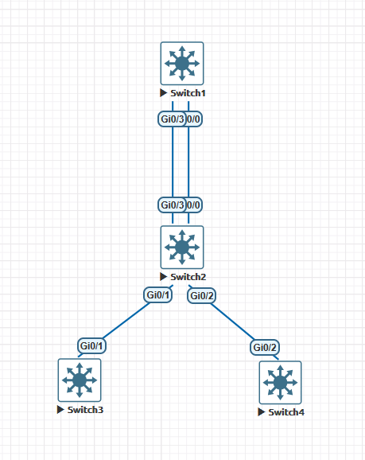
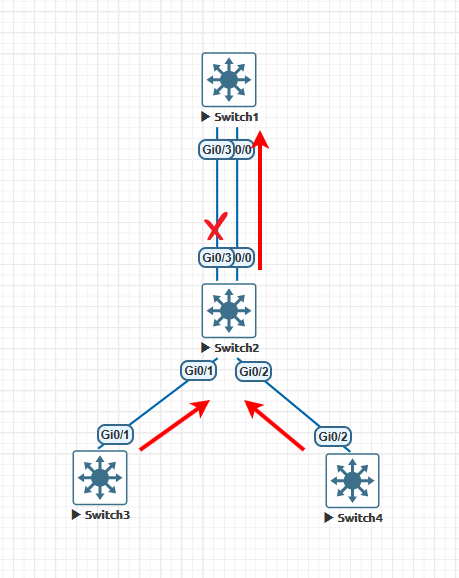
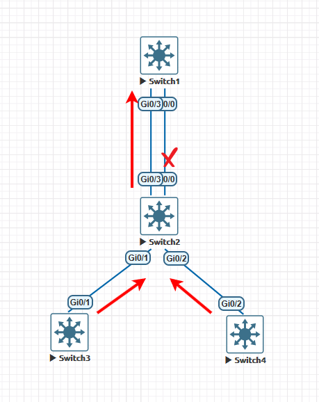
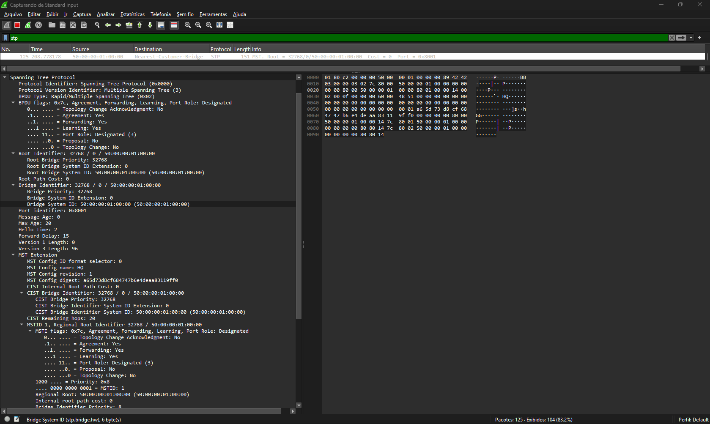

# 🛠️ MSTP (IEEE 802.1s): Engenharia de Tráfego Avançada - Manipulação de Custo e Prioridade de Porta

---

## 📋 Sumário

- [🛠️ MSTP (IEEE 802.1s): Engenharia de Tráfego Avançada - Manipulação de Custo e Prioridade de Porta](#️-mstp-ieee-8021s-engenharia-de-tráfego-avançada---manipulação-de-custo-e-prioridade-de-porta)
  - [📋 Sumário](#-sumário)
  - [🎯 Objetivo Desta Seção](#-objetivo-desta-seção)
  - [📐 Topologia de Referência para Engenharia de Tráfego](#-topologia-de-referência-para-engenharia-de-tráfego)
  - [🔬 Conceitos Fundamentais de Decisão de Caminho no MSTP](#-conceitos-fundamentais-de-decisão-de-caminho-no-mstp)
    - [O Critério de Desempate de 4 Etapas (STP/RSTP/MSTP)](#o-critério-de-desempate-de-4-etapas-stprstpmstp)
    - [Valores Padrão de Custo IEEE 802.1t (32 Bits)](#valores-padrão-de-custo-ieee-8021t-32-bits)
  - [⚙️ Cenário 1: Manipulação de Caminho por Instância Via Custo (`cost`)](#️-cenário-1-manipulação-de-caminho-por-instância-via-custo-cost)
    - [Análise da Topologia e Comportamento Padrão](#análise-da-topologia-e-comportamento-padrão)
    - [1. Configurações Iniciais - Preparação do Cenário](#1-configurações-iniciais---preparação-do-cenário)
    - [Verificações](#verificações)
    - [2. Configuração Prática na CLI (Cisco IOS XE)](#2-configuração-prática-na-cli-cisco-ios-xe)
    - [3. Validação Operacional e Auditoria dos Caminhos](#3-validação-operacional-e-auditoria-dos-caminhos)
    - [💡 Regra Fundamental: Como o Custo Influencia a Escolha da Rota](#-regra-fundamental-como-o-custo-influencia-a-escolha-da-rota)
    - [💡 Nota de Campo: Por que o Custo Alterado Não Aparece na Captura do Wireshark no MSTP?](#-nota-de-campo-por-que-o-custo-alterado-não-aparece-na-captura-do-wireshark-no-mstp)
      - [1. Comportamento no MSTP (IEEE 802.1s)](#1-comportamento-no-mstp-ieee-8021s)
      - [2. Contraponto: Como isso funcionaria no STP / RSTP Legado?](#2-contraponto-como-isso-funcionaria-no-stp--rstp-legado)
  - [🔀 Cenário 2: Desempate em Links Paralelos Via Prioridade de Porta (`port-priority`)](#-cenário-2-desempate-em-links-paralelos-via-prioridade-de-porta-port-priority)
  - [🧹 Limpeza do Ambiente: Desfazendo a Configuração de Custos](#-limpeza-do-ambiente-desfazendo-a-configuração-de-custos)
    - [Comandos para Reverter os Custos na CLI do SW02](#comandos-para-reverter-os-custos-na-cli-do-sw02)
    - [1. Entendendo o Desempate em Links Duplicados](#1-entendendo-o-desempate-em-links-duplicados)
    - [2. Configuração Prática na CLI (Cisco IOS XE)](#2-configuração-prática-na-cli-cisco-ios-xe-1)
    - [3. Validação dos Papéis e IDs de Porta](#3-validação-dos-papéis-e-ids-de-porta)
    - [⚖️ Quando Ajustar o Custo (`cost`) vs. Prioridade de Porta (`port-priority`)](#️-quando-ajustar-o-custo-cost-vs-prioridade-de-porta-port-priority)
      - [1. Quando alterar o Custo (`cost`)?](#1-quando-alterar-o-custo-cost)
      - [2. Quando alterar a Prioridade de Porta (`port-priority`)?](#2-quando-alterar-a-prioridade-de-porta-port-priority)
    - [🔄 Existem situações em que devemos alterar os dois juntos?](#-existem-situações-em-que-devemos-alterar-os-dois-juntos)
    - [💡 Root Primary vs. Root Secondary: Quando apenas ajustar as Roots é suficiente?](#-root-primary-vs-root-secondary-quando-apenas-ajustar-as-roots-é-suficiente)
      - [Como isso funciona na prática?](#como-isso-funciona-na-prática)
      - [Quando essa estratégia sozinha é suficiente?](#quando-essa-estratégia-sozinha-é-suficiente)
  - [🧪 Checkpoint de Validação Prática](#-checkpoint-de-validação-prática)

---

## 🎯 Objetivo Desta Seção

Esta terceira parte da documentação visa cobrir a manipulação determinística de tráfego dentro do **Blueprint do CCNP ENCOR 350-401** (item **3.1.c Configure and verify common Spanning Tree Protocols**).  

Nesta etapa, saímos do comportamento padrão do protocolo e implementamos técnicas de **Engenharia de Tráfego** via controle de **Root Path Cost** e **Port-Priority**. Você aprenderá a forçar caminhos específicos para diferentes instâncias MST e resolver empates em enlaces paralelos redundantes.

---

## 📐 Topologia de Referência para Engenharia de Tráfego

Para a realização dos testes de manipulação de métricas, estendemos a topologia base incluindo dois links paralelos entre os switches de agregação/acesso para demonstrar claramente o desempate por *Port-Priority*:



- **Mapeamento de Portas**  
  - **SWITCH01** porta **Gi0/0** ----> **SWITCH02** porta **Gi0/0** ( Caminho para a instância **MST1**)
  - **SWITCH01** porta **Gi0/3** ----> **SWITCH02** porta **Gi0/3** ( Caminho para a instância **MST2**)
  - **SWITCH02** porta **Gi0/1** ----> **SWITCH03** porta **Gi0/1**
  - **SWITCH02** porta **Gi0/2** ----> **SWITCH04** porta **Gi0/2**

- **Mapeamento de VLANs/Instâncias:**
  - **MSTI 1:** VLANs 10, 20, 30
  - **MSTI 2:** VLANs 40, 50, 60
  - **MSTI 0 (IST):** VLANs 1, 999

---

## 🔬 Conceitos Fundamentais de Decisão de Caminho no MSTP

### O Critério de Desempate de 4 Etapas (STP/RSTP/MSTP)

Para selecionar qual porta assume o papel de **Root Port** (a porta mais próxima da Root Bridge para cada instância) e **Designated Port**, o MSTP executa rigorosamente a sequência:

1. **Menor Root Bridge ID (BID):** Define a Root Bridge por instância.
2. **Menor Root Path Cost (RPC):** Soma do custo dos links de saída até atingir o Root.
3. **Menor Sender Bridge ID (BID do Vizinho):** Em caso de caminhos com mesmo custo de múltiplos switches.
4. **Menor Sender Port ID (Port Priority + Port Number do Vizinho):** Em caso de múltiplos links conectados ao **mesmo** switch vizinho.

---

### Valores Padrão de Custo IEEE 802.1t (32 Bits)

O MSTP adota obrigatoriamente a tabela de custo de 32 bits (IEEE 802.1t), eliminando o antigo padrão de 16 bits do STP clássico:

| Velocidade do Link | Custo Padrão IEEE (32-bit / MSTP) | Custo Legado STP (16-bit) |
| :---               | :---                              | :---                      |
| **10 Mbps**        | $2.000.000$                       | $100$                     |
| **100 Mbps**       | $200.000$                         | $19$                      |
| **1 Gbps**         | $20.000$                          | $4$                       |
| **10 Gbps**        | $2.000$                           | $2$                       |

---

## ⚙️ Cenário 1: Manipulação de Caminho por Instância Via Custo (`cost`)

### Análise da Topologia e Comportamento Padrão

Por padrão, enlaces GigabitEthernet possuem o custo igual a $20000$. Quando um switch de acesso (ex: `SW_ACC01`) possui dois uplinks para os switches de Core, ele escolhe o uplink direto como **Root Port** se o custo para atingir o Root daquela instância for menor.

Nossa meta é realizar o **balanceamento ativo-ativo**:

- **Tráfego das VLANs 10, 20, 30 (MSTI 1):** Deve preferir o enlace primário via `Gi0/0`.
- **Tráfego das VLANs 40, 50, 60 (MSTI 2):** Deve desviar via `Gi0/3`, tornando a `Gi0/3` a porta de backup (*Alternate/Blocking*) apenas para a Instância 2.

---

### 1. Configurações Iniciais - Preparação do Cenário

- Criar as vlans em todos os switches  
  
```ios
vlan 10,20,30,40,50,60
```

- Alterar o modo do Spanning-Tree

```ios
spanning-tree mode mst
```

- Configurando o MST e alocando as Vlans nas instâncias

```ios
spanning-tree mst configuration
revision 1
name HQ
instance 1 vlan 10,20,30
instance 2 vlan 40,50,60
exit
```

- Configurando as interfaces tronco

**SW01**  

- interfaces `Gi0/0 e Gi0/3`

**SW02**  

- Interfaces `Gi0/0, G0/1, Gi0/2 e Gi0/3`

**SW03**  

- Interfaces `Gi0/1`

**SW04**  

- Interfaces `G0/2`

```ios
switchport trunk encapsulation dot1q
switchport mode trunk
switchport trunk native vlan 60
switchport trunk allowed vlan 10,20,30,40,50,60
```

### Verificações

Agora, antes de continuarmos precisamos fazer algumas verificações.

Vamos verificar quem é o switch root. Então vamos entrar no switch **SW01** e executar a verificação:
  
```ios
SW01#show spanning-tree root

                                        Root    Hello Max Fwd
MST Instance           Root ID          Cost    Time  Age Dly  Root Port
---------------- -------------------- --------- ----- --- ---  ------------
MST0             32768 5000.0001.0000         0    2   20  15
MST1             32769 5000.0001.0000         0    2   20  15
MST2             32770 5000.0001.0000         0    2   20  15
SW01#
```

Certo, agora que temos os mac addresses dos switch root, podemos observar que o mac é o mesmo. Para verificarmos o mac address da caixa, poderíamos executar o comando **`show version`** ou **`show version | include Base`**. Na saída teríamos que observar a linha com as palavras **mac base**. No nosso exemplo, estamos utilizando a imagem virtualizada vios_l2 (Cisco IOSv-L2), o comando show version infelizmente não mostra a linha do "Base Ethernet MAC Address" como acontece nos switches físicos. Isso ocorre porque ele é uma máquina virtual rodando em cima do QEMU/KVM e não possui uma placa mãe (backplane) física com um pool de MACs gravado de fábrica. Então temos que utilizar o comando **`show spanning-tree bridge id`**  

```ios
SW01#show spanning-tree root

                                        Root    Hello Max Fwd
MST Instance           Root ID          Cost    Time  Age Dly  Root Port
---------------- -------------------- --------- ----- --- ---  ------------
MST0             32768 5000.0001.0000         0    2   20  15
MST1             32769 5000.0001.0000         0    2   20  15
MST2             32770 5000.0001.0000         0    2   20  15
```

Com isso podemos confirmar que o switch **SW01** é o **ROOT BRIDGE** para todas as instâncias MSTP.
  
Agora como temos caminhos redundantes somente nos switches **SW01 e SW02** vamos analisar as instâncias mst nesses dois equipamentos.  

- **SW01**
  
```ios
SW01#show spanning-tree mst 1

##### MST1    vlans mapped:   10,20,30
Bridge        address 5000.0001.0000  priority      32769 (32768 sysid 1)
Root          this switch for MST1

Interface        Role Sts Cost      Prio.Nbr Type
---------------- ---- --- --------- -------- --------------------------------
Gi0/0            Desg FWD 20000     128.1    P2p
Gi0/3            Desg FWD 20000     128.4    P2p

SW01#show spanning-tree mst 2

##### MST2    vlans mapped:   40,50,60
Bridge        address 5000.0001.0000  priority      32770 (32768 sysid 2)
Root          this switch for MST2

Interface        Role Sts Cost      Prio.Nbr Type
---------------- ---- --- --------- -------- --------------------------------
Gi0/0            Desg FWD 20000     128.1    P2p
Gi0/3            Desg FWD 20000     128.4    P2p

SW01#
```

- **SW02**

```ios
SW02#show spanning-tree mst 1

##### MST1    vlans mapped:   10,20,30
Bridge        address 5000.0002.0000  priority      32769 (32768 sysid 1)
Root          address 5000.0001.0000  priority      32769 (32768 sysid 1)
              port    Gi0/0           cost          20000     rem hops 19

Interface        Role Sts Cost      Prio.Nbr Type
---------------- ---- --- --------- -------- --------------------------------
Gi0/0            Root FWD 20000     128.1    P2p
Gi0/1            Desg FWD 20000     128.2    P2p
Gi0/2            Desg FWD 20000     128.3    P2p
Gi0/3            Altn BLK 20000     128.4    P2p

SW02#show spanning-tree mst 2

##### MST2    vlans mapped:   40,50,60
Bridge        address 5000.0002.0000  priority      32770 (32768 sysid 2)
Root          address 5000.0001.0000  priority      32770 (32768 sysid 2)
              port    Gi0/0           cost          20000     rem hops 19

Interface        Role Sts Cost      Prio.Nbr Type
---------------- ---- --- --------- -------- --------------------------------
Gi0/0            Root FWD 20000     128.1    P2p
Gi0/1            Desg FWD 20000     128.2    P2p
Gi0/2            Desg FWD 20000     128.3    P2p
Gi0/3            Altn BLK 20000     128.4    P2p

SW02#
```

Analisando as saídas, conseguimos entender por onde o tráfego passa por cada caixa. Vou desenhar no nosso cenário para entendermos melhor de forma visual.

Vamos verificar o fluxo para **MST1**



Agora vamos verificar o fluxo para **MST2**


Ou seja, temos o mesmo root para todas as instâncias e o fluxo do tráfego passa somente pelo link das portas **`Gi0/0`** que se ligam nos switchs **SW01 e SW02**. Ou seja, estamos com um link parado sem uso e isso não é interessante.

### 2. Configuração Prática na CLI (Cisco IOS XE)

Como vimos que a porta bloqueada está no switch **SW02**, vamos fazer a manipulação das prioridades nessa caixa somente nas portas **`Gi0/0` e `Gi0/3`**

Para alterar o custo de um link especificamente para uma determinada instância MST (sem afetar as demais instâncias ou o tráfego global):

```ios
! ========================================================
! AJUSTE DE CUSTO NO SW_ACC01 PARA ENGENHARIA DE TRÁFEGO
! ========================================================
!
interface GigabitEthernet0/3
 ! Eleva o custo do enlace Gi0/1 na MSTI 1 para forçar o caminho via Gi0/3
 spanning-tree mst 1 cost 50000
exit

interface GigabitEthernet0/0
 ! Eleva o custo do enlace Gi0/2 na MSTI 2 para forçar o caminho via Gi0/1
 spanning-tree mst 2 cost 50000
exit
```

> ⚠️ **Atenção:** O comando `spanning-tree cost <valor>` (sem o parâmetro `mst`) altera o custo padrão de **todas** as instâncias na interface simultaneamente.

---

### 3. Validação Operacional e Auditoria dos Caminhos

Execute o comando `show spanning-tree mst` no `SW02` para verificar se o custo customizado alterou os estados e papéis das portas:

```ios
SW02#show spanning-tree mst 1

##### MST1    vlans mapped:   10,20,30
Bridge        address 5000.0002.0000  priority      32769 (32768 sysid 1)
Root          address 5000.0001.0000  priority      32769 (32768 sysid 1)
              port    Gi0/0           cost          20000     rem hops 19

Interface        Role Sts Cost      Prio.Nbr Type
---------------- ---- --- --------- -------- --------------------------------
Gi0/0            Root FWD 20000     128.1    P2p
Gi0/1            Desg FWD 20000     128.2    P2p
Gi0/2            Desg FWD 20000     128.3    P2p
Gi0/3            Altn BLK 50000     128.4    P2p

SW02#show spanning-tree mst 2

##### MST2    vlans mapped:   40,50,60
Bridge        address 5000.0002.0000  priority      32770 (32768 sysid 2)
Root          address 5000.0001.0000  priority      32770 (32768 sysid 2)
              port    Gi0/3           cost          20000     rem hops 19

Interface        Role Sts Cost      Prio.Nbr Type
---------------- ---- --- --------- -------- --------------------------------
Gi0/0            Altn BLK 50000     128.1    P2p
Gi0/1            Desg FWD 20000     128.2    P2p
Gi0/2            Desg FWD 20000     128.3    P2p
Gi0/3            Root FWD 20000     128.4    P2p

SW02#
```

**Conclusão da Verificação:**

- **MSTI 1:** Porta `Gi0/0` operando em **Root FWD** (Custo $20000$) e `Gi0/3` como **Altn BLK** (Custo $50000$).
- **MSTI 2:** Porta `Gi0/3` operando em **Root FWD** (Custo $20000$) e `Gi0/0` como **Altn BLK** (Custo $50000$).
- Alcançado 100% de balanceamento de carga ativo-ativo por instância.

**Fluxo do tráfego da instância em MST1**  



**Fluxo do tráfego da instância em MST2**  


### 💡 Regra Fundamental: Como o Custo Influencia a Escolha da Rota

Ao manipular o **Root Path Cost** no Spanning Tree, vale a regra do menor caminho lógico:

- **Custo Menor = Rota Preferencial:** O switch sempre elege como **Root Port** a interface que acumula o menor custo total para atingir a Root Bridge.
- **Aumentar o Custo = Desviar o Tráfego:** Quando você eleva manualmente o custo de uma interface (ex: de $20.000$ para $50.000$), você torna aquela rota desinteressante para o algoritmo. O switch descartará esse caminho e escolherá o link alternativo (com custo menor) para encaminhar o tráfego daquela instância, forçando o bloqueio (*Alternate/Blocking*) na porta que teve o custo elevado.

> ⚠️ **Atenção para a Prova:** Nunca confunda o custo do Spanning Tree com métricas de protocolos de roteamento (como OSPF ou EIGRP), onde métricas maiores às vezes indicam preferência dependendo da engenharia. No STP, **quem tem o menor custo vence**.

---

### 💡 Nota de Campo: Por que o Custo Alterado Não Aparece na Captura do Wireshark no MSTP?



Ao realizar um laboratório e planejar uma análise de pacotes com o Wireshark para auditar o comportamento da métrica `cost`, é natural esperar que o valor alterado (ex: `50000`) apareça diretamente nos cabeçalhos dos BPDUs transmitidos na rede. No entanto, no **MSTP**, a dinâmica do protocolo funciona de forma diferente dos protocolos legados:

#### 1. Comportamento no MSTP (IEEE 802.1s)

- **Custo de Recepção Local:** O comando `spanning-tree mst [instância] cost <valor>` altera estritamente o **custo de entrada/recepção** na interface do switch receptor (não-Root). 
- **Processamento no Plano de Controle:** O switch utiliza esse valor internamente em seu algoritmo para calcular o *Root Path Cost* (RPC) local e decidir qual interface se tornará a *Root Port* e qual será bloqueada (*Alternate/Blocking*).
- **Ausência no Pacote:** O switch não reescreve esse valor customizado local no BPDU para transmiti-lo de volta ou enviá-lo ao Root Bridge. Como o switch Root (no nosso caso, o **SW01**) é quem gera e transmite os BPDUs para a rede com custo base `0`, qualquer captura de pacotes realizada no enlace continuará exibindo o custo enviado pelo Root (`Cost = 0` ou custo de enlace padrão), e não o valor de `50000` inserido no switch não-Root (**SW02**).

---

#### 2. Contraponto: Como isso funcionaria no STP / RSTP Legado?

Para fins de diferenciação e entendimento avançado exigido no **CCNP ENCOR**:

- **Acúmulo de Custo Hop-by-Hop (STP / RSTP):** Nos protocolos Spanning Tree legados (onde há uma única topologia global por porta), os BPDUs viajam em cadeia de switch em switch. Quando um switch intermediário recebe um BPDU, ele **adiciona o custo da sua porta de recepção** ao valor do BPDU e retransmite a mensagem com o novo valor acumulado (*Root Path Cost*) para os switches abaixo dele (*downstream*).
- **Visibilidade na Captura:** Em cenários legados, se você inspecionar o pacote capturado na porta de saída de um switch intermediário que está propagando a topologia para frente, você verá o campo *Root Path Cost* incrementado com o valor do custo ajustado.

> 📌 **Resumo Prático para Troubleshooting:** No MSTP, a validação de comandos de `cost` **não deve ser buscada no Wireshark**, e sim diretamente via CLI através dos comandos de auditoria operacionais:
>
> ```ios
> show spanning-tree mst <instância> interface <interface>
> ```
>
> O campo `Cost` no output do IOS XE refletirá a métrica manipulada e confirmará a mudança do papel da porta (*Root* vs *Altn*).
>
> ```ios
> SW02#show spanning-tree mst 1 interface G0/3
> 
> GigabitEthernet0/3 of MST1 is alternate blocking
> Portfast : no             (default)        port guard : none        (default)
> Link type: point-to-point (auto)           bpdu filter: disable     (default)
> Boundary : internal                        bpdu guard : disable     (default)
> PVST Sim : enable         (default)
> Bpdus (MRecords) sent 6, received 752
> 
> Instance Role Sts Cost      Prio.Nbr Vlans mapped
> -------- ---- --- --------- -------- -------------------------------
> 1        Altn BLK 50000     128.4    10,20,30
> 
> SW02#
> ```

---

---ALTERAR DAQUI---

---

## 🔀 Cenário 2: Desempate em Links Paralelos Via Prioridade de Porta (`port-priority`)

## 🧹 Limpeza do Ambiente: Desfazendo a Configuração de Custos

Antes de avançarmos para o **Cenário 2 (Manipulação de Port-Priority)**, é importante limparmos o ambiente do laboratório para evitar conflitos de métricas acumuladas. Como ajustamos os custos manualmente no **SW02**, vamos removê-los e retornar as portas ao comportamento padrão ($20000$).

### Comandos para Reverter os Custos na CLI do SW02

```ios
configure terminal
interface GigabitEthernet0/0
 no spanning-tree mst 2 cost 50000
exit

interface GigabitEthernet0/3
 no spanning-tree mst 1 cost 50000
end
```

Com as portas do SW02 readequadas ao custo padrão, o Spanning Tree descarta as métricas manuais de caminho, preparando o terreno determinístico para testarmos o desempate refinado via Port-Priority.

### 1. Entendendo o Desempate em Links Duplicados

Se conectarmos duas interfaces físicas paralelas entre dois switches (como fizemos com **`Gi0/0` e `Gi0/3`** entre o **SW01 e o SW02**):

- **Custo para o Root:** Idêntico em ambas as portas.
- **Bridge ID do Vizinho:** Idêntico (ambas chegam no mesmo switch vizinho).

Neste cenário de empate perfeito nos critérios anteriores, a escolha da Root Port recairá sobre o Sender Port ID enviado pelo switch vizinho (Designated Bridge).  
  
O Port ID é um campo de 16 bits composto por:  

**$$\text{Port ID} = \text{Port Priority (8 bits)} + \text{Port Index/Number (8 bits)}$$**
  
A prioridade padrão é $128$, ajustável em incrementos de $16$ (ex: $0, 16, 32, 64 \dots 240$).

---

### 2. Configuração Prática na CLI (Cisco IOS XE)

> 💡 **Ponto Crítico do CCNP ENCOR:** A prioridade de porta deve ser alterada no switch **DESIGNADOR (Sender / Transmissor)** para surtir efeito sobre o switch receptor! Alterar a prioridade da porta local no switch que recebe os BPDUs **não altera** a escolha da Root Port.
  
**Quem é o "Switch Designador (Sender)" nesse caso?**  
  
Como os dois links paralelos estão ligando o Switch1 ao Switch2, o **Switch1** (que é o Root Bridge de todas as instâncias) atua como o switch transmissor (Designated Bridge) enviando os BPDUs para baixo através das portas Gi0/0 e Gi0/3 dele.  
  
Portanto, para alterar a port-priority que o Switch2 vai receber e usar como critério de desempate, o comando deve ser aplicado nas portas correspondentes no **Switch1** (ou balanceado entre as pontas dependendo de qual critério de desempate você deseja influenciar).

Para garantir que a MSTI 1 prefira um link e a MSTI 2 prefira o outro utilizando a prioridade de porta, configuramos de forma simétrica no switch transmissor (ex: Switch1):

```ios
! ========================================================
! CONFIGURAÇÃO DE PORT-PRIORITY NO SW1 (Core / Sender)
! ========================================================
!
configure terminal

! Configuração para favorecer a MSTI 1 na porta Gi0/0
interface GigabitEthernet0/0
 spanning-tree mst 1 port-priority 64   ! Prioridade menor (64) ganha a eleição para MSTI 1
 spanning-tree mst 2 port-priority 128  ! Mantém padrão para MSTI 2
exit

! Configuração para favorecer a MSTI 2 na porta Gi0/3
interface GigabitEthernet0/3
 spanning-tree mst 1 port-priority 128  ! Mantém padrão para MSTI 1
 spanning-tree mst 2 port-priority 64   ! Prioridade menor (64) ganha a eleição para MSTI 2
exit
```

---

### 3. Validação dos Papéis e IDs de Porta

Execute a verificação no switch receptor (`SW_ACC02`):

```text
SW02#show spanning-tree mst 1

##### MST1    vlans mapped:   10,20,30
Bridge        address 5000.0002.0000  priority      32769 (32768 sysid 1)
Root          address 5000.0001.0000  priority      32769 (32768 sysid 1)
              port    Gi0/0           cost          20000     rem hops 19

Interface        Role Sts Cost      Prio.Nbr Type
---------------- ---- --- --------- -------- --------------------------------
Gi0/0            Root FWD 20000     128.1    P2p
Gi0/1            Desg FWD 20000     128.2    P2p
Gi0/2            Desg FWD 20000     128.3    P2p
Gi0/3            Altn BLK 20000     128.4    P2p

SW02#show spanning-tree mst 2

##### MST2    vlans mapped:   40,50,60
Bridge        address 5000.0002.0000  priority      32770 (32768 sysid 2)
Root          address 5000.0001.0000  priority      32770 (32768 sysid 2)
              port    Gi0/3           cost          20000     rem hops 19

Interface        Role Sts Cost      Prio.Nbr Type
---------------- ---- --- --------- -------- --------------------------------
Gi0/0            Altn BLK 20000     128.1    P2p
Gi0/1            Desg FWD 20000     128.2    P2p
Gi0/2            Desg FWD 20000     128.3    P2p
Gi0/3            Root FWD 20000     128.4    P2p

SW02#
```

---

### ⚖️ Quando Ajustar o Custo (`cost`) vs. Prioridade de Porta (`port-priority`)

Na engenharia de tráfego do Spanning Tree (MSTP/RSTP), cada parâmetro atua em uma camada diferente do algoritmo de seleção de rotas. Compreender o momento certo de aplicar cada um evita configurações ineficazes.

#### 1. Quando alterar o Custo (`cost`)?

- **O que faz:** Altera a métrica de preferência de todo o enlace físico com base na velocidade ou largura de banda lógica da porta.
- **Quando usar:** Utilize o custo quando você precisar direcionar o tráfego de instâncias específicas (**MSTIs**) por **caminhos físicos diferentes** (por exemplo, fazer a MSTI 1 subir pelo Link A e a MSTI 2 subir pelo Link B em uma topologia com links paralelos no Core). É a ferramenta principal para o **balanceamento de carga ativo-ativo**.

#### 2. Quando alterar a Prioridade de Porta (`port-priority`)?

- **O que faz:** Atua exclusivamente como um **critério de desempate refinado** (o 4º passo do algoritmo do STP).
- **Quando usar:** Utilize a prioridade de porta estritamente quando houver um **empate perfeito** — ou seja, quando dois ou mais links paralelos conectam exatamente os **mesmos dois switches**, possuem exatamente a **mesma velocidade (mesmo custo)** e chegam ao mesmo vizinho.  

---

### 🔄 Existem situações em que devemos alterar os dois juntos?

**Em arquiteturas tradicionais e bem desenhadas, raramente você precisa alterar os dois na mesma porta simultaneamente.**  

- Se os links possuem **velocidades diferentes** (ex: um link de 10Gbps e um de 1Gbps), o próprio custo padrão do protocolo já diferencia as rotas de forma natural. Se você quiser desviar o tráfego para o link mais lento por algum motivo de negócio, o **Custo (`cost`)** isolado resolve o problema.
- Se os links possuem a **mesma velocidade** (ex: dois cabos Gigabit paralelos), o **Path Cost** de ambos será idêntico. Nesses casos, se você não alterar nada, o Spanning Tree usará o *Port ID* interno para desempatar, mas para forçar uma engenharia determinística de qual link atende qual instância, recorremos à **Port-Priority**.

> ⚠️ **Regra de Ouro para a Prova (CCNP ENCOR):**  
>
> - O **Custo** decide qual caminho é o "mais curto" globalmente para o switch.
> - A **Prioridade de Porta** só é avaliada se o Custo, a Root Bridge e o Bridge ID do vizinho forem **absolutamente idênticos**. Se você alterar o custo de uma porta para um valor maior, o algoritmo do STP descarta aquela rota imediatamente, tornando o uso simultâneo da *port-priority* desnecessário naquele enlace.

### 💡 Root Primary vs. Root Secondary: Quando apenas ajustar as Roots é suficiente?

Em muitas topologias de redes corporativas tradicionais, configurar apenas o **Root Primary** e o **Root Secondary** (via `spanning-tree mst <instância> root primary` e `secondary`) por instância já é suficiente para garantir o balanceamento de carga ativo-ativo.  

#### Como isso funciona na prática?

Quando você define o **Switch A** como Root da Instância 1 e o **Switch B** como Root da Instância 2, o algoritmo do Spanning Tree cria caminhos lógicos inversos a partir dos switches de acesso:

- O tráfego da **Instância 1** converge naturalmente subindo pelo caminho que aponta para o Switch A.
- O tráfego da **Instância 2** converge subindo pelo caminho que aponta para o Switch B.

#### Quando essa estratégia sozinha é suficiente?

- **Topologias em Árvore Tradicionais:** Quando os switches de acesso possuem caminhos distintos e independentes para chegar aos dois switches de Core (por exemplo, um uplink dedicado para cada switch de Core).
- **Ausência de Links Paralelos Diretos:** Se os enlaces entre os nós principais não formam pares redundantes e idênticos conectados diretamente entre as mesmas duas caixas (onde o custo e o tipo de porta são estritamente iguais), a própria eleição de Root Bridge já divide os fluxos de forma limpa.

> 📌 **A Regra de Ouro:** Ajustar as **Roots** define *para onde* o tráfego de cada VLAN/instância deve convergir globalmente na rede. Ajustar **Custos e Port-Priorities** é a ferramenta de engenharia fina utilizada quando a topologia possui enlaces paralelos idênticos e você precisa forçar manualmente o caminho físico exato que cada instância vai percorrer.

## 🧪 Checkpoint de Validação Prática

Antes de avançar para o laboratório final de **STP Enhancements (BPDU Guard, Root Guard e PortFast)**, certifique-se de validar os seguintes pontos no ambiente de laboratório:

1. [ ] **Manipulação de Custo:** A alteração de `cost` foi aplicada com o prefixo `mst <instance>` no switch receptor e confirmada via `show spanning-tree mst <instance>`[cite: 17].
2. [ ] **Balanceamento por Custo:** O balanceamento de carga ativo-ativo via custo está funcional: o tráfego de instâncias distintas utiliza caminhos físicos opostos (verificado através dos mapeamentos de portas e diagramas).
3. [ ] **Reversão de Métricas:** Os custos manuais foram limpos e readequadas as portas ao padrão antes de iniciar os testes de desempate por prioridade.
4. [ ] **Configuração de Port-Priority:** A alteração de `port-priority` para o desempate de links paralelos foi configurada corretamente no switch vizinho transmissor (**Sender / Designated Bridge**, ex: SW1), e não no receptor.
5. [ ] **Escala de Valores:** Os valores configurados de prioridade de porta respeitam restritamente a escala de múltiplos de 16 ($0, 16, 32, 64 \dots 240$).
6. [ ] **Consolidação Conceitual:** Compreensão clara de quando utilizar a manipulação de Custo (engenharia de tráfego de instâncias), de quando recorrer à Port-Priority (desempate de links idênticos) e de quando o ajuste isolado de *Root Primary/Secondary* já é suficiente para o design da rede.  
  