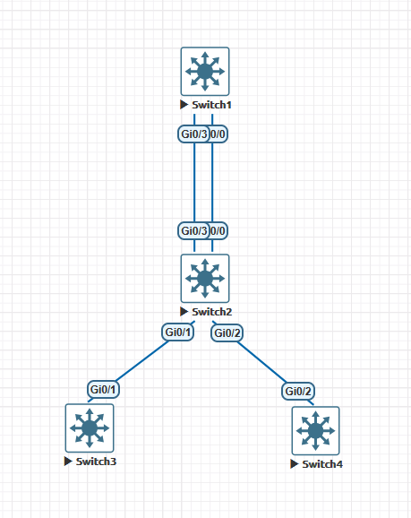

# 🛡️ MSTP Enhancements (IEEE 802.1s): Proteção de Topologia, Segurança e Convergência Avançada

---

## 📋 Sumário

- [🛡️ MSTP Enhancements (IEEE 802.1s): Proteção de Topologia, Segurança e Convergência Avançada](#️-mstp-enhancements-ieee-8021s-proteção-de-topologia-segurança-e-convergência-avançada)
  - [📋 Sumário](#-sumário)
  - [🎯 Objetivo Desta Seção](#-objetivo-desta-seção)
  - [📐 Topologia de Referência do Laboratório](#-topologia-de-referência-do-laboratório)
  - [Preparação inicial do Cenário](#preparação-inicial-do-cenário)
  - [🔬 Conceitos Fundamentais dos Enhancements no MSTP](#-conceitos-fundamentais-dos-enhancements-no-mstp)
    - [Comportamento Específico no MSTP (IEEE 802.1s)](#comportamento-específico-no-mstp-ieee-8021s)
  - [⚙️ Cenário 1: MSTP Root Guard](#️-cenário-1-mstp-root-guard)
    - [1. Entendendo o Sequestro do Root no MSTP](#1-entendendo-o-sequestro-do-root-no-mstp)
    - [2. Configuração Prática na CLI (Cisco IOS XE no SW02)](#2-configuração-prática-na-cli-cisco-ios-xe-no-sw02)
    - [3. Simulação Prática do Ataque (Injetando BPDU Superior no SW03)](#3-simulação-prática-do-ataque-injetando-bpdu-superior-no-sw03)
    - [4. Validação Operacional e Auditoria (`root-inconsistent`)](#4-validação-operacional-e-auditoria-root-inconsistent)
    - [5. Resolução e Restabelecimento do Enlace](#5-resolução-e-restabelecimento-do-enlace)
  - [⚙️ Cenário 2: MSTP BPDU Guard e PortFast / Edge Port](#️-cenário-2-mstp-bpdu-guard-e-portfast--edge-port)
    - [1. Protegendo a Borda do Domínio MSTP](#1-protegendo-a-borda-do-domínio-mstp)
    - [2. Configuração Prática na CLI (Cisco IOS XE no SW02)](#2-configuração-prática-na-cli-cisco-ios-xe-no-sw02-1)
      - [Habilitação Global (Recomendado para Portas Edge)](#habilitação-global-recomendado-para-portas-edge)
      - [Habilitação por Interface Directa](#habilitação-por-interface-directa)
    - [3. Simulação de Conexão Indevida (SW04 gerando BPDUs na porta de acesso)](#3-simulação-de-conexão-indevida-sw04-gerando-bpdus-na-porta-de-acesso)
    - [4. Validação do Estado `err-disable`](#4-validação-do-estado-err-disable)
    - [5. Automação de Recuperação via `errdisable recovery`](#5-automação-de-recuperação-via-errdisable-recovery)
    - [⚠️ Alerta de Engenharia de Campo: O Perigo do Flapping Infinito via `errdisable recovery`](#️-alerta-de-engenharia-de-campo-o-perigo-do-flapping-infinito-via-errdisable-recovery)
      - [🔄 O Ciclo Vicioso (*Flap Loop*):](#-o-ciclo-vicioso-flap-loop)
      - [🔴 Impactos de Produção:](#-impactos-de-produção)
    - [⚠️ Quando e Onde Utilizar o Auto Recovery (`errdisable recovery`)](#️-quando-e-onde-utilizar-o-auto-recovery-errdisable-recovery)
  - [⚡ Cenário 3: Proteções Adicionais - BPDU Filter e Loop Guard no MSTP](#-cenário-3-proteções-adicionais---bpdu-filter-e-loop-guard-no-mstp)
    - [1. BPDU Filter no MSTP: Comportamento Global vs. Interface](#1-bpdu-filter-no-mstp-comportamento-global-vs-interface)
    - [2. Loop Guard no MSTP](#2-loop-guard-no-mstp)
    - [3. UDLD (Unidirectional Link Detection)](#3-udld-unidirectional-link-detection)
  - [📊 Matriz Comparativa para a Prova CCNP ENCOR 350-401](#-matriz-comparativa-para-a-prova-ccnp-encor-350-401)
  - [🧪 Checkpoint de Validação Prática Final](#-checkpoint-de-validação-prática-final)

---

## 🎯 Objetivo Desta Seção

Esta etapa da documentação visa cobrir a aplicação prática das proteções e melhorias de Spanning Tree (**STP Enhancements**) operando especificamente sob o protocolo **MSTP (IEEE 802.1s)**, atendendo ao item **3.1.c Configure and verify common Spanning Tree Protocols and Spanning Tree enhancements** do blueprint **CCNP ENCOR 350-401**.

Utilizaremos a **mesma topologia física de 4 switches** dos laboratórios anteriores de MSTP, simulando o **SW03** como um switch não-autorizado que tenta assumir a função de IST/MSTI Root e o **SW04** como um dispositivo de borda gerando MST-BPDUs indevidos em uma porta de acesso.

---

## 📐 Topologia de Referência do Laboratório

A topologia mantém-se idêntica à dos exercícios anteriores de MSTP:



- **Mapeamento de Interfaces e Funções neste Laboratório:**
  - **SW01 (Core / Legítimo Root Bridge):** Root Bridge legítimo para CIST/IST (MST0), MSTI 1 e MSTI 2.
  - **SW02 (Aggregation / Distribuição):** Switch de aplicação dos recursos de defesa (**Root Guard**, **BPDU Guard**, **PortFast Edge**).
  - **SW03 (Switch Não-Autorizado / Atacante):** Conectado na porta `Gi0/1` do `SW02`. Simulará um switch de acesso tentando forçar a eleição como Root Bridge via MST-BPDUs superiores.
  - **SW04 (Equipamento Indevido em Porta de Acesso):** Conectado na porta `Gi0/2` do `SW02`. Simulará a injeção de BPDUs em porta de borda configurada com **PortFast + BPDU Guard**.

- **Instâncias MST Configuradas:**
  - **Region Name:** `HQ` | **Revision:** `1`
  - **MSTI 1:** VLANs 10, 20, 30
  - **MSTI 2:** VLANs 40, 50, 60
  - **IST / MST0:** VLANs 1, 999

---

## Preparação inicial do Cenário

Vamos entrar em **SW01** e torná-lo o **ROOT BRIDGE** para todas as instâncias do MSTP.

```ios
SW01(config)#spanning-tree mst 0,1,2 root primary
```

Agora vamos verificar:

```ios
SW01#show spanning-tree mst 0

##### MST0    vlans mapped:   1-9,11-19,21-29,31-39,41-49,51-59,61-4094
Bridge        address 5000.0001.0000  priority      24576 (24576 sysid 0)
Root          this switch for the CIST
Operational   hello time 2 , forward delay 15, max age 20, txholdcount 6
Configured    hello time 2 , forward delay 15, max age 20, max hops    20

Interface        Role Sts Cost      Prio.Nbr Type
---------------- ---- --- --------- -------- --------------------------------
Gi0/0            Desg FWD 20000     128.1    P2p
Gi0/1            Desg FWD 20000     128.2    P2p
Gi0/2            Desg FWD 20000     128.3    P2p
Gi0/3            Desg FWD 20000     128.4    P2p
Gi1/0            Desg FWD 20000     128.5    P2p
Gi1/1            Desg FWD 20000     128.6    P2p
Gi1/2            Desg FWD 20000     128.7    P2p
Gi1/3            Desg FWD 20000     128.8    P2p
Gi2/0            Desg FWD 20000     128.9    P2p
Gi2/1            Desg FWD 20000     128.10   P2p
Gi2/2            Desg FWD 20000     128.11   P2p
Gi2/3            Desg FWD 20000     128.12   P2p
Gi3/0            Desg FWD 20000     128.13   P2p
Gi3/1            Desg FWD 20000     128.14   P2p
Gi3/2            Desg FWD 20000     128.15   P2p
Gi3/3            Desg FWD 20000     128.16   P2p

SW01#show spanning-tree mst 1

##### MST1    vlans mapped:   10,20,30
Bridge        address 5000.0001.0000  priority      24577 (24576 sysid 1)
Root          this switch for MST1

Interface        Role Sts Cost      Prio.Nbr Type
---------------- ---- --- --------- -------- --------------------------------
Gi0/0            Desg FWD 20000     128.1    P2p
Gi0/3            Desg FWD 20000     128.4    P2p

SW01#show spanning-tree mst 2

##### MST2    vlans mapped:   40,50,60
Bridge        address 5000.0001.0000  priority      24578 (24576 sysid 2)
Root          this switch for MST2

Interface        Role Sts Cost      Prio.Nbr Type
---------------- ---- --- --------- -------- --------------------------------
Gi0/0            Desg FWD 20000     128.1    P2p
Gi0/3            Desg FWD 20000     128.4    P2p

SW01#

SW01#show spanning-tree root

                                        Root    Hello Max Fwd
MST Instance           Root ID          Cost    Time  Age Dly  Root Port
---------------- -------------------- --------- ----- --- ---  ------------
MST0             24576 5000.0001.0000         0    2   20  15
MST1             24577 5000.0001.0000         0    2   20  15
MST2             24578 5000.0001.0000         0    2   20  15
SW01#

SW01#show spanning-tree bridge id
MST0             6000.5000.0001.0000
MST1             6001.5000.0001.0000
MST2             6002.5000.0001.0000
SW01#
```

## 🔬 Conceitos Fundamentais dos Enhancements no MSTP

### Comportamento Específico no MSTP (IEEE 802.1s)

1. **Escopo do Root Guard no MSTP:** Diferente do PVST+ onde cada VLAN tem seu próprio BPDU, no MSTP todos os M-Records (instâncias) são envelopados em um único **MST-BPDU**. Quando o **Root Guard** atua em um enlace MSTP, se um BPDU contiver uma prioridade superior para *qualquer* instância (CIST ou MSTI), a porta entra em estado `root-inconsistent` para **todas** as instâncias mapeadas naquela interface.
2. **PortFast (Edge Ports):** No MSTP, portas de borda (*Edge Ports*) transitam imediatamente para *Forwarding* via RSTP/MSTP rapid-state transition. Ao habilitar `spanning-tree portfast`, a porta não gera anúncios de mudança de topologia (*Topology Change - TC*) dentro da região MSTP quando sofre *flapping*.
3. **BPDU Guard & BPDU Filter:** Inspecionam quadros na borda. Ao receber um MST-BPDU (EtherType $0x8809$ / LLC STP), interrompem a recepção ou desativam a porta.

---

## ⚙️ Cenário 1: MSTP Root Guard

### 1. Entendendo o Sequestro do Root no MSTP

Se um novo switch for adicionado à rede rodando MSTP com a mesma `Region Name` e `Revision`, mas com prioridade $0$ configurada para a CIST (MST0) ou qualquer MSTI, o protocolo acatará a alteração. Todo o tráfego inter-VLAN da região passará a convergir em direção a esse novo nó.

O **Root Guard** no MSTP força a interface a permanecer estritamente como **Designated Port**. Se a interface receber um MST-BPDU com um Root BID superior ao Root atual da região, o switch bloqueia a porta no estado **`root-inconsistent`**.

---

### 2. Configuração Prática na CLI (Cisco IOS XE no SW02)

No **SW02**, aplicamos o Root Guard na interface `Gi0/1` (apontando para o switch de acesso `SW03`):

```ios
! ========================================================
! CONFIGURAÇÃO DO ROOT GUARD NO SW02 (MSTP)
! ========================================================
configure terminal
interface GigabitEthernet0/1
 description Link para SW03 (Acesso / Borda)
 spanning-tree guard root
end
```

> ⚠️ **Atenção para o Exame:** O comando `spanning-tree guard root` é aplicado no nível de interface e atua sobre todas as instâncias MSTP (MST0, MST1, MST2) negociadas naquela porta.

**OBS:** quando aplicamos o recurso, recebemos um log no terminal avisando que o **Root Guard** foi habilitado a interface.

```ios
*Nov  5 13:53:51.093: %SPANTREE-2-ROOTGUARD_CONFIG_CHANGE: Root guard enabled on port GigabitEthernet0/1.
```

---

### 3. Simulação Prática do Ataque (Injetando BPDU Superior no SW03)

Para testar a defesa, acessamos o **SW03** (já pertencente à mesma região MST `HQ`) e reduzimos sua prioridade para $0$ na instância MST 1:

```ios
! ========================================================
! SIMULAÇÃO DE ATAQUE NO SW03 (FORÇANDO ROOT NA INSTÂNCIA MST1)
! ========================================================
configure terminal
spanning-tree mst 1 priority 0
end
```

---

### 4. Validação Operacional e Auditoria (`root-inconsistent`)

Assim que o **SW03** envia o MST-BPDU com o M-Record da MST1 contendo a prioridade $0$, o **SW02** emite o seguinte log:

```text
*Nov  5 14:00:38.925: %SPANTREE-2-ROOTGUARD_BLOCK: Root guard blocking port GigabitEthernet0/1 on MST1.
```

Para verificar o bloqueio por inconsistência no **SW02**:

```ios
SW02#show spanning-tree inconsistentports

Name                 Interface                Inconsistency
-------------------- ------------------------ ------------------
MST1                 GigabitEthernet0/1       Root Inconsistent

Number of inconsistent ports (segments) in the system : 1

SW02#
```

Detalhamento da interface `Gi0/1` no **SW02**:

```ios
SW02#show spanning-tree interface GigabitEthernet0/1 detail
 Port 2 (GigabitEthernet0/1) of MST0 is designated forwarding
   Port path cost 20000, Port priority 128, Port Identifier 128.2.
   Designated root has priority 24576, address 5000.0001.0000
   Designated bridge has priority 32768, address 5000.0002.0000
   Designated port id is 128.2, designated path cost 0
   Timers: message age 0, forward delay 0, hold 0
   Number of transitions to forwarding state: 3
   Link type is point-to-point by default, Internal
   PVST Simulation is enabled by default
   Root guard is enabled on the port
   BPDU: sent 722, received 315

 Port 2 (GigabitEthernet0/1) of MST1 is broken  (Root Inconsistent)
   Port path cost 20000, Port priority 128, Port Identifier 128.2.
   Designated root has priority 24577, address 5000.0001.0000
   Designated bridge has priority 32769, address 5000.0002.0000
   Designated port id is 128.2, designated path cost 20000
   Timers: message age 5, forward delay 0, hold 0
   Number of transitions to forwarding state: 2
   Link type is point-to-point by default, Internal
   PVST Simulation is enabled by default
   Root guard is enabled on the port
   BPDU: sent 722, received 311

 Port 2 (GigabitEthernet0/1) of MST2 is designated forwarding
   Port path cost 20000, Port priority 128, Port Identifier 128.2.
   Designated root has priority 24578, address 5000.0001.0000
   Designated bridge has priority 32770, address 5000.0002.0000
   Designated port id is 128.2, designated path cost 20000
   Timers: message age 0, forward delay 0, hold 0
   Number of transitions to forwarding state: 2
   Link type is point-to-point by default, Internal
   PVST Simulation is enabled by default
   Root guard is enabled on the port
   BPDU: sent 722, received 311
SW02#
```

---

### 5. Resolução e Restabelecimento do Enlace

Removemos a prioridade maliciosa no **SW03**:

```ios
! No SW03
configure terminal
no spanning-tree mst 1 priority
end
```

No **SW02**, a porta detecta a normalização dos BPDUs e restabelece a interface automaticamente:

```text
*Nov  5 14:06:25.468: %SPANTREE-2-ROOTGUARD_UNBLOCK: Root guard unblocking port GigabitEthernet0/1 on MST1.
```

---

## ⚙️ Cenário 2: MSTP BPDU Guard e PortFast / Edge Port

### 1. Protegendo a Borda do Domínio MSTP

- **PortFast / Edge Port:** Transita a porta imediatamente para *Forwarding* no MSTP. Evita que o reconectamento de estações de trabalho cause o envio de requisições de migração de topologia (*Topology Change*) que limparem as tabelas de CAM (MAC Address table) da região MSTP.
- **BPDU Guard:** Se uma porta de borda receber qualquer BPDU (seja STP legado, RSTP ou MSTP), a porta é desativada imediatamente no estado **`err-disable`**.

---

### 2. Configuração Prática na CLI (Cisco IOS XE no SW02)

Configuração na interface `Gi0/2` do **SW02** simulação de porta de acesso:

#### Habilitação Global (Recomendado para Portas Edge)

```ios
configure terminal
spanning-tree portfast default
spanning-tree portfast bpduguard default
```

#### Habilitação por Interface Directa

```ios
configure terminal
interface GigabitEthernet0/2
 description Porta de Acesso Host (SW04 no Lab)
 switchport mode access
 switchport access vlan 10
 spanning-tree portfast
 spanning-tree bpduguard enable
end
```

---

### 3. Simulação de Conexão Indevida (SW04 gerando BPDUs na porta de acesso)

O **SW04**, ao ser conectado na porta `Gi0/2` do **SW02**, iniciará a transmissão de MST-BPDUs.

No nosso cenário vamos habilitar somente na porta **`Gi0/2`**.  
  
No momento em habilitamos o recrso, já recebemos um alerta no console.

---

### 4. Validação do Estado `err-disable`

O **SW02** detecta o MST-BPDU na porta de acesso e desarma o link:

```text
%SPANTREE-2-BLOCK_BPDUGUARD: Received BPDU on port GigabitEthernet0/2 with BPDU Guard enabled. Disabling port.
%LINK-3-UPDOWN: Interface GigabitEthernet0/2, changed state to down
%LINEPROTO-5-UPDOWN: Line protocol on Interface GigabitEthernet0/2, changed state to down
```

Auditoria da interface em `err-disable`:

```ios
SW02#show interfaces status

Port      Name               Status       Vlan       Duplex  Speed Type
Gi0/0                        connected    trunk      a-full   auto RJ45
Gi0/1     Link para SW03 (Ac connected    trunk      a-full   auto RJ45
Gi0/2     Porta de Acesso Ho err-disabled 10           auto   auto RJ45
Gi0/3                        connected    trunk      a-full   auto RJ45
Gi1/0                        connected    1          a-full   auto RJ45
Gi1/1                        connected    1          a-full   auto RJ45
Gi1/2                        connected    1          a-full   auto RJ45
Gi1/3                        connected    1          a-full   auto RJ45
Gi2/0                        connected    1          a-full   auto RJ45
Gi2/1                        connected    1          a-full   auto RJ45
Gi2/2                        connected    1          a-full   auto RJ45
Gi2/3                        connected    1          a-full   auto RJ45
Gi3/0                        connected    1          a-full   auto RJ45
Gi3/1                        connected    1          a-full   auto RJ45
Gi3/2                        connected    1          a-full   auto RJ45
Gi3/3                        connected    1          a-full   auto RJ45
SW02#
SW02#show interfaces status err
SW02#show interfaces status err-disabled

Port      Name               Status       Reason               Err-disabled Vlans
Gi0/2     Porta de Acesso Ho err-disabled bpduguard
SW02#
```

---

### 5. Automação de Recuperação via `errdisable recovery`

Para evitar intervenção manual via `shutdown` / `no shutdown`:

```ios
configure terminal
errdisable recovery cause bpduguard
errdisable recovery interval 60
end
```

Verificação do temporizador de recuperação no **SW02**:

```ios
SW02#show errdisable recovery

ErrDisable Reason    Timer Status
-----------------    --------------
bpduguard            Enabled

Timer interval: 60 seconds

Interface       Errdisable Reason   Time Left(sec)
---------       -----------------   --------------
Gi0/2           bpduguard           34
```

Agora, aqui vamos enfrentar uma situação interessante e que demanda um certo cuidado. Como não removemos o **SW04**, a proteção ainda está ativa e com o recurso de autorecovery do err-disabel ativo. Então isso vai gerar um loop. A interface tenta ficar no estado normal pois o autorecovery atua mas logo cai entrando error-disable.

```ios
*Nov  5 14:27:52.344: %PM-4-ERR_RECOVER: Attempting to recover from bpduguard err-disable state on Gi0/2
*Nov  5 14:27:52.954: %SPANTREE-2-BLOCK_BPDUGUARD: Received BPDU on port Gi0/2 with BPDU Guard enabled. Disabling port.
*Nov  5 14:27:52.955: %PM-4-ERR_DISABLE: bpduguard error detected on Gi0/2, putting Gi0/2 in err-disable state
*Nov  5 14:28:22.956: %PM-4-ERR_RECOVER: Attempting to recover from bpduguard err-disable state on Gi0/2
*Nov  5 14:28:24.377: %SPANTREE-2-BLOCK_BPDUGUARD: Received BPDU on port Gi0/2 with BPDU Guard enabled. Disabling port.
*Nov  5 14:28:24.377: %PM-4-ERR_DISABLE: bpduguard error detected on Gi0/2, putting Gi0/2 in err-disable state
*Nov  5 14:28:54.372: %PM-4-ERR_RECOVER: Attempting to recover from bpduguard err-disable state on Gi0/2
*Nov  5 14:28:54.981: %SPANTREE-2-BLOCK_BPDUGUARD: Received BPDU on port Gi0/2 with BPDU Guard enabled. Disabling port.
*Nov  5 14:28:54.981: %PM-4-ERR_DISABLE: bpduguard error detected on Gi0/2, putting Gi0/2 in err-disable state
```

### ⚠️ Alerta de Engenharia de Campo: O Perigo do Flapping Infinito via `errdisable recovery`

Ao habilitar a recuperação automática de portas em `err-disable` causadas por **BPDU Guard** (`errdisable recovery cause bpduguard`), um comportamento crítico pode ocorrer se o dispositivo malicioso ou switch não autorizado **não for fisicamente removido**:

#### 🔄 O Ciclo Vicioso (*Flap Loop*):

1. **Recuperação:** O temporizador (`errdisable recovery interval`) expira e o switch força a abertura da porta.
2. **Janela de Vulnerabilidade:** Como a porta possui **PortFast** ativo, ela entra imediatamente em estado de *Forwarding*. Durante os milissegundos iniciais antes de processar o primeiro BPDU, a porta encaminha tráfego normal.
3. **Detecção e Queda:** O switch recebe o próximo MST-BPDU vindo da ponta não autorizada e o BPDU Guard desativa a porta novamente (`err-disable`).
4. **Repetição:** O processo se repete a cada intervalo configurado (ex: a cada 60 segundos).

```text
[ Porta em Err-Disable ] ──( Timer Expira )──> [ Interface em Forwarding (PortFast) ]
          ▲                                                    │
          │                                           (Recebe novo BPDU)
          │                                                    ▼
   [ Desativa Porta ] <──( BPDU Guard Atua )────────── [ Tráfego de Risco / Flap ]
```

#### 🔴 Impactos de Produção:

- **Instabilidade de CPU (Control Plane):** O constante ligar/desligar da interface gera interrupções de hardware e *syslogs* ininterruptos, sobrecarregando o processador do switch.
- **Tempestade L2 Temporária:** A cada janela de abertura da porta, se houver um loop físico no switch não autorizado, quadros de broadcast vazam para o restante da rede corporativa.
- **Flapping de Tabela MAC:** Os switches da rede aprendem e desaprendem os endereços MAC repetidamente a cada ciclo.

> 💡 **Boa Prática Recomendada em Ambientes Críticos:**
> Em redes corporativas de alta disponibilidade, o **BPDU Guard NÃO deve utilizar auto-recuperação rápida** (`errdisable recovery`). O padrão recomendado é manter a porta bloqueada até a intervenção manual do administrador de rede (`shutdown` / `no shutdown`) após a auditoria física e remoção do equipamento invasor. Se a auto-recuperação for estritamente necessária por política operacional, defina intervalos longos (ex: `interval 600` a `3600` segundos) para mitigar o impacto de *flapping*.

### ⚠️ Quando e Onde Utilizar o Auto Recovery (`errdisable recovery`)

O recurso de recuperação automática deve ser aplicado com cautela, pois pode mascarar problemas de infraestrutura ou criar loops de estado (*flapping*).

- **Ambientes Recomendados:**  
  - **Remotos ou Filiais (Sites sem TI local):** Evita o deslocamento técnico por pequenos incidentes e mantém a continuidade do negócio.
  - **Ambientes de Laboratório / Testes:** Facilita os ensaios de conectividade sem requerer reset manual de portas (`shutdown` / `no shutdown`).
- **Regra de Uso Prudente:** Configure tempos de intervalo maiores (ex: `interval 300` a `600` segundos) e ative apenas em portas de acesso controladas, acompanhando os eventos por Syslog ou SNMP.
- **Redes Corporativas / Acesso Central:** Evite a ativação global ou automatizada. Mantenha a porta em `err-disable` para obrigar a auditoria e remoção física do dispositivo não autorizado.

---

## ⚡ Cenário 3: Proteções Adicionais - BPDU Filter e Loop Guard no MSTP

### 1. BPDU Filter no MSTP: Comportamento Global vs. Interface

O **BPDU Filter** desativa o envio e a recepção de BPDUs. No MSTP, seu comportamento varia conforme a forma de aplicação:

| Escopo de Aplicação | Comando                                     | Transmite BPDUs?                                                  | Se RECEBER um BPDU? | Risco de Loop |
| :---                | :---                                        | :---                                                              | :--- | :--- |
| **Global**          | `spanning-tree portfast bpdufilter default` | Envia de 1 a 11 BPDUs na inicialização da interface. Se não receber resposta, para. | **Perde a condição de PortFast/Filter** e volta a operar como uma porta MSTP normal. | 🟢 Baixo |
| **Interface**       | `spanning-tree bpdufilter enable`           | **Nunca envia BPDUs.** | **Ignora completamente o BPDU recebido.** A porta permanece em *Forwarding*. | 🔴 **Crítico (Risco elevado de Loop L2)** |

---

### 2. Loop Guard no MSTP

- **Funcionamento:** Em enlaces MSTP redundantes, se um link de entrada parar de receber MST-BPDUs devido a uma falha unidirecional (sem queda do link físico), a porta bloqueada (*Alternate Port*) normalmente passaria para *Forwarding*, gerando um loop de Camada 2.
- **Atuação:** O Loop Guard detecta a ausência de BPDUs e coloca a porta no estado **`loop-inconsistent`**, impedindo que ela passe para *Forwarding*.
- **Configuração Global:**

```ios
configure terminal
spanning-tree loopguard default
```

---

### 3. UDLD (Unidirectional Link Detection)

Complemento de Camada 2 ao Loop Guard (especialmente para enlaces de fibra óptica e uplinks entre switches):

```ios
! Ativação global para portas de fibra
configure terminal
udld aggressive
```

- **Modo Normal:** Marca o link como indeterminado se perder a bidirecionalidade.
- **Modo Aggressive:** Tenta reestabelecer contato 8 vezes; se não obtiver resposta, coloca a interface imediatamente em **`err-disable`**.

---

## 📊 Matriz Comparativa para a Prova CCNP ENCOR 350-401
  
| Feature                 | Nível de Configuração                                 | Estado em Caso de Violação            | Recuperação Automática?                           |
| :---                    | :---                                                  | :---                                  | :---                                              |
| **Root Guard**          | Interface (`spanning-tree guard root`)                | `root-inconsistent`                   | ✅ Sim (automática ao cessar BPDU superior)       |
| **BPDU Guard**          | Global ou Interface                                   | `err-disable`                         | ⚠️ Requer `errdisable recovery` ou `shut/no shut` |
| **BPDU Filter (Global)**| Global (`spanning-tree portfast bpdufilter default`)  | Perde status de Filter, vira porta MSTP normal | ✅ Sim                                   |
| **BPDU Filter (Porta)** | Interface (`spanning-tree bpdufilter enable`)         | Ignora BPDUs (sempre Forwarding)      | ❌ Não (Desativa o MSTP na porta)                 |
| **Loop Guard**          | Global ou Interface                                   | `loop-inconsistent`                   | ✅ Sim (automática ao retornar BPDUs)             |
| **UDLD Aggressive**     | Global ou Interface                                   | `err-disable`                         | ⚠️ Requer `udld reset` ou recovery                |

---

## 🧪 Checkpoint de Validação Prática Final

- [ ] **MSTP Root Guard:** Aplicado `spanning-tree guard root` na porta `Gi0/1` do `SW02`.
- [ ] **Simulação de Ataque MSTP:** Reduzida a prioridade do `SW03` na MST1 para $0$ e verificado o estado `root-inconsistent` no `SW02`.
- [ ] **Restabelecimento:** Removida a prioridade do `SW03` e confirmado o retorno automático da interface para *Forwarding*.
- [ ] **MSTP BPDU Guard:** Habilitado na porta `Gi0/2` do `SW02` juntamente com o `portfast`.
- [ ] **Simulação de BPDU Guard:** Conectado o `SW04` enviando MST-BPDUs na porta de acesso e verificado a transição para `err-disable`.
- [ ] **Auto-Recuperação:** Configurado `errdisable recovery cause bpduguard` e validada a contagem regressiva via `show errdisable recovery`.
- [ ] **Consolidação dos Enhancements:** Domínio dos conceitos de BPDU Filter (Global vs Interface) e Loop Guard/UDLD operando sobre regiões MSTP.  
  