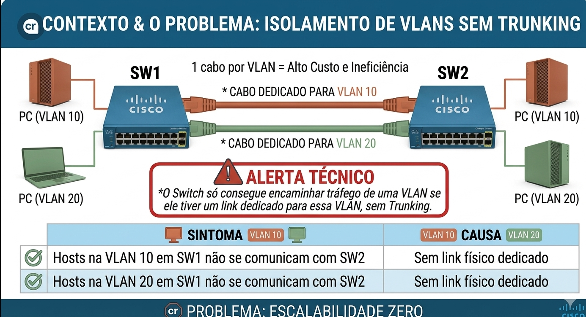
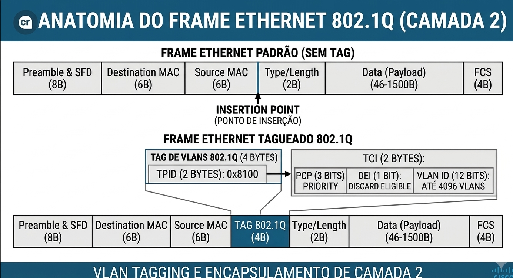
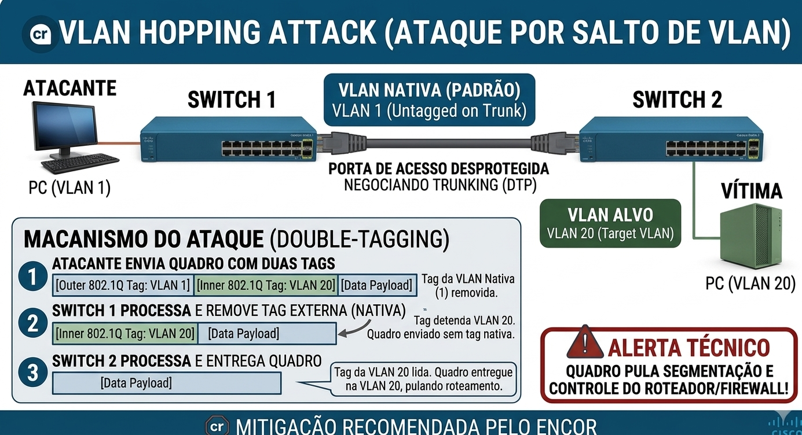
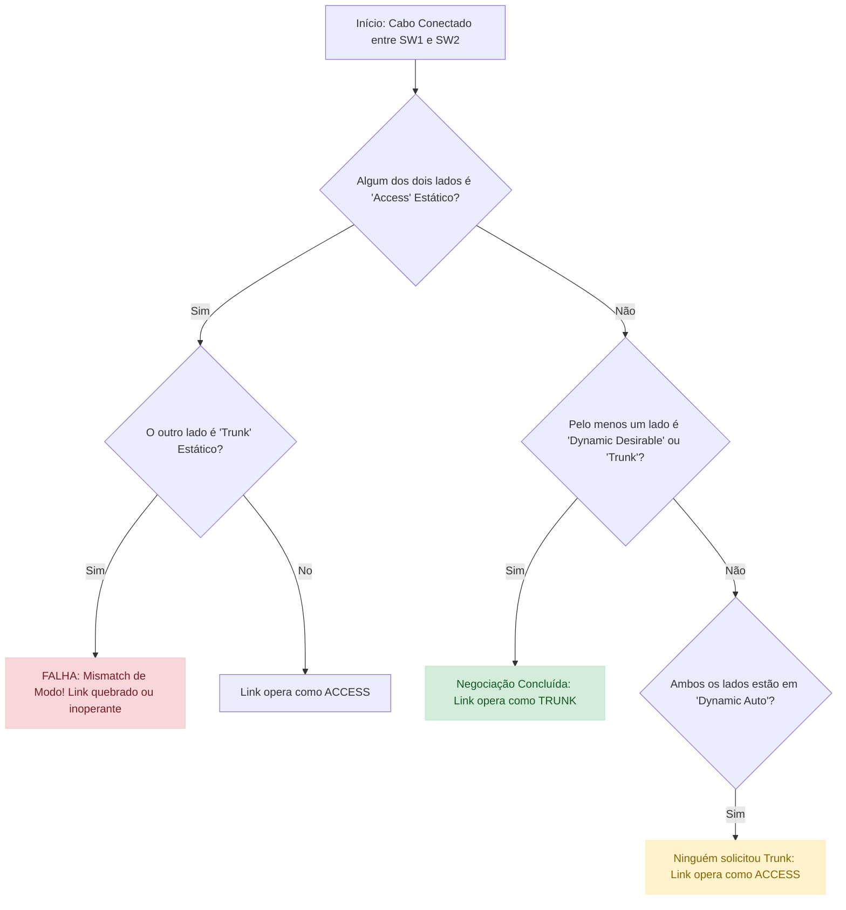
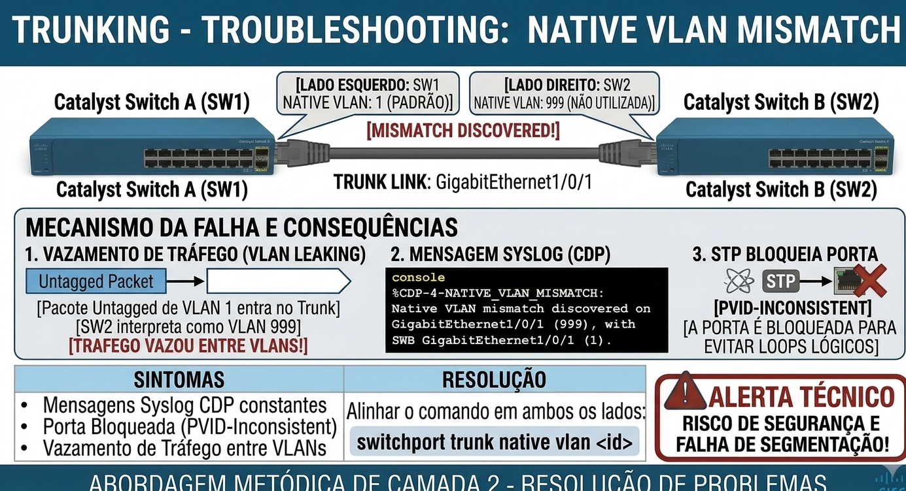
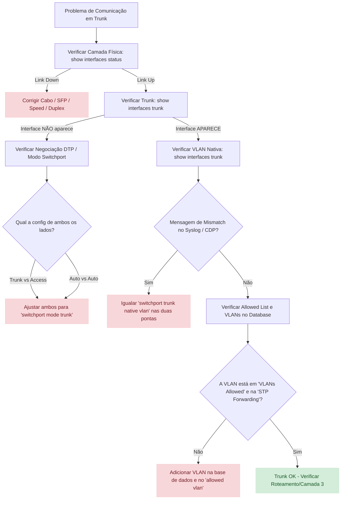

# 02 - Layer 2 Infrastructure: Trunking (802.1Q) & Dynamic Trunking Protocol (DTP) - Teoria e Troubleshooting

- [02 - Layer 2 Infrastructure: Trunking (802.1Q) \& Dynamic Trunking Protocol (DTP) - Teoria e Troubleshooting](#02---layer-2-infrastructure-trunking-8021q--dynamic-trunking-protocol-dtp---teoria-e-troubleshooting)
  - [Glossário Técnico de Trunking (Dicionário de Camada 2)](#glossário-técnico-de-trunking-dicionário-de-camada-2)
  - [🎯 Objetivo do Documento](#-objetivo-do-documento)
  - [Como Este Documento Deve Ser Lido](#como-este-documento-deve-ser-lido)
  - [Contexto \& O Problema: Isolamento de VLANs sem Trunking](#contexto--o-problema-isolamento-de-vlans-sem-trunking)
  - [Anatomia do Frame Ethernet 802.1Q (Camada 2)](#anatomia-do-frame-ethernet-8021q-camada-2)
    - [Detalhamento dos Campos do Cabeçalho 802.1Q Tag (4 Bytes)](#detalhamento-dos-campos-do-cabeçalho-8021q-tag-4-bytes)
  - [O Conceito da Native VLAN (VLAN Nativa)](#o-conceito-da-native-vlan-vlan-nativa)
    - [VLAN Hopping Attack (Ataque por Salto de VLAN)](#vlan-hopping-attack-ataque-por-salto-de-vlan)
  - [Trunking - Static 802.1Q](#trunking---static-8021q)
    - [Configuração de Trunk Estático no Cisco IOS/IOS-XE](#configuração-de-trunk-estático-no-cisco-iosios-xe)
    - [A Importância da Listagem Explícita (VLAN Allowed List)](#a-importância-da-listagem-explícita-vlan-allowed-list)
  - [Trunking - Dynamic Trunking Protocol (DTP)](#trunking---dynamic-trunking-protocol-dtp)
    - [Modos de Operação do DTP](#modos-de-operação-do-dtp)
    - [Matriz de Negociação DTP](#matriz-de-negociação-dtp)
    - [Fluxograma de Decisão do DTP](#fluxograma-de-decisão-do-dtp)
    - [A Regra de Ouro do ENCOR para DTP](#a-regra-de-ouro-do-encor-para-dtp)
  - [Trunking - Troubleshooting (Resolução de Problemas)](#trunking---troubleshooting-resolução-de-problemas)
    - [Cenário 1: Native VLAN Mismatch](#cenário-1-native-vlan-mismatch)
    - [Cenário 2: DTP Negotation Mismatch](#cenário-2-dtp-negotation-mismatch)
    - [Cenário 3: Allowed List Inconsistente (VLAN Pruning Involuntário)](#cenário-3-allowed-list-inconsistente-vlan-pruning-involuntário)
    - [Cenário 4: Encapsulation Mismatch (Legacy switches)](#cenário-4-encapsulation-mismatch-legacy-switches)
  - [Árvore Lógica de Troubleshooting de Trunk](#árvore-lógica-de-troubleshooting-de-trunk)
  - [Comandos Essenciais de Diagnóstico e Validação](#comandos-essenciais-de-diagnóstico-e-validação)
  - [Consolidação do Conhecimento](#consolidação-do-conhecimento)
  - [🧪 Pronto para Testar seu Conhecimento?](#-pronto-para-testar-seu-conhecimento)

---

## Glossário Técnico de Trunking (Dicionário de Camada 2)

Os termos abaixo formam a base para o entendimento de entroncamento Ethernet e negociação dinâmica em switches Cisco:

| Termo | Significado Técnico | Analogia Didática |
| :--- | :--- | :--- |
| **802.1Q (Dot1q)** | Padrão aberto da IEEE para etiquetagem (tagging) de quadros Ethernet em VLANs. | A inserção de uma etiqueta ou "carimbo" com o código do departamento na caixa de entrega. |
| **Trunk Port** | Interface do switch configurada para transportar tráfego de múltiplas VLANs entre switches ou roteadores. | Um túnel de passagem por onde trafegam carros de várias cidades diferentes sem misturar os passageiros. |
| **Access Port** | Interface conectada a um dispositivo final (PC, impressora) pertencente a apenas uma VLAN. | A porta de entrada de um escritório específico de uma empresa. |
| **Native VLAN** | VLAN cujos quadros trafegam no link trunk **sem etiqueta** (untagged). Padrão em switches Cisco: VLAN 1. | Uma encomenda enviada em uma caixa sem carimbo por ter prioridade ou por padrão do sistema. |
| **VLAN Tagging** | O ato de modificar o cabeçalho Ethernet adicionando 4 bytes de informação sobre a VLAN. | Colocar uma selo com o número do andar na correspondência interna. |
| **DTP** | *Dynamic Trunking Protocol*. Protocolo proprietário da Cisco usado para negociar autotrunk em links Ethernet. | Um aperto de mão entre dois switches negociando se vão falar a mesma "língua de trunking". |
| **Dynamic Auto** | Modo DTP onde a porta prefere ser Access, mas vira Trunk se o vizinho pedir (modo passivo). | "Eu fico na minha; se você quiser virar trunk, eu aceito." |
| **Dynamic Desirable**| Modo DTP onde a porta busca ativamente se transformar em Trunk enviando quadros DTP (modo ativo). | "Eu quero muito ser trunk! Vamos virar trunk agora?" |
| **VLAN Hopping** | Ataque de segurança onde um host injeta um tag 802.1Q para enviar tráfego não autorizado a outra VLAN. | Usar um crachá falso para pular a catraca de um departamento restrito. |
| **Allowed List** | Filtro configurado no trunk para delimitar quais VLANs têm permissão para atravessar o link. | A lista de passageiros autorizados a embarcar no trem interurbano. |

---

## 🎯 Objetivo do Documento

Este documento tem como objetivo detalhar a teoria e a resolução de problemas (*troubleshooting*) de links entroncados (**802.1Q Trunking**) e da negociação automática (**Dynamic Trunking Protocol - DTP**), alinhado com os requisitos do exame **CCNP ENCOR 350-401** (tópicos 3.1.a / 36, 37 e 38).

Ao final do estudo deste material, você será capaz de:

- Analisar a estrutura do frame Ethernet modificado pelo protocolo IEEE 802.1Q.
- Explicar o funcionamento e a mecânica de operação da VLAN Nativa e os seus riscos associados de segurança.
- Configurar e validar trunks estáticos com listagem restritiva de VLANs.
- Compreender a matriz completa de comportamento do DTP e desativá-lo seguindo as melhores práticas de hardening.
- Diagnosticar falhas comuns em trunks utilizando uma metodologia lógica baseada em saídas do Cisco IOS/IOS-XE.

---

## Como Este Documento Deve Ser Lido

Siga a estrutura lógica para garantir um aprendizado sólido:

1. **Compreensão do problema de escala de VLANs:** Por que precisamos de trunks.
2. **Estudo de baixo nível:** A modificação do quadro Ethernet pelo 802.1Q.
3. **Mecânica de configuração estática:** Comandos e podagem de tráfego.
4. **Mecânica de negociação dinâmica (DTP):** Estados e matrizes de resposta.
5. **Diagnóstico e Troubleshooting:** Análise de cenários de erro, validação de CLI e resolução de inconsistências.

---

## Contexto & O Problema: Isolamento de VLANs sem Trunking

As VLANs (Virtual Local Area Networks) dividem um switch físico em múltiplos domínios de broadcast lógicos. Sem o conceito de **Trunking**, para interconectar duas VLANs (ex: VLAN 10 e VLAN 20) espalhadas em dois switches diferentes (SW1 e SW2), seria necessário reservar **um cabo físico dedicado para cada VLAN**.



Em uma empresa com 50 VLANs, isso exigiria 50 cabos interconectando os switches, esgotando rapidamente a densidade de portas e inviabilizando o gerenciamento físico. 

A solução é o **Trunking (Entroncamento)**: um único link físico multiplexa o tráfego de centenas de VLANs simultaneamente, mantendo a isolação lógica intacta por meio da inserção de uma etiqueta de identificação em cada quadro Ethernet.

---

## Anatomia do Frame Ethernet 802.1Q (Camada 2)

O padrão **IEEE 802.1Q** resolve a multiplexação alterando a estrutura do frame Ethernet II nativo. Ele insere um cabeçalho de **4 bytes (32 bits)** entre o campo *Source MAC Address* e o campo *Type/Length*.



### Detalhamento dos Campos do Cabeçalho 802.1Q Tag (4 Bytes)

1. **TPID (Tag Protocol Identifier) - 16 bits (2 bytes):**
   - É fixado no valor hexadecimal `0x8100`.
   - Indica para a placa de rede ou switch receptora que este quadro possui uma tag 802.1Q. Se o equipamento não suportar 802.1Q, ele interpreta este valor como um tamanho/tipo desconhecido e descarta o quadro.
2. **TCI (Tag Control Information) - 16 bits (2 bytes):** Divisível em três subcampos:
   - **Priority / PCP (Priority Code Point) - 3 bits:** Utilizado pelo protocolo IEEE 802.1p para suporte a **Quality of Service (QoS)** em Camada 2. Permite categorizar o tráfego em até 8 níveis de prioridade (0 a 7, onde 7 é tipicamente controle de rede e 5 é voz sobre IP).
   - **DEI (Drop Eligible Indicator) / CFI (Canonical Format Indicator) - 1 bit:** Originalmente usado para compatibilidade com redes Token Ring. Hoje é utilizado em conjuntos de QoS para marcar pacotes elegíveis a descarte em situações de congestionamento.
   - **VLAN ID (VID) - 12 bits:** O identificador numérico da VLAN. Como possui 12 bits ($2^{12} = 4096$), permite criar IDs de VLAN na faixa de **0 a 4095**:
     - `0` e `4095`: Reservados pelo sistema.
     - `1`: VLAN Padrão (*Default VLAN*).
     - `2` a `1001`: Faixa de VLANs Normais (*Normal Range*).
     - `1002` a `1005`: Reservados para Token Ring / FDDI (legado).
     - `1006` a `4094`: Faixa Estendida de VLANs (*Extended Range*).

---

## O Conceito da Native VLAN (VLAN Nativa)

Em um link trunk configurado com o padrão IEEE 802.1Q, nem todo tráfego viaja etiquetado. Por definição do padrão:

> **Regra Central da VLAN Nativa:** Quadros pertencentes à VLAN Nativa do trunk são transmitidos de forma **sem tag (untagged)**. Se o switch receber um quadro sem tag em uma porta configurada como trunk, ele assume automaticamente que esse quadro pertence à VLAN Nativa daquela interface.

O principal motivo histórico e funcional para a existência da VLAN Nativa é permitir a interoperabilidade com dispositivos antigos que não compreendem cabeçalhos 802.1Q e para o tráfego de controle de certos protocolos de rede.

Por padrão nos switches Cisco, a VLAN 1 é configurada tanto como VLAN Default de acesso quanto como **VLAN Nativa** de todas as portas trunk.

### VLAN Hopping Attack (Ataque por Salto de VLAN)

Se a VLAN Nativa for mantida com as configurações padrão (VLAN 1) e houver portas de acesso desprotegidas negociando trunking, a rede fica vulnerável ao ataque de **Double-Tagging (VLAN Hopping)**:



1. Um atacante injeta um quadro com **duas tags 802.1Q**. A tag externa corresponde à VLAN Nativa do trunk (ex: VLAN 1) e a tag interna corresponde à VLAN da vítima (ex: VLAN 20).
2. O primeiro switch recebe o quadro, remove a tag externa (por corresponder à VLAN Nativa e dever ser enviada untagged para o trunk) e repassa o quadro preservando a tag interna (VLAN 20).
3. O segundo switch recebe o quadro, lê a segunda tag (VLAN 20) e entrega o pacote dentro da VLAN alvo, pulando a segmentação e o controle do roteador/firewall.

> **Mitigação Recomendada pelo ENCOR:**
>
> - Altere a VLAN Nativa de todos os trunks para uma VLAN não utilizada/dummy (ex: VLAN 999).
> - Nunca utilize a VLAN 1 como VLAN Nativa.
> - Configure explicitamente o comando de hardening: `vlan dot1q tag native` (força o switch a etiquetar até mesmo a VLAN Nativa).

---

## Trunking - Static 802.1Q

O entroncamento estático ocorre quando o administrador desativa qualquer mecanismo autônomo de negociação e força explicitamente a interface a operar como um ponto de agregação de VLANs.

### Configuração de Trunk Estático no Cisco IOS/IOS-XE

Para configurar uma porta trunk estática de forma manual e segura, utilizamos a seguinte sequência de comandos no modo de interface:

```text
SwitchA(config)# interface GigabitEthernet1/0/1
SwitchA(config-if)# switchport encapsulation dot1q   ! Exigido em switches legados (ex: Catalyst 3750/4500)
SwitchA(config-if)# switchport mode trunk             ! Força a porta a operar em modo Trunk estático
SwitchA(config-if)# switchport nonegotiate            ! Desativa o envio de quadros DTP
SwitchA(config-if)# switchport trunk native vlan 999  ! Altera a VLAN nativa padrão
SwitchA(config-if)# switchport trunk allowed vlan 10,20,30 ! Define o pruning manual de VLANs
```

### A Importância da Listagem Explícita (VLAN Allowed List)

Por padrão, um trunk permite a passagem de **todas as VLANs configuradas** na base de dados (de 1 a 4094). Isso significa que tempestades de broadcast (*Broadcast Storms*) originadas na VLAN 500 viajarão por todos os trunks, mesmo se não houver dispositivos dessa VLAN do outro lado.

O comando `switchport trunk allowed vlan` aplica uma restrição de tráfego, agindo como um mecanismo de *VLAN Pruning* manual:

- `switchport trunk allowed vlan 10,20`: Sobrescreve a lista, permitindo apenas as VLANs 10 e 20.
- `switchport trunk allowed vlan add 30`: **(Seguro)** Adiciona a VLAN 30 à lista existente.
- `switchport trunk allowed vlan remove 20`: **(Seguro)** Remove a VLAN 20 da lista.

> ⚠️ **Pegadinha clássica do ENCOR:** Se você digitar `switchport trunk allowed vlan 30` em um trunk que já permitia as VLANs 10 e 20, o comando **substituirá** a lista inteira, isolando o tráfego das VLANs 10 e 20! Sempre use o parâmetro `add` para incluir VLANs adicionais.

---

## Trunking - Dynamic Trunking Protocol (DTP)

O **Dynamic Trunking Protocol (DTP)** é um protocolo proprietário da Cisco de Camada 2 criado para facilitar a configuração inicial de redes, permitindo que dois switches vizinhos negociem automaticamente se o link de conexão entre eles será em modo **Access** ou **Trunk**.

Os quadros DTP são transmitidos periodicamente a cada 30 segundos usando a VLAN Nativa (VLAN 1 por padrão) via endereço MAC multicast `01:00:0C:CC:CC:CC`.

### Modos de Operação do DTP

Uma interface Ethernet em um switch Cisco pode rodar em um dos cinco modos de switchport:

1. **Access (`switchport mode access`):** A porta opera estaticamente como uma porta de acesso final. Ela desativa o trunking, mas **continua enviando quadros DTP** anunciando sua relutância em virar trunk.
2. **Trunk (`switchport mode trunk`):** A porta opera estaticamente como um trunk 802.1Q. Ela **continua enviando quadros DTP** para pedir que o vizinho também opere como trunk.
3. **Dynamic Auto (`switchport mode dynamic auto`):** A porta consegue virar trunk, mas **não inicia a negociação**. Ela apenas escuta passivamente quadros DTP. Se o vizinho pedir para virar trunk, ela aceita. *(Padrão em switches Cisco mais antigos e muitas linhas Catalyst).*
4. **Dynamic Desirable (`switchport mode dynamic desirable`):** A porta **busca ativamente** se transformar em trunk. Ela envia quadros DTP periodicamente solicitando ao vizinho que converta a conexão em trunk.
5. **No-Negotiate (`switchport nonegotiate`):** Desativa totalmente a geração e a leitura de frames DTP na interface. Só pode ser aplicado se a porta for colocada manualmente em `switchport mode trunk` ou `switchport mode access`.

### Matriz de Negociação DTP

A tabela a seguir é cobrança certa na prova do ENCOR. Ela descreve o estado final da porta de acordo com os modos configurados em cada ponta do link:

| Modo Switch A          | Modo Switch B                 | Estado Resultante do Link          | Operou DTP?         |
| :---                   | :---                          | :---                               | :---                |
| **Dynamic Auto**       | **Dynamic Auto**              | **Access** (Nenhum pediu trunking) | Sim                 |
| **Dynamic Auto**       | **Dynamic Desirable**         | **Trunk (802.1Q)**                 | Sim                 |
| **Dynamic Auto**       | **Trunk**                     | **Trunk (802.1Q)**                 | Sim                 |
| **Dynamic Auto**       | **Access**                    | **Access**                         | Sim                 |
| **Dynamic Desirable**  | **Dynamic Desirable**         | **Trunk (802.1Q)**                 | Sim                 |
| **Dynamic Desirable**  | **Trunk**                     | **Trunk (802.1Q)**                 | Sim                 |
| **Dynamic Desirable**  | **Access**                    | **Access**                         | Sim                 |
| **Trunk**              | **Trunk**                     | **Trunk (802.1Q)**                 | Sim                 |
| **Trunk**              | **Access**                    | **INCONSISTENTE (Falha / Down)**   | Sim                 |
| **Trunk (Nonegotiate)**| **Dynamic Auto / Desirable**  | **Access / Limbo (Mismatch)**      | Não (Lado A calado) |

### Fluxograma de Decisão do DTP



### A Regra de Ouro do ENCOR para DTP

> 🛑 **Best Practice de Arquitetura de Redes:**
> O DTP representa um vetor de risco de segurança (possibilitando ataques no trunk por hackers) e uma causa frequente de instabilidade em ambiente corporativo.  
>
> A boa prática ditada pela Cisco para o ENCOR determina:
> **Desative o DTP em todas as portas de infraestrutura**.
>
> Use sempre:  
> `switchport mode trunk` + `switchport nonegotiate` nos links entre switches/roteadores.
> `switchport mode access` + `switchport nonegotiate` nas portas de hosts.

---

## Trunking - Troubleshooting (Resolução de Problemas)

A resolução de problemas em links trunk requer uma abordagem metódica de Camada 2. Abaixo estão os quatro cenários de falha mais comuns cobrados em provas e encontrados em redes de produção.

### Cenário 1: Native VLAN Mismatch

Ocorre quando as duas pontas do link trunk estão com VLANs nativas diferentes (ex: SW1 com Native VLAN 1 e SW2 com Native VLAN 999).



- **Sintomas:**
  - Mensagens constantes no `syslog` geradas pelo CDP (Cisco Discovery Protocol):
    `%CDP-4-NATIVE_VLAN_MISMATCH: Native VLAN mismatch discovered on GigabitEthernet1/0/1 (999), with SwitchB GigabitEthernet1/0/1 (1).`
  - O Spanning Tree Protocol (STP) detecta o erro e bloqueia a porta por segurança, colocando-a no estado **PVID-Inconsistent** (impedindo o tráfego daquela VLAN).
  - Tráfego de vazamento entre VLANs (*VLAN Leaking*): Um pacote não etiquetado da VLAN 999 vindo do SW1 é interpretado pelo SW2 como pertencente à VLAN 1.
- **Resolução:** Alinhar o comando `switchport trunk native vlan <id>` identicamente em ambos os lados.

### Cenário 2: DTP Negotation Mismatch

Ocorre quando um lado está forçado como `switchport mode trunk` rodando DTP, enquanto o outro lado está configurado como `switchport mode access`.

- **Sintomas:**
  - O lado configurado como Access espera apenas tráfego untagged. O lado configurado como Trunk envia pacotes com tags 802.1Q.
  - Perda parcial ou total de conectividade entre os switches.
  - O comando `show interfaces trunk` exibe o trunk de um lado, mas o vizinho mostra a porta como de acesso no `show interfaces switchport`.
- **Resolução:** Padronizar ambos os lados em modo Trunk estático com `switchport nonegotiate`.

### Cenário 3: Allowed List Inconsistente (VLAN Pruning Involuntário)

Ocorre quando a VLAN X é criada e permitida no SW1, mas foi removida da lista `allowed vlan` do trunk no SW2 (ou a VLAN sequer existe no banco de dados local do SW2).

- **Sintomas:**
  - Equipamentos na VLAN X conectados ao SW1 não conseguem pingar ou se comunicar com equipamentos na VLAN X conectados ao SW2.
  - O link trunk físico está funcional (`Up/Up`), mas a VLAN específica não é encaminhada.
- **Resolução:**
  - Verificar a base de dados do switch: `show vlan brief`.
  - Ajustar a lista permitida: `switchport trunk allowed vlan add X`.

### Cenário 4: Encapsulation Mismatch (Legacy switches)

Dispositivos Cisco mais antigos suportam tanto o encapsulamento proprietário **ISL (Inter-Switch Link)** quanto o padrão **802.1Q**. Se o SW1 estiver tentando falar ISL e o SW2 apenas 802.1Q, o trunk não subirá.

- **Sintomas:** A interface física pode ficar Up, mas a porta de trunk não opera e não repassa quadros.
- **Resolução:** Forçar explicitamente `switchport trunk encapsulation dot1q` nos dois switches antes de aplicar o modo trunk.

---

## Árvore Lógica de Troubleshooting de Trunk

Utilize o fluxo abaixo para isolar problemas em trunks no CLI durante simulações e problemas reais:



---

## Comandos Essenciais de Diagnóstico e Validação

Dominar os comandos de verificação é crucial para resolver questões práticas e responder cenários de exames do ENCOR.

1. **`show interfaces trunk` (O comando número 1 de Trunking):**
   Exibe as interfaces que estão operando ativamente em modo trunk, a VLAN Nativa, o protocolo de encapsulamento e a lista de VLANs permitidas/ativas.

   ```text
   SwitchA# show interfaces trunk

   Port        Mode         Encapsulation  Status        Native vlan
   Gi1/0/1     on           802.1q         trunking      999

   Port        Vlans allowed on trunk
   Gi1/0/1     10,20,30

   Port        Vlans allowed and active in management domain
   Gi1/0/1     10,20,30

   Port        Vlans in spanning tree forwarding state and not pruned
   Gi1/0/1     10,20
   ```

2. **`show interfaces <interface> switchport` (O diagnóstico detalhado da porta):**
   Mostra os modos administrativo e operacional de uma interface individual, detalhando como o DTP está configurado e se a negociação está ativa.

   ```text
   SwitchA# show interfaces GigabitEthernet1/0/1 switchport
   Name: Gi1/0/1
   Switchport: Enabled
   Administrative Mode: trunk               ! O que foi configurado (ex: mode trunk)
   Operational Mode: trunk                  ! O estado atual da porta (ex: trunk ou access)
   Administrative Trunking Encapsulation: dot1q
   Operational Trunking Encapsulation: dot1q
   Negotiation of Trunking: Off             ! Off indica que 'switchport nonegotiate' está ativo
   Access Mode VLAN: 1 (default)
   Trunking Native Mode VLAN: 999 (NATIVE_VLAN_DUMMY)
   Administrative Native VLAN tagging: enabled
   Voice VLAN: none
   Apparatus Allowed VLANs: 10,20,30
   ```

3. **`show vlan brief`:**
   Mapeia todas as VLANs existentes na base de dados (VLAN Database) do switch local e indica a quais portas de acesso cada VLAN está atribuída. *(Nota: Portas trunk NÃO aparecem na saída do `show vlan brief`)*.

4. **`show dtp interface <interface>`:**
   Exibe os contadores internos de pacotes DTP enviados/recebidos e o estado de negociação da porta.

---

## Consolidação do Conhecimento

Após o estudo deste documento, certifique-se de consolidar os seguintes pilares teóricos e práticos:

- **Estrutura 802.1Q:** Lembrar da adição de 4 bytes no frame Ethernet, com o campo de VLAN ID contendo 12 bits (4096 VLANs possíveis).
- **VLAN Nativa:** Saber que viaja sem tag (untagged) e que erros de alinhamento causam alertas no CDP e bloqueios por PVID Inconsistency via STP.
- **Matriz DTP:** Gravar que o único cenário onde portas em autonegociação **não** viram trunk é quando ambos os lados estão em `Dynamic Auto` (ou com portas de acesso ativas).
- **Hardening Recomendado:** Sempre utilizar `switchport mode trunk` combinado com `switchport nonegotiate` e isolar a VLAN Nativa em uma VLAN sem uso.

## 🧪 Pronto para Testar seu Conhecimento?

Este capítulo estabeleceu toda a fundação conceitual e arquitetural do Trunking 802.1Q, DTP e os cenários de Troubleshooting em redes de Camada 2.

Antes de avançar para os tópicos de EtherChannels, valide sua compreensão dos fundamentos e dos cenários práticos estudados.

Os simulados foram planejados para reforçar os conceitos de encapsulamento, o comportamento dos modos DTP e o diagnóstico preciso de falhas (como Native VLAN Mismatch e Allowed List).

👉 **Acesse os simulados de Trunking e DTP**

🔗 [Abrir Simulados Trunking & DTP](https://alcancil.github.io/Cisco/CCNP%20350-401%20ENCOR/03%20-%20Infrastructure/02%20-%20STP%20(Spanning%20Tree%20Protocol)/25%20-%20MSTP/Arquivos/Simulado/)  

**Simulados temáticos:**  

1. [Anatomia do Encapsulamento 802.1Q, Tagging e Native VLAN](https://alcancil.github.io/Cisco/CCNP%20350-401%20ENCOR/03%20-%20Infrastructure/02%20-%20STP%20(Spanning%20Tree%20Protocol)/25%20-%20MSTP/Arquivos/Simulado/01.html)
2. [Dinâmica de Negociação do Dynamic Trunking Protocol (DTP)](https://alcancil.github.io/Cisco/CCNP%20350-401%20ENCOR/03%20-%20Infrastructure/02%20-%20STP%20(Spanning%20Tree%20Protocol)/25%20-%20MSTP/Arquivos/Simulado/02.html)
3. [Troubleshooting de Links Trunk: Native VLAN e Allowed List Mismatch](https://alcancil.github.io/Cisco/CCNP%20350-401%20ENCOR/03%20-%20Infrastructure/02%20-%20STP%20(Spanning%20Tree%20Protocol)/25%20-%20MSTP/Arquivos/Simulado/03.html)
4. [Mitigação de Segurança e Hardening de Portas (VLAN Hopping)](https://alcancil.github.io/Cisco/CCNP%20350-401%20ENCOR/03%20-%20Infrastructure/02%20-%20STP%20(Spanning%20Tree%20Protocol)/25%20-%20MSTP/Arquivos/Simulado/04.html)
5. [Comandos de Diagnóstico, CLI e Verificação de Interfaces Trunk](https://alcancil.github.io/Cisco/CCNP%20350-401%20ENCOR/03%20-%20Infrastructure/02%20-%20STP%20(Spanning%20Tree%20Protocol)/25%20-%20MSTP/Arquivos/Simulado/05.html)

**Simulado completo de Trunking & DTP:** [50 questões — 75 minutos](https://alcancil.github.io/Cisco/CCNP%20350-401%20ENCOR/03%20-%20Infrastructure/02%20-%20STP%20(Spanning%20Tree%20Protocol)/25%20-%20MSTP/Arquivos/Simulado/completo.html)

**📊 Painel de Estatísticas:** [Acompanhe seu desempenho](https://alcancil.github.io/Cisco/CCNP%20350-401%20ENCOR/03%20-%20Infrastructure/02%20-%20STP%20(Spanning%20Tree%20Protocol)/25%20-%20MSTP/Arquivos/Simulado/dashboard.html)

👉 Próximo Passo: Na sequência, avançaremos para os tópicos de EtherChannels (Static, LACP e PAgP) para continuar fechando o bloco de infraestrutura de Camada 2 do CCNP ENCOR!
  