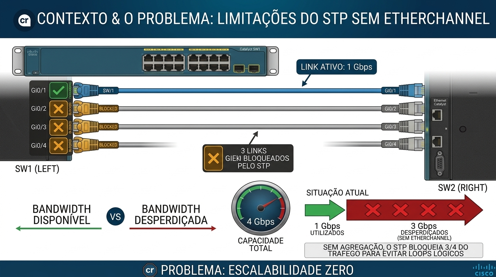
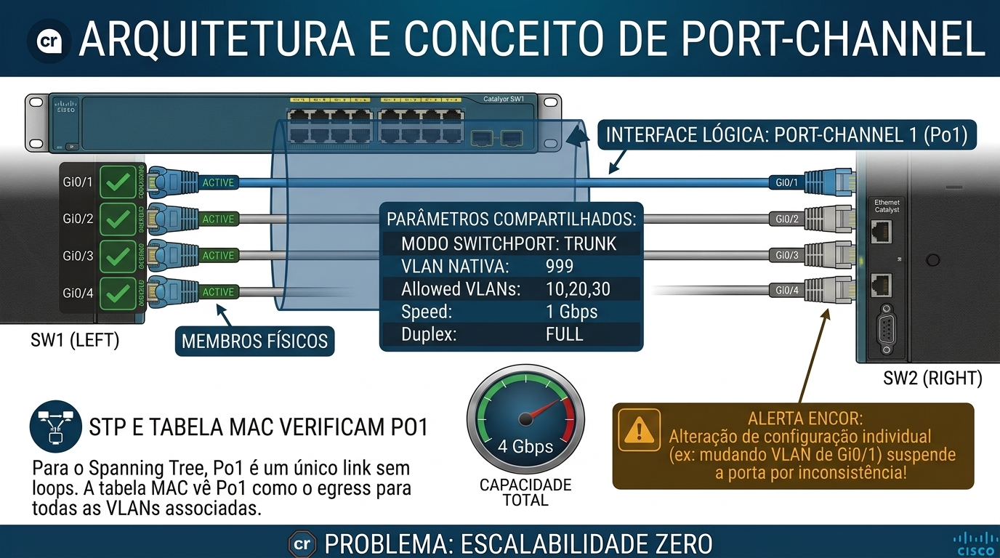
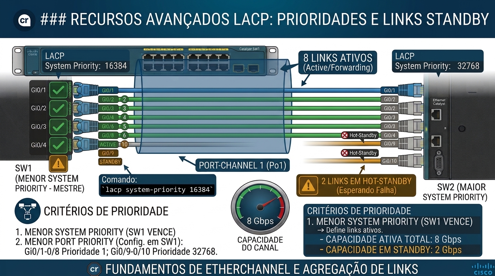
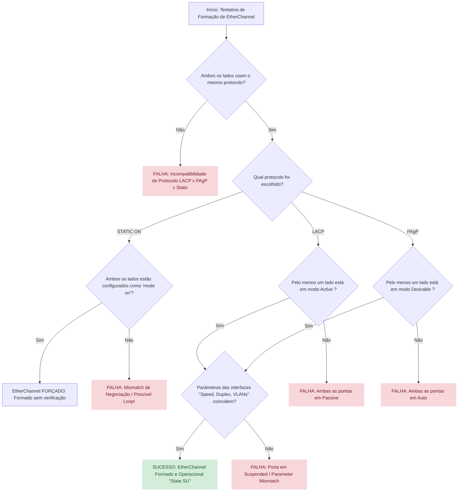
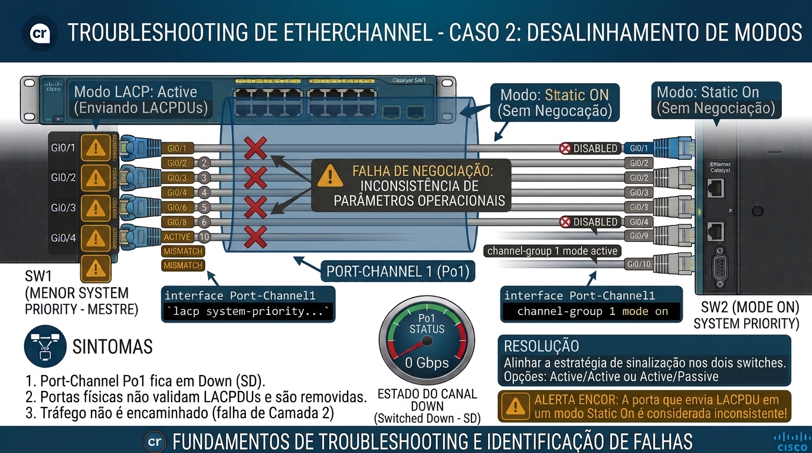
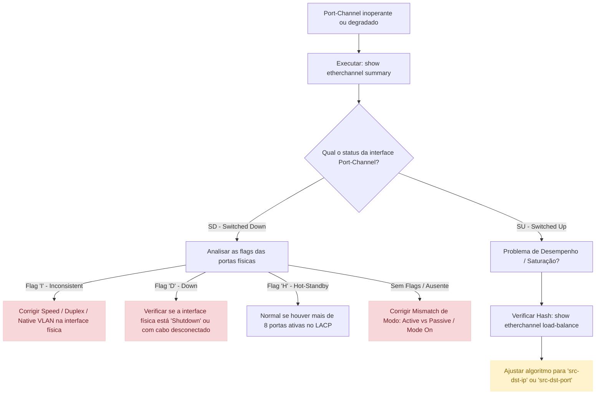

# Layer 2 Infrastructure: EtherChannel Estático (Mode On), LACP (802.3ad), PAgP & Troubleshooting - Teoria e Prática

- [Layer 2 Infrastructure: EtherChannel Estático (Mode On), LACP (802.3ad), PAgP \& Troubleshooting - Teoria e Prática](#layer-2-infrastructure-etherchannel-estático-mode-on-lacp-8023ad-pagp--troubleshooting---teoria-e-prática)
  - [Glossário Técnico de EtherChannel (Dicionário de Aggregation de Link)](#glossário-técnico-de-etherchannel-dicionário-de-aggregation-de-link)
  - [🎯 Objetivo do Documento](#-objetivo-do-documento)
  - [Como Este Documento Deve Ser Lido](#como-este-documento-deve-ser-lido)
  - [Contexto \& O Problema: Limitações do Spanning Tree sem EtherChannel](#contexto--o-problema-limitações-do-spanning-tree-sem-etherchannel)
  - [Arquitetura e Conceito de Port-Channel](#arquitetura-e-conceito-de-port-channel)
  - [Mecanismos de Balanceamento de Carga (Load Balancing Algorithms)](#mecanismos-de-balanceamento-de-carga-load-balancing-algorithms)
  - [EtherChannel - Static (Mode On)](#etherchannel---static-mode-on)
    - [Configuração de EtherChannel Estático no Cisco IOS/IOS-XE](#configuração-de-etherchannel-estático-no-cisco-iosios-xe)
    - [O Perigo do Modo Estático (On/On Mismatch)](#o-perigo-do-modo-estático-onon-mismatch)
  - [EtherChannel - Link Aggregation Control Protocol (LACP - IEEE 802.3ad / 802.1AX)](#etherchannel---link-aggregation-control-protocol-lacp---ieee-8023ad--8021ax)
    - [Modos de Operação do LACP](#modos-de-operação-do-lacp)
    - [Matriz de Negociação LACP](#matriz-de-negociação-lacp)
    - [Recursos Avançados LACP: Prioridades e Links Standby](#recursos-avançados-lacp-prioridades-e-links-standby)
  - [EtherChannel - Port Aggregation Protocol (PAgP - Cisco Proprietary)](#etherchannel---port-aggregation-protocol-pagp---cisco-proprietary)
    - [Modos de Operação do PAgP](#modos-de-operação-do-pagp)
    - [Matriz de Negociação PAgP](#matriz-de-negociação-pagp)
    - [Modo PAgP Auto/Desirable com Aprendizado de MAC (Auto-Switched)](#modo-pagp-autodesirable-com-aprendizado-de-mac-auto-switched)
  - [Fluxograma Unificado de Decisão de Formação de EtherChannel](#fluxograma-unificado-de-decisão-de-formação-de-etherchannel)
  - [EtherChannel - Troubleshooting (Resolução de Problemas)](#etherchannel---troubleshooting-resolução-de-problemas)
    - [Cenário 1: Parameter Mismatch (Velocidade, Duplex ou VLANs)](#cenário-1-parameter-mismatch-velocidade-duplex-ou-vlans)
    - [Cenário 2: Misconfiguration de Modos (Ex: LACP Passive vs Static On)](#cenário-2-misconfiguration-de-modos-ex-lacp-passive-vs-static-on)
    - [Cenário 3: EtherChannel Guard e Estado Err-Disable](#cenário-3-etherchannel-guard-e-estado-err-disable)
    - [Cenário 4: Balanceamento de Carga Ineficiente (Hash Polarization)](#cenário-4-balanceamento-de-carga-ineficiente-hash-polarization)
  - [Árvore Lógica de Troubleshooting de EtherChannel](#árvore-lógica-de-troubleshooting-de-etherchannel)
  - [Comandos Essenciais de Diagnóstico e Validação](#comandos-essenciais-de-diagnóstico-e-validação)
  - [Consolidação do Conhecimento](#consolidação-do-conhecimento)
  - [🧪 Pronto para Testar seu Conhecimento?](#-pronto-para-testar-seu-conhecimento)

---

## Glossário Técnico de EtherChannel (Dicionário de Aggregation de Link)

Os termos a seguir servem de base para o entendimento das tecnologias de agregação de links de Camada 2 e Camada 3:

| Termo | Significado Técnico | Analogia Didática |
| :---                   | :---                                                                                           | :---                                              |
| **EtherChannel / LAG** | *Link Aggregation Group*. Agrupamento de múltiplas interfaces físicas em uma única interface lógica. | Juntar 4 faixas de uma pista simples para criar uma rodovia de 4 pistas com a mesma sinalização. |
| **Port-Channel (Po)**  | A interface virtual representativa criada no switch para controlar o grupo de links agregados. | O nome da linha de metrô, independentemente de quantos vagões ela possui rodando juntos. |
| **LACP**               | *Link Aggregation Control Protocol* (IEEE 802.3ad/802.1AX). Protocolo padrão aberto para negociação de trunks de links. | Um contrato padrão internacional aceito por switches de qualquer fabricante (Cisco, HP, Arista). |
| **PAgP**              | *Port Aggregation Protocol*. Protocolo proprietário da Cisco para negociação de EtherChannel. | Um aperto de mão exclusivo que só funciona entre equipamentos Cisco. |
| **Static EtherChannel (Mode On)** | Agregação forçada sem a troca de pacotes de controle/negociação (sem LACP ou PAgP). | Soldar dois cabos fisicamente: não há conversa entre os lados, eles apenas assumem que o outro está pronto. |
| **LACP Active** | Modo LACP onde a interface busca ativamente formar EtherChannel enviando pacotes LACPDU. | Alguém que chega na reunião com o contrato pronto pedindo a assinatura do colega. |
| **LACP Passive** | Modo LACP onde a interface apenas escuta pacotes LACPDU, respondendo se for solicitada. | Alguém que fica em silêncio na reunião e só assina o contrato se for provocado. |
| **PAgP Desirable** | Modo PAgP ativo que busca negociar ativamente o link via pacotes PAgP. | O parceiro comercial que toma a iniciativa de fechar a parceria. |
| **PAgP Auto** | Modo PAgP passivo que aguarda a iniciativa da outra ponta para negociar o canal. | O parceiro comercial receptivo que aguarda a proposta chegar. |
| **Hash Polarization** | Ocorrência onde todo o tráfego é direcionado para apenas um link físico da agregação devido a uma escolha inadequada do algoritmo de hash. | Um congestionamento gigante onde todos os motoristas decidem usar a mesma faixa da direita da rodovia. |

---

## 🎯 Objetivo do Documento

Este documento detalha o funcionamento teórico, os aspectos de protocolo e a metodologia de **Troubleshooting de EtherChannels** estáticos e dinâmicos (LACP e PAgP), cobrindo de ponta a ponta o tópico **3.1.b Troubleshoot static and dynamic EtherChannels** do edital do exame **CCNP ENCOR 350-401**.

Ao final do estudo deste material, você estará apto a:

- Explicar como o EtherChannel contorna as limitações de bloqueio do Spanning Tree Protocol (STP).
- Comparar os protocolos **LACP (IEEE 802.3ad)**, **PAgP (Cisco)** e o modo **Estático (On)** em termos de frames de controle, modos e recursos.
- Analisar os algoritmos de balanceamento de carga de Camada 2, 3 e 4 e identificar problemas de saturação de links (Hash Polarization).
- Configurar e alinhar os parâmetros exigidos para que os membros físicos ingressem com sucesso no Port-Channel.
- Diagnosticar e resolver falhas de estado `err-disable`, inconsistências de configuração e falhas de negociação usando o CLI Cisco IOS/IOS-XE.

---

## Como Este Documento Deve Ser Lido

Para fixar o conhecimento de forma progressiva, siga estes passos:

1. **Compreensão do problema de largura de banda e STP:** Entenda por que links paralelos são bloqueados sem o EtherChannel.
2. **Conceito da interface Port-Channel:** Como o IOS trata o canal lógico x interfaces físicas membros.
3. **Estudo de Mecanismos de Negociação:** Analise o funcionamento do modo Estático (On), LACP e PAgP.
4. **Compreensão do Algoritmo de Hash:** Como o switch distribui os frames nos links físicos.
5. **Diagnóstico e Resolução de Erros:** Estude os erros de incompatibilidade e a árvore lógica de troubleshooting.

---

## Contexto & O Problema: Limitações do Spanning Tree sem EtherChannel

Em uma topologia de rede corporativa, adicionar cabos extras entre switches para aumentar a largura de banda gera loops de Camada 2. Por padrão, o **Spanning Tree Protocol (STP)** identifica esses links redundantes e coloca as portas sobressalentes em estado de bloqueio (*Blocking*).



Como resultado, mesmo que você conecte 4 cabos de 1 Gbps entre dois switches, a largura de banda utilizável continuará sendo de apenas 1 Gbps.

A solução é o **EtherChannel**: a tecnologia agrupa logicamente até 8 portas físicas ativas (e até 16 no LACP com portas em standby) em uma **única interface lógica Port-Channel**. O Spanning Tree enxerga esse grupo como um único link de 4 Gbps, mantendo todas as interfaces encaminhando tráfego sem causar loops.

---

## Arquitetura e Conceito de Port-Channel

Quando criamos um EtherChannel, o switch gera uma interface virtual chamada **Port-Channel (ex: Po1)**.  

Todas as configurações operacionais e de protocolo de Camada 2 ou Camada 3 devem ser aplicadas **diretamente na interface Port-Channel** ou ser idênticas em todas as portas membro físicas:

- **Modo Switchport:** Access ou Trunk.
- **VLANs:** Native VLAN e a lista de Allowed VLANs.
- **Parâmetros de Camada Física:** Velocidade (Speed), Duplex e tipo de meio (Cobre/Fibra).
- **Spanning Tree:** Parâmetros de STP Cost e Port Priority.



> 💡 **Nota Importante para o ENCOR:** Se você alterar a VLAN de acesso de uma porta física individual que pertence a um Port-Channel, essa porta será suspensa do EtherChannel por ter configurações desalinhadas (*Inconsistent Parameters*).

---

## Mecanismos de Balanceamento de Carga (Load Balancing Algorithms)

O EtherChannel **não faz multiplexação de pacotes individuais** de uma mesma sessão IP entre vários cabos (isso causaria entrega de pacotes fora de ordem na Camada 4). Em vez disso, o switch utiliza um **algoritmo matemático de Hash** para atribuir cada fluxo de comunicação a um link físico específico.

O cálculo do Hash gera um valor de índice numérico que seleciona a interface de saída no grupo.

```text
Entrada (MAC/IP/Porta Origem e Destino) ──> [ Algoritmo de Hash ] ──> Índice do Link Físico (1 a 8)
```

Os critérios configuráveis de balanceamento de carga no Cisco IOS variam conforme a camada:

| Algoritmo (`port-channel load-balance`) | Campos Analisados no Frame/Pacote                | Cenário Indicado                                                    |
| :---                                    | :---                                             | :---                                                                |
| `src-mac`                               | Apenas o MAC de Origem                           | Vários hosts enviando tráfego para um único dispositivo.            |
| `dst-mac`                               | Apenas o MAC de Destino                          | Um único dispositivo enviando tráfego para vários hosts.            |
| `src-dst-mac`                           | Combinação (XOR) de MAC Origem e Destino         | Tráfego genérico com variação constante de MACs em Camada 2.        |
| `src-ip`                                | Apenas o IP de Origem                            | Roteamento entre sub-redes em ambientes de Camada 3.                |
| `dst-ip`                                | Apenas o IP de Destino                           | Tráfego direcionado a múltiplos servidores em redes distintas.      |
| `src-dst-ip`                            | Combinação (XOR) de IP Origem e Destino          | **Recomendado para a maioria das redes corporativas.**              |
| `src-dst-port`                          | Combinação de Portas TCP/UDP de Origem e Destino | Redes com alto volume de sessões simultâneas entre os mesmos hosts. |

> ⚠️ **Atenção:** O balanceamento de carga no EtherChannel é por **fluxo**, não por pacote. Se um único host transferir um arquivo gigante via FTP para um único servidor, todo o tráfego desse arquivo fluirá por apenas um link físico, limitando a velocidade à capacidade daquela interface individual!

---

## EtherChannel - Static (Mode On)
  
No modo estático, a agregação é forçada manualmente sem o uso de qualquer protocolo de sinalização e negociação de controle de link.
  
### Configuração de EtherChannel Estático no Cisco IOS/IOS-XE
  
Para criar um EtherChannel estático de Camada 2 unindo duas interfaces:
  
```text
SwitchA(config)# interface range GigabitEthernet1/0/1 - 2
SwitchA(config-if-range)# switchport mode trunk
SwitchA(config-if-range)# switchport trunk native vlan 999
SwitchA(config-if-range)# channel-group 1 mode on   ! Força o EtherChannel estático sem protocolo de negociação
SwitchA(config-if-range)# exit
  
SwitchA(config)# interface port-channel 1
SwitchA(config-if)# switchport mode trunk
SwitchA(config-if)# switchport trunk native vlan 999
```

### O Perigo do Modo Estático (On/On Mismatch)

Como o modo `on` desativa os pacotes de negociação LACP e PAgP, o switch assume ceticamente que o vizinho está pronto e configurado corretamente.  
  
Se o Switch A for configurado como `mode on` e o Switch B estiver com portas normais de acesso/trunk sem EtherChannel, o Switch A continuará enviando tráfego dividido entre todos os cabos. Isso gera **loops severos de Camada 2** ou queda massiva de pacotes, pois o Switch B tratará os links como portas independentes.

---

## EtherChannel - Link Aggregation Control Protocol (LACP - IEEE 802.3ad / 802.1AX)

O **LACP** é o padrão aberto mantido pela IEEE. Ele permite que equipamentos de múltiplos fabricantes negociem a formação de um Port-Channel de maneira transparente e segura.

Os switches trocam quadros **LACPDU (LACP Data Units)** via endereço MAC multicast `01:80:C2:00:00:02` para validar a conectividade física e as configurações de cada interface antes de agrupar o link.

### Modos de Operação do LACP

1. **Active (`channel-group X mode active`):** A interface busca ativamente formar o EtherChannel enviando pacotes LACPDU em intervalos regulares.
2. **Passive (`channel-group X mode passive`):** A interface responde aos pacotes LACPDU recebidos, mas não toma a iniciativa de começar a negociação.

### Matriz de Negociação LACP

| Modo Switch A        | Modo Switch B | O EtherChannel Formará? | Justificativa                                           |
| :---                 | :---          | :---                    | :---                                                    |
| **Active**           | **Active**    | **SIM**                 | Ambas as pontas enviam LACPDUs e iniciam o canal.       |
| **Active**           | **Passive**   | **SIM**                 | O lado Active envia LACPDUs e o lado Passive responde.  |
| **Passive**          | **Passive**   | **NÃO**                 | Ambas as pontas aguardam em silêncio. O canal não sobe. |
| **Active / Passive** | **Mode On**   | **NÃO**                 | O lado `On` não entende nem envia pacotes LACP.         |

### Recursos Avançados LACP: Prioridades e Links Standby

O LACP suporta até 16 interfaces por Port-Channel, mas apenas **8 podem estar ativas simultaneamente** transmitindo dados. As demais 8 portas permanecem em modo **Hot-Standby**, assumindo imediatamente se um link ativo falhar.

A escolha de quais portas ficam ativas é feita com base em dois critérios de prioridade:

1. **LACP System Priority:** Define qual switch domina a tomada de decisão sobre quais links ficam ativos no canal. (Valor padrão: `32768`. Menor valor vence).
   - Comando: `lacp system-priority <1-65535>`
2. **LACP Port Priority:** Configurada por interface no switch de menor System Priority para definir a preferência dos links. (Valor padrão: `32768`. Menor valor vence).
   - Comando no modo de interface: `lacp port-priority <1-65535>`



---

## EtherChannel - Port Aggregation Protocol (PAgP - Cisco Proprietary)

O **PAgP** é o protocolo proprietário desenvolvido pela Cisco. Ele desempenha uma função similar ao LACP, transmitindo pacotes PAgP para o endereço MAC multicast `01:00:0C:CC:CC:CC`.

### Modos de Operação do PAgP

1. **Desirable (`channel-group X mode desirable`):** A interface solicita ativamente que o vizinho inicie o EtherChannel enviando pacotes PAgP.
2. **Auto (`channel-group X mode auto`):** A interface aguarda passivamente por solicitações PAgP do vizinho.

### Matriz de Negociação PAgP

| Modo Switch A        | Modo Switch B | O EtherChannel Formará? | Justificativa                                   |
| :---                 | :---          | :---                    | :---                                            |
| **Desirable**        | **Desirable** | **SIM**                 | Ambas as pontas enviam PAgP e negociam o canal. |
| **Desirable**        | **Auto**      | **SIM**                 | O lado Desirable inicia e o lado Auto responde. |
| **Auto**             | **Auto**      | **NÃO**                 | Ninguém toma a iniciativa. O canal não sobe.    |
| **Desirable / Auto** | **Mode On**   | **NÃO**                 | O modo `On` ignora os pacotes PAgP.             |

### Modo PAgP Auto/Desirable com Aprendizado de MAC (Auto-Switched)

O PAgP possui um recurso adicional chamado **PAgP Non-Silent**. Por padrão, o PAgP espera receber pacotes de controle do vizinho. No entanto, se configurado em modo `non-silent`, ele exige a recepção contínua de pacotes de dados ou PAgP para manter o link ativo, prevenindo unidirecionalidade em links de fibra óptica.

---

## Fluxograma Unificado de Decisão de Formação de EtherChannel



---

## EtherChannel - Troubleshooting (Resolução de Problemas)

Agregações de link costumam apresentar problemas devido ao descumprimento de requisitos rigorosos de simetria entre as interfaces membros.

### Cenário 1: Parameter Mismatch (Velocidade, Duplex ou VLANs)

O EtherChannel exige alinhamento absoluto dos parâmetros de hardware e software entre todas as interfaces do grupo.

- **Parâmetros que OBRIGATORIAMENTE devem ser idênticos:**
  1. **Speed & Duplex:** Se uma interface for 1 Gbps e outra 100 Mbps, o EtherChannel rejeita a interface mais lenta.
  2. **Switchport Mode:** Todas Access ou todas Trunk.
  3. **VLAN de Acesso / Native VLAN:** As VLANs nativas nos trunks precisam bater.
  4. **Allowed VLAN List:** A lista de VLANs permitidas deve ser exatamente igual em todas as portas membro.
- **Sintoma:** O comando `show etherchannel summary` mostra a porta com a flag **(I)** (*Stand-alone / Inconsistent*) ou **(s)** (*Suspended*).
- **Resolução:** Padronizar as configurações de todas as interfaces físicas dentro da faixa com o comando `interface range`.

### Cenário 2: Misconfiguration de Modos (Ex: LACP Passive vs Static On)

Acontece quando uma ponta está tentando negociar via LACP ou PAgP e o outro lado foi forçado manualmente com `channel-group X mode on`.



- **Sintomas:**
  - O Port-Channel fica em estado **Down** (exibido como `SD` - *Switched Down*).
  - As portas físicas não conseguem validar os pacotes LACPDU e são removidas do agrupamento.
- **Resolução:** Verificar e alinhar a estratégia de sinalização nos dois switches (`active/active` ou `active/passive`).

### Cenário 3: EtherChannel Guard e Estado Err-Disable

O recurso **EtherChannel Guard** previne loops de Camada 2 quando o switch detecta uma configuração diferente (misconfiguration) de EtherChannel do lado do vizinho (por exemplo, quando o vizinho envia quadros STP BPDUs individuais em interfaces que deveriam ser parte do mesmo grupo).

- **Sintomas:**
  - A interface Port-Channel e suas portas membro são colocadas no estado `err-disable`.
  - Mensagem no Syslog:
    `%ETHCHNNL-5-RECV_DISABLE: Receive error notice on GigabitEthernet1/0/1; putting interface in err-disable state.`
- **Resolução:**
  1. Identificar e corrigir o erro de configuração nos switches.
  2. Reativar as interfaces manualmente: `shutdown` seguido de `no shutdown` nas portas afetadas (ou configurar a autorrecuperação com `errdisable recovery cause etherchannel-guard`).

### Cenário 4: Balanceamento de Carga Ineficiente (Hash Polarization)

Ocorre quando os fluxos de tráfego na rede utilizam um algoritmo de hash incompatível com a topologia de endereçamento.

- **Sintoma:** Um dos cabos do EtherChannel atinge 100% de utilização enquanto os demais permanecem com 0% de uso.
- **Causa Exemplo:** Configurar `port-channel load-balance src-mac` em um switch de acesso onde todo o tráfego do prédio passa por um único roteador de saída (o MAC de destino muda, mas o MAC de origem é sempre o mesmo se analisado em cenários específicos de tráfego concentrado).
- **Resolução:** Alterar o algoritmo global de hash para incorporar portas TCP/UDP ou combinação de IP Origem e Destino:
  `SwitchA(config)# port-channel load-balance src-dst-mixed-ip-port`

---

## Árvore Lógica de Troubleshooting de EtherChannel

Siga a sequência abaixo para diagnosticar qualquer falha de EtherChannel reportada no CLI:



---

## Comandos Essenciais de Diagnóstico e Validação

Dominar estes comandos é indispensável para responder questões práticas da prova CCNP ENCOR.

1. **`show etherchannel summary` (O principal comando de validação):**
   Exibe o estado operacional do Port-Channel e o status de cada interface física individual através de uma matriz de letras de sinalização (flags).

```ios
   SwitchA# show etherchannel summary
   Flags:  D - down        P - bundled in port-channel
           I - stand-alone s - suspended
           H - Hot-standby s - Peer-selection
           u - unsuitable for bundling
           U - in use      S - Layer2
           R - Layer3

   Group  Port-channel  Protocol    Ports
   ------+-------------+-----------+-----------------------------------------------
   1      Po1(SU)       LACP        Gi1/0/1(P)   Gi1/0/2(P)
   ```
  
   *Interpretação:* `Po1(SU)` significa Camada 2 (S) e Operacional/Up (U). `Gi1/0/1(P)` significa que a porta foi agrupada com sucesso no canal (Bundled in port-channel).

2. **`show interfaces port-channel <id>`:**
   Exibe a largura de banda total agregada (ex: 2 Gbps para 2 portas de 1 Gbps), a MTU e as estatísticas de transmissão do canal lógico.

3. **`show etherchannel load-balance`:**
   Mostra qual algoritmo de hash está ativo no switch para a distribuição de tráfego nos links membros.

   ```ios
   SwitchA# show etherchannel load-balance
   EtherChannel Load-Balancing Configuration:
           Extended Load-Balance Engine: Enabled
           Global LB Method: Source XOR Destination IP Address
   ```

4. **`show lacp neighbor` / `show pagp neighbor`:**
   Exibe os detalhes do switch vizinho com o qual o protocolo de controle está negociando (System ID, Port Priority e operacionalidade).

---

## Consolidação do Conhecimento

Revise os principais tópicos antes de passar para as questões de fixação:

- **Diferenças de Protocolos:**
  - **LACP:** Padrão aberto (802.3ad), modos `Active` e `Passive`, suporta 8 portas ativas + 8 portas standby.
  - **PAgP:** Proprietário Cisco, modos `Desirable` e `Auto`.
  - **Static:** Modo `On`, força o canal sem trocar pacotes de controle.
- **Regra de Homogeneidade:** Todas as interfaces membros devem ter configurações **exatamente iguais** de velocidade, duplex, modo switchport e VLANs.
- **Comportamento STP:** O Spanning Tree trata o Port-Channel como uma única interface lógica.
- **Load Balancing:** Distribui tráfego com base em **fluxos** usando funções de hash (MAC, IP ou Portas Layer 4).

---

## 🧪 Pronto para Testar seu Conhecimento?

Parabéns por concluir a teoria de **EtherChannel Estático, LACP, PAgP e Troubleshooting**!

Agora é a hora de consolidar o aprendizado e testar seu raciocínio em questões no mesmo formato cobrado na prova do CCNP ENCOR 350-401.

👉 **Acesse os simulados de EtherChannel**

🔗 [Abrir Simulados EtherChannel](https://alcancil.github.io/Cisco/CCNP%20350-401%20ENCOR/03%20-%20Infrastructure/03%20-%20Trunking%20e%20EtherChannels/02%20-%20Teoria/Arquivos/Simulado/)

**Simulados temáticos:**

1. [Fundamentos de Arquitetura de EtherChannel e Funcionamento com STP](https://alcancil.github.io/Cisco/CCNP%20350-401%20ENCOR/03%20-%20Infrastructure/03%20-%20Trunking%20e%20EtherChannels/02%20-%20Teoria/Arquivos/Simulado/06.html)
2. [Operação e Negociação de EtherChannel Estático (Mode On)](https://alcancil.github.io/Cisco/CCNP%20350-401%20ENCOR/03%20-%20Infrastructure/03%20-%20Trunking%20e%20EtherChannels/02%20-%20Teoria/Arquivos/Simulado/07.html)
3. [Deep Dive no Protocolo LACP (IEEE 802.3ad / Prioridades e Standby)](https://alcancil.github.io/Cisco/CCNP%20350-401%20ENCOR/03%20-%20Infrastructure/03%20-%20Trunking%20e%20EtherChannels/02%20-%20Teoria/Arquivos/Simulado/08.html)
4. [Protocolo Proprietário PAgP (Modos Auto e Desirable)](https://alcancil.github.io/Cisco/CCNP%20350-401%20ENCOR/03%20-%20Infrastructure/03%20-%20Trunking%20e%20EtherChannels/02%20-%20Teoria/Arquivos/Simulado/09.html)
5. [Troubleshooting Avançado: Inconsistências, Load Balancing e Err-Disable](https://alcancil.github.io/Cisco/CCNP%20350-401%20ENCOR/03%20-%20Infrastructure/03%20-%20Trunking%20e%20EtherChannels/02%20-%20Teoria/Arquivos/Simulado/10.html)

**Simulado completo de Trunking & EtherChannels:** [50 questões — 75 minutos](https://alcancil.github.io/Cisco/CCNP%20350-401%20ENCOR/03%20-%20Infrastructure/03%20-%20Trunking%20e%20EtherChannels/02%20-%20Teoria/Arquivos/Simulado/completo.html)

**📊 Painel de Estatísticas:** [Acompanhe seu desempenho](https://alcancil.github.io/Cisco)