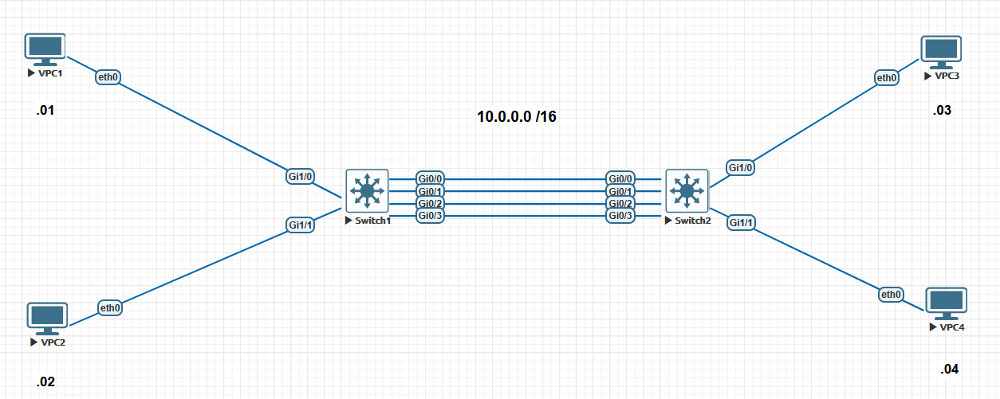
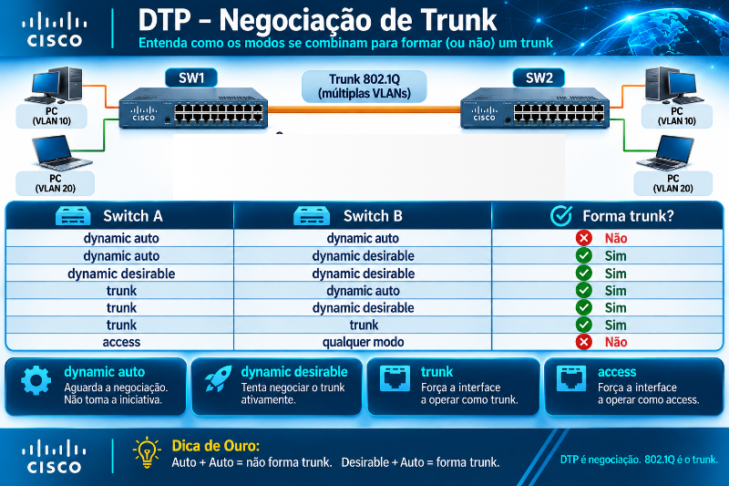
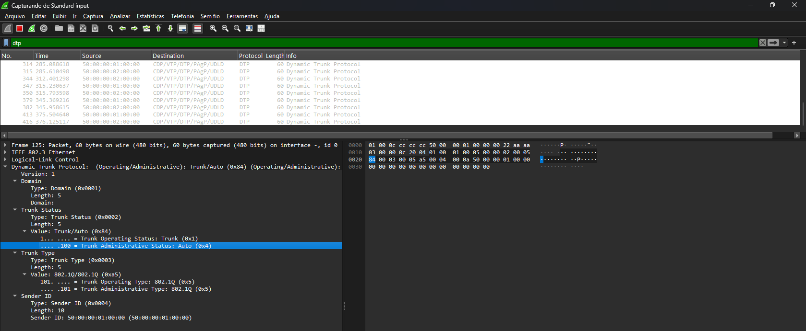
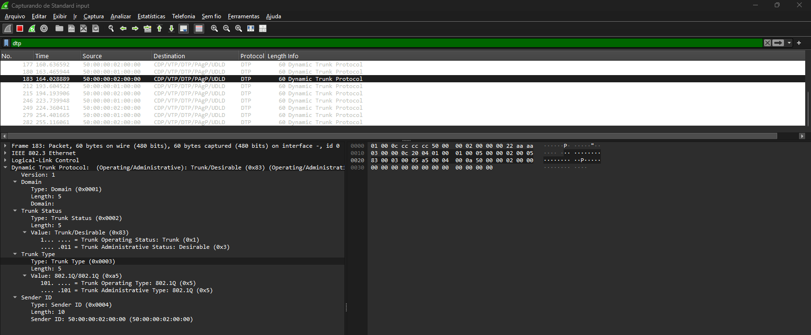
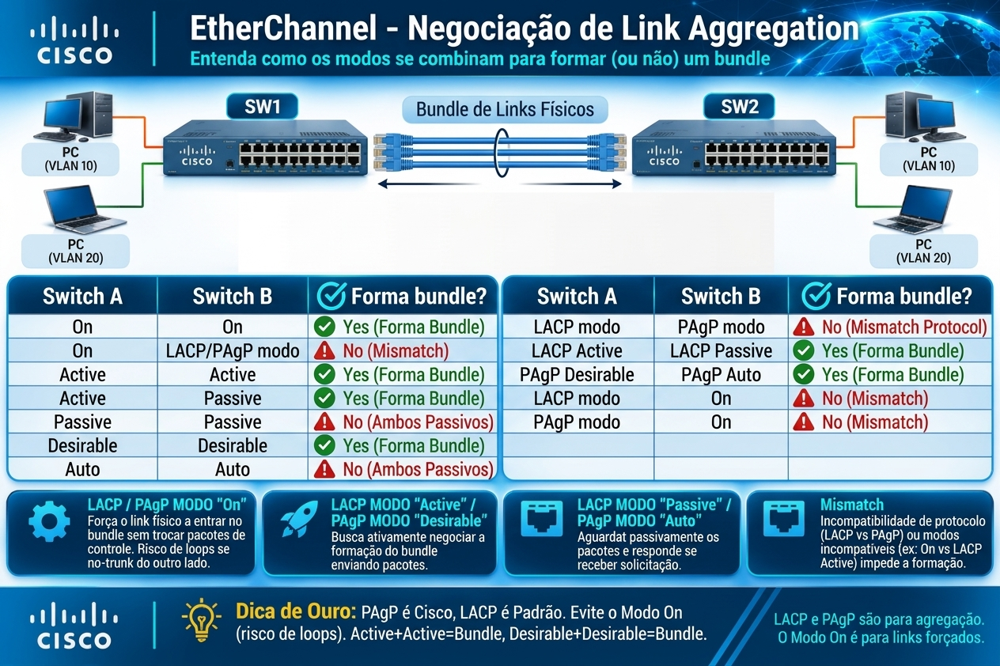
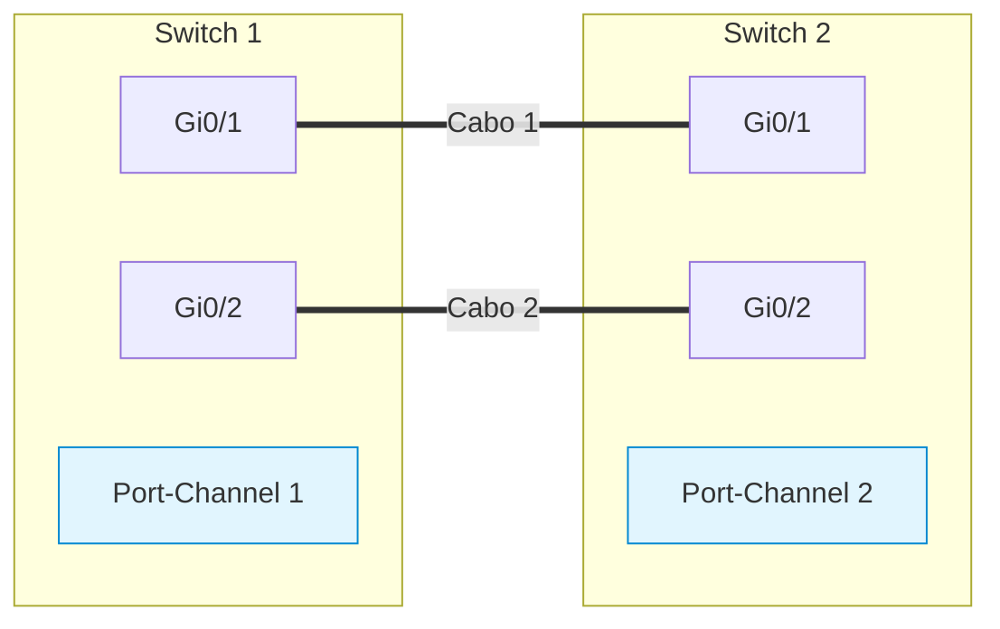

# Guia Prático de Laboratórios: Layer 2 Infrastructure (Trunking 802.1Q, DTP, EtherChannels & Troubleshooting)

- [Guia Prático de Laboratórios: Layer 2 Infrastructure (Trunking 802.1Q, DTP, EtherChannels \& Troubleshooting)](#guia-prático-de-laboratórios-layer-2-infrastructure-trunking-8021q-dtp-etherchannels--troubleshooting)
  - [🎯 Objetivo Geral do Guia](#-objetivo-geral-do-guia)
  - [🧰 Requisitos de Ambiente e Topologia](#-requisitos-de-ambiente-e-topologia)
  - [🧪 Lab 01: Trunking Estático 802.1Q, Native VLAN e Pruning Manual](#-lab-01-trunking-estático-8021q-native-vlan-e-pruning-manual)
    - [Objetivos](#objetivos)
    - [Diagrama da Topologia](#diagrama-da-topologia)
    - [Passo a Passo de Configuração](#passo-a-passo-de-configuração)
      - [Configuração dos VPCs](#configuração-dos-vpcs)
      - [1. Criação das VLANs em ambos os switches (SW1 e SW2)](#1-criação-das-vlans-em-ambos-os-switches-sw1-e-sw2)
      - [2. Configuração das Portas de Acesso dos Hosts](#2-configuração-das-portas-de-acesso-dos-hosts)
      - [3. Configuração do Trunk Estático e Pruning Restritivo no Link Inter-Switch (`Gi0/1`)](#3-configuração-do-trunk-estático-e-pruning-restritivo-no-link-inter-switch-gi01)
    - [Validação e Verificação](#validação-e-verificação)
  - [🧪 Lab 02: Negociação DTP, Matriz de Estados e Hardening L2](#-lab-02-negociação-dtp-matriz-de-estados-e-hardening-l2)
    - [Objetivos](#objetivos-1)
    - [Configuração e Testes de Matriz DTP](#configuração-e-testes-de-matriz-dtp)
    - [Diagrama da Topologia](#diagrama-da-topologia-1)
      - [Cenário A: Dynamic Auto vs Dynamic Desirable](#cenário-a-dynamic-auto-vs-dynamic-desirable)
      - [Cenário B: Dynamic Auto vs Dynamic Auto](#cenário-b-dynamic-auto-vs-dynamic-auto)
    - [Aplicando Boas Práticas (Hardening)](#aplicando-boas-práticas-hardening)
    - [Validação CLI](#validação-cli)
  - [🧪 Lab 03: Troubleshooting Avançado de Trunking e VLAN Leaking](#-lab-03-troubleshooting-avançado-de-trunking-e-vlan-leaking)
    - [Cenário de Falha 1: Native VLAN Mismatch (PVID-Inconsistent)](#cenário-de-falha-1-native-vlan-mismatch-pvid-inconsistent)
      - [1. Injetando a Falha](#1-injetando-a-falha)
      - [2. Sintomas Observados](#2-sintomas-observados)
      - [3. Resolução](#3-resolução)
    - [Cenário de Falha 2: Allowed List Inconsistente (VLAN Pruning Involuntário)](#cenário-de-falha-2-allowed-list-inconsistente-vlan-pruning-involuntário)
      - [1. Injetando a Falha (Erro comum de digitação)](#1-injetando-a-falha-erro-comum-de-digitação)
      - [2. Diagnóstico](#2-diagnóstico)
      - [3. Resolução Segura](#3-resolução-segura)
  - [🧪 Lab 04: EtherChannel Estático (Mode On) e Riscos de Loop](#-lab-04-etherchannel-estático-mode-on-e-riscos-de-loop)
    - [Objetivos](#objetivos-2)
    - [Configuração do Port-Channel Estático](#configuração-do-port-channel-estático)
      - [1. Configuração no SW1](#1-configuração-no-sw1)
      - [2. Configuração no SW2](#2-configuração-no-sw2)
    - [Verificações](#verificações)
    - [Simulação de Mismatch de Negociação (Static On vs Normal Access)](#simulação-de-mismatch-de-negociação-static-on-vs-normal-access)
  - [🧪 Lab 05: Troubleshooting de EtherChannels e Load Balancing](#-lab-05-troubleshooting-de-etherchannels-e-load-balancing)
    - [Cenário de Falha 1: Speed/Duplex Mismatch e Flags de Erro](#cenário-de-falha-1-speedduplex-mismatch-e-flags-de-erro)
      - [1. Injetando a Falha](#1-injetando-a-falha-1)
      - [2. Sintomas e Diagnóstico no CLI](#2-sintomas-e-diagnóstico-no-cli)
      - [2. Sintomas e Diagnóstico no CLI](#2-sintomas-e-diagnóstico-no-cli-1)
      - [3. Resolução](#3-resolução-1)
    - [Cenário de Falha 2: Hash Polarization e Ajuste do Algoritmo](#cenário-de-falha-2-hash-polarization-e-ajuste-do-algoritmo)
    - [📋 Topologia e Objetivo](#-topologia-e-objetivo)
      - [No SW1 e SW2 (Configuração dos Switches):](#no-sw1-e-sw2-configuração-dos-switches)
    - [Passo 2: Configuração dos Endereços IP nos VPCs](#passo-2-configuração-dos-endereços-ip-nos-vpcs)
    - [Passo 3: Forçando a Hash Polarization (O Problema)](#passo-3-forçando-a-hash-polarization-o-problema)
    - [Passo 4: Aplicando o Algoritmo Otimizado (A Solução)](#passo-4-aplicando-o-algoritmo-otimizado-a-solução)
  - [🧪 Lab 06: Dynamic Link Aggregation (LACP 802.3ad e PAgP)](#-lab-06-dynamic-link-aggregation-lacp-8023ad-e-pagp)
    - [Objetivos](#objetivos-3)
    - [Parte 1: LACP com Prioridades e Portas Hot-Standby](#parte-1-lacp-com-prioridades-e-portas-hot-standby)
      - [Topologia da Parte 1](#topologia-da-parte-1)
      - [1. Configurando o LACP no SW1 (Master Switch via System Priority)](#1-configurando-o-lacp-no-sw1-master-switch-via-system-priority)
    - [Prioridades no LACP: System-Priority vs. Port-Priority](#prioridades-no-lacp-system-priority-vs-port-priority)
      - [`lacp system-priority` (Escopo Global / Nível de Equipamento)](#lacp-system-priority-escopo-global--nível-de-equipamento)
      - [`lacp port-priority` (Escopo de Interface / Nível de Porta)](#lacp-port-priority-escopo-de-interface--nível-de-porta)
    - [Resumo de Aplicação no Laboratório](#resumo-de-aplicação-no-laboratório)
      - [2. Configurando o SW2 (LACP Passive)](#2-configurando-o-sw2-lacp-passive)
      - [3. Validação do tronco e Bundle LACP Standby](#3-validação-do-tronco-e-bundle-lacp-standby)
    - [Como ver quem foi eleito o Master (System Priority)?](#como-ver-quem-foi-eleito-o-master-system-priority)
    - [Parte 2: PAgP (Desirable / Auto)](#parte-2-pagp-desirable--auto)
      - [1. Configuração no SW1 (Desirable)](#1-configuração-no-sw1-desirable)
      - [2. Configuração no SW2 (Auto)](#2-configuração-no-sw2-auto)
    - [3. Aplicando as políticas de Layer 2](#3-aplicando-as-políticas-de-layer-2)
      - [4. Validação do PAgP](#4-validação-do-pagp)
  - [📝 Checklist Final de Validação para a Prova](#-checklist-final-de-validação-para-a-prova)

---

## 🎯 Objetivo Geral do Guia

Este guia prático foi desenhado para consolidar 100% dos tópicos **3.1.a** e **3.1.b** do blueprint do **CCNP ENCOR 350-401**. 

Ao executar estes laboratórios, você aplicará na prática a configuração, a negociação dinâmica e a resolução de falhas estruturais em ambientes de Camada 2 Cisco IOS/IOS-XE.

---

## 🧰 Requisitos de Ambiente e Topologia

Os laboratórios podem ser executados no **Cisco CML (Cisco Modeling Labs)**, **EVE-NG**, **GNS3** (utilizando imagens IOSvL2) ou em switches físicos Catalyst.

- **Equipamentos:** 2x Switches Catalyst de Camada 2/3 (SW1 e SW2), 4x Hosts/VPCS (PC1, PC2, PC3, PC4).
- **Links Físicos Necessários:**
  - `Gi0/0` e `Gi0/0`: Conexões diretas entre SW1 e SW2.
  - `Gi0/1` e `Gi0/1`: Conexões diretas entre SW1 e SW2.
  - `Gi0/2` e `Gi0/2`: Conexões diretas entre SW1 e SW2.
  - `Gi0/3` e `Gi0/3`: Conexões diretas entre SW1 e SW2.
  - `Gi1/0` e `Gi1/1`: Portas de acesso para os hosts. - VPC01 e VPC02 no switch **SW01**
  - `Gi1/0` e `Gi1/1`: Portas de acesso para os hosts. - VPC01 e VPC02 no switch **SW02**

---

## 🧪 Lab 01: Trunking Estático 802.1Q, Native VLAN e Pruning Manual

### Objetivos

1. Criar a base de dados de VLANs nos switches.
2. Configurar um trunk estático 802.1Q entre SW1 e SW2 na interface `GigabitEthernet0/1`.
3. Alterar a VLAN Nativa padrão (VLAN 1) para uma VLAN dummy dedicada (`VLAN 999`).
4. Aplicar a restrição de tráfego (*Allowed List*) permitindo apenas as VLANs 10 e 20.

### Diagrama da Topologia



### Passo a Passo de Configuração

#### Configuração dos VPCs

| **HOST** | **IP**      | **MÁSCARA**   | **VLAN** |
| :---     | :---        | :---          | :---     |
| VPC01    | 10.0.0.1    | 255.255.0.0   | 10       |
| VPC02    | 192.168.0.2 | 255.255.255.0 | 20       |
| VPC03    | 10.0.0.3    | 255.255.0.0   | 10       |
| VPC04    | 192.168.0.4 | 255.255.0.0   | 20       |

- **VPC01**

```vpc
VPCS> ip 10.0.0.1 255.255.0.0
Checking for duplicate address...
VPCS : 10.0.0.1 255.255.0.0

VPCS> save
Saving startup configuration to startup.vpc
.  done

VPCS>
```

- **VPC02**

```vpc
VPCS> ip 192.168.0.2 255.255.255.0
Checking for duplicate address...
VPCS : 192.168.0.2 255.255.255.0

VPCS> save
Saving startup configuration to startup.vpc
.  done

VPCS>
```

- **VPC03**

```vpc
VPCS> ip 10.0.0.3 255.255.0.0
Checking for duplicate address...
VPCS : 10.0.0.3 255.255.0.0

VPCS> save
Saving startup configuration to startup.vpc
.  done

VPCS>
```

- **VPC04**

```ios
VPCS> ip 192.168.0.4 255.255.255.0
Checking for duplicate address...
VPCS : 192.168.0.4 255.255.255.0

VPCS> save
Saving startup configuration to startup.vpc
.  done

VPCS>
```

#### 1. Criação das VLANs em ambos os switches (SW1 e SW2)

```ios
configure terminal
vlan 10
name VENDAS
vlan 20
name ENGENHARIA
vlan 999
name NATIVE_DUMMY
exit
```

*(Repita o mesmo procedimento no SW01 e SW02)*.

#### 2. Configuração das Portas de Acesso dos Hosts

**SW01**  
  
```ios
! SW1 - Conexão dos Hosts
interface GigabitEthernet1/0
switchport mode access
switchport access vlan 10
interface GigabitEthernet1/1
switchport mode access
switchport access vlan 20
```
  
**SW02**  

```ios
! SW2 - Conexão dos Hosts
interface GigabitEthernet1/0
switchport mode access
switchport access vlan 10
interface GigabitEthernet1/1
switchport mode access
switchport access vlan 20
```

#### 3. Configuração do Trunk Estático e Pruning Restritivo no Link Inter-Switch (`Gi0/1`)

```ios
interface range GigabitEthernet0/0-3
switchport trunk encapsulation dot1q  
! Exigido em plataformas legadas ou multicamada
switchport mode trunk
switchport trunk native vlan 999
switchport trunk allowed vlan 10,20
```

*(Aplique a mesma configuração exata nas interfaces `Gi0/0`, `Gi0/1`, `Gi0/2` e `Gi0/4` dos switches SW01 e SW02)*.

### Validação e Verificação

1. Verifique se o link trunk foi estabelecido corretamente:
  
   ```ios
   SW1# show interfaces trunk
   ```

- **SW01**

```ios
   SW01#show int trunk

Port        Mode             Encapsulation  Status        Native vlan
Gi0/0       on               802.1q         trunking      999
Gi0/1       on               802.1q         trunking      999
Gi0/2       on               802.1q         trunking      999
Gi0/3       on               802.1q         trunking      999

Port        Vlans allowed on trunk
Gi0/0       10,20
Gi0/1       10,20
Gi0/2       10,20
Gi0/3       10,20

Port        Vlans allowed and active in management domain
Gi0/0       10,20
Gi0/1       10,20
Gi0/2       10,20
Gi0/3       10,20

Port        Vlans in spanning tree forwarding state and not pruned
Gi0/0       10,20
Gi0/1       10,20
Gi0/2       10,20

Port        Vlans in spanning tree forwarding state and not pruned
Gi0/3       10,20
SW01#
```

- **SW02**

```ios
SW02#show int trunk

Port        Mode             Encapsulation  Status        Native vlan
Gi0/0       on               802.1q         trunking      999
Gi0/1       on               802.1q         trunking      999
Gi0/2       on               802.1q         trunking      999
Gi0/3       on               802.1q         trunking      999

Port        Vlans allowed on trunk
Gi0/0       10,20
Gi0/1       10,20
Gi0/2       10,20
Gi0/3       10,20

Port        Vlans allowed and active in management domain
Gi0/0       10,20
Gi0/1       10,20
Gi0/2       10,20
Gi0/3       10,20

Port        Vlans in spanning tree forwarding state and not pruned
Gi0/0       10,20
Gi0/1       none
Gi0/2       none

Port        Vlans in spanning tree forwarding state and not pruned
Gi0/3       none
SW02#
```

  **Saída Esperada:** As interface `Gi0/0`, `Gi0/1`, `Gi0/2` e `Gi0/3` devem constar com *Status* `trunking`, *Native vlan* `999` e *Vlans allowed on trunk* contendo `10,20`.

1. Teste o teste de conectividade (Ping):
   - PC1 (VLAN 10) deve pingar PC3 (VLAN 10).
   - PC2 (VLAN 20) deve pingar PC4 (VLAN 20).
   - Tentativas de envio de pacotes entre VLANs distintas sem um roteador/L3 switch devem falhar.

- VPC01

```vpc
vpc01> ping 10.0.0.3

84 bytes from 10.0.0.3 icmp_seq=1 ttl=64 time=4.242 ms
84 bytes from 10.0.0.3 icmp_seq=2 ttl=64 time=6.289 ms
84 bytes from 10.0.0.3 icmp_seq=3 ttl=64 time=3.448 ms
84 bytes from 10.0.0.3 icmp_seq=4 ttl=64 time=4.253 ms
84 bytes from 10.0.0.3 icmp_seq=5 ttl=64 time=4.225 ms

vpc01> ping 192.168.0.2

host (255.255.0.0) not reachable

vpc01> ping 192.168.0.4

host (255.255.0.0) not reachable

vpc01>
```

---

Antes de prosseguir, vamos a uma breve revisão sobre os modos das portas que podem formar os troncos.



## 🧪 Lab 02: Negociação DTP, Matriz de Estados e Hardening L2

### Objetivos

1. Observar a negociação automática de trunking usando o DTP entre portas em modo `dynamic auto` e `dynamic desirable`.
2. Validar o travamento da negociação quando um dos lados é colocado em modo `access`.
3. Executar as melhores práticas de *Hardening* recomendadas para o ENCOR: desativação do DTP com `switchport nonegotiate`.

### Configuração e Testes de Matriz DTP

### Diagrama da Topologia

Aqui estaremos utilizando o mesmo cenário do laboratório anterior.


#### Cenário A: Dynamic Auto vs Dynamic Desirable

1. No SW1, configure a porta `Gi0/2` como `dynamic auto`:
  
   ```ios
   SW1(config)# interface GigabitEthernet0/0
   SW1(config-if)# switchport mode dynamic auto
   ```

2. No SW2, configure a porta `Gi0/2` como `dynamic desirable`:

   ```ios
   SW2(config)# interface GigabitEthernet0/0
   SW2(config-if)# switchport mode dynamic desirable
   ```
  
3. Execute `show interface G0/0 trunk` no SW1 e no SW2.  
   *Resultado:* O link negociará e se transformará em **Trunk 802.1Q**, pois o SW2 enviou pacotes DTP ativos pedindo entroncamento.

- **SW01**

```ios
SW01#show interface g0/0 trunk

Port        Mode             Encapsulation  Status        Native vlan
Gi0/0       auto             802.1q         trunking      999

Port        Vlans allowed on trunk
Gi0/0       10,20

Port        Vlans allowed and active in management domain
Gi0/0       10,20

Port        Vlans in spanning tree forwarding state and not pruned
Gi0/0       10,20
SW01#
```

- **SW02**

```ios
SW02#show interface g0/0 trunk

Port        Mode             Encapsulation  Status        Native vlan
Gi0/0       desirable        802.1q         trunking      999

Port        Vlans allowed on trunk
Gi0/0       10,20

Port        Vlans allowed and active in management domain
Gi0/0       10,20

Port        Vlans in spanning tree forwarding state and not pruned
Gi0/0       10,20
SW02#
```

Agora vamos executar capturas no wireshark.

- **SW01** interface `Gi0/0`



- **SW01** interface `Gi0/0`



#### Cenário B: Dynamic Auto vs Dynamic Auto

Agora que testamos um modo, vamos gerar um pequeno erro para observarmos o comportamento dos equipamentos.

1. Altere o SW2 para `dynamic auto`:
  
   ```ios
   SW2(config-if)# switchport mode dynamic auto
   ```
  
2. Verifique o estado operacional da interface:
  
   ```ios
   SW1# show interfaces GigabitEthernet0/2 switchport
   ```
  
- **SW02**

```ios
SW02#show int g0/0 trunk

Port        Mode             Encapsulation  Status        Native vlan
Gi0/0       auto             802.1q         not-trunking  999

Port        Vlans allowed on trunk
Gi0/0       1

Port        Vlans allowed and active in management domain
Gi0/0       1

Port        Vlans in spanning tree forwarding state and not pruned
Gi0/0       1
SW02#
```

   *Resultado:* O *Operational Mode* mudou para **static access**. Nenhuma das pontas tomou a iniciativa de solicitar trunk.

### Aplicando Boas Práticas (Hardening)

Para proteger a infraestrutura contra ataques de *VLAN Hopping* e desestabilizações no DTP, aplique a configuração padrão de segurança em todas as portas de infraestrutura:

```ios
SW1(config)# interface GigabitEthernet0/0
SW1(config-if)# switchport mode trunk
SW1(config-if)# switchport nonegotiate

SW2(config)# interface GigabitEthernet0/0
SW2(config-if)# switchport mode trunk
SW2(config-if)# switchport nonegotiate
```

Alterar nos dois switches.

### Validação CLI

Execute o comando para confirmar que a negociação de trunking foi desativada:

```ios
SW1# show interfaces GigabitEthernet0/0 switchport | include Negotiation
Negotiation of Trunking: Off
```

- **SW01**

```ios
SW01#show interfaces GigabitEthernet0/0 switchport | include Negotiation
Negotiation of Trunking: Off
SW01#show int trunk

Port        Mode             Encapsulation  Status        Native vlan
Gi0/0       on               802.1q         trunking      999
Gi0/1       on               802.1q         trunking      999
Gi0/2       on               802.1q         trunking      999
Gi0/3       on               802.1q         trunking      999

Port        Vlans allowed on trunk
Gi0/0       10,20
Gi0/1       10,20
Gi0/2       10,20
Gi0/3       10,20

Port        Vlans allowed and active in management domain
Gi0/0       10,20
Gi0/1       10,20
Gi0/2       10,20
Gi0/3       10,20

Port        Vlans in spanning tree forwarding state and not pruned
Gi0/0       10,20
Gi0/1       10,20
Gi0/2       10,20

Port        Vlans in spanning tree forwarding state and not pruned
Gi0/3       10,20
SW01#
```

- **SW02**

```ios
SW02#show int trunk

Port        Mode             Encapsulation  Status        Native vlan
Gi0/0       on               802.1q         trunking      999
Gi0/1       on               802.1q         trunking      999
Gi0/2       on               802.1q         trunking      999
Gi0/3       on               802.1q         trunking      999

Port        Vlans allowed on trunk
Gi0/0       10,20
Gi0/1       10,20
Gi0/2       10,20
Gi0/3       10,20

Port        Vlans allowed and active in management domain
Gi0/0       10,20
Gi0/1       10,20
Gi0/2       10,20
Gi0/3       10,20

Port        Vlans in spanning tree forwarding state and not pruned
Gi0/0       10,20
Gi0/1       none
Gi0/2       none

Port        Vlans in spanning tree forwarding state and not pruned
Gi0/3       none
SW02#
```

Agora podemos notar que as interfaces `Gi0/0` estão formando o tronco porém se utilizar o protocolo **DTP**

---

## 🧪 Lab 03: Troubleshooting Avançado de Trunking e VLAN Leaking

### Cenário de Falha 1: Native VLAN Mismatch (PVID-Inconsistent)

#### 1. Injetando a Falha

Altere propositalmente a VLAN nativa apenas no SW1, mantendo o SW2 na VLAN Nativa 1.

```ios
SW1(config)# interface GigabitEthernet0/0
SW1(config-if)# switchport trunk native vlan 100
```

#### 2. Sintomas Observados

- Em poucos segundos, mensagens do CDP surgirão no console do SW1 e SW2:

  ```ios
  *Nov 11 21:51:26.059: %CDP-4-NATIVE_VLAN_MISMATCH: Native VLAN mismatch discovered on GigabitEthernet0/0 (100), with SW02 GigabitEthernet0/0 (999).
  ```

#### 3. Resolução

Alinhe a VLAN Nativa em ambas as pontas do link:

```ios
SW01(config)# interface GigabitEthernet0/0
SW01(config-if)# switchport trunk native vlan 999
SW01(config-if)# vlan dot1q tag native

SW02(config)# interface GigabitEthernet0/0
SW02(config-if)# switchport trunk native vlan 999
SW02(config-if)# vlan dot1q tag native
```

**OBS:** O comando vlan dot1q tag native força o switch a etiquetar (taggear) também o tráfego da VLAN nativa nos links trunk, em vez de enviá-lo sem etiqueta (untagged). Isso é uma importante prática de segurança para mitigar ataques de VLAN Hopping (Double-Tagging). Isso é uma boa prática de hardnering

---

### Cenário de Falha 2: Allowed List Inconsistente (VLAN Pruning Involuntário)

#### 1. Injetando a Falha (Erro comum de digitação)

Tente adicionar a VLAN 30 no SW1 sem utilizar o comando `add`. Essa costuma ser uma "pegadinha" clássica. Cuidado com esse tipo de comando em produção pois pode derrubar a rede toda.

Primeiro vamos listar as vlans permitidas na interface `Gi0/0` antes de mais nada:

```ios
SW01#show run | section interface GigabitEthernet0/0
interface GigabitEthernet0/0
 switchport trunk allowed vlan 10,20
 switchport trunk encapsulation dot1q
 switchport trunk native vlan 999
 switchport mode trunk
 switchport nonegotiate
 media-type rj45
 negotiation auto
SW01#
```

Agora vamos rodar o comando para autorizar a vlan 30 também.

```ios
SW1(config)# interface GigabitEthernet0/0
SW1(config-if)# switchport trunk allowed vlan 30  ! ⚠️ Isso substitui toda a lista existente!
```

#### 2. Diagnóstico

1. Os hosts da VLAN 10 e VLAN 20 perdem totalmente a comunicação entre switches.
2. Execute o comando de diagnóstico no SW1:

```ìos
  SW01#show run | section interface GigabitEthernet0/0
*Nov 11 22:22:46.526: %SYS-5-CONFIG_I: Configured from console by console
interface GigabitEthernet0/0
 switchport trunk allowed vlan 30
 switchport trunk encapsulation dot1q
 switchport trunk native vlan 999
 switchport mode trunk
 switchport nonegotiate
 media-type rj45
 negotiation auto
SW01#
```

Também podemos verificar mostrando as interfaces tronco:

   ```ios
   SW01(config-if)#do show int trunk

Port        Mode             Encapsulation  Status        Native vlan
Gi0/0       on               802.1q         trunking      999
Gi0/1       on               802.1q         trunking      999
Gi0/2       on               802.1q         trunking      999
Gi0/3       on               802.1q         trunking      999

Port        Vlans allowed on trunk
Gi0/0       30
Gi0/1       10,20
Gi0/2       10,20
Gi0/3       10,20

Port        Vlans allowed and active in management domain
Gi0/0       none
Gi0/1       10,20
Gi0/2       10,20
Gi0/3       10,20

Port        Vlans in spanning tree forwarding state and not pruned
Gi0/0       none
Gi0/1       10,20
Gi0/2       10,20

Port        Vlans in spanning tree forwarding state and not pruned
Gi0/3       10,20

   ```

3. Note que as VLANs 10 e 20 foram removidas da lista permitida no SW1, embora continuem ativas no SW2.

#### 3. Resolução Segura

Corrija a lista permitida adicionando novamente as VLANs corretas sem apagar as existentes:

```ios
SW1(config-if)# switchport trunk allowed vlan add 10,20
```

Sempre que quiser adicionar uma vlan a lista de vlans permitidasem um interface tronk, nunca se esqueça de adicionar a palavra **`add`** no comando. Exemplo:

```ios
SW01(config-if)#switchport trunk allowed vlan add 30
SW01(config-if)#do show run | section interface GigabitEthernet0/0
interface GigabitEthernet0/0
 switchport trunk allowed vlan 10,20,30
 switchport trunk encapsulation dot1q
 switchport trunk native vlan 999
 switchport mode trunk
 switchport nonegotiate
 media-type rj45
 negotiation auto
SW01(config-if)#
```

Colocando a palvar **`add`** no final do comando **`switchport trunk allowed vlan tag`** adiciona a vlan ao final da lista sem substituir a lista existente.

---

Agora vamos fazer uma breve revisão sobre os modos de agregação de portas.  
  


## 🧪 Lab 04: EtherChannel Estático (Mode On) e Riscos de Loop

### Objetivos

1. Agrupar logicamente duas interfaces físicas (`Gi0/1` e `Gi0/2`) em uma interface virtual `Port-Channel 1`.
2. Utilizar o modo estático `channel-group 1 mode on`.
3. Analisar o comportamento do Spanning Tree com a interface lógica agregada.



### Configuração do Port-Channel Estático

#### 1. Configuração no SW1

Primeiramente vamos voltar as portas nos padrões de fábrica default com o comando: **`default interface range G0/1-2`**.  

```ios
SW01(config)#default interface range G0/1-2
SW01(config)#
*Nov 12 03:44:47.731: %LINK-5-CHANGED: Interface GigabitEthernet0/1, changed state to reset
*Nov 12 03:44:47.856: %LINK-5-CHANGED: Interface GigabitEthernet0/2, changed state to reset
*Nov 12 03:44:48.733: %LINEPROTO-5-UPDOWN: Line protocol on Interface GigabitEthernet0/1, changed state to down
*Nov 12 03:44:48.856: %LINEPROTO-5-UPDOWN: Line protocol on Interface GigabitEthernet0/2, changed state to down
*Nov 12 03:44:51.914: %LINK-3-UPDOWN: Interface GigabitEthernet0/2, changed state to up
*Nov 12 03:44:52.072: %LINK-3-UPDOWN: Interface GigabitEthernet0/1, changed state to up
*Nov 12 03:44:52.916: %LINEPROTO-5-UPDOWN: Line protocol on Interface GigabitEthernet0/2, changed state to up
*Nov 12 03:44:53.072: %LINEPROTO-5-UPDOWN: Line protocol on Interface GigabitEthernet0/1, changed state to up
```

Agora vamos criar a agregação de links das portas **`Gi0/1-2`**. Isso é conhecido como bundle.

```ios
SW01(config)#
SW01(config)#int range g0/1-2
SW01(config-if-range)#channel-group 1 mode on
Creating a port-channel interface Port-channel 1

SW01(config-if-range)#
*Nov 12 03:47:56.552: %LINK-3-UPDOWN: Interface Port-channel1, changed state to up
*Nov 12 03:47:57.552: %LINEPROTO-5-UPDOWN: Line protocol on Interface Port-channel1, changed state to up
```

**OBS:** quando aplicamos o comando de channel-group, o sistema cria uma porta virtual agregando as portas que indicamos. No nosso caso, criamos a porta **`Po01`**. O sistema retorna um log:

```ios
Creating a port-channel interface Port-channel 1
```

Verificar se a porta foi criada com o comando: **`show interfaces status`**

```ios
SW01#show interfaces status

Port      Name               Status       Vlan       Duplex  Speed Type
Gi0/0                        connected    trunk      a-full   auto RJ45
Gi0/1                        connected    trunk      a-full   auto RJ45
Gi0/2                        connected    trunk      a-full   auto RJ45
Gi0/3                        connected    trunk      a-full   auto RJ45
Gi1/0                        connected    10         a-full   auto RJ45
Gi1/1                        connected    20         a-full   auto RJ45
Gi1/2                        connected    1          a-full   auto RJ45
Gi1/3                        connected    1          a-full   auto RJ45
Gi2/0                        connected    1          a-full   auto RJ45
Gi2/1                        connected    1          a-full   auto RJ45
Gi2/2                        connected    1          a-full   auto RJ45
Gi2/3                        connected    1          a-full   auto RJ45
Gi3/0                        connected    1          a-full   auto RJ45
Gi3/1                        connected    1          a-full   auto RJ45
Gi3/2                        connected    1          a-full   auto RJ45
Gi3/3                        connected    1          a-full   auto RJ45
Po1                          connected    trunk      a-full   auto
SW01#
```

As políticas de Camada 2 (como modo Trunk, VLAN nativa e lista de VLANs permitidas) devem ser aplicadas **exclusivamente na interface lógica (Port-Channel)**, e nunca nas portas físicas individuais.

- **Herança Automática:** O Port-Channel atua de forma centralizada, assumindo o controle total do grupo e propagando automaticamente as configurações de VLAN para todas as portas físicas membro.
- **Inconsistência e Suspensão (*Parameter Mismatch*):** Se houver divergência e você configurar manualmente uma porta física com parâmetros diferentes da interface lógica, o switch detectará a inconsistência. Como consequência, a porta física é imediatamente suspensa do grupo — exibindo a flag `s` ou `I` no comando `show etherchannel summary` —, o que paralisa o tráfego naquele link específico.

**Boa prática:** Mantenha as portas físicas apenas com o comando de associação (`channel-group mode`) e gerencie todas as políticas de Camada 2 diretamente no Port-Channel.

Vamos aplicar agora as configurações de tronco de camada 2. Vamos aplicar as configurações na porta criada **`Po1`**

```ios
SW01(config)#int po1
SW01(config-if)#switchport trunk encapsulation dot1q
SW01(config-if)#switchport mode trunk 
SW01(config-if)#switchport trunk native vlan 999
SW01(config-if)#switchpor trunk allowed vlan 10,20
SW01(config-if)#
```

#### 2. Configuração no SW2

Agora precisamos fazer a mesma coisa no switch **SW02**.

Vamos retornar as intefaces nos padrões de fábrica das interfaces **`Gi0/1-2`**

```ios
SW02(config)#default interface range g0/1-2
SW02(config)#
*Nov 12 03:58:03.798: %LINK-5-CHANGED: Interface GigabitEthernet0/1, changed state to reset
*Nov 12 03:58:03.918: %LINK-5-CHANGED: Interface GigabitEthernet0/2, changed state to reset
*Nov 12 03:58:04.798: %LINEPROTO-5-UPDOWN: Line protocol on Interface GigabitEthernet0/1, changed state to down
*Nov 12 03:58:04.919: %LINEPROTO-5-UPDOWN: Line protocol on Interface GigabitEthernet0/2, changed state to down
*Nov 12 03:58:07.913: %LINK-3-UPDOWN: Interface GigabitEthernet0/2, changed state to up
*Nov 12 03:58:08.068: %LINK-3-UPDOWN: Interface GigabitEthernet0/1, changed state to up
*Nov 12 03:58:08.913: %LINEPROTO-5-UPDOWN: Line protocol on Interface GigabitEthernet0/2, changed state to up
*Nov 12 03:58:09.068: %LINEPROTO-5-UPDOWN: Line protocol on Interface GigabitEthernet0/1, changed state to up
```

Agora vamos criar o bundle

```ios
SW02(config)#int range g0/1-2
SW02(config-if-range)#channel-group 1 mode on
Creating a port-channel interface Port-channel 1

SW02(config-if-range)#
*Nov 12 04:00:39.577: %LINK-3-UPDOWN: Interface Port-channel1, changed state to up
*Nov 12 04:00:40.577: %LINEPROTO-5-UPDOWN: Line protocol on Interface Port-channel1, changed state to up
```

Por fim, precisamos aplicar as configurações do tronco de camada 2.

```ios
SW2(config)# interface Po1
SW02(config-if)#switchport trunk encapsulation dot1q
SW2(config-if)# switchport mode trunk
SW2(config-if)# switchport trunk native vlan 999
SW2(config-if)# switchport trunk allowed vlan 10,20
SW2(config-if)# 
```

### Verificações

Agora que configuramos tudo, precisamos fazer as verificações. Então vamos verificar se os troncos estão ok.

- **SW01**

```ios
SW01#show int trunk

Port        Mode             Encapsulation  Status        Native vlan
Gi0/0       on               802.1q         trunking      999
Gi0/3       on               802.1q         trunking      999
Po1         auto             802.1q         trunking      999

Port        Vlans allowed on trunk
Gi0/0       10,20,30
Gi0/3       10,20
Po1         10,20

Port        Vlans allowed and active in management domain
Gi0/0       10,20
Gi0/3       10,20
Po1         10,20

Port        Vlans in spanning tree forwarding state and not pruned
Gi0/0       10,20
Gi0/3       10,20
Po1         10,20
SW01#
```

- **SW02**

```ios
SW02#show int trunk

Port        Mode             Encapsulation  Status        Native vlan
Gi0/0       on               802.1q         trunking      999
Gi0/3       on               802.1q         trunking      999
Po1         on               802.1q         trunking      999

Port        Vlans allowed on trunk
Gi0/0       10,20
Gi0/3       10,20
Po1         10,20

Port        Vlans allowed and active in management domain
Gi0/0       10,20
Gi0/3       10,20
Po1         10,20

Port        Vlans in spanning tree forwarding state and not pruned
Gi0/0       none
Gi0/3       none
Po1         10,20
```

Agora precisamos verificar se o bundle está funcionando e operacional. Vamos executar o comando **`show etherchannel summary`**

- **SW01**

```ios
SW01#show etherchannel summary
Flags:  D - down        P - bundled in port-channel
        I - stand-alone s - suspended
        H - Hot-standby (LACP only)
        R - Layer3      S - Layer2
        U - in use      N - not in use, no aggregation
        f - failed to allocate aggregator

        M - not in use, minimum links not met
        m - not in use, port not aggregated due to minimum links not met
        u - unsuitable for bundling
        w - waiting to be aggregated
        d - default port

        A - formed by Auto LAG


Number of channel-groups in use: 1
Number of aggregators:           1

Group  Port-channel  Protocol    Ports
------+-------------+-----------+-----------------------------------------------
1      Po1(SU)          -        Gi0/1(P)    Gi0/2(P)

SW01#
```

Analsando a saída, podemos notar que a porra **Po1(SU)** tem os parâmetros **SU**. Olhando a leganda, **S** é uma agregação de **layer2** e o parâmetro **U** que a agregação está em uso. Ou seja, o bundle está ativo e operacional.

- **SW02**

```ios
SW02#show etherchannel summary
Flags:  D - down        P - bundled in port-channel
        I - stand-alone s - suspended
        H - Hot-standby (LACP only)
        R - Layer3      S - Layer2
        U - in use      N - not in use, no aggregation
        f - failed to allocate aggregator

        M - not in use, minimum links not met
        m - not in use, port not aggregated due to minimum links not met
        u - unsuitable for bundling
        w - waiting to be aggregated
        d - default port

        A - formed by Auto LAG


Number of channel-groups in use: 1
Number of aggregators:           1

Group  Port-channel  Protocol    Ports
------+-------------+-----------+-----------------------------------------------
1      Po1(SU)          -        Gi0/1(P)    Gi0/2(P)

SW02#
```

Com isso podemos concluir conseguimos atingir nosso objetivo de configurar as portas em agregação no **modo ON** de forma correta.

### Simulação de Mismatch de Negociação (Static On vs Normal Access)

Se o SW1 for configurado com `channel-group 1 mode on` e as portas do SW2 forem mantidas como portas independentes sem EtherChannel:

- O SW1 tentará distribuir quadros nos dois cabos via hash.
- O SW2 enxergará quadros com o mesmo MAC vindo de portas diferentes, causando **Mac Flapping** e instabilidade severa de Camada 2.

## 🧪 Lab 05: Troubleshooting de EtherChannels e Load Balancing

### Cenário de Falha 1: Speed/Duplex Mismatch e Flags de Erro

#### 1. Injetando a Falha

Altere manualmente a velocidade da porta `Gi0/2` no SW1 dentro do Port-Channel 10:

```ios
SW1(config)# interface GigabitEthernet0/2
SW01(config-if)#no negotiation auto
SW1(config-if)# speed 100
```

Para forçar o protocolo fazer o recalculo, é necessário derrubar a porta e depois colocar ela em estádo operacional.

```ios
SW01(config)#int Po10
SW01(config-if)#shut
SW01(config-if)#
*Nov 13 16:38:13.625: %LINK-5-CHANGED: Interface GigabitEthernet0/0, changed state to administratively down
*Nov 13 16:38:13.654: %LINK-5-CHANGED: Interface GigabitEthernet0/1, changed state to administratively down
*Nov 13 16:38:13.679: %LINK-5-CHANGED: Interface Port-channel10, changed state to administratively down
*Nov 13 16:38:13.682: %LINK-5-CHANGED: Interface GigabitEthernet0/2, changed state to administratively down
*Nov 13 16:38:13.710: %LINK-5-CHANGED: Interface GigabitEthernet0/3, changed state to administratively down
*Nov 13 16:38:14.625: %LINEPROTO-5-UPDOWN: Line protocol on Interface GigabitEthernet0/0, changed state to down
*Nov 13 16:38:14.655: %LINEPROTO-5-UPDOWN: Line protocol on Interface GigabitEthernet0/1, changed state to down
*Nov 13 16:38:14.679: %LINEPROTO-5-UPDOWN: Line protocol on Interface Port-channel10, changed state to down
*Nov 13 16:38:14.682: %LINEPROTO-5-UPDOWN: Line protocol on Interface GigabitEthernet0/2, changed state to down
*Nov 13 16:38:14.710: %LINEPROTO-5-UPDOWN: Line protocol on Interface GigabitEthernet0/3, changed state to down
SW01(config-if)#no shut
SW01(config-if)#
*Nov 13 16:38:19.433: %EC-5-CANNOT_BUNDLE2: Gi0/1 is not compatible with Gi0/0 and will be suspended (speed of Gi0/1 is auto, Gi0/0 is 100M)
*Nov 13 16:38:19.732: %EC-5-CANNOT_BUNDLE2: Gi0/2 is not compatible with Gi0/0 and will be suspended (speed of Gi0/2 is auto, Gi0/0 is 100M)
*Nov 13 16:38:19.733: %EC-5-CANNOT_BUNDLE2: Gi0/3 is not compatible with Gi0/0 and will be suspended (speed of Gi0/3 is auto, Gi0/0 is 100M)end
SW01#
*Nov 13 16:38:21.138: %LINK-3-UPDOWN: Interface Port-channel10, changed state to down
*Nov 13 16:38:21.138: %LINK-3-UPDOWN: Interface GigabitEthernet0/0, changed state to up
*Nov 13 16:38:21.284: %LINK-3-UPDOWN: Interface GigabitEthernet0/1, changed state to up
*Nov 13 16:38:21.400: %SYS-5-CONFIG_I: Configured from console by console
*Nov 13 16:38:21.437: %LINK-3-UPDOWN: Interface GigabitEthernet0/2, changed state to up
*Nov 13 16:38:21.584: %LINK-3-UPDOWN: Interface GigabitEthernet0/3, changed state to up
*Nov 13 16:38:22.139: %LINEPROTO-5-UPDOWN: Line protocol on Interface GigabitEthernet0/0, changed state to up
*Nov 13 16:38:25.465: %LINK-3-UPDOWN: Interface Port-channel10, changed state to up
*Nov 13 16:38:26.465: %LINEPROTO-5-UPDOWN: Line protocol on Interface Port-channel10, changed state to up
```

#### 2. Sintomas e Diagnóstico no CLI

O switch detecta a incompatibilidade física e remove a porta do agrupamento lógico:

```ios
SW01#show etherchannel summ
Flags:  D - down        P - bundled in port-channel
        I - stand-alone s - suspended
        H - Hot-standby (LACP only)
        R - Layer3      S - Layer2
        U - in use      N - not in use, no aggregation
        f - failed to allocate aggregator

        M - not in use, minimum links not met
        m - not in use, port not aggregated due to minimum links not met
        u - unsuitable for bundling
        w - waiting to be aggregated
        d - default port

        A - formed by Auto LAG


Number of channel-groups in use: 1
Number of aggregators:           1

Group  Port-channel  Protocol    Ports
------+-------------+-----------+-----------------------------------------------
10     Po10(SU)        LACP      Gi0/0(P)    Gi0/1(s)    Gi0/2(s)
                                 Gi0/3(s)

SW01#
```

#### 2. Sintomas e Diagnóstico no CLI

O switch detecta a incompatibilidade física de velocidade e suspende as portas divergentes:

SW01# show etherchannel summary
Group  Port-channel  Protocol    Ports
------+-------------+-----------+-----------------------------------------------
10     Po10(SU)      LACP        Gi0/0(P)    Gi0/1(s)    Gi0/2(s)
                                 Gi0/3(s)

**Interpretação da Flag `(s)`:** As portas `Gi0/1`, `Gi0/2` e `Gi0/3` entraram no estado **Suspended**. Como o LACP exige parâmetros idênticos em todos os membros do bundle, ele isola preventivamente as portas que possuem velocidade divergente da porta de referência (`Gi0/0`).

#### 3. Resolução

Padronize a velocidade e a auto-negociação em todas as portas físicas do grupo para restaurar o bundle:

SW1(config)# interface GigabitEthernet0/0
SW1(config-if)# speed auto
*(ou configure todas em 100 Mbps com 'no negotiation auto' e 'speed 100')*

---


---CONTINUAR DAQUI---

### Cenário de Falha 2: Hash Polarization e Ajuste do Algoritmo

### 📋 Topologia e Objetivo

- **VLAN Utilizada:** VLAN 10 (todas as portas de acesso e o Port-Channel em modo Trunk).
- **Sub-rede:** `172.16.0.0 /16`
- **Bundle LACP:** Portas `Gi0/0` a `Gi0/3` entre o **Switch1** e o **Switch2**.
- **Objetivo:** Demonstrar como um algoritmo de hash inadequado (`src-mac` ou `dst-mac`) concentra todo o tráfego em uma única porta física do EtherChannel (*Hash Polarization*), mesmo com múltiplos hosts conversando, e como corrigir isso utilizando o balanceamento baseado em IP e portas (`src-dst-mixed-ip-port`).

**OBS:** limpar todas as configurações antes de começar ou trocar os switches por outros novos no Eve-ng

#### No SW1 e SW2 (Configuração dos Switches):

```ios
enable
configure terminal
! Criação da VLAN 10
vlan 10
 name DADOS
vlan 999
  name Dummy
exit

! Configuração das portas de acesso dos VPCs (Gi1/0 e Gi1/1)
interface range GigabitEthernet1/0 - 1
 switchport mode access
 switchport access vlan 10
 no shutdown
exit

! Configuração das portas do Bundle LACP (Gi0/0 até Gi0/3)
interface range GigabitEthernet0/0 - 3
 channel-group 10 mode active
 no shutdown
exit

! Configuração da interface lógica Port-Channel 10 (Trunk)
interface Port-channel 10
 switchport trunk encapsulation dot1q
 switchport mode trunk
 switchport trunk allowed vlan 10
 switchport trunk native vlan 999
end
```

**Verificação:** Execute show etherchannel summary e confirme se o Po10 exibe as quatro portas (Gi0/0 a Gi0/3) ativas com a flag (P).

### Passo 2: Configuração dos Endereços IP nos VPCs

Como não estamos utilizando roteamento (Camada 3), todos os 4 computadores estarão na mesma camada de enlace e na mesma sub-rede (172.16.0.0/16).

Configure cada VPC em suas respectivas janelas de terminal:

- VPC01

```vpc
ip 172.16.0.1 255.255.0.0
```

- Vpc02

```vpc
ip 172.16.0.2 255.255.0.0
```

- VPC03

```vpc
ip 172.16.0.3 255.255.0.0
```

- VPC04

```vpc
ip 172.16.0.1 255.255.0.0
```

### Passo 3: Forçando a Hash Polarization (O Problema)

Antes de mais nada, vamos analisar o algorítmo de hash que vem configurado por padrão com o comando **`show etherchannel load-balance`**

```ios
SW01#show etherchannel load-balance
EtherChannel Load-Balancing Configuration:
        src-dst-ip

EtherChannel Load-Balancing Addresses Used Per-Protocol:
Non-IP: Source XOR Destination MAC address
  IPv4: Source XOR Destination IP address
  IPv6: Source XOR Destination IP address

SW01#
```

1. **Configurando um algoritmo restritivo no SW1**

Por padrão ou por configuração estática, defina o hash para olhar apenas para o MAC de origem (src-mac). Então vamos trocar o algorítmo de hash nos dois switches. Entrar em modo de configuração e digitar o comando:

- **`port-channel load-balance src-mac`**

2. **Gerando tráfego simultâneo para simular o problema**

Para simular o fluxo de dados e verificar a polarização, abra o terminal do VPC1 e do VPC2 e inicie pings contínuos para os computadores do outro lado (172.16.0.3 e 172.16.0.4):

- VPC1:

```vpc
    ping 172.16.0.3 -t
```

- VPC2:
  
```vpc
    ping 172.16.0.4 -t
```

3. **Analisando o desbalanceamento nas portas físicas**

Com o tráfego correndo, verifique os contadores de pacotes de cada interface física que compõe o bundle no SW1:

- **SW01**

```ios
show interfaces GigabitEthernet 0/0 | include packets
show interfaces GigabitEthernet 0/1 | include packets
show interfaces GigabitEthernet 0/2 | include packets
show interfaces GigabitEthernet 0/3 | include packets
```

Primeiro devemos limpar os contadores nos dos switches

- **`clear counters`**

```ios
SW01#show interfaces GigabitEthernet 0/0 | include packets
  5 minute input rate 0 bits/sec, 0 packets/sec
  5 minute output rate 1000 bits/sec, 1 packets/sec
     17 packets input, 2420 bytes, 0 no buffer
     181 packets output, 16058 bytes, 0 underruns
SW01#

SW01#show interfaces GigabitEthernet 0/1 | include packets
  5 minute input rate 0 bits/sec, 0 packets/sec
  5 minute output rate 0 bits/sec, 0 packets/sec
     33 packets input, 5340 bytes, 0 no buffer
     20 packets output, 2736 bytes, 0 underruns
SW01#

SW01#show interfaces GigabitEthernet 0/2 | include packets
  5 minute input rate 1000 bits/sec, 1 packets/sec
  5 minute output rate 0 bits/sec, 0 packets/sec
     159 packets input, 16752 bytes, 0 no buffer
     21 packets output, 2860 bytes, 0 underruns
SW01#

SW01#show interfaces GigabitEthernet 0/3 | include packets
  5 minute input rate 0 bits/sec, 0 packets/sec
  5 minute output rate 0 bits/sec, 0 packets/sec
     25 packets input, 3568 bytes, 0 no buffer
     184 packets output, 19646 bytes, 0 underruns
SW01#
```

Pela saída, podemos concluir que a comunicação estão saindo somente pela porta **`Gi0/2`** - ** 159 packets input, 16752 bytes, 0 no buffer**
  
**O que acontece aqui?** Devido à limitação do algoritmo baseado estritamente em **src-mac (ou dst-mac)**, você notará que 100% dos pacotes estarão concentrados em apenas uma única interface física (por exemplo, Gi0/0), enquanto as outras três (Gi0/1, Gi0/2, Gi0/3) permanecerão com o contador de pacotes de saída praticamente estagnado. Isso é a Hash Polarization saturando um único cabo desnecessariamente.

### Passo 4: Aplicando o Algoritmo Otimizado (A Solução)

Para resolver a polarização e distribuir o tráfego de forma inteligente utilizando as camadas superiores (IPs e portas de origem/destino):

1. **Alterando o método de Hash nos switches:**

```ios
port-channel load-balance src-dst-ip
```

2. **Validando a alteração:**

- **SW01**

```ios
SW01#show etherchannel load-balance
EtherChannel Load-Balancing Configuration:
        src-dst-ip

EtherChannel Load-Balancing Addresses Used Per-Protocol:
Non-IP: Source XOR Destination MAC address
  IPv4: Source XOR Destination IP address
  IPv6: Source XOR Destination IP address

SW01#
```

- **SW02**

```ios
SW02#show etherchannel load-balance
EtherChannel Load-Balancing Configuration:
        src-dst-ip

EtherChannel Load-Balancing Addresses Used Per-Protocol:
Non-IP: Source XOR Destination MAC address
  IPv4: Source XOR Destination IP address
  IPv6: Source XOR Destination IP address

SW02#
```

3. **Verificando o novo comportamento do tráfego:**

Zere os contadores se desejar (clear counters) e observe novamente o show interfaces counters nas portas Gi0/0 a Gi0/3 enquanto os pings continuam rodando.

- **Resultado Esperado:** O switch passa a calcular o hash considerando os diferentes IPs e portas dos fluxos, distribuindo os pacotes de forma equilibrada entre os cabos físicos do Port-Channel.

---

## 🧪 Lab 06: Dynamic Link Aggregation (LACP 802.3ad e PAgP)

### Objetivos

1. Configurar um EtherChannel LACP dinâmico com 4 links físicos, definindo prioridades de sistema e porta.
2. Limitar o grupo a 2 links ativos e 2 links em **Hot-Standby**.
3. Configurar um segundo grupo de EtherChannel utilizando o protocolo proprietário **PAgP**.

### Parte 1: LACP com Prioridades e Portas Hot-Standby

#### Topologia da Parte 1

Links  `Gi0/0`, `Gi0/1`, `Gi0/2`e `Gi0/3` conectando SW1 e SW2. Agora vamos criar um bundle com todas as portas.  

Antes de continuarmos, precisamos retornar as configurações de fábrica dessas portas. Vamos executar o comando nos dois switches:

```ios
(config)#default interface range g0/0-3
(config)#no interface Po1
```

Com isso não temos mais nenhum tronco formado e nenhuma porta virtual de agregação.

#### 1. Configurando o LACP no SW1 (Master Switch via System Priority)

```ios
SW1(config)# lacp system-priority 1000  ! Menor valor que o padrão (32768), vira o tomador de decisão

SW1(config)# interface range GigabitEthernet0/1 - 3
SW1(config-if-range)# channel-group 10 mode active
*Nov 12 17:30:20.052: %LINEPROTO-5-UPDOWN: Line protocol on Interface GigabitEthernet0/0, changed state to up
*Nov 12 17:30:20.055: %LINEPROTO-5-UPDOWN: Line protocol on Interface GigabitEthernet0/1, changed state to up
*Nov 12 17:30:20.060: %LINEPROTO-5-UPDOWN: Line protocol on Interface GigabitEthernet0/2, changed state to up
*Nov 12 17:30:20.063: %LINEPROTO-5-UPDOWN: Line protocol on Interface GigabitEthernet0/3, changed state to up
*Nov 12 17:30:26.801: %EC-5-L3DONTBNDL2: Gi0/2 suspended: LACP currently not enabled on the remote port.
*Nov 12 17:30:27.023: %EC-5-L3DONTBNDL2: Gi0/3 suspended: LACP currently not enabled on the remote port.
*Nov 12 17:30:27.254: %EC-5-L3DONTBNDL2: Gi0/0 suspended: LACP currently not enabled on the remote port.
*Nov 12 17:30:27.801: %LINEPROTO-5-UPDOWN: Line protocol on Interface GigabitEthernet0/2, changed state to down
*Nov 12 17:30:28.003: %EC-5-L3DONTBNDL2: Gi0/1 suspended: LACP currently not enabled on the remote port.
*Nov 12 17:30:28.023: %LINEPROTO-5-UPDOWN: Line protocol on Interface GigabitEthernet0/3, changed state to down
*Nov 12 17:30:28.255: %LINEPROTO-5-UPDOWN: Line protocol on Interface GigabitEthernet0/0, changed state to down
*Nov 12 17:30:29.003: %LINEPROTO-5-UPDOWN: Line protocol on Interface GigabitEthernet0/1, changed state to down
```

Pela saída, até agora setamos a prioridade do protocolo **lacp em 1000** e criamos o bundle com 4 portas utilizando o protocolo **lacp**. Agora vamos partir para as configurações da porta virtual **Po10**

```ios
SW01(config)# interface Po10
SW01(config-if)# switchport trunk allowed vlan 10,20
SW01(config-if)# switchport trunk encapsulation dot1q
SW01(config-if)# switchport trunk native vlan 999
SW01(config-if)# switchport mode trunk
SW01(config-if)# switchport nonegotiate
```

Aqui configuramos as políticas de camada 2 no bundle. Então aqui definimos que o bundle:

- são permitidas trafegarem somente as vlans 10 e 20 pelo tronco
- usa o encapsulamento dot1q
- a vlan nativa do tronco é a 999, não a padrão 1
- o bundle está atuando em modo trocno
- desativamos a negociação do protocolo dtp, ou seja, o bundle fica em modo tronco ativo

Agora vamos ajustar os outros parâmetros referente ao bundle. Como queremos que duas portas fiquem ativas e duas em standby, então iremos alterar as prioridades. Agora essas configurações precisam serem aplicadas diretamente nas interfaces físicas.

```ios
! Definindo a prioridade das portas individuais no SW1 para escolher quem fica Ativo
SW1(config)# interface range GigabitEthernet0/0 - 1
SW1(config-if-priority)# lacp port-priority 100  ! Vencerão e ficarão ATIVAS

SW1(config)# interface range GigabitEthernet0/2 - 3
SW1(config-if-priority)# lacp port-priority 60000 ! Ficarão em HOT-STANDBY
```

Por fim, precisamos definir quantas portas podem fazer parte do bundle. Parte ativa.

```ios
! Definindo o limite máximo de portas ativas no Port-Channel
SW1(config)# interface Port-channel 10
SW1(config-if)# lacp max-bundle 2
```

### Prioridades no LACP: System-Priority vs. Port-Priority

O LACP suporta até **16 portas físicas** em um mesmo grupo, mas o padrão **IEEE 802.3ad** permite no máximo **8 links ativos simultaneamente** (os demais permanecem em modo *standby*/backup). Para definir qual switch decide as regras e quais portas têm preferência para ficar ativas, o protocolo utiliza duas prioridades distintas:

#### `lacp system-priority` (Escopo Global / Nível de Equipamento)

- **Onde configurar:** Modo de configuração global (`SW1(config)#`).
- **Função:** Define a prioridade do **switch inteiro** na negociação LACP. Quando dois switches se conectam, o equipamento com o **menor valor** (padrão é `32768`) vence a eleição e assume o papel de tomador de decisão (*Master*) para definir quais links entram no bundle ativo.

#### `lacp port-priority` (Escopo de Interface / Nível de Porta)

- **Onde configurar:** Modo de configuração da interface física (`SW1(config-if)#`), **nunca** no Port-Channel.
- **Função:** Define a prioridade de uma **porta física específica** dentro do switch que venceu a eleição global. Caso haja mais links conectados do que o limite ativo suportado, as interfaces com o **menor valor** (padrão é `32768`) vencem a seleção e encaminham tráfego, enquanto as de maior valor ficam em *standby*.

---

### Resumo de Aplicação no Laboratório

| **Nível / Interface**      | **O que configurar**                                        | **Exemplos de Comandos**                                                        |
| :---                       | :---                                                        | :---                                                                            |
| **Global (`config`)**      | Eleição do switch gerente do LACP                           | `lacp system-priority 1000`                                                     |
| **Porta Física (`Gi0/x`)** | Seleção física de links ativos/backup e temporizadores LACP | `lacp port-priority 100`, `lacp rate fast`, `channel-group 1 mode active`       |
| **Port-Channel (`Po1`)**   | Políticas de Camada 2 e tráfego agregado                    | `switchport mode trunk`, `switchport trunk native vlan`, `switchport trunk allowed vlan` |

#### 2. Configurando o SW2 (LACP Passive)

Agora vamos configurar o switch **SW02**. Primeiro vamos criar o bundle.

```ios
SW02#conf t
Enter configuration commands, one per line.  End with CNTL/Z.
SW02(config)#interface range g0/0-3
SW02(config-if-range)#channel-group 10 mode passive
Creating a port-channel interface Port-channel 10

```

Agora vamos aplicar as políticas de layer2 no porta **Po10**

```ios
SW02(config)#interface Po10
SW02(config-if)#switchport trunk encapsulation dot1q
SW02(config-if)#switchport mode trunk
*Nov 12 19:29:52.011: %LINK-3-UPDOWN: Interface Port-channel10, changed state to down
*Nov 12 19:29:53.011: %LINEPROTO-5-UPDOWN: Line protocol on Interface Port-channel10, changed state to down
*Nov 12 19:30:02.326: %LINEPROTO-5-UPDOWN: Line protocol on Interface Port-channel10, changed state to up
SW02(config-if)#switchport trunk native vlan 999
SW02(config-if)#switchport trunk allowed vlan 10,20
```

Agora precisamos ajustar as portas para que não ocorram divergências nas eleições do **LACP**. Vamos ajustar as mesmas prioridades que fizemos antes

```ios
SW02(config)#int range g0/0-1
SW02(config-if-range)#lacp port-priority 100
SW02(config-if-range)#exit
SW02(config)#int range g0/2-3
SW02(config-if-range)#lacp port-priorit 6000
SW02(config-if-range)#
```

Também precisamos ajustar a quantidade de portas presentes ativas no bundle no switch **sw02**

```ios
SW02(config)#interface Po10
SW02(config-if)#lacp max-bundle 2
```

Feito isso, precisamos desativar e reativar a porta **Po10** nos dois switches com os comandos **shutdown e no shutdown**

#### 3. Validação do tronco e Bundle LACP Standby

Execute o comando de verificação no SW1.

Primeiro vamos verificar o tronco:

```ios
SW01#show int trunk

Port        Mode             Encapsulation  Status        Native vlan
Po10        on               802.1q         trunking      999

Port        Vlans allowed on trunk
Po10        10,20

Port        Vlans allowed and active in management domain
Po10        10,20

Port        Vlans in spanning tree forwarding state and not pruned
Po10        10,20
SW01#
```

Aqui podemos confirmar que o tronco formou. Vamos analisar agora o bundle.

- Vamos utilizar o comando:

**`show etherchannel summary`**  
  
```ios
SW01#show etherchannel summary
Flags:  D - down        P - bundled in port-channel
        I - stand-alone s - suspended
        H - Hot-standby (LACP only)
        R - Layer3      S - Layer2
        U - in use      N - not in use, no aggregation
        f - failed to allocate aggregator

        M - not in use, minimum links not met
        m - not in use, port not aggregated due to minimum links not met
        u - unsuitable for bundling
        w - waiting to be aggregated
        d - default port

        A - formed by Auto LAG


Number of channel-groups in use: 1
Number of aggregators:           1

Group  Port-channel  Protocol    Ports
------+-------------+-----------+-----------------------------------------------
10     Po10(SU)        LACP      Gi0/0(P)    Gi0/1(P)    Gi0/2(H)
                                 Gi0/3(H)

SW01#
```

**Análise de Saída:**  

- `Po10(SU)` -> Channel de Camada 2 UP.
- `Gi0/0(P)` e `Gi0/1(P)` -> *Bundled in port-channel* (Ativas).
- `Gi0/2(H)` e `Gi0/3(H)` -> *Hot-standby* (Aguardando falha das ativas).

### Como ver quem foi eleito o Master (System Priority)?

Para descobrir qual equipamento é o tomador de decisão da agregação, utilize o comando show lacp neighbor ou show lacp sys-id em um dos switches.

No SW1, execute:

- **`show lacp sys-id`**

```ios
SW01#show lacp sys-id
1000, 5000.0001.8000
SW01#
```

- **`show lacp neighbor`**

```ios
SW01#show lacp neighbor
Flags:  S - Device is requesting Slow LACPDUs
        F - Device is requesting Fast LACPDUs
        A - Device is in Active mode       P - Device is in Passive mode

Channel group 10 neighbors

Partner's information:

                  LACP port                        Admin  Oper   Port    Port
Port      Flags   Priority  Dev ID          Age    key    Key    Number  State
Gi0/0     SP      100       5000.0002.8000   7s    0x0    0xA    0x1     0x3C
Gi0/1     SP      100       5000.0002.8000  24s    0x0    0xA    0x2     0x3C
Gi0/2     SP      6000      5000.0002.8000  14s    0x0    0xA    0x3     0x4
Gi0/3     SP      6000      5000.0002.8000  10s    0x0    0xA    0x4     0x4
SW01#
```

Agora vamos realizar um teste para ver se as portas que estão em **H ( Hot Sandby ) vão assumir em um caso de falha. Vamos acessar o VPC01 e comçar um ping continuo para o VPC03 que está na mesma sub rede e vlan que VPC01.

```vpc01
vpc01> ping -t 10.0.0.3
Cannot resolve -t

vpc01> ping 10.0.0.3 -t

84 bytes from 10.0.0.3 icmp_seq=1 ttl=64 time=4.100 ms
84 bytes from 10.0.0.3 icmp_seq=2 ttl=64 time=4.987 ms
84 bytes from 10.0.0.3 icmp_seq=3 ttl=64 time=4.673 ms
84 bytes from 10.0.0.3 icmp_seq=4 ttl=64 time=5.534 ms
84 bytes from 10.0.0.3 icmp_seq=5 ttl=64 time=3.931 ms
84 bytes from 10.0.0.3 icmp_seq=6 ttl=64 time=4.288 ms
84 bytes from 10.0.0.3 icmp_seq=7 ttl=64 time=3.913 ms
84 bytes from 10.0.0.3 icmp_seq=8 ttl=64 time=3.677 ms
...
```

> **Nota de Laboratório (Comportamento no Emulador EVE-NG):**
> Em ambientes virtualizados, o comando `shutdown` aplicado apenas em uma das pontas do link não derruba a portadora física da interface remota instantaneamente. Isso gera uma assimetria temporária no protocolo LACP, fazendo com que a interface remota permaneça ativa até o tempo limite de expiração (*timeout*) ou entre em estado de suspensão (`s`), interrompendo o tráfego. Para simular corretamente um rompimento físico de cabo e validar a comutação limpa das portas em *Hot-Standby* (`H`) para ativas (`P`), é necessário desativar as interfaces ativas (`Gi0/0` e `Gi0/1`) simultaneamente em ambos os switches. Em um situação real, um cabo se rompe por exemplo, e as duas pontas entendem simultânemanete que o problema ocorreu e promove uma das portas em hot standbay para ativa sem ter esse problema mencinado.

Agora temos que que desligar as portas **`Gi0/0 e Gi0/1`** no dos switches para obtermos sucesso no nosso experimento. Então vamos aplicar os comandos:

- **SW01**

```ios
SW01(config)#int range g0/0-1
SW01(config-if-range)#shut
```

- **SW02**

```ios
SW02(config)#int range g0/0-1
SW02(config-if-range)#shut
```

Agora vamos analisar o estado do bundle nos dois switches:

- **SW01**

```ios
SW01#show etherchannel summary
Flags:  D - down        P - bundled in port-channel
        I - stand-alone s - suspended
        H - Hot-standby (LACP only)
        R - Layer3      S - Layer2
        U - in use      N - not in use, no aggregation
        f - failed to allocate aggregator

        M - not in use, minimum links not met
        m - not in use, port not aggregated due to minimum links not met
        u - unsuitable for bundling
        w - waiting to be aggregated
        d - default port

        A - formed by Auto LAG


Number of channel-groups in use: 1
Number of aggregators:           1

Group  Port-channel  Protocol    Ports
------+-------------+-----------+-----------------------------------------------
10     Po10(SU)        LACP      Gi0/0(D)    Gi0/1(D)    Gi0/2(P)
                                 Gi0/3(P)

SW01#
```

- **SW02**

```ios
SW02#sho etherchannel summary
Flags:  D - down        P - bundled in port-channel
        I - stand-alone s - suspended
        H - Hot-standby (LACP only)
        R - Layer3      S - Layer2
        U - in use      N - not in use, no aggregation
        f - failed to allocate aggregator

        M - not in use, minimum links not met
        m - not in use, port not aggregated due to minimum links not met
        u - unsuitable for bundling
        w - waiting to be aggregated
        d - default port

        A - formed by Auto LAG


Number of channel-groups in use: 1
Number of aggregators:           1

Group  Port-channel  Protocol    Ports
------+-------------+-----------+-----------------------------------------------
10     Po10(SU)        LACP      Gi0/0(D)    Gi0/1(D)    Gi0/2(P)
                                 Gi0/3(P)

SW02#
```

Podemos notar que as portas **`Gi0/0 e Gi0/1`** aparecem com (D) de down. Já as portas **`Gi0/3 e Gi0/4`** assumiram como (P), P - bundled in port-channel.

Já se voltamos em vpc01, podemos observar que só perdemos poucos pacotes e a comunicação voltou logo.

```vpc01
84 bytes from 10.0.0.3 icmp_seq=1431 ttl=64 time=5.044 ms
84 bytes from 10.0.0.3 icmp_seq=1432 ttl=64 time=4.362 ms
84 bytes from 10.0.0.3 icmp_seq=1433 ttl=64 time=3.158 ms
84 bytes from 10.0.0.3 icmp_seq=1434 ttl=64 time=3.382 ms
84 bytes from 10.0.0.3 icmp_seq=1435 ttl=64 time=3.270 ms
10.0.0.3 icmp_seq=1436 timeout
10.0.0.3 icmp_seq=1437 timeout
10.0.0.3 icmp_seq=1438 timeout
10.0.0.3 icmp_seq=1439 timeout
10.0.0.3 icmp_seq=1440 timeout
10.0.0.3 icmp_seq=1441 timeout
10.0.0.3 icmp_seq=1442 timeout
10.0.0.3 icmp_seq=1443 timeout
10.0.0.3 icmp_seq=1444 timeout
10.0.0.3 icmp_seq=1445 timeout
10.0.0.3 icmp_seq=1446 timeout
10.0.0.3 icmp_seq=1447 timeout
10.0.0.3 icmp_seq=1448 timeout
10.0.0.3 icmp_seq=1449 timeout
10.0.0.3 icmp_seq=1450 timeout
10.0.0.3 icmp_seq=1451 timeout
10.0.0.3 icmp_seq=1452 timeout
10.0.0.3 icmp_seq=1453 timeout
10.0.0.3 icmp_seq=1454 timeout
10.0.0.3 icmp_seq=1455 timeout
10.0.0.3 icmp_seq=1456 timeout
10.0.0.3 icmp_seq=1457 timeout
10.0.0.3 icmp_seq=1458 timeout
10.0.0.3 icmp_seq=1459 timeout
10.0.0.3 icmp_seq=1460 timeout
10.0.0.3 icmp_seq=1461 timeout
10.0.0.3 icmp_seq=1462 timeout
84 bytes from 10.0.0.3 icmp_seq=1463 ttl=64 time=3.625 ms
84 bytes from 10.0.0.3 icmp_seq=1464 ttl=64 time=3.654 ms
84 bytes from 10.0.0.3 icmp_seq=1465 ttl=64 time=4.495 ms
84 bytes from 10.0.0.3 icmp_seq=1466 ttl=64 time=2.593 ms
84 bytes from 10.0.0.3 icmp_seq=1467 ttl=64 time=3.919 ms
...
```

---

### Parte 2: PAgP (Desirable / Auto)

Novamente precisamos restaurar nossas portas de **`Gi0/0 a Gi0/3`** aos padrões de fábrica nos dois switches.

- **SW01**

```ios
SW01(config)#default interface range g0/0-3
SW01(config)#no interface Po10
```

- **SW02**

```ios
SW02(config)#default interface range g0/0-3
SW02(config)#no interface Po10
```

Agora vamos criar o bundle

#### 1. Configuração no SW1 (Desirable)

```ios
SW01(config)#int range g0/0 - 3
SW01(config-if-range)#channe
SW01(config-if-range)#channel-gr
SW01(config-if-range)#channel-group 20 mode des
SW01(config-if-range)#channel-group 20 mode desirable
Creating a port-channel interface Port-channel 20

SW01(config-if-range)#
*Nov 13 11:29:42.418: %LINEPROTO-5-UPDOWN: Line protocol on Interface GigabitEthernet0/2, changed state to down
*Nov 13 11:29:42.424: %LINEPROTO-5-UPDOWN: Line protocol on Interface GigabitEthernet0/3, changed state to down
*Nov 13 11:29:51.679: %LINEPROTO-5-UPDOWN: Line protocol on Interface GigabitEthernet0/2, changed state to up
*Nov 13 11:29:52.338: %LINEPROTO-5-UPDOWN: Line protocol on Interface GigabitEthernet0/3, changed state to 
```

#### 2. Configuração no SW2 (Auto)

```ios
SW02(config)#interface range G0/0-3
SW02(config-if-range)#channel-group 20 mode auto
Creating a port-channel interface Port-channel 20

SW02(config-if-range)#
*Nov 13 11:40:49.679: %LINEPROTO-5-UPDOWN: Line protocol on Interface GigabitEthernet0/0, changed state to down
*Nov 13 11:40:49.686: %LINEPROTO-5-UPDOWN: Line protocol on Interface GigabitEthernet0/1, changed state to down
*Nov 13 11:40:49.691: %LINEPROTO-5-UPDOWN: Line protocol on Interface GigabitEthernet0/2, changed state to down
*Nov 13 11:40:49.695: %LINEPROTO-5-UPDOWN: Line protocol on Interface GigabitEthernet0/3, changed state to down
*Nov 13 11:40:54.339: %LINEPROTO-5-UPDOWN: Line protocol on Interface GigabitEthernet0/0, changed state to up
*Nov 13 11:40:55.338: %LINK-3-UPDOWN: Interface Port-channel20, changed state to up
*Nov 13 11:40:56.338: %LINEPROTO-5-UPDOWN: Line protocol on Interface Port-channel20, changed state to up
*Nov 13 11:40:58.577: %LINEPROTO-5-UPDOWN: Line protocol on Interface GigabitEthernet0/3, changed state to up
*Nov 13 11:40:58.699: %LINEPROTO-5-UPDOWN: Line protocol on Interface GigabitEthernet0/2, changed state to up
*Nov 13 11:40:59.437: %LINEPROTO-5-UPDOWN: Line protocol on Interface GigabitEthernet0/1, changed state to up
```

### 3. Aplicando as políticas de Layer 2

Agora vamos acessar a interface virtual criada Po20 nos dois switches e aplicar as polícas de layer 2.

- **SW01**

```ios
SW01(config)#interface Po20
SW01(config-if)#switchport trunk encapsulation dot1q
SW01(config-if)#switchport mode trunk
SW01(config-if)#switchport trunk allowed vlan 10,20
SW01(config-if)#switchport trunk native vlan 999
SW01(config-if)#
*Nov 13 11:43:33.824: %LINK-3-UPDOWN: Interface Port-channel20, changed state to downtr
*Nov 13 11:43:34.824: %LINEPROTO-5-UPDOWN: Line protocol on Interface Port-channel20, changed state
*Nov 13 11:43:38.741: %LINK-3-UPDOWN: Interface Port-channel20, changed state
*Nov 13 11:43:39.741: %LINEPROTO-5-UPDOWN: Line protocol on Interface Port-channel20, changed state to up
```

- **SW02**

```ios
SW02(config)#int po20
SW02(config-if)#switchport trunk encapsulation dot1q
SW02(config-if)#switchport mode trunk
SW02(config-if)#switchport trunk native vlan 999
SW02(config-if)#switchport trunk allowed vlan 10,20
SW02(config-if)#
```

#### 4. Validação do PAgP

Check o status da negociação do protocolo Cisco:

- **SW01**

```ios
SW01#show pagp neighbor
Flags:  S - Device is sending Slow hello.  C - Device is in Consistent state.
        A - Device is in Auto mode.        P - Device learns on physical port.

Channel group 20 neighbors
          Partner              Partner          Partner         Partner Group
Port      Name                 Device ID        Port       Age  Flags   Cap.
Gi0/0     SW02                 5000.0002.8000   Gi0/0       16s SAC     140001
Gi0/1     SW02                 5000.0002.8000   Gi0/1       14s SAC     140001
Gi0/2     SW02                 5000.0002.8000   Gi0/2        9s SAC     140001
Gi0/3     SW02                 5000.0002.8000   Gi0/3        9s SAC     140001
SW01#
```

```ios
SW01#show etherchannel summary
Flags:  D - down        P - bundled in port-channel
        I - stand-alone s - suspended
        H - Hot-standby (LACP only)
        R - Layer3      S - Layer2
        U - in use      N - not in use, no aggregation
        f - failed to allocate aggregator

        M - not in use, minimum links not met
        m - not in use, port not aggregated due to minimum links not met
        u - unsuitable for bundling
        w - waiting to be aggregated
        d - default port

        A - formed by Auto LAG


Number of channel-groups in use: 1
Number of aggregators:           1

Group  Port-channel  Protocol    Ports
------+-------------+-----------+-----------------------------------------------
20     Po20(SU)        PAgP      Gi0/0(P)    Gi0/1(P)    Gi0/2(P)
                                 Gi0/3(P)

SW01#
```

- **SW02**

```ios
SW02#show pagp neighbor
Flags:  S - Device is sending Slow hello.  C - Device is in Consistent state.
        A - Device is in Auto mode.        P - Device learns on physical port.

Channel group 20 neighbors
          Partner              Partner          Partner         Partner Group
Port      Name                 Device ID        Port       Age  Flags   Cap.
Gi0/0     SW01                 5000.0001.8000   Gi0/0        2s SC      140001
Gi0/1     SW01                 5000.0001.8000   Gi0/1       10s SC      140001
Gi0/2     SW01                 5000.0001.8000   Gi0/2        8s SC      140001
Gi0/3     SW01                 5000.0001.8000   Gi0/3       26s SC      140001
SW02#
```

```ios
SW02#show etherchannel summary
Flags:  D - down        P - bundled in port-channel
        I - stand-alone s - suspended
        H - Hot-standby (LACP only)
        R - Layer3      S - Layer2
        U - in use      N - not in use, no aggregation
        f - failed to allocate aggregator

        M - not in use, minimum links not met
        m - not in use, port not aggregated due to minimum links not met
        u - unsuitable for bundling
        w - waiting to be aggregated
        d - default port

        A - formed by Auto LAG


Number of channel-groups in use: 1
Number of aggregators:           1

Group  Port-channel  Protocol    Ports
------+-------------+-----------+-----------------------------------------------
20     Po20(SU)        PAgP      Gi0/0(P)    Gi0/1(P)    Gi0/2(P)
                                 Gi0/3(P)

SW02#
```

**OBS:** O PAgP é um protocolo proprietário da Cisco mais antigo e simplificado, operando apenas nos modos desirable e auto com comandos legados. Diferente do LACP, ele não oferece recursos avançados de controle como system-priority, max-bundle ou Hot-Standby. Por isso, para cenários que exigem redundância e controle fino, o LACP é o padrão da indústria e o mais exigido na certificação CCNP.

---

## 📝 Checklist Final de Validação para a Prova

Antes de concluir a sessão de laboratórios, certifique-se de responder com total precisão às seguintes checagens práticas:

- [ ] Consigo identificar a diferença entre a saída do `show interfaces trunk` e `show vlan brief`? (Lembrando que portas trunk **não** aparecem no `show vlan brief`).
- [ ] Sei qual flag indica erro de consistência no `show etherchannel summary`? (`I` = Independent, `s` = Suspended, `D` = Down).
- [ ] Sei exatamente o que acontece quando aplico `switchport trunk allowed vlan 20` sem o parâmetro `add`?
- [ ] Compreendo a regra de que no LACP a preferência de portas é ditada pelo switch de **menor** *System Priority*?
- [ ] Sei o comando exato para desativar os frames de negociação DTP? (`switchport nonegotiate`).

---
