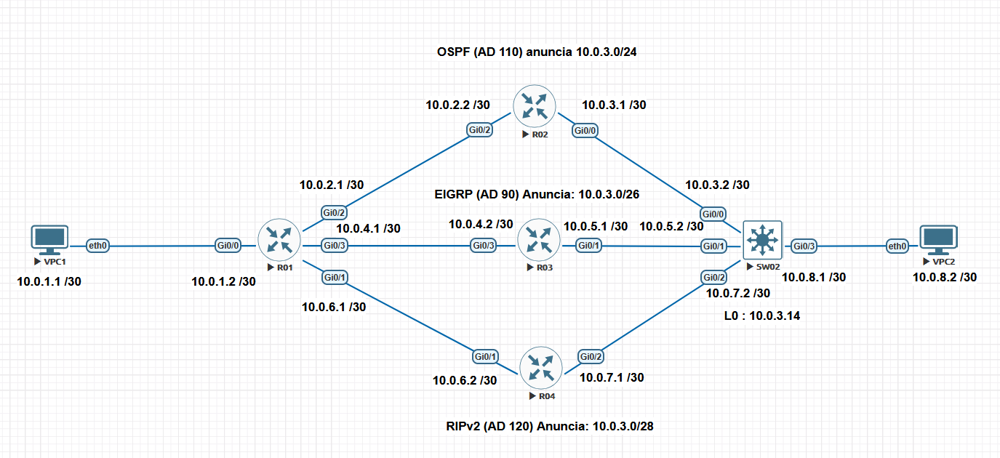
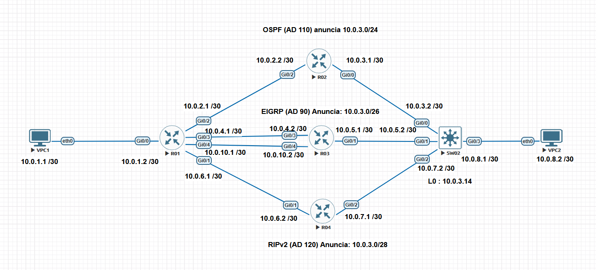
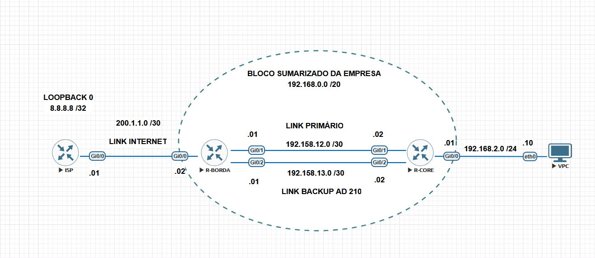
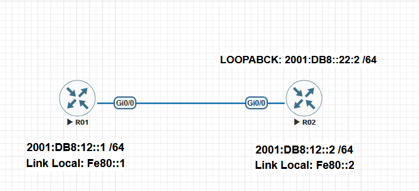
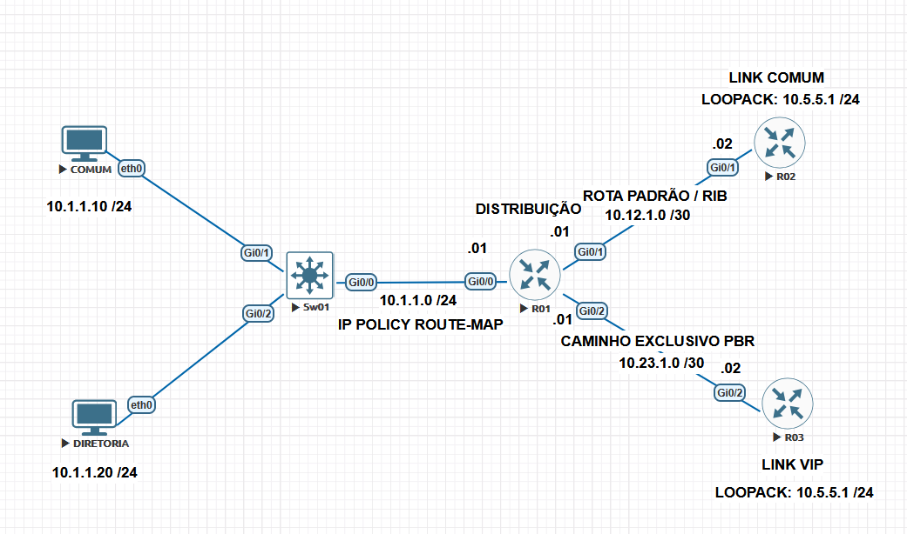
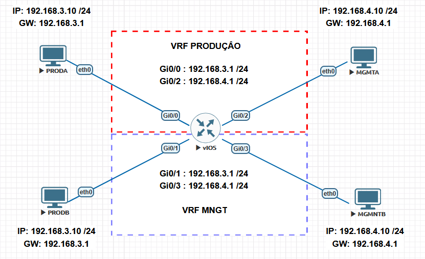

# Layer 3 Infrastructure: Laboratórios Práticos de Fundamentos de Roteamento IP (EVE-NG)

- [Layer 3 Infrastructure: Laboratórios Práticos de Fundamentos de Roteamento IP (EVE-NG)](#layer-3-infrastructure-laboratórios-práticos-de-fundamentos-de-roteamento-ip-eve-ng)
  - [🎯 Objetivo dos Laboratórios](#-objetivo-dos-laboratórios)
  - [🛠️ Requisitos e Preparação do Ambiente no EVE-NG](#️-requisitos-e-preparação-do-ambiente-no-eve-ng)
  - [🧪 Lab 01: Hierarquia de Decisão (Longest Prefix Match, AD e ECMP)](#-lab-01-hierarquia-de-decisão-longest-prefix-match-ad-e-ecmp)
    - [Inventário de Equipamentos e Imagens (EVE-NG — Lab 01)](#inventário-de-equipamentos-e-imagens-eve-ng--lab-01)
      - [Requisitos de Interfaces por Equipamento](#requisitos-de-interfaces-por-equipamento)
    - [1. Topologia do cenário](#1-topologia-do-cenário)
    - [2. Planejamento de Endereçamento IP (Topologia Lab 01 - Longest Prefix Match)](#2-planejamento-de-endereçamento-ip-topologia-lab-01---longest-prefix-match)
    - [3. Configuração Base e Cenário de Disputa](#3-configuração-base-e-cenário-de-disputa)
    - [4. Tarefas de Validação e Troubleshooting](#4-tarefas-de-validação-e-troubleshooting)
  - [🧪 Lab 02: Rotas Estáticas Avançadas (Fully Specified, Default, Floating e Null0)](#-lab-02-rotas-estáticas-avançadas-fully-specified-default-floating-e-null0)
    - [1. Montagem Visual da Topologia no EVE-NG](#1-montagem-visual-da-topologia-no-eve-ng)
    - [2. Tabela de Endereçamento](#2-tabela-de-endereçamento)
    - [3. Configuração Passo a Passo (Contingência e Anti-Loop)](#3-configuração-passo-a-passo-contingência-e-anti-loop)
    - [4. Tarefas de Validação e Teste de Falha](#4-tarefas-de-validação-e-teste-de-falha)
  - [🧪 Lab 03: Roteamento Estático IPv6 e Armadilha do Link-Local](#-lab-03-roteamento-estático-ipv6-e-armadilha-do-link-local)
    - [1. Montagem Visual da Topologia no EVE-NG](#1-montagem-visual-da-topologia-no-eve-ng-1)
    - [2. Tabela de Endereçamento IPv6](#2-tabela-de-endereçamento-ipv6)
    - [3. Configuração Passo a Passo](#3-configuração-passo-a-passo)
    - [4. Tarefas de Validação](#4-tarefas-de-validação)
  - [🧪 Lab 04: Roteamento Condicional com Policy-Based Routing (PBR)](#-lab-04-roteamento-condicional-com-policy-based-routing-pbr)
    - [1. Montagem Visual da Topologia no EVE-NG](#1-montagem-visual-da-topologia-no-eve-ng-2)
    - [2. Tabela de Endereçamento](#2-tabela-de-endereçamento-1)
    - [3. Configuração Passo a Passo](#3-configuração-passo-a-passo-1)
    - [4. Tarefas de Validação e Fallback](#4-tarefas-de-validação-e-fallback)
  - [🧪 Lab 05: Segmentação de Camada 3 e Overlapping IPs com VRF-Lite](#-lab-05-segmentação-de-camada-3-e-overlapping-ips-com-vrf-lite)
    - [1. Montagem Visual da Topologia no EVE-NG](#1-montagem-visual-da-topologia-no-eve-ng-3)
    - [2. Tabela de Endereçamento (Sobreposição Intencional)](#2-tabela-de-endereçamento-sobreposição-intencional)
    - [3. Configuração Passo a Passo](#3-configuração-passo-a-passo-2)
    - [4. Tarefas de Validação](#4-tarefas-de-validação-1)
  - [📋 Checklist Final de Validação Prática](#-checklist-final-de-validação-prática)

---

## 🎯 Objetivo dos Laboratórios

Este roteiro prático traduz os conceitos teóricos de **Fundamentos de Roteamento IP (CCNP ENCOR 350-401)** em cenários reproduzíveis dentro do emulador **EVE-NG**. 

Ao concluir os cinco laboratórios, você terá validado na linha de comando (CLI):

- A sobreposição da regra de **Longest Prefix Match** sobre a **Administrative Distance (AD)** e o balanceamento **ECMP**.
- O comportamento de rotas estáticas **Fully Specified**, **Default Route (`0.0.0.0/0`)**, **Floating Static Routes** e descarte preventivo com **`Null0`**.
- A obrigatoriedade da interface de saída ao utilizar endereços **IPv6 Link-Local (`FE80::/10`)** como *next-hop*.
- O desvio de fluxo baseado em origem com **Policy-Based Routing (PBR)** sem alteração da RIB.
- O isolamento total de planos de controle e encaminhamento com **VRF-Lite** utilizando endereços IP idênticos (*Overlapping IPs*).

---

## 🛠️ Requisitos e Preparação do Ambiente no EVE-NG

Antes de iniciar os laboratórios, utilize as imagens recomendadas abaixo para garantir compatibilidade total com todos os comandos do Cisco IOS / IOS-XE:

- **Roteadores:** Cisco IOL (`L3-ADVENTERPRISEK9-M-15.x` ou `17.x`) ou Cisco CSR1000v / IOSv.
- **Hosts Finais:** Virtual PC Simulator (**VPCS**) nativo do EVE-NG (leve e ideal para testes de `ping` e `trace`).
- **Organização:** Crie uma pasta chamada `ENCOR-04-Fundamentos-Roteamento` no EVE-NG e monte um arquivo `.unl` por laboratório (ou utilize uma topologia modular desligando os nós não utilizados).

---

## 🧪 Lab 01: Hierarquia de Decisão (Longest Prefix Match, AD e ECMP)

**Objetivo:** Comprovar na prática que o *Longest Prefix Match* vence qualquer Distância Administrativa, observar o desempate por AD entre protocolos diferentes e validar o balanceamento *Equal-Cost Multi-Path* (ECMP).

### Inventário de Equipamentos e Imagens (EVE-NG — Lab 01)

Para reproduzir exatamente a topologia validada no EVE-NG, adicione os seguintes nós ao ambiente:

| Quantidade | Dispositivo (Hostname)     | Tipo de Nó no EVE-NG             | Imagem Recomendada (Cisco / Virtual)                                        | Papel na Topologia                                                                                                                                                        |
| :---:      | :---                       | :---                             | :---                                                                        | :---                                                                                                                                                                      |
| **4x**     | `R01`, `R02`, `R03`, `R04` | **Router (Camada 3)**            | `Cisco vIOS` (vIOS-L3) ou `Cisco IOL L3` (`i86bi_linux-adventerprisek9...`) | Roteadores de borda e núcleos dos domínios **OSPF** (`R02`), **EIGRP** (`R03`) e **RIPv2** (`R04`), convergindo as rotas no `R01`.                                        |
| **1x**     | `SW02`                     | **Multilayer Switch (Camada 3)** | `Cisco vIOS-L2` ou `Cisco IOL L2` (`i86bi_linux_l2-adventerprisek9...`)     | Switch de Camada 3 (`ip routing` habilitado) que concentra os três enlaces com portas roteadas (`no switchport`) e hospeda a interface alvo `Loopback0` (`10.0.3.14/32`). |
| **2x**     | `VPC1`, `VPC2`             | **Virtual PC (VPCS)**            | `VPCS` (nativo do EVE-NG)                                                   | Hosts finais leves para geração de tráfego ICMP (`ping` e `traceroute`) ponta a ponta entre `10.0.1.1` e `10.0.8.2` / `10.0.3.14`.                                        |

#### Requisitos de Interfaces por Equipamento

- **`R01`:** Mínimo de **4 interfaces GigabitEthernet** (`Gi0/0`, `Gi0/1`, `Gi0/2`, `Gi0/3`).
- **`R02`, `R03`, `R04`:** Mínimo de **2 interfaces GigabitEthernet** cada.
- **`SW02`:** Mínimo de **4 interfaces GigabitEthernet** (`Gi0/0`, `Gi0/1`, `Gi0/2`, `Gi0/3`) configuradas em modo Layer 3 (`no switchport`).
- **`VPC1` e `VPC2`:** **1 interface Ethernet** (`eth0`) cada.

### 1. Topologia do cenário

Aqui vamos montar o cenário e vou configurar roteamentos com protocolos dinâmicos como **RIPv2, EIGRP e OSPF**. Porém o objeto será observar o comportamento do **Longest Prefix Match (LPM) e Equal-Cost Multi-Path** nas tabelas de roteamento e, portanto, vou deixar as configurações mas não vou entrar muito nos detalhes das configurações desses protocolos pois serão analisados mais a frente.



### 2. Planejamento de Endereçamento IP (Topologia Lab 01 - Longest Prefix Match)

| Dispositivo     | Interface   | Endereço IP | Máscara (CIDR) | Máscara Decimal   | Sub-rede / Rede | Gateway / Papel na Topologia                     |
| :---            | :---        | :---        | :---           | :---              | :---            | :---                                             |
| **VPC1**        | `eth0`      | `10.0.1.1`  | `/30`          | `255.255.255.252` | `10.0.1.0/30`   | Host Origem (Gateway: `10.0.1.2`)                |
| **R01**         | `Gi0/0`     | `10.0.1.2`  | `/30`          | `255.255.255.252` | `10.0.1.0/30`   | Gateway da LAN (`VPC1`)                          |
| **R01**         | `Gi0/2`     | `10.0.2.1`  | `/30`          | `255.255.255.252` | `10.0.2.0/30`   | Enlace Superior para `R02` (OSPF)                |
| **R01**         | `Gi0/3`     | `10.0.4.1`  | `/30`          | `255.255.255.252` | `10.0.4.0/30`   | Enlace Central para `R03` (EIGRP)                |
| **R01**         | `Gi0/1`     | `10.0.6.1`  | `/30`          | `255.255.255.252` | `10.0.6.0/30`   | Enlace Inferior para `R04` (RIPv2)               |
| **R02**         | `Gi0/2`     | `10.0.2.2`  | `/30`          | `255.255.255.252` | `10.0.2.0/30`   | Vizinho `R01` (OSPF)                             |
| **R02**         | `Gi0/0`     | `10.0.3.1`  | `/30`          | `255.255.255.252` | `10.0.3.0/30`   | Enlace para `SW02` (Anuncia `10.0.3.0/24`)       |
| **R03**         | `Gi0/3`     | `10.0.4.2`  | `/30`          | `255.255.255.252` | `10.0.4.0/30`   | Vizinho `R01` (EIGRP)                            |
| **R03**         | `Gi0/1`     | `10.0.5.1`  | `/30`          | `255.255.255.252` | `10.0.5.0/30`   | Enlace para `SW02` (Anuncia `10.0.3.0/26`)       |
| **R04**         | `Gi0/1`     | `10.0.6.2`  | `/30`          | `255.255.255.252` | `10.0.6.0/30`   | Vizinho `R01` (RIPv2)                            |
| **R04**         | `Gi0/2`     | `10.0.7.1`  | `/30`          | `255.255.255.252` | `10.0.7.0/30`   | Enlace para `SW02` (Anuncia `10.0.3.0/28`)       |
| **SW02** *(L3)* | `Gi0/0`     | `10.0.3.2`  | `/30`          | `255.255.255.252` | `10.0.3.0/30`   | Porta Roteada (`no switchport`) para `R02`       |
| **SW02** *(L3)* | `Gi0/1`     | `10.0.5.2`  | `/30`          | `255.255.255.252` | `10.0.5.0/30`   | Porta Roteada (`no switchport`) para `R03`       |
| **SW02** *(L3)* | `Gi0/2`     | `10.0.7.2`  | `/30`          | `255.255.255.252` | `10.0.7.0/30`   | Porta Roteada (`no switchport`) para `R04`       |
| **SW02** *(L3)* | `Gi0/3`     | `10.0.8.1`  | `/30`          | `255.255.255.252` | `10.0.8.0/30`   | Porta Roteada (`no switchport`) / Gateway `VPC2` |
| **SW02** *(L3)* | `Loopback0` | `10.0.3.14` | `/32`          | `255.255.255.255` | `10.0.3.14/32`  | IP Alvo do Teste (*Longest Prefix Match*)        |
| **VPC2**        | `eth0`      | `10.0.8.2`  | `/30`          | `255.255.255.252` | `10.0.8.0/30`   | Host Destino (Gateway: `10.0.8.1`)               |

### 3. Configuração Base e Cenário de Disputa

- **VPC01**

```vpc
VPCS> ip 10.0.1.1 255.255.255.252 10.0.1.2
Checking for duplicate address...
VPCS : 10.0.1.1 255.255.255.252 gateway 10.0.1.2
VPCS> set pcname vpc01

vpc01> save
Saving startup configuration to startup.vpc
.  done
```

- **VPC02**

```vpc
VPCS> set pcname vpc02

vpc02> ip 10.0.8.2 255.255.255.252 10.0.8.1
Checking for duplicate address...
vpc02 : 10.0.8.2 255.255.255.252 gateway 10.0.8.1

vpc02> save
Saving startup configuration to startup.vpc
.  done

vpc02>
```

Configure os protocolos em `R1` e nos respectivos vizinhos (`R2`, `R3`, `R4`) para injetar os três prefixos sobrepostos na RIB de `R1`:

- **R01**
- R01 (Roteador de Borda / Ponto de Decisão): Recebe os três anúncios concorrentes (10.0.3.0/24 via OSPF, 10.0.3.0/26 via EIGRP e 10.0.3.0/28 via RIPv2).

```ios
enable
configure terminal
hostname R01
!
interface GigabitEthernet0/0
 description LAN para VPC01
 ip address 10.0.1.2 255.255.255.252
 no shutdown
!
interface GigabitEthernet0/2
 description Link para R02 (OSPF)
 ip address 10.0.2.1 255.255.255.252
 no shutdown
!
interface GigabitEthernet0/3
 description Link para R03 (EIGRP)
 ip address 10.0.4.1 255.255.255.252
 no shutdown
!
interface GigabitEthernet0/1
 description Link para R04 (RIPv2)
 ip address 10.0.6.1 255.255.255.252
 no shutdown
!
! === PROCESSOS DE ROTEAMENTO EM R01 ===
router ospf 1
 network 10.0.1.0 0.0.0.3 area 0
 network 10.0.2.0 0.0.0.3 area 0
!
router eigrp 100
 network 10.0.1.0 0.0.0.3
 network 10.0.4.0 0.0.0.3
 no auto-summary
!
router rip
 version 2
 network 10.0.0.0
 no auto-summary
!
end
write memory
```

- **R02 OSPF /24**
- R02 (Domínio OSPF — Anuncia 10.0.3.0/24 com AD 110)
- Aprende 10.0.3.14/32 do SW02 na Área 1 e sumariza como 10.0.3.0/24 para o R01 na Área 0.

```ios
enable
configure terminal
hostname R02
!
interface GigabitEthernet0/2
 description Link para R01 (Area 0)
 ip address 10.0.2.2 255.255.255.252
 no shutdown
!
interface GigabitEthernet0/0
 description Link para SW02 (Area 1)
 ip address 10.0.9.1 255.255.255.252
 no shutdown
!
router ospf 1
 network 10.0.2.0 0.0.0.3 area 0
 network 10.0.9.0 0.0.0.3 area 1
 area 1 range 10.0.3.0 255.255.255.0
!
end
write memory
```

- **R03 EIGRP /26**
- R03 (Domínio EIGRP — Anuncia 10.0.3.0/26 com AD 90)
- Aprende a rota do SW02 via EIGRP e envia a sumarização manual 10.0.3.0/26 na interface Gi0/3 voltada para o R01

```ios
enable
configure terminal
hostname R03
!
interface GigabitEthernet0/3
 description Link para R01
 ip address 10.0.4.2 255.255.255.252
 ip summary-address eigrp 100 10.0.3.0 255.255.255.192
 no shutdown
!
interface GigabitEthernet0/1
 description Link para SW02
 ip address 10.0.5.1 255.255.255.252
 no shutdown
!
router eigrp 100
 network 10.0.4.0 0.0.0.3
 network 10.0.5.0 0.0.0.3
 no auto-summary
!
end
write memory
```

- **R04 RIPv2 /28**
- R04 (Domínio RIPv2 — Anuncia 10.0.3.0/28 com AD 120)
- Aprende a rota do SW02 via RIPv2 e envia a sumarização manual 10.0.3.0/28 na interface Gi0/1 voltada para o R01

```ios
enable
configure terminal
hostname R04
!
interface GigabitEthernet0/1
 description Link para R01
 ip address 10.0.6.2 255.255.255.252
 ip summary-address rip 10.0.3.0 255.255.255.240
 no shutdown
!
interface GigabitEthernet0/2
 description Link para SW02
 ip address 10.0.7.1 255.255.255.252
 no shutdown
!
router rip
 version 2
 network 10.0.0.0
 no auto-summary
!
end
write memory
```

- **SW02**
- SW02 (Switch Multilayer L3 — Hospeda Loopback0 10.0.3.14/32)
- Concentra os três domínios de roteamento e injeta a rede da Loopback0 (10.0.3.14/32) e da VPC02 (10.0.8.0/30) em todos eles para garantir conectividade de ida e volta.

```ios
enable
configure terminal
hostname SW02
ip routing
!
interface Loopback0
 description Alvo do Teste Longest Prefix Match
 ip address 10.0.3.14 255.255.255.255
!
interface GigabitEthernet0/0
 description Link L3 para R02 (OSPF)
 no switchport
 ip address 10.0.9.2 255.255.255.252
 no shutdown
!
interface GigabitEthernet0/1
 description Link L3 para R03 (EIGRP)
 no switchport
 ip address 10.0.5.2 255.255.255.252
 no shutdown
!
interface GigabitEthernet0/2
 description Link L3 para R04 (RIPv2)
 no switchport
 ip address 10.0.7.2 255.255.255.252
 no shutdown
!
interface GigabitEthernet0/3
 description Link L3 para VPC02
 no switchport
 ip address 10.0.8.1 255.255.255.252
 no shutdown
!
! === ANUNCIO DA LOOPBACK0 NOS 3 PROTOCOLOS ===
router ospf 1
 network 10.0.9.0 0.0.0.3 area 1
 network 10.0.3.14 0.0.0.0 area 1
 network 10.0.8.0 0.0.0.3 area 1
!
router eigrp 100
 network 10.0.5.0 0.0.0.3
 network 10.0.3.14 0.0.0.0
 network 10.0.8.0 0.0.0.3
 no auto-summary
!
router rip
 version 2
 network 10.0.0.0
 no auto-summary
!
end
write memory
```

### 4. Tarefas de Validação e Troubleshooting

1. **Verifique a RIB de `R01`:** Execute `show ip route 10.0.3.0 255.255.255.0 longer-prefixes`. Confirme que **todas as três rotas** (`O IA 10.0.3.0/24`, `D 10.0.3.0/26` e `R 10.0.3.0/28`) estão instaladas simultaneamente na RIB por possuírem máscaras diferentes.

```ios
R01#show ip route 10.0.3.0 255.255.255.0 longer-prefixes
Codes: L - local, C - connected, S - static, R - RIP, M - mobile, B - BGP
       D - EIGRP, EX - EIGRP external, O - OSPF, IA - OSPF inter area
       N1 - OSPF NSSA external type 1, N2 - OSPF NSSA external type 2
       E1 - OSPF external type 1, E2 - OSPF external type 2
       i - IS-IS, su - IS-IS summary, L1 - IS-IS level-1, L2 - IS-IS level-2
       ia - IS-IS inter area, * - candidate default, U - per-user static route
       o - ODR, P - periodic downloaded static route, H - NHRP, l - LISP
       a - application route
       + - replicated route, % - next hop override, p - overrides from PfR

Gateway of last resort is not set

      10.0.0.0/8 is variably subnetted, 15 subnets, 5 masks
O IA     10.0.3.0/24 [110/3] via 10.0.2.2, 00:49:52, GigabitEthernet0/2
D        10.0.3.0/26 [90/131072] via 10.0.4.2, 00:50:04, GigabitEthernet0/3
R        10.0.3.0/28 [120/2] via 10.0.6.2, 00:00:20, GigabitEthernet0/1
R01#
```

2. **Teste o Longest Prefix Match:** No `vpc01` (`10.0.1.1`), execute `trace 10.0.3.14` (alvo na `Loopback0` do `SW02`). Observe que o pacote sai pelo `R01` (`10.0.1.2`) e segue para `10.0.6.2` (**`R04` — RIPv2**, AD 120) porque `/28` vence `/26` e `/24`.

> **Nota:** Por padrão, o `trace` do VPCS utiliza pacotes **UDP** (retornando *ICMP Port Unreachable* ao atingir o destino); utilize `trace 10.0.3.14 -P 1` para forçar o uso de **ICMP** e exibir o IP final `10.0.3.14` diretamente no último salto.

```ios
vpc01> trace 10.0.3.14 -P 1
trace to 10.0.3.14, 8 hops max (ICMP), press Ctrl+C to stop
 1   10.0.1.2   1.043 ms  1.388 ms  0.906 ms
 2   10.0.6.2   1.428 ms  1.862 ms  1.449 ms
 3   10.0.3.14   4.369 ms  5.307 ms  2.747 ms

vpc01>
```

3. **Teste o Desempate por AD:** Em `R04`, acesse a interface `Gi0/1` e altere a sumarização para `/26` (`ip summary-address rip 10.0.3.0 255.255.255.192`). Rode `show ip route 10.0.3.0 255.255.255.0 longer-prefixes` em `R01` e veja a rota RIP desaparecer da RIB, sendo vencida pelo **EIGRP (AD 90)** via `R03` (`10.0.4.2`) — o que pode ser comprovado repetindo `trace 10.0.3.14` no `vpc01`.

- **R04**

```ios
ena
conf t
int g0/1
no ip summary-address rip 10.0.3.0 255.255.255.240
ip summary-address rip 10.0.3.0 255.255.255.192
```

**OBS:** um detalhe clássico do Cisco IOS no RIP: diferente do EIGRP (onde um novo ip summary-address sobrescreve o anterior), o comando ip summary-address rip permite múltiplos resumos simultâneos na mesma interface!  
Se você digitar o novo comando /26 sem remover o antigo /28, o R04 passa a anunciar os dois (10.0.3.0/26 e 10.0.3.0/28), e o /28 continuou ganhando na RIB do R01 (R 10.0.3.0/28 [120/2] via 10.0.6.2).  
Por esse motivo inserimos o comando `no ip summary-address rip 10.0.3.0 255.255.255.240`

- **R01**

```ios
R01#show ip route 10.0.3.0 255.255.255.0 longer-prefixes
Codes: L - local, C - connected, S - static, R - RIP, M - mobile, B - BGP
       D - EIGRP, EX - EIGRP external, O - OSPF, IA - OSPF inter area
       N1 - OSPF NSSA external type 1, N2 - OSPF NSSA external type 2
       E1 - OSPF external type 1, E2 - OSPF external type 2
       i - IS-IS, su - IS-IS summary, L1 - IS-IS level-1, L2 - IS-IS level-2
       ia - IS-IS inter area, * - candidate default, U - per-user static route
       o - ODR, P - periodic downloaded static route, H - NHRP, l - LISP
       a - application route
       + - replicated route, % - next hop override, p - overrides from PfR

Gateway of last resort is not set

      10.0.0.0/8 is variably subnetted, 14 subnets, 4 masks
O IA     10.0.3.0/24 [110/3] via 10.0.2.2, 01:32:12, GigabitEthernet0/2
D        10.0.3.0/26 [90/131072] via 10.0.4.2, 01:32:24, GigabitEthernet0/3
R01#
```

- **VPC01**

```vpc
vpc01> trace 10.0.3.14 -P 1
trace to 10.0.3.14, 8 hops max (ICMP), press Ctrl+C to stop
 1   10.0.1.2   0.997 ms  0.962 ms  0.886 ms
 2   10.0.4.2   1.823 ms  1.750 ms  1.608 ms
 3   10.0.3.14   3.537 ms  3.142 ms  3.471 ms

vpc01>
```

1. **Teste o ECMP:** Adicione um segundo enlace ponto-a-ponto conectando `R01` a `R03` (ex: `10.0.10.0/30`) dentro do EIGRP 100. Valide com `show ip route 10.0.3.0` em `R01` que duas rotas `D` aparecem instaladas simultaneamente com a mesma métrica (*ECMP*).



- **R01**

```ios
ena
conf t  
interface GigabitEthernet0/4
ip address 10.0.10.1 255.255.255.252
no shutdown
router eigrp 100
network 10.0.10.0 0.0.0.3
```

- **R03**

```ios
ena
conf t
interface GigabitEthernet0/4
ip address 10.0.10.2 255.255.255.252
no shutdown
router eigrp 100
network 10.0.10.0 0.0.0.3
```

Agora vamos analisar como ficou a tabela de roteamento em **R01** com o comando **`show ip route`**

```ios
R01#show ip route
Codes: L - local, C - connected, S - static, R - RIP, M - mobile, B - BGP
       D - EIGRP, EX - EIGRP external, O - OSPF, IA - OSPF inter area
       N1 - OSPF NSSA external type 1, N2 - OSPF NSSA external type 2
       E1 - OSPF external type 1, E2 - OSPF external type 2
       i - IS-IS, su - IS-IS summary, L1 - IS-IS level-1, L2 - IS-IS level-2
       ia - IS-IS inter area, * - candidate default, U - per-user static route
       o - ODR, P - periodic downloaded static route, H - NHRP, l - LISP
       a - application route
       + - replicated route, % - next hop override, p - overrides from PfR

Gateway of last resort is not set

      10.0.0.0/8 is variably subnetted, 17 subnets, 4 masks
C        10.0.1.0/30 is directly connected, GigabitEthernet0/0
L        10.0.1.2/32 is directly connected, GigabitEthernet0/0
C        10.0.2.0/30 is directly connected, GigabitEthernet0/2
L        10.0.2.1/32 is directly connected, GigabitEthernet0/2
O IA     10.0.3.0/24 [110/3] via 10.0.2.2, 00:00:48, GigabitEthernet0/2
D        10.0.3.0/26 [90/131072] via 10.0.4.2, 00:00:14, GigabitEthernet0/3
D        10.0.3.14/32 [90/131072] via 10.0.10.2, 00:00:19, GigabitEthernet0/4
C        10.0.4.0/30 is directly connected, GigabitEthernet0/3
L        10.0.4.1/32 is directly connected, GigabitEthernet0/3
D        10.0.5.0/30 [90/3072] via 10.0.10.2, 00:00:19, GigabitEthernet0/4
                     [90/3072] via 10.0.4.2, 00:00:19, GigabitEthernet0/3
C        10.0.6.0/30 is directly connected, GigabitEthernet0/1
L        10.0.6.1/32 is directly connected, GigabitEthernet0/1
R        10.0.7.0/30 [120/1] via 10.0.6.2, 00:00:08, GigabitEthernet0/1
D        10.0.8.0/30 [90/3328] via 10.0.10.2, 00:00:14, GigabitEthernet0/4
                     [90/3328] via 10.0.4.2, 00:00:14, GigabitEthernet0/3
O IA     10.0.9.0/30 [110/2] via 10.0.2.2, 00:00:48, GigabitEthernet0/2
C        10.0.10.0/30 is directly connected, GigabitEthernet0/4
L        10.0.10.1/32 is directly connected, GigabitEthernet0/4
R01#
```

> **Nota Técnica — Validação de ECMP e Sumarização:**
>
> - **Balanceamento ECMP (`10.0.5.0/30` e `10.0.8.0/30`):** Como os dois enlaces paralelos entre `R01` e `R03` (`Gi0/3` e `Gi0/4`) possuem largura de banda e atraso idênticos, o EIGRP calcula exatamente a mesma métrica (`[90/3072]` e `[90/3328]`) e instala ambos os caminhos simultaneamente na RIB para balanceamento de carga (*Equal-Cost Multi-Path*).
> - **Sumarização por Interface (`10.0.3.0/26` vs. `10.0.3.14/32`):** Como o comando `ip summary-address eigrp 100 10.0.3.0 255.255.255.192` foi aplicado apenas na interface `Gi0/3` de `R03`, a nova interface `Gi0/4` (`10.0.10.2`) anunciou a rota específica `10.0.3.14/32` sem sumarização (para que o ECMP atue também sobre a rota sumarizada `/26`, basta replicar o mesmo comando de sumarização na interface `Gi0/4` de `R03`).

---

## 🧪 Lab 02: Rotas Estáticas Avançadas (Fully Specified, Default, Floating e Null0)

**Objetivo:** Implementar uma rota estática *Fully Specified*, configurar contingência automática com *Floating Static Route* e eliminar loops de roteamento em blocos sumarizados usando `Null0`.

### 1. Montagem Visual da Topologia no EVE-NG



### 2. Tabela de Endereçamento

| Dispositivo  | Interface       | Endereço IPv4                   | Máscara           | Função                |
| :---         | :---            | :---                            | :---              | :---                  |
| **ISP**      | `G0/0` / `Lo0`  | `200.1.1.1` / `8.8.8.8`         | `/30` / `/32`     | Provedor Internet     |
| **R1-Borda** | `G0/0`          | `200.1.1.2`                     | `255.255.255.252` | Uplink Internet       |
| **R1-Borda** | `G0/1`          | `192.168.12.1`                  | `255.255.255.252` | Link Primário para R2 |
| **R1-Borda** | `G0/2`          | `192.168.13.1`                  | `255.255.255.252` | Link Backup para R2   |
| **R2-Core**  | `G0/0` / `G0/1` | `192.168.12.2` / `192.168.13.2` | `/30`             | Links com R1-Borda    |
| **R2-Core**  | `G0/2`          | `192.168.2.1`                   | `255.255.255.0`   | Gateway da LAN        |
| **PC-LAN**   | `eth0`          | `192.168.2.10`                  | `255.255.255.0`   | Host Corporativo      |

### 3. Configuração Passo a Passo (Contingência e Anti-Loop)

- **ISP**

```ios
! === CONFIGURACAO NO ISP ===
ena
conf t
hostname ISP
interface Loopback0
 ip address 8.8.8.8 255.255.255.255
!
interface GigabitEthernet 0/0
 ip address 200.1.1.1 255.255.255.252
 no shutdown
!
! ISP aponta o bloco sumarizado /20 inteiro para R1-Borda
ip route 192.168.0.0 255.255.240.0 200.1.1.2
```

- **R1-BORDA**

```ios
! === CONFIGURACAO EM R1-BORDA ===
ena
conf t
hostname R1-BORDA
interface GigabitEthernet 0/0
 ip address 200.1.1.2 255.255.255.252
 no shutdown
!
interface GigabitEthernet 0/1
 ip address 192.168.12.1 255.255.255.252
 no shutdown
!
interface GigabitEthernet 0/2
 ip address 192.168.13.1 255.255.255.252
 no shutdown
!
! 1. Rota Padrao (Gateway of Last Resort) para Internet
ip route 0.0.0.0 0.0.0.0 GigabitEthernet0/0 200.1.1.1
!
! 2. Rota Primária Fully Specified (AD 10) para LAN
ip route 192.168.2.0 255.255.255.0 GigabitEthernet0/1 192.168.12.2 10
!
! 3. Rota Estatica Flutuante de Backup (AD 210) para LAN
ip route 192.168.2.0 255.255.255.0 GigabitEthernet0/2 192.168.13.2 210
exit
```

- **R2-CORE**

```ios
! === CONFIGURACAO EM R2-CORE ===
ena
conf t
hostname R2-CORE
interface GigabitEthernet0/1
 ip address 192.168.12.2 255.255.255.252
 no shutdown
!
interface GigabitEthernet0/2
 ip address 192.168.13.2 255.255.255.252
 no shutdown
!
interface GigabitEthernet0/0
 ip address 192.168.2.1 255.255.255.0
 no shutdown
!
! Rotas Padrão de retorno (Primária e Flutuante)
ip route 0.0.0.0 0.0.0.0 GigabitEthernet0/1 192.168.12.1 10
ip route 0.0.0.0 0.0.0.0 GigabitEthernet0/2 192.168.13.1 210
exit
```

- **VPC01**

```VPC
VPCS> set pcname VPC01

VPC01> ip 192.168.2.10 255.255.255.0 192.168.2.1
Checking for duplicate address...
VPC01 : 192.168.2.10 255.255.255.0 gateway 192.168.2.1

VPC01>
```

### 4. Tarefas de Validação e Teste de Falha

1. **Valide o Gateway of Last Resort:** Em `R1-Borda`, execute `show ip route`. Confirme a exibição de `Gateway of last resort is 200.1.1.1` e a rota `S* 0.0.0.0/0`.

```ios
R1-BORDA#show ip route
Codes: L - local, C - connected, S - static, R - RIP, M - mobile, B - BGP
       D - EIGRP, EX - EIGRP external, O - OSPF, IA - OSPF inter area
       N1 - OSPF NSSA external type 1, N2 - OSPF NSSA external type 2
       E1 - OSPF external type 1, E2 - OSPF external type 2
       i - IS-IS, su - IS-IS summary, L1 - IS-IS level-1, L2 - IS-IS level-2
       ia - IS-IS inter area, * - candidate default, U - per-user static route
       o - ODR, P - periodic downloaded static route, H - NHRP, l - LISP
       a - application route
       + - replicated route, % - next hop override, p - overrides from PfR

Gateway of last resort is 200.1.1.1 to network 0.0.0.0

S*    0.0.0.0/0 [1/0] via 200.1.1.1, GigabitEthernet0/0
S     192.168.2.0/24 [10/0] via 192.168.12.2, GigabitEthernet0/1
      192.168.12.0/24 is variably subnetted, 2 subnets, 2 masks
C        192.168.12.0/30 is directly connected, GigabitEthernet0/1
L        192.168.12.1/32 is directly connected, GigabitEthernet0/1
      192.168.13.0/24 is variably subnetted, 2 subnets, 2 masks
C        192.168.13.0/30 is directly connected, GigabitEthernet0/2
L        192.168.13.1/32 is directly connected, GigabitEthernet0/2
      200.1.1.0/24 is variably subnetted, 2 subnets, 2 masks
C        200.1.1.0/30 is directly connected, GigabitEthernet0/0
L        200.1.1.2/32 is directly connected, GigabitEthernet0/0
R1-BORDA#
```

2. **Teste a Floating Static Route:**

- Verifique que `192.168.2.0/24` usa `192.168.12.2 [10/0]`.

Primeiro, vamos analisar a rota para `192.168.2.0/24` em `R1-BORDA`

```ios
R1-BORDA#show ip route 192.168.2.0
Routing entry for 192.168.2.0/24
  Known via "static", distance 10, metric 0
  Routing Descriptor Blocks:
  * 192.168.12.2, via GigabitEthernet0/1
      Route metric is 0, traffic share count is 1
R1-BORDA#
```

Conseguimos verificar que a rede `192.168.2.0/24` está usando a rota `192.168.12.2 [10/0]`. Observe que essa rota utiliza **distância 10 e metric 0**. Agora vamos verificar o caminho em VPC01.

```vpc01
VPC01> trace 8.8.8.8 -P 1
trace to 8.8.8.8, 8 hops max (ICMP), press Ctrl+C to stop
 1   192.168.2.1   1.291 ms  1.198 ms  0.836 ms
 2   192.168.12.1   1.730 ms  1.562 ms  1.709 ms
 3   8.8.8.8   2.469 ms  2.192 ms  2.625 ms

VPC01>
```

- Derrube o link primário em `R1-Borda`: `interface GigabitEthernet0/1` $\rightarrow$ `shutdown`.
- Rode `show ip route 192.168.2.0` e veja a rota de backup `[210/0]` via `192.168.13.2` assumir imediatamente. Reative `GigabitEthernet0/1` depois (`no shutdown`).

- Comando `shut`

```ios
R1-BORDA(config)#int g0/1
R1-BORDA(config-if)#shut
*Nov 20 21:29:48.103: %LINK-5-CHANGED: Interface GigabitEthernet0/1, changed state to administratively down
*Nov 20 21:29:49.103: %LINEPROTO-5-UPDOWN: Line protocol on Interface GigabitEthernet0/1, changed state to down
R1-BORDA#

R1-BORDA#show ip route 192.168.2.0
Routing entry for 192.168.2.0/24
  Known via "static", distance 210, metric 0
  Routing Descriptor Blocks:
  * 192.168.13.2, via GigabitEthernet0/2
      Route metric is 0, traffic share count is 1
R1-BORDA#
```

- Comando `no shut`

```ios
R1-BORDA(config)#int g0/1
R1-BORDA(config-if)#no shut
R1-BORDA(config-if)#end
R1-BORDA#
*Nov 20 21:33:16.869: %SYS-5-CONFIG_I: Configured from console by console
R1-BORDA#
*Nov 20 21:33:17.138: %LINK-3-UPDOWN: Interface GigabitEthernet0/1, changed state to up
*Nov 20 21:33:18.138: %LINEPROTO-5-UPDOWN: Line protocol on Interface GigabitEthernet0/1, changed state to up
R1-BORDA#show ip route 192.168.2.0
Routing entry for 192.168.2.0/24
  Known via "static", distance 10, metric 0
  Routing Descriptor Blocks:
  * 192.168.12.2, via GigabitEthernet0/1
      Route metric is 0, traffic share count is 1
R1-BORDA#
```

Com isso, conseguimos provar que a rota backup assumiu imediatamente quando a principal caiu. Também pudemos observar que quando a rota principal retorna, ela assume imediatamente.

1. **Provoque e Elimine o Loop de Sumarização (`Null0`):**

- No `ISP`, execute `traceroute 192.168.5.5` (IP não alocado dentro do `/20`). Observe os saltos quicando entre `200.1.1.2` e `200.1.1.1` até o TTL expirar!

```VPC
ISP#traceroute 192.168.5.5
Type escape sequence to abort.
Tracing the route to 192.168.5.5
VRF info: (vrf in name/id, vrf out name/id)
  1 200.1.1.2 2 msec 2 msec 2 msec
  2 200.1.1.1 1 msec 2 msec 1 msec
  3 200.1.1.2 3 msec 4 msec 3 msec
  4 200.1.1.1 3 msec 3 msec 2 msec
  5 200.1.1.2 3 msec 3 msec 3 msec
  6 200.1.1.1 3 msec 3 msec 3 msec
  7 200.1.1.2 3 msec 5 msec 4 msec
  8 200.1.1.1 4 msec 3 msec 3 msec
  9 200.1.1.2 5 msec 5 msec 4 msec
 10 200.1.1.1 4 msec 4 msec 4 msec
 11 200.1.1.2 5 msec 6 msec 5 msec
 12 200.1.1.1 5 msec 4 msec 4 msec
 13 200.1.1.2 6 msec 5 msec 5 msec
 14 200.1.1.1 5 msec 4 msec 4 msec
 15 200.1.1.2 5 msec 6 msec 5 msec
 16 200.1.1.1 6 msec 5 msec 6 msec
 17 200.1.1.2 5 msec 6 msec 6 msec
 18 200.1.1.1 6 msec 6 msec 5 msec
 19 200.1.1.2 7 msec 6 msec 6 msec
 20 200.1.1.1 6 msec 7 msec 7 msec
 21 200.1.1.2 8 msec 7 msec 7 msec
 22 200.1.1.1 7 msec 7 msec 6 msec
 23 200.1.1.2 8 msec 8 msec 8 msec
 24 200.1.1.1 7 msec 8 msec 8 msec
 25 200.1.1.2 8 msec 11 msec 11 msec
 26 200.1.1.1 10 msec 10 msec 9 msec
 27 200.1.1.2 12 msec 10 msec 10 msec
 28 200.1.1.1 10 msec 11 msec 9 msec
 29 200.1.1.2 10 msec 10 msec 10 msec
 30 200.1.1.1 10 msec 10 msec 16 msec
ISP#
```

> **Por que o loop acontece?**
>
> O `ISP` possui uma rota sumarizada (`192.168.0.0/20`) enviando todo esse bloco para o `R1-BORDA`, mas o `R1-BORDA` conhece apenas a sub-rede interna ativa (`192.168.2.0/24`). Ao receber um pacote para um IP inexistente dentro do bloco (`192.168.5.5`), o `R1-BORDA` aplica sua rota padrão (`0.0.0.0/0`) e o devolve ao `ISP`, criando um ciclo infinito até o TTL expirar.

- Aplique a proteção em `R1-Borda`: `ip route 192.168.0.0 255.255.240.0 Null0`.

```ios
R1-BORDA#conf t
Enter configuration commands, one per line.  End with CNTL/Z.
R1-BORDA(config)#ip route 192.168.0.0 255.255.240.0 Null0
R1-BORDA(config)#
```

- Repita `traceroute 192.168.5.5` no `ISP` (o pacote morre em 1 salto na borda) e teste `ping 192.168.2.10` (funciona normalmente pois `/24` vence `/20`).

```ios
ISP#traceroute 192.168.5.5
Type escape sequence to abort.
Tracing the route to 192.168.5.5
VRF info: (vrf in name/id, vrf out name/id)
  1 200.1.1.2 2 msec 3 msec 2 msec
  2 200.1.1.2 !H  !H  *
```

> **Proteção Anti-Loop Validada (`Null0` e Código `!H`):**
>
> Com a rota `ip route 192.168.0.0 255.255.240.0 Null0` configurada no `R1-BORDA`, pacotes destinados a sub-redes não alocadas dentro do bloco `/20` (como `192.168.5.5`) dão *match* nessa rota por *Longest Prefix Match* (vencendo a rota padrão `0.0.0.0/0`) e são descartados imediatamente na interface virtual `Null0` sem retornar ao `ISP`. O código **`!H`** (*Host Unreachable*) confirma que o `R1-BORDA` bloqueou o loop no primeiro salto e notificou a origem com uma mensagem ICMP de destino inalcançável.
---

## 🧪 Lab 03: Roteamento Estático IPv6 e Armadilha do Link-Local

**Objetivo:** Habilitar o roteamento IPv6 e comprovar por que rotas estáticas apontando para endereços Link-Local (`FE80::`) exigem a especificação explícita da interface de saída.

### 1. Montagem Visual da Topologia no EVE-NG



### 2. Tabela de Endereçamento IPv6

| Dispositivo | Interface   | Endereço IPv6 Global | Endereço Link-Local |
| :---        | :---        | :---                 | :---                |
| **R1**      | `G0/0`      | `2001:DB8:12::1/64`  | `FE80::1`           |
| **R2**      | `G0/0`      | `2001:DB8:12::2/64`  | `FE80::2`           |
| **R2**      | `Loopback0` | `2001:DB8:22::2/64`  | —                   |

### 3. Configuração Passo a Passo

```ios
! === CONFIGURACAO EM R1 ===
ena
conf t
hostname R01
ipv6 unicast-routing
!
interface GigabitEthernet0/0
 ipv6 address 2001:DB8:12::1/64
 ipv6 address FE80::1 link-local
 no shutdown
```

```ios
! === CONFIGURACAO EM R2 ===
ena
conf t
hostname R02
ipv6 unicast-routing
!
interface GigabitEthernet0/0
 ipv6 address 2001:DB8:12::2/64
 ipv6 address FE80::2 link-local
 no shutdown
!
interface Loopback0
 ipv6 address 2001:DB8:22::2/64
```

### 4. Tarefas de Validação

1. **Teste a sintaxe inválida (sem interface):** Em `R01`, tente digitar `ipv6 route 2001:DB8:22::/64 FE80::2`. Observe que o Cisco IOS rejeita o comando (`%Interface has to be specified for a link-local nexthop`).

```ios
R01(config)#ipv6 route 2001:DB8:22::/64 FE80::2
% Interface has to be specified for a link-local nexthop
R01(config)#
```

2. **Aplique a rota Fully Specified IPv6:** Execute `ipv6 route 2001:DB8:22::/64 GigabitEthernet0/0 FE80::2` em `R01`.

```ios
R01(config)#ipv6 route 2001:DB8:22::/64 GigabitEthernet0/0 FE80::2
```

3. **Valide:** Execute `show ipv6 route static` e `ping 2001:DB8:22::2`.

- Exibindo a rota estática

```ios
R01#show ipv6 route static
IPv6 Routing Table - default - 4 entries
Codes: C - Connected, L - Local, S - Static, U - Per-user Static route
       B - BGP, HA - Home Agent, MR - Mobile Router, R - RIP
       H - NHRP, I1 - ISIS L1, I2 - ISIS L2, IA - ISIS interarea
       IS - ISIS summary, D - EIGRP, EX - EIGRP external, NM - NEMO
       ND - ND Default, NDp - ND Prefix, DCE - Destination, NDr - Redirect
       RL - RPL, O - OSPF Intra, OI - OSPF Inter, OE1 - OSPF ext 1
       OE2 - OSPF ext 2, ON1 - OSPF NSSA ext 1, ON2 - OSPF NSSA ext 2
       la - LISP alt, lr - LISP site-registrations, ld - LISP dyn-eid
       a - Application
S   2001:DB8:22::/64 [1/0]
     via FE80::2, GigabitEthernet0/0
R01#
```

- Validando com o ping

```ios
R01#ping 2001:DB8:22::2
Type escape sequence to abort.
Sending 5, 100-byte ICMP Echos to 2001:DB8:22::2, timeout is 2 seconds:
!!!!!
Success rate is 100 percent (5/5), round-trip min/avg/max = 1/2/6 ms
R01#
```

---

## 🧪 Lab 04: Roteamento Condicional com Policy-Based Routing (PBR)

**Objetivo:** Desviar o tráfego originado por uma sub-rede VIP para um link dedicado utilizando *Route-Map* na entrada da interface, mantendo a RIB inalterada e validando o *fallback* automático.

### 1. Montagem Visual da Topologia no EVE-NG



### 2. Tabela de Endereçamento

| Dispositivo         | Interface      | Endereço IPv4            | Máscara           | Papel no Cenário                   |
| :---                | :---           | :---                     | :---              | :---                               |
| **PC-Comum**        | `eth0`         | `10.1.1.10`              | `255.255.255.0`   | Segue RIB normal (via R2)          |
| **PC-Diretoria**    | `eth0`         | `10.1.1.20`              | `255.255.255.0`   | Interceptado pelo PBR (via R3)     |
| **R1-Distribuicao** | `e0/0`         | `10.1.1.1`               | `255.255.255.0`   | Interface de entrada (`ip policy`) |
| **R1-Distribuicao** | `G0/1`         | `10.12.1.1`              | `255.255.255.252` | Next-Hop padrão (`10.12.1.2`)      |
| **R1-Distribuicao** | `G0/2`         | `10.23.1.1`              | `255.255.255.252` | Next-Hop VIP (`10.23.1.3`)         |
| **R2-LinkComum**    | `G0/0` / `Lo0` | `10.12.1.2` / `10.5.5.1` | `/30` / `/24`     | Servidor Destino (Link Comum)      |
| **R3-LinkVIP**      | `G0/0` / `Lo0` | `10.23.1.3` / `10.5.5.1` | `/30` / `/24`     | Servidor Destino (Link VIP)        |

### 3. Configuração Passo a Passo

- **VPC - COMUM**

```vpc
VPCS> set pcname comum

comum> ip 10.1.1.10 255.255.255.0 10.1.1.1
Checking for duplicate address...
comum : 10.1.1.10 255.255.255.0 gateway 10.1.1.1

comum> save
Saving startup configuration to startup.vpc
.  done

comum>
```

- **VPC - DIRETORIA**

```VPC
VPCS> set pcname diretoria

diretoria> ip 10.1.1.20 255.255.255.0 10.1.1.1
Checking for duplicate address...
diretoria : 10.1.1.20 255.255.255.0 gateway 10.1.1.1

diretoria> save
Saving startup configuration to startup.vpc
.  done

diretoria>
```

- **R1 - DISTRIBUIÇÂO**

```ios
! === CONFIGURACAO EM R1-DISTRIBUICAO ===
ena
conf t
hostname R1-DISTRIBUICAO
interface GigabitEthernet0/0
 ip address 10.1.1.1 255.255.255.0
 no shutdown
!
interface GigabitEthernet0/1
 ip address 10.12.1.1 255.255.255.252
 no shutdown
!
interface GigabitEthernet0/2
 ip address 10.23.1.1 255.255.255.252
 no shutdown
!
! Rota padrão da RIB aponta exclusivamente para R2 (Link Comum)
ip route 10.5.5.0 255.255.255.0 10.12.1.2
!
! 1. ACL captura apenas o IP da Diretoria (10.1.1.20) indo para 10.5.5.0/24
access-list 101 permit ip host 10.1.1.20 10.5.5.0 0.0.0.255
!
! 2. Route-Map define o desvio para R3 (10.23.1.3)
route-map DESVIO_VIP permit 10
 match ip address 101
 set ip next-hop 10.23.1.2
!
! 3. Aplica a política na interface de ENTRADA (G0/0)
interface GigabitEthernet0/0
 ip policy route-map DESVIO_VIP
exit
```

- **R2 LINK COMUM**

```ios
! === CONFIGURACAO EM R2-LINKCOMUM ===
enable
configure terminal
hostname R2-LINKCOMUM
!
interface Loopback0
 ip address 10.5.5.1 255.255.255.0
!
interface GigabitEthernet0/1
 ip address 10.12.1.2 255.255.255.252
 no shutdown
!
! Rota de retorno para a LAN (PC-Comum e Fallback da Diretoria)
ip route 10.1.1.0 255.255.255.0 10.12.1.1
exit
write memory
```

- **R3 LINK VIP**

```ios
! === CONFIGURACAO EM R3-LINKVIP ===
enable
configure terminal
hostname R3-LINKVIP
!
interface Loopback0
 ip address 10.5.5.1 255.255.255.0
!
interface GigabitEthernet0/2
 ip address 10.23.1.2 255.255.255.252
 no shutdown
!
! Rota de retorno para a LAN (Trafego desviado pelo PBR)
ip route 10.1.1.0 255.255.255.0 10.23.1.1
exit
write memory
```

### 4. Tarefas de Validação e Fallback

1. **Verifique a RIB:** Rode `show ip route 10.5.5.0` em `R1`. Confirme que a RIB aponta **apenas** para `10.12.1.2` (R2).

```ios
R1-DISTRIBUICAO#show ip route 10.5.5.0
Routing entry for 10.5.5.0/24
  Known via "static", distance 1, metric 0
  Routing Descriptor Blocks:
  * 10.12.1.2
      Route metric is 0, traffic share count is 1
R1-DISTRIBUICAO#
```

2. **Teste os Fluxos:**
  
- No `PC-Comum` (`10.1.1.10`), execute `trace 10.5.5.1` $\rightarrow$ sai por `10.12.1.2` (R2).

```vpc
comum> trace 10.5.5.1 -P 1
trace to 10.5.5.1, 8 hops max (ICMP), press Ctrl+C to stop
 1   10.1.1.1   2.806 ms  2.051 ms  2.422 ms
 2   10.5.5.1   3.501 ms  3.001 ms  2.533 ms

comum>
```

- No `PC-Diretoria` (`10.1.1.20`), execute `trace 10.5.5.1` $\rightarrow$ desviado para `10.23.1.2` (R3).

```vpc
diretoria> trace 10.5.5.1 -P 1
trace to 10.5.5.1, 8 hops max (ICMP), press Ctrl+C to stop
 1   10.1.1.1   2.335 ms  2.316 ms  2.035 ms
 2   10.5.5.1   3.214 ms  2.941 ms  3.919 ms

diretoria>
```

> **Por que o `traceroute` exibe `10.5.5.1` nos dois caminhos?** 
>
> Como o IP `10.5.5.1` está configurado diretamente na `Loopback0` tanto do `R2-LinkComum` quanto do `R3-LinkVIP`, ao receber o pacote no 2º salto (`TTL=2`), o roteador de destino reconhece o endereço como local e responde imediatamente com um *ICMP Echo Reply* originado pelo próprio IP consultado (`10.5.5.1`), omitindo o IP da interface física de entrada (`10.12.1.2` ou `10.23.1.2`). A comprovação do desvio é feita pelos contadores de *match* da ACL `101` e do *Route-Map* (`show route-map DESVIO_VIP`) no `R1-Distribuicao` que iremos analisar.

Agora vamos adotar a seguinte abordagem, vamos ativar o comando `debug ip icmp` em **R02 e R03**. Agora vamos primeiro no **VPC COMUM** e vamos executar o ping.

- **VPC COMUM**

```VPC
comum> ping 10.5.5.1 -c 1

84 bytes from 10.5.5.1 icmp_seq=1 ttl=254 time=3.417 ms

comum>
```

- **R2**

```ios
R2-LINKCOMUM#debug ip icmp
ICMP packet debugging is on
R2-LINKCOMUM#
*Nov 21 03:52:17.074: ICMP: echo reply sent, src 10.5.5.1, dst 10.1.1.10, topology BASE, dscp 0 topoid 0
```

- **R03**

```ios
R3-LINKVIP#
```

Agora vmaos executar o mesmo teste de ping porém vamos executar no **VPC DIRETORIA**

- **VPC DIRETORIA**

```VPC
diretoria> ping 10.5.5.1 -c 1

84 bytes from 10.5.5.1 icmp_seq=1 ttl=254 time=4.366 ms
```

- **R02**

```ios
R2-LINKCOMUM#
```

- **R03**

```ios
R3-LINKVIP>
*Nov 21 04:03:06.828: ICMP: echo reply sent, src 10.5.5.1, dst 10.1.1.20, topology BASE, dscp 0 topoid 0
```

3. **Inspecione Contadores:** Em `R1`, execute `show access-lists`, `show route-map DESVIO_VIP` e `show ip policy` para ver os pacotes contabilizados (*Policy routing matches*).

- **show access-lists**

```ios
R1-DISTRIBUICAO#show access-lists
Extended IP access list 101
    10 permit ip host 10.1.1.20 10.5.5.0 0.0.0.255 (38 matches)
R1-DISTRIBUICAO#
```

- **`show route-map DESVIO_VIP**

```ios
R1-DISTRIBUICAO#show route-map DESVIO_VIP
route-map DESVIO_VIP, permit, sequence 10
  Match clauses:
    ip address (access-lists): 101
  Set clauses:
    ip next-hop 10.23.1.2
  Policy routing matches: 38 packets, 3964 bytes
R1-DISTRIBUICAO#
```

- `show ip policy`

```ios
R1-DISTRIBUICAO#show ip policy
Interface      Route map
Gi0/0          DESVIO_VIP
R1-DISTRIBUICAO#
```

1. **Teste o Fallback Automático:** Derrube `GigabitEthernet0/2` em `R1` (`shutdown`) e repita o `trace 10.5.5.1` no `PC-Diretoria`. O tráfego assume automaticamente o caminho da RIB (`10.12.1.2`) sem perda de conectividade.

- **R01**

```ios
R1-DISTRIBUICAO(config)#int g0/2
R1-DISTRIBUICAO(config-if)#shut
R1-DISTRIBUICAO(config-if)#
*Nov 21 04:10:48.192: %LINK-5-CHANGED: Interface GigabitEthernet0/2, changed state to administratively down
*Nov 21 04:10:49.192: %LINEPROTO-5-UPDOWN: Line protocol on Interface GigabitEthernet0/2, changed state to down
```

- **VPC DIRETORIA**

```vpc
diretoria> trace 10.5.5.1 -P 1
trace to 10.5.5.1, 8 hops max (ICMP), press Ctrl+C to stop
 1   10.1.1.1   1.903 ms  2.385 ms  2.540 ms
 2   10.5.5.1   3.715 ms  3.152 ms  3.428 ms

diretoria>
```

- **R02**

```ios
R2-LINKCOMUM>
*Nov 21 04:12:25.291: ICMP: echo reply sent, src 10.5.5.1, dst 10.1.1.20, topology BASE, dscp 0 topoid 0
```

---

## 🧪 Lab 05: Segmentação de Camada 3 e Overlapping IPs com VRF-Lite

**Objetivo:** Configurar múltiplas instâncias de roteamento isoladas (`VRF MGMT` e `Global Routing Table`) no mesmo roteador físico utilizando exatamente as mesmas sub-redes IP sem conflito.

### 1. Montagem Visual da Topologia no EVE-NG



### 2. Tabela de Endereçamento (Sobreposição Intencional)

| Instância L3     | Interface em R1 | IP em R1         | Host Conectado | IP do Host / Gateway     |
| :---             | :---            | :---             | :---           | :---                     |
| **Global Table** | `Gi0/0`         | `192.168.3.1/24` | `PC-Prod-A`    | `192.168.3.10` / GW `.1` |
| **Global Table** | `Gi0/2`         | `192.168.4.1/24` | `PC-Prod-B`    | `192.168.4.10` / GW `.1` |
| **VRF MGMT**     | `Gi0/1`         | `192.168.3.1/24` | `PC-Mgmt-A`    | `192.168.3.10` / GW `.1` |
| **VRF MGMT**     | `Gi0/3`         | `192.168.4.1/24` | `PC-Mgmt-B`    | `192.168.4.10` / GW `.1` |

### 3. Configuração Passo a Passo

- **R01**

```ios
ena
conf t
hostname R1-CORE
!
! === CONFIGURACAO EM R1-CORE ===
! Passo 1: Criar a instância VRF multiprotocolo
vrf definition MGMT
 address-family ipv4
 exit-address-family
!
! Passo 2: Configurar interfaces da Tabela Global
interface GigabitEthernet0/0
 ip address 192.168.3.1 255.255.255.0
 no shutdown
!
interface GigabitEthernet0/2
 ip address 192.168.4.1 255.255.255.0
 no shutdown
!
! Passo 3: Associar interfaces à VRF MGMT ANTES de aplicar os IPs
interface GigabitEthernet0/1
 vrf forwarding MGMT
 ip address 192.168.3.1 255.255.255.0
 no shutdown
!
interface GigabitEthernet0/3
 vrf forwarding MGMT
 ip address 192.168.4.1 255.255.255.0
 no shutdown
```

- **PRODA**

```vpc
VPCS> set pcname PRODA

PRODA> ip 192.168.3.10 255.255.255.0 192.168.3.1
Checking for duplicate address...
PRODA : 192.168.3.10 255.255.255.0 gateway 192.168.3.1

PRODA> save
```

- **PRODB**

```vpc
VPCS> set pcname PRODB

PRODB> ip 192.168.3.10 255.255.255.0 192.168.3.1
Checking for duplicate address...
PRODB : 192.168.3.10 255.255.255.0 gateway 192.168.3.1

PRODB> save
```

- **MGMTA**

```VPC
VPCS> set pcname MNGTA

MNGTA> ip 192.168.4.10 255.255.255.0 192.168.4.1
Checking for duplicate address...
MNGTA : 192.168.4.10 255.255.255.0 gateway 192.168.4.1

MNGTA> save
```

- **MGMTB**

```vpc
VPCS> set pcname MGNTB

MGNTB> ip 192.168.4.10 255.255.255.0 192.168.4.1
Checking for duplicate address...
MGNTB : 192.168.4.10 255.255.255.0 gateway 192.168.4.1

MGNTB> save
```

### 4. Tarefas de Validação

1. **Comprove a Separação das RIBs:**

- Execute `show ip route` (exibe apenas `Gi0/0` e `Gi0/2`).

```ios
R1-CORE#show ip route
Codes: L - local, C - connected, S - static, R - RIP, M - mobile, B - BGP
       D - EIGRP, EX - EIGRP external, O - OSPF, IA - OSPF inter area
       N1 - OSPF NSSA external type 1, N2 - OSPF NSSA external type 2
       E1 - OSPF external type 1, E2 - OSPF external type 2
       i - IS-IS, su - IS-IS summary, L1 - IS-IS level-1, L2 - IS-IS level-2
       ia - IS-IS inter area, * - candidate default, U - per-user static route
       o - ODR, P - periodic downloaded static route, H - NHRP, l - LISP
       a - application route
       + - replicated route, % - next hop override, p - overrides from PfR

Gateway of last resort is not set

      192.168.3.0/24 is variably subnetted, 2 subnets, 2 masks
C        192.168.3.0/24 is directly connected, GigabitEthernet0/0
L        192.168.3.1/32 is directly connected, GigabitEthernet0/0
      192.168.4.0/24 is variably subnetted, 2 subnets, 2 masks
C        192.168.4.0/24 is directly connected, GigabitEthernet0/2
L        192.168.4.1/32 is directly connected, GigabitEthernet0/2
R1-CORE#
```

- Execute `show ip route vrf MGMT` (exibe apenas `Gi0/1` e `Gi0/3`).

```ios
R1-CORE#show ip route vrf MGMT

Routing Table: MGMT
Codes: L - local, C - connected, S - static, R - RIP, M - mobile, B - BGP
       D - EIGRP, EX - EIGRP external, O - OSPF, IA - OSPF inter area
       N1 - OSPF NSSA external type 1, N2 - OSPF NSSA external type 2
       E1 - OSPF external type 1, E2 - OSPF external type 2
       i - IS-IS, su - IS-IS summary, L1 - IS-IS level-1, L2 - IS-IS level-2
       ia - IS-IS inter area, * - candidate default, U - per-user static route
       o - ODR, P - periodic downloaded static route, H - NHRP, l - LISP
       a - application route
       + - replicated route, % - next hop override, p - overrides from PfR

Gateway of last resort is not set

      192.168.3.0/24 is variably subnetted, 2 subnets, 2 masks
C        192.168.3.0/24 is directly connected, GigabitEthernet0/1
L        192.168.3.1/32 is directly connected, GigabitEthernet0/1
      192.168.4.0/24 is variably subnetted, 2 subnets, 2 masks
C        192.168.4.0/24 is directly connected, GigabitEthernet0/3
L        192.168.4.1/32 is directly connected, GigabitEthernet0/3
R1-CORE#
```

2. **Teste o Isolamento e a Comunicação Intra-VRF:**

- De `PC-Prod-A`, pingue `PC-Prod-B` (`192.168.4.10`) $\rightarrow$ **Sucesso**.

```ios
PRODA> ping 192.168.4.10

84 bytes from 192.168.4.10 icmp_seq=1 ttl=63 time=3.943 ms
84 bytes from 192.168.4.10 icmp_seq=2 ttl=63 time=0.433 ms
84 bytes from 192.168.4.10 icmp_seq=3 ttl=63 time=1.071 ms
84 bytes from 192.168.4.10 icmp_seq=4 ttl=63 time=0.676 ms
84 bytes from 192.168.4.10 icmp_seq=5 ttl=63 time=0.923 ms

PRODA>
```

- De `PC-Mgmt-A`, pingue `PC-Mgmt-B` (`192.168.4.10`) $\rightarrow$ **Sucesso**.

```ios
MNGTA> ping 192.168.4.10

192.168.4.10 icmp_seq=1 ttl=64 time=0.001 ms
192.168.4.10 icmp_seq=2 ttl=64 time=0.001 ms
192.168.4.10 icmp_seq=3 ttl=64 time=0.001 ms
192.168.4.10 icmp_seq=4 ttl=64 time=0.001 ms
192.168.4.10 icmp_seq=5 ttl=64 time=0.001 ms

MNGTA>
```

- Em `R1-Core`, execute `ping 192.168.3.10` (atinge `PC-Prod-A`) e `ping vrf MGMT 192.168.3.10` (atinge `PC-Mgmt-A`).

```ios
R1-CORE#ping 192.168.3.10
Type escape sequence to abort.
Sending 5, 100-byte ICMP Echos to 192.168.3.10, timeout is 2 seconds:
!!!!!
Success rate is 100 percent (5/5), round-trip min/avg/max = 1/1/1 ms
R1-CORE#
R1-CORE#
R1-CORE#ping vrf MGMT 192.168.3.10
Type escape sequence to abort.
Sending 5, 100-byte ICMP Echos to 192.168.3.10, timeout is 2 seconds:
.!!!!
Success rate is 80 percent (4/5), round-trip min/avg/max = 1/1/1 ms
R1-CORE#

```

- **Garantia de Isolamento:** Desligue `PC-Prod-B` e tente pingá-lo a partir de `PC-Mgmt-A` $\rightarrow$ **Falha total**, comprovando que as tabelas não vazam tráfego entre si.

```vpc
PRODA> ping 192.168.3.10

192.168.3.10 icmp_seq=1 ttl=64 time=0.001 ms
192.168.3.10 icmp_seq=2 ttl=64 time=0.001 ms
192.168.3.10 icmp_seq=3 ttl=64 time=0.001 ms
192.168.3.10 icmp_seq=4 ttl=64 time=0.001 ms
192.168.3.10 icmp_seq=5 ttl=64 time=0.001 ms

PRODA>
```

Agora vamos analisar as tabelas de roteamento em **R01**

```ios
R1-CORE#show ip route
Codes: L - local, C - connected, S - static, R - RIP, M - mobile, B - BGP
       D - EIGRP, EX - EIGRP external, O - OSPF, IA - OSPF inter area
       N1 - OSPF NSSA external type 1, N2 - OSPF NSSA external type 2
       E1 - OSPF external type 1, E2 - OSPF external type 2
       i - IS-IS, su - IS-IS summary, L1 - IS-IS level-1, L2 - IS-IS level-2
       ia - IS-IS inter area, * - candidate default, U - per-user static route
       o - ODR, P - periodic downloaded static route, H - NHRP, l - LISP
       a - application route
       + - replicated route, % - next hop override, p - overrides from PfR

Gateway of last resort is not set

      192.168.3.0/24 is variably subnetted, 2 subnets, 2 masks
C        192.168.3.0/24 is directly connected, GigabitEthernet0/0
L        192.168.3.1/32 is directly connected, GigabitEthernet0/0
      192.168.4.0/24 is variably subnetted, 2 subnets, 2 masks
C        192.168.4.0/24 is directly connected, GigabitEthernet0/2
L        192.168.4.1/32 is directly connected, GigabitEthernet0/2
R1-CORE#
R1-CORE#
R1-CORE#
R1-CORE#
R1-CORE#show ip route vrf MGMT

Routing Table: MGMT
Codes: L - local, C - connected, S - static, R - RIP, M - mobile, B - BGP
       D - EIGRP, EX - EIGRP external, O - OSPF, IA - OSPF inter area
       N1 - OSPF NSSA external type 1, N2 - OSPF NSSA external type 2
       E1 - OSPF external type 1, E2 - OSPF external type 2
       i - IS-IS, su - IS-IS summary, L1 - IS-IS level-1, L2 - IS-IS level-2
       ia - IS-IS inter area, * - candidate default, U - per-user static route
       o - ODR, P - periodic downloaded static route, H - NHRP, l - LISP
       a - application route
       + - replicated route, % - next hop override, p - overrides from PfR

Gateway of last resort is not set

      192.168.3.0/24 is variably subnetted, 2 subnets, 2 masks
C        192.168.3.0/24 is directly connected, GigabitEthernet0/1
L        192.168.3.1/32 is directly connected, GigabitEthernet0/1
      192.168.4.0/24 is variably subnetted, 2 subnets, 2 masks
C        192.168.4.0/24 is directly connected, GigabitEthernet0/3
L        192.168.4.1/32 is directly connected, GigabitEthernet0/3
R1-CORE#
```

---

## 📋 Checklist Final de Validação Prática

Marque cada item após executar e validar a saída no terminal do EVE-NG:

- [ ] **Lab 01:** Confirmado que `/28` via RIPv2 vence `/24` via OSPF na FIB por *Longest Prefix Match*.
- [ ] **Lab 02:** Validado o failover automático da *Floating Static Route* (`AD 210`) e o fim do loop de sumarização com `Null0`.
- [ ] **Lab 03:** Validada a rota IPv6 *Fully Specified* utilizando `FE80::2` + interface de saída.
- [ ] **Lab 04:** Confirmado o desvio seletivo via PBR com `show route-map` e o retorno automático à RIB na queda do link VIP.
- [ ] **Lab 05:** Validada a coexistência de `192.168.3.0/24` e `192.168.4.0/24` na tabela global e na `VRF MGMT`.