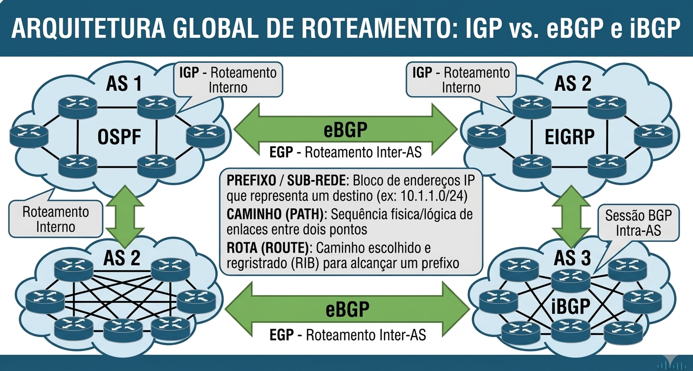
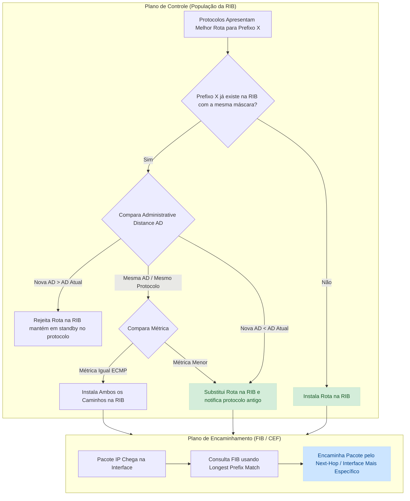
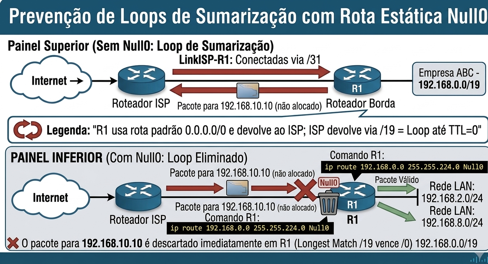
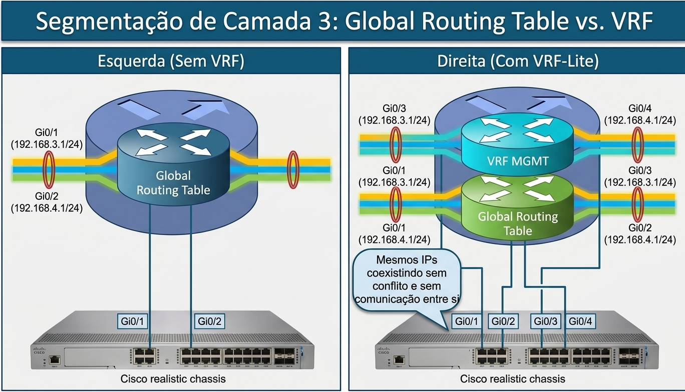

# Layer 3 Infrastructure: IP Routing Essentials - Fundamentos de Roteamento, Seleção de Caminhos, Rotas Estáticas, PBR e VRF

- [Layer 3 Infrastructure: IP Routing Essentials - Fundamentos de Roteamento, Seleção de Caminhos, Rotas Estáticas, PBR e VRF](#layer-3-infrastructure-ip-routing-essentials---fundamentos-de-roteamento-seleção-de-caminhos-rotas-estáticas-pbr-e-vrf)
  - [Glossário Técnico de Roteamento IP (Dicionário de Infraestrutura)](#glossário-técnico-de-roteamento-ip-dicionário-de-infraestrutura)
  - [🎯 Objetivo do Documento](#-objetivo-do-documento)
  - [Como Este Documento Deve Ser Lido](#como-este-documento-deve-ser-lido)
  - [1. Visão Geral dos Protocolos de Roteamento (IGP vs. EGP)](#1-visão-geral-dos-protocolos-de-roteamento-igp-vs-egp)
    - [As 4 Famílias de Algoritmos de Roteamento](#as-4-famílias-de-algoritmos-de-roteamento)
    - [Tabela Comparativa de Algoritmos de Roteamento](#tabela-comparativa-de-algoritmos-de-roteamento)
  - [2. Seleção de Caminhos (Path Selection): Como o Roteador Decide](#2-seleção-de-caminhos-path-selection-como-o-roteador-decide)
    - [Critério 1: Longest Prefix Match (Tamanho do Prefixo)](#critério-1-longest-prefix-match-tamanho-do-prefixo)
    - [Critério 2: Administrative Distance (AD - Confiabilidade da Fonte)](#critério-2-administrative-distance-ad---confiabilidade-da-fonte)
    - [Critério 3: Métrica (Custo do Protocolo) e Balanceamento (ECMP vs. Unequal-Cost)](#critério-3-métrica-custo-do-protocolo-e-balanceamento-ecmp-vs-unequal-cost)
    - [Fluxograma de Instalação na RIB e Encaminhamento](#fluxograma-de-instalação-na-rib-e-encaminhamento)
  - [3. Roteamento Estático: Tipos, Contingência e Prevenção de Loops](#3-roteamento-estático-tipos-contingência-e-prevenção-de-loops)
    - [Os 3 Tipos de Rotas Estáticas (e a Armadilha do ARP)](#os-3-tipos-de-rotas-estáticas-e-a-armadilha-do-arp)
    - [Default Route (`0.0.0.0/0` / `::/0`): O Gateway de Último Recurso](#default-route-00000--0-o-gateway-de-último-recurso)
      - [Como ela funciona na prática?](#como-ela-funciona-na-prática)
      - [Sintaxe e Validação (IPv4 e IPv6)](#sintaxe-e-validação-ipv4-e-ipv6)
    - [Floating Static Routes (Rota Estática Flutuante para Contingência)](#floating-static-routes-rota-estática-flutuante-para-contingência)
    - [Static Null Routes (`Null0`): Matando Loops de Sumarização na Raiz](#static-null-routes-null0-matando-loops-de-sumarização-na-raiz)
    - [Roteamento Estático em IPv6 (Detalhe Crítico de Link-Local)](#roteamento-estático-em-ipv6-detalhe-crítico-de-link-local)
  - [4. Policy-Based Routing (PBR): Roteamento Condicional](#4-policy-based-routing-pbr-roteamento-condicional)
    - [Como o PBR Funciona na Prática](#como-o-pbr-funciona-na-prática)
  - [5. Virtual Routing and Forwarding (VRF): Virtualização de Camada 3](#5-virtual-routing-and-forwarding-vrf-virtualização-de-camada-3)
    - [Implementação Prática de VRF-Lite (Passo a Passo)](#implementação-prática-de-vrf-lite-passo-a-passo)
  - [Comandos Essenciais de Diagnóstico e Validação](#comandos-essenciais-de-diagnóstico-e-validação)
  - [Consolidação do Conhecimento](#consolidação-do-conhecimento)
  - [🧪 Próximos Passos](#-próximos-passos)

## Glossário Técnico de Roteamento IP (Dicionário de Infraestrutura)

Os termos abaixo sintetizam a terminologia central utilizada no plano de controle (*Control Plane*) e no plano de encaminhamento (*Data Plane*) de roteadores corporativos:

| Termo                            | Significado Técnico                                                                                                                              | Analogia Prática                                                                                                |
| :---                             | :---                                                                                                                                             | :---                                                                                                            |
| **RIB**                          | *Routing Information Base*. A tabela de roteamento principal na memória (CPU) onde os protocolos competem para instalar as melhores rotas.       | O planejamento central de logística que decide qual transportadora faz cada entrega.                            |
| **FIB**                          | *Forwarding Information Base*. Tabela otimizada em hardware/CEF gerada a partir da RIB para encaminhar pacotes em alta velocidade.               | O painel de despacho rápido na doca, onde o pacote já sai direto sem precisar consultar a gerência.             |
| **Autonomous System (AS)**       | Conjunto de redes e roteadores sob uma única administração técnica (ex: uma empresa, operadora ou provedor de nuvem).                            | Um país ou território com suas próprias leis de trânsito internas.                                              |
| **IGP / EGP**                    | *Interior Gateway Protocol* (roda dentro do AS: OSPF, EIGRP, IS-IS) vs. *Exterior Gateway Protocol* (conecta ASs diferentes: BGP).               | Transporte municipal/estadual (IGP) vs. voos internacionais entre países (EGP).                                 |
| **Longest Prefix Match**         | Regra soberana de encaminhamento: entre várias rotas que cobrem um IP de destino, vence sempre a máscara mais específica (`/28` ganha de `/24`). | Entregar uma carta usando o endereço com rua e número exato em vez de mandar apenas para o CEP geral da cidade. |
| **Administrative Distance (AD)** | Nota de confiabilidade (0 a 255) dada à origem da rota. Quanto **menor** o número, mais confiável é a fonte.                                     | Entre um GPS ao vivo (AD 1) e um mapa impresso antigo (AD 120), você confia no GPS.                             |
| **ECMP**                         | *Equal-Cost Multi-Path*. Instalação simultânea de múltiplas rotas com o mesmo custo/métrica para balancear tráfego entre links.                  | Duas rodovias idênticas paralelas dividindo o fluxo de carros para evitar congestionamento.                     |
| **Floating Static Route**        | Rota estática configurada com uma AD maior que a rota principal, ficando oculta até que o link primário caia.                                    | Um gerador a diesel desligado que só entra em operação automática quando falta energia da concessionária.       |
| **Null0**                        | Interface virtual sempre ativa (`up/up`) que descarta imediatamente qualquer pacote enviado para ela, sem custo de CPU.                          | Uma trituradora de papel na entrada do escritório para descartar correspondência inválida antes que circule.    |
| **VRF**                          | *Virtual Routing and Forwarding*. Virtualização de camada 3 que cria tabelas de roteamento totalmente isoladas no mesmo roteador físico.         | Várias empresas diferentes dividindo o mesmo prédio comercial, cada uma com sua recepção e arquivos trancados.  |

## 🎯 Objetivo do Documento

Este documento consolida os fundamentos obrigatórios de **Roteamento IP** (baseados no Capítulo 6 do material oficial Cisco CCNP ENCOR 350-401), estabelecendo a base estrutural antes do aprofundamento nos protocolos dinâmicos individuais (EIGRP, OSPF e BGP).

Ao concluir este material, você terá domínio prático sobre:

* A distinção arquitetural entre **IGPs** e **EGPs** e o funcionamento das quatro famílias de algoritmos (*Distance Vector*, *Advanced Distance Vector*, *Link-State* e *Path Vector*).
* A hierarquia exata de decisão de um roteador: **Longest Prefix Match $\rightarrow$ Administrative Distance $\rightarrow$ Métrica**.
* A diferença operacional e de performance entre rotas estáticas **Directly Attached**, **Recursive** e **Fully Specified** (e por que apontar apenas interface em Ethernet derruba a CPU).
* O uso de **Floating Static Routes** para contingência e rotas para **Null0** para eliminar loops em blocos sumarizados.
* O desvio condicional de tráfego com **Policy-Based Routing (PBR)** e o isolamento de tabelas de roteamento com **VRF (Virtual Routing and Forwarding)**.

## Como Este Documento Deve Ser Lido

O conteúdo está organizado na ordem lógica em que um pacote e uma rota são processados dentro de um equipamento Cisco:

1. **Classificação dos Protocolos:** Como as rotas são descobertas e anunciadas dentro e fora de um Sistema Autônomo.
2. **Lógica de Seleção (RIB & FIB):** Como o roteador desempata rotas concorrentes e decide para qual interface enviar cada pacote.
3. **Roteamento Estático Avançado:** As armadilhas reais de configuração manual em links Ethernet/Serial, contingência e prevenção de loops.
4. **Controle Granular e Segmentação:** Como alterar o fluxo padrão sem mexer na RIB (PBR) e como isolar domínios de roteamento na mesma caixa (VRF).

---

## 1. Visão Geral dos Protocolos de Roteamento (IGP vs. EGP)

Para evitar confusão terminológica em projetos e exames, vale alinhar três conceitos básicos:

- **Prefixo / Sub-rede:** Um bloco de endereços IP que representa um destino na rede (ex: `10.1.1.0/24`).
- **Caminho (*Path*):** A sequência física/lógica de enlaces entre dois pontos.
- **Rota (*Route*):** O caminho escolhido e registrado por um processo de roteamento ou na tabela principal (RIB) para alcançar um prefixo.

Todo roteamento dinâmico divide-se em dois escopos de atuação:
  
- **IGP (*Interior Gateway Protocol*):** Opera **dentro** de um mesmo *Autonomous System (AS)*. Foca em convergência rápida e escolha do melhor caminho interno. Exemplos: **RIPv2, EIGRP, OSPF e IS-IS**.
- **EGP (*Exterior Gateway Protocol*):** Opera **entre** diferentes *Autonomous Systems* (conectando empresas a operadoras e operadoras entre si na Internet). Hoje, o único padrão utilizado é o **BGP**.
  - *Nota:* Quando o BGP troca rotas entre ASs distintos, chamamos de **eBGP** (*External BGP*). Quando troca rotas entre roteadores dentro do mesmo AS, chamamos de **iBGP** (*Internal BGP*).



### As 4 Famílias de Algoritmos de Roteamento

1. **Distance Vector (ex: RIPv2):** Anuncia rotas como vetores compostos por *Distância* (métrica, como contagem de saltos) e *Vetor* (direção/next-hop). O roteador não conhece o mapa da rede; ele confia cegamente na placa de sinalização do vizinho (*routing by rumor*). Consome pouca CPU/memória, mas toma decisões pobres (ex: prefere 2 saltos em um link lento de 64 Kbps a 4 saltos em links de 1 Gbps).
2. **Advanced Distance Vector / Híbrido (ex: EIGRP):** Utiliza o algoritmo **DUAL**. Mantém a lógica de receber informações dos vizinhos sem montar um mapa global da rede, mas incorpora *Hellos* para vizinhança, atualizações parciais apenas sob demanda, métricas compostas (banda e atraso) e rotas de backup pré-validadas sem loops.
3. **Link-State (ex: OSPF e IS-IS):** Cada roteador anuncia o estado e o custo de seus links diretamente conectados para **todos** os roteadores da área (via *LSAs* no OSPF ou *LSPs* no IS-IS). Todos montam exatamente o mesmo mapa completo da rede (**LSDB**) e rodam o algoritmo **Dijkstra (SPF)** para calcular a árvore mais curta. Exige mais CPU/memória, mas evita loops e enxerga toda a topologia.
4. **Path Vector (ex: BGP):** Projetado para escala de Internet. Em vez de métricas de banda ou saltos internos, escolhe caminhos com base em **Atributos de Caminho** (*AS_Path*, *Local Preference*, *MED*, etc.). A prevenção de loops é direta: cada AS por onde a rota passa adiciona seu número ao atributo `AS_Path`; se um roteador recebe um anúncio que já contém seu próprio número de AS, ele descarta a rota imediatamente.

### Tabela Comparativa de Algoritmos de Roteamento

| Característica            | Distance Vector                  | Advanced Distance Vector            | Link-State                         | Path Vector                               |
| :---                      | :---                             | :---                                | :---                               | :---                                      |
| **Protocolo Exemplo**     | RIPv2                            | EIGRP                               | OSPF, IS-IS                        | BGP (eBGP / iBGP)                         |
| **Visão da Rede**         | Apenas o que o vizinho informa   | Vizinhos + rotas de backup (DUAL)   | Mapa completo da área (LSDB)       | Lista de ASs atravessados                 |
| **Critério de Decisão**   | Contagem de saltos (*Hop Count*) | Métrica composta (Banda + Delay)    | Custo acumulado (Dijkstra SPF)     | Atributos de política (*Path Attributes*) |
| **Envio de Atualizações** | Periódico (tabela completa)      | Parcial e sob demanda (*Bounded*)   | Sob demanda (*Flooding* de LSAs)   | Incremental via sessão TCP (porta 179)    |
| **Prevenção de Loops**    | Split Horizon, Route Poisoning   | Condição de Viabilidade ($RD < FD$) | Visão sincronizada + algoritmo SPF | Verificação do próprio AS no `AS_Path`    |
| **Consumo de Recursos**   | Baixo                            | Baixo a Moderado                    | Alto (CPU e Memória para LSDB)     | Alto (proporcional ao tamanho da tabela)  |

---

## 2. Seleção de Caminhos (Path Selection): Como o Roteador Decide

Quando um pacote chega a um roteador — ou quando múltiplos protocolos tentam gravar rotas na tabela — existe uma hierarquia rígida de decisão. **Não há exceção para essa ordem:**

### Critério 1: Longest Prefix Match (Tamanho do Prefixo)

Na hora de encaminhar um pacote, o roteador consulta a **FIB** buscando a rota com a máscara de sub-rede mais específica (maior número de bits `1` à esquerda) que englobe o IP de destino. **Esse critério vence qualquer protocolo ou distância administrativa.**

**Exemplo Prático:**
Suponha que a tabela de roteamento possua estas três rotas simultaneamente:

- `10.0.3.0/24` (cobre `.0` a `.255`) $\rightarrow$ via `10.3.3.3` (OSPF, AD 110)
- `10.0.3.0/26` (cobre `.0` a `.63`) $\rightarrow$ via `10.2.2.2` (EIGRP, AD 90)
- `10.0.3.0/28` (cobre `.0` a `.15`) $\rightarrow$ via `10.1.1.1` (RIP, AD 120)

Se chegar um pacote destinado ao IP **`10.0.3.14`**:

- Ele encaixa nas três redes.
- Mesmo o RIP tendo a pior Distância Administrativa (`120`), o pacote será enviado para **`10.1.1.1`** porque `/28` é um prefixo mais longo (mais específico) que `/26` e `/24`.

### Critério 2: Administrative Distance (AD - Confiabilidade da Fonte)

Se dois ou mais protocolos diferentes aprenderem **exatamente o mesmo prefixo e máscara** (ex: `10.3.3.0/24`), a RIB desempata escolhendo a fonte mais confiável — aquela com a **menor Distância Administrativa**.

| Origem da Rota                     | AD Padrão | Observação Técnica                                                       |
| :---                               | :---:     | :---                                                                     |
| **Directly Connected (Conectada)** | `0`       | Interface ativa com IP configurado (ou estática apontando só interface). |
| **Static Route (Estática)**        | `1`       | Rota estática configurada apontando para um *Next-Hop IP*.               |
| **EIGRP Summary Route**            | `5`       | Rota sumarizada gerada automaticamente ou manualmente pelo EIGRP.        |
| **External BGP (eBGP)**            | `20`      | Rotas aprendidas de outro Sistema Autônomo.                              |
| **EIGRP (Internal)**               | `90`      | Rotas internas do próprio domínio EIGRP.                                 |
| **OSPF**                           | `110`     | Rotas Intra-area, Inter-area ou Externas do OSPF.                        |
| **IS-IS**                          | `115`     | Rotas do protocolo IS-IS.                                                |
| **RIPv2**                          | `120`     | Rotas aprendidas via RIP.                                                |
| **EIGRP (External)**               | `170`     | Rotas redistribuídas para dentro do EIGRP.                               |
| **Internal BGP (iBGP)**            | `200`     | Rotas BGP trocadas dentro do mesmo AS.                                   |

> ⚠️ **Pegadinha Clássica de Prova:** Cada protocolo de roteamento roda seu próprio algoritmo **antes** de falar com a RIB e apresenta apenas o *seu* melhor caminho para a tabela principal. Por exemplo: se o BGP eleger internamente uma rota **iBGP** (AD 200) em vez de uma eBGP (AD 20), ele apresentará a rota com AD 200 para a RIB — e se houver uma rota **OSPF** (AD 110) para o mesmo prefixo, o OSPF vencerá a disputa na RIB!

### Critério 3: Métrica (Custo do Protocolo) e Balanceamento (ECMP vs. Unequal-Cost)

Quando um **mesmo protocolo** possui múltiplos caminhos para o mesmo destino, ele usa a sua própria métrica (custo OSPF, métrica composta EIGRP, etc.) para escolher o menor valor:

- **ECMP (*Equal-Cost Multi-Path*):** Se dois ou mais caminhos dentro do mesmo protocolo tiverem exatamente a **mesma métrica**, o roteador instala todos eles na RIB (até o limite de `maximum-paths`, geralmente 4 por padrão) e balanceia o tráfego entre os links. Suportado por RIP, EIGRP, OSPF e IS-IS.
- **Unequal-Cost Load Balancing:** Exclusivo do **EIGRP** (habilitado via comando `variance`). Permite instalar rotas de custos diferentes na RIB e distribuir os pacotes proporcionalmente à métrica de cada caminho.

### Fluxograma de Instalação na RIB e Encaminhamento



---

## 3. Roteamento Estático: Tipos, Contingência e Prevenção de Loops

Rotas estáticas oferecem controle determinístico e consumo zero de banda de rede (não trocam pacotes de controle), mas não reagem automaticamente a falhas remotas.

### Os 3 Tipos de Rotas Estáticas (e a Armadilha do ARP)

1. **Directly Attached Static Route (Apenas Interface de Saída):**
   - **Sintaxe:** `ip route 10.22.22.0 255.255.255.0 Serial1/0`
   - **Comportamento:** Na tabela de rotas (`show ip route`), aparece marcada como `S ... is directly connected` (sem exibir `[AD/Metric]`, comportando-se com AD 0).
   - **Regra de Ouro:** Use **apenas em links Ponto-a-Ponto (Seriais)**. Se você configurar uma rota apontando apenas para uma interface **Ethernet** (que depende de ARP), o roteador achará que todos os IPs daquela rede de destino estão diretamente conectados no cabo e disparará requisições **ARP para cada IP de destino acessado**, estourando a CPU e a tabela ARP.

2. **Recursive Static Route (Apenas IP do Next-Hop):**
   - **Sintaxe:** `ip route 10.22.22.0 255.255.255.0 10.12.1.2`
   - **Comportamento:** O roteador precisa fazer uma **busca recursiva** na RIB: primeiro encontra a rota de destino (`10.22.22.0/24` $\rightarrow$ `10.12.1.2`), depois busca uma segunda vez na RIB para descobrir por qual interface física ele alcança `10.12.1.2`.
   - *Atenção:* Uma rota estática recursiva **não pode** resolver seu *next-hop* usando uma rota padrão (`0.0.0.0/0`). Se não houver uma rota específica para o IP do *next-hop*, a rota estática não entra na RIB.

3. **Fully Specified Static Route (Interface de Saída + IP do Next-Hop):**
   - **Sintaxe:** `ip route 10.22.22.0 255.255.255.0 GigabitEthernet0/0 10.12.1.2`
   - **Comportamento:** É a **melhor prática absoluta em interfaces Ethernet/Multi-acesso**. Elimina a busca recursiva extra na RIB, evita o problema de tempestade ARP e garante que, se a interface `Gi0/0` cair, a rota seja imediatamente removida da tabela sem tentar resolver o *next-hop* por outro caminho indesejado.

### Default Route (`0.0.0.0/0` / `::/0`): O Gateway de Último Recurso

A **Rota Padrão (*Default Route*)**, conhecida no Cisco IOS como **Gateway of Last Resort**, é uma rota estática "coringa" configurada com prefixo e máscara zerados (`0.0.0.0 0.0.0.0` em IPv4 e `::/0` em IPv6).

#### Como ela funciona na prática?

- **Menor especificidade absoluta:** Por ter comprimento de prefixo `/0`, ela perde para **qualquer** outra rota presente na RIB na regra de *Longest Prefix Match*. Ela só é acionada quando o roteador não conhece nenhum caminho mais específico para o IP de destino.
- **Onde usar:** Indispensável em roteadores de borda (*Edge*), filiais (*Stub networks*) e firewalls para encaminhar tráfego destinado à Internet ou ao Core sem precisar carregar milhões de prefixos externos.

#### Sintaxe e Validação (IPv4 e IPv6)

```ios
! Configurando a Rota Padrão IPv4 apontando para o Next-Hop do ISP
R1(config)# ip route 0.0.0.0 0.0.0.0 192.168.1.2

! Configurando a Rota Padrão IPv6
R1(config)# ipv6 route ::/0 2001:db8:12::2
```

Na tabela de roteamento (`show ip route`), ela aparece identificada com o código **`S*`** (onde `*` indica candidata à rota padrão) e atualiza o topo da saída:

```text
Gateway of last resort is 192.168.1.2 to network 0.0.0.0

S*    0.0.0.0/0 [1/0] via 192.168.1.2
```

> ⚠️ **Regra Crítica de Recursividade:** Uma rota estática recursiva **nunca** pode usar a rota padrão (`0.0.0.0/0`) para resolver o seu próprio *Next-Hop*. Se o IP do próximo salto não for alcançável por uma rota conectada ou mais específica que `/0`, a rota estática não será instalada na RIB.

### Floating Static Routes (Rota Estática Flutuante para Contingência)

Consiste em configurar uma rota estática de backup com uma **Administrative Distance maior** que a rota primária (seja ela estática ou aprendida via OSPF/EIGRP).

```ios
! Rota primária via Ethernet (AD 10)
R1(config)# ip route 192.168.22.0 255.255.255.0 GigabitEthernet0/0 192.168.12.2 10

! Rota de backup flutuante via Serial (AD 210 - maior que OSPF 110 e EIGRP 90)
R1(config)# ip route 192.168.22.0 255.255.255.0 Serial1/0 210
```

Enquanto a interface `Gi0/0` estiver ativa, apenas a rota com AD `10` aparece na RIB. Se `Gi0/0` cair, a rota primária é removida e a rota com AD `210` "flutua" para dentro da RIB assumindo o tráfego.

### Static Null Routes (`Null0`): Matando Loops de Sumarização na Raiz

Quando uma empresa recebe um bloco grande do provedor (ex: `192.168.0.0/20`) e utiliza apenas algumas sub-redes internas (`192.168.2.0/24` e `192.168.3.0/24`), cria-se um risco clássico de loop:

1. O ISP envia pacotes para `192.168.5.5` (uma sub-rede ainda não usada na empresa) para o roteador de borda `R1`.
2. `R1` não tem uma rota específica `/24` para `192.168.5.0`, então ele aplica a sua **rota padrão (`0.0.0.0/0`)** e devolve o pacote para o ISP.
3. O ISP vê que `192.168.5.5` pertence ao bloco `/20` da empresa e manda de volta para `R1`, gerando um **loop de roteamento** até o TTL expirar.

**Solução:** Criar uma rota estática para o bloco sumarizado apontando para **`Null0`**:

```ios
R1(config)# ip route 192.168.0.0 255.255.240.0 Null0
```

Como `/20` é mais específico que a rota padrão `/0` (Longest Prefix Match), qualquer pacote destinado a sub-redes não alocadas dentro do bloco `/20` cai na `Null0` e é descartado silenciosamente na borda, enquanto as sub-redes ativas (`/24`) continuam funcionando normalmente por serem ainda mais específicas (prefixo `/24` em relação a `/20`).



### Roteamento Estático em IPv6 (Detalhe Crítico de Link-Local)

Os conceitos de IPv4 aplicam-se identicamente ao IPv6 (lembrando sempre de habilitar `ipv6 unicast-routing` globalmente). Porém, há uma regra obrigatória para provas e produção:

- **Se o *next-hop* for um endereço IPv6 Link-Local (`FE80::...`):** Como endereços `FE80::/10` existem em todos os links e não são roteáveis, o roteador não sabe por qual porta sair. Você **deve obrigatoriamente** configurar uma **Fully Specified Static Route** informando a interface de saída junto com o IP Link-Local:

  ```ios
  R1(config)# ipv6 route 2001:db8:22::/64 GigabitEthernet0/1 FE80::2
  ```

---

## 4. Policy-Based Routing (PBR): Roteamento Condicional

Por padrão, todo roteador encaminha pacotes olhando **exclusivamente o IP de destino**. O **Policy-Based Routing (PBR)** quebra essa regra, permitindo que o roteador tome decisões de encaminhamento baseadas em critérios personalizados na entrada da interface:

- Endereço IP de **origem** (ex: sub-rede da diretoria sai pelo link dedicado, visitantes saem pela banda larga).
- Protocolo ou porta TCP/UDP (ex: tráfego VoIP/RTP segue pelo link de menor latência).
- Tamanho do pacote ou marcações QoS (DSCP/IP Precedence).

### Como o PBR Funciona na Prática

O PBR é construído com uma **ACL** (para classificar o tráfego) + um **Route-Map** (para definir a ação `set ip next-hop`) + aplicação na **interface de entrada** (`ip policy route-map ...`):

```ios
! 1. Classifica o tráfego da rede 10.1.1.0/24 indo para 10.5.5.0/24
R2(config)# access-list 101 permit ip 10.1.1.0 0.0.0.255 10.5.5.0 0.0.0.255

! 2. Cria a política desviando esse fluxo específico para o next-hop 10.23.1.3
R2(config)# route-map DESVIO_VIP permit 10
R2(config-route-map)# match ip address 101
R2(config-route-map)# set ip next-hop 10.23.1.3

! 3. Aplica na interface onde o tráfego ENTRA no roteador
R2(config)# interface GigabitEthernet0/1
R2(config-if)# ip policy route-map DESVIO_VIP
```

> 💡 **Pontos Críticos de PBR para Troubleshooting e Exame:**
>
> 1. **Não altera a RIB:** Se você rodar `show ip route`, a tabela continuará mostrando o caminho normal do OSPF/EIGRP. O PBR intercepta o pacote antes da consulta tradicional da RIB.
> 2. **Fallback Automático:** Se o *next-hop* definido no `set ip next-hop` cair ou sumir da RIB, o PBR é ignorado e o pacote volta a seguir o roteamento normal da tabela (evitando buracos negros).
> 3. **Tráfego Local:** Por padrão, o PBR afeta apenas pacotes que *atravessam* o roteador. Para aplicar políticas a pacotes gerados pelo próprio roteador (ex: ping/SSH originado na caixa), usa-se o comando global `ip local policy route-map <nome>`.

---

## 5. Virtual Routing and Forwarding (VRF): Virtualização de Camada 3

Assim como as **VLANs** segmentam um switch físico em múltiplos domínios de broadcast isolados na Camada 2, o **VRF** virtualiza um roteador físico em múltiplos **roteadores virtuais independentes na Camada 3**.

Cada instância VRF possui:

- Sua própria **RIB** (tabela de roteamento) e **FIB** completamente isoladas.
- Suas próprias interfaces/sub-interfaces dedicadas.
- Processos de roteamento dinâmico independentes.

**O Grande Benefício (Overlapping IPs):** Como as tabelas são isoladas, você pode utilizar **exatamente as mesmas faixas de IP** (ex: `192.168.3.0/24`) em duas VRFs diferentes no mesmo roteador sem nenhum conflito (cenário padrão em operadoras MPLS, multitenancy em Data Centers e isolamento de redes de gerência Out-of-Band).



### Implementação Prática de VRF-Lite (Passo a Passo)

Ao associar uma interface a uma VRF, o IOS remove automaticamente qualquer endereço IP que estivesse configurado nela por segurança. Portanto, configure o IP **sempre depois** do comando `vrf forwarding`:

```ios
! Passo 1: Criar a definição multiprotocolo da VRF (suporta IPv4 e IPv6)
R1(config)# vrf definition MGMT
R1(config-vrf)# address-family ipv4
R1(config-vrf-af)# exit
R1(config-vrf)# exit

! Passo 2: Associar a interface à VRF e configurar o endereçamento IP
R1(config)# interface GigabitEthernet0/3
R1(config-if)# vrf forwarding MGMT
R1(config-if)# ip address 192.168.3.1 255.255.255.0
R1(config-if)# no shutdown
```

---

## Comandos Essenciais de Diagnóstico e Validação

| Objetivo Operacional              | Comando CLI (Cisco IOS / IOS-XE)    | O que Validar na Saída                                                            |
| :---                              | :---                                | :---                                                                              |
| **Inspecionar a RIB Global**      | `show ip route`                     | Códigos de origem (`C`, `L`, `S`, `D`, `O`, `B`), `[AD/Metric]` e *Next-Hop*.     |
| **Detalhar uma Rota Específica**  | `show ip route 10.22.22.0`          | Confirma a AD exata (mesmo em rotas estáticas com interface) e *traffic share*.   |
| **Inspecionar Tabela de uma VRF** | `show ip route vrf MGMT`            | Valida as rotas isoladas da instância `MGMT` (não aparecem na global).            |
| **Testar Conectividade na VRF**   | `ping vrf MGMT 10.0.3.2`            | O `ping` padrão usa a tabela global; sempre especifique `vrf <nome>`.             |
| **Validar Políticas PBR**         | `show route-map` / `show ip policy` | Verifica contadores de pacotes que deram *match* na política e interfaces ativas. |
| **Validar Tabela IPv6**           | `show ipv6 route`                   | Verifica rotas conectadas (`C`), locais (`L` `/128`) e estáticas (`S`).           |

---

## Consolidação do Conhecimento

Antes de mergulhar na configuração detalhada de cada protocolo dinâmico, garanta que estes cinco pilares estejam fixados:

1. **Hierarquia Soberana:** Para encaminhar um pacote, vence o **Longest Prefix Match**. Para instalar uma rota na RIB com a mesma máscara, vence a **menor Administrative Distance**. Dentro do mesmo protocolo, vence a **menor Métrica**.
2. **Estáticas em Ethernet:** Nunca aponte apenas a interface de saída em redes Ethernet (gera tempestade ARP e alto uso de CPU). Use sempre **Fully Specified** (`interface` + `next-hop IP`).
3. **Contingência e Anti-Loop:** Use **Floating Static Routes** (AD alta) para backup e **rotas para `Null0`** para descartar tráfego não alocado dentro de blocos sumarizados.
4. **PBR é Invisível na RIB:** Políticas PBR desviam pacotes na entrada da interface sem alterar a saída do `show ip route`.
5. **VRF é VLAN de Camada 3:** Isola completamente tabelas de roteamento e permite sobreposição de IPs (`Overlapping IPs`) no mesmo equipamento físico.

## 🧪 Próximos Passos

Com os fundamentos de roteamento IP, seleção de caminhos, rotas estáticas avançadas, PBR e VRF consolidados na teoria, o próximo passo é partir para os **laboratórios práticos** validando cada um desses cenários (tabelas de roteamento, *Floating Static Routes*, prevenção de loops com `Null0`, *Policy-Based Routing* e segmentação com VRF-Lite) antes de avançar para os protocolos dinâmicos do bloco **3.2 Layer 3** (**EIGRP**, **OSPFv2/v3** e **eBGP**).
