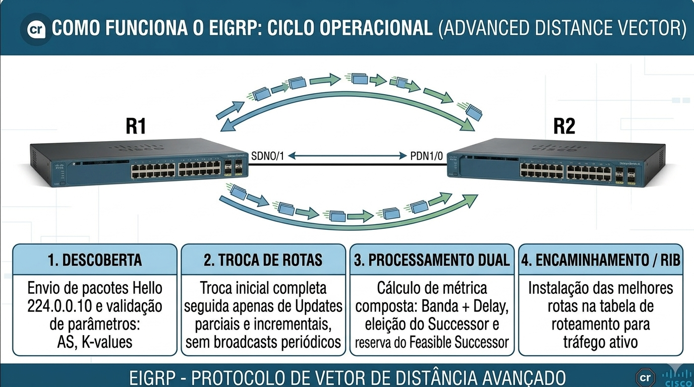
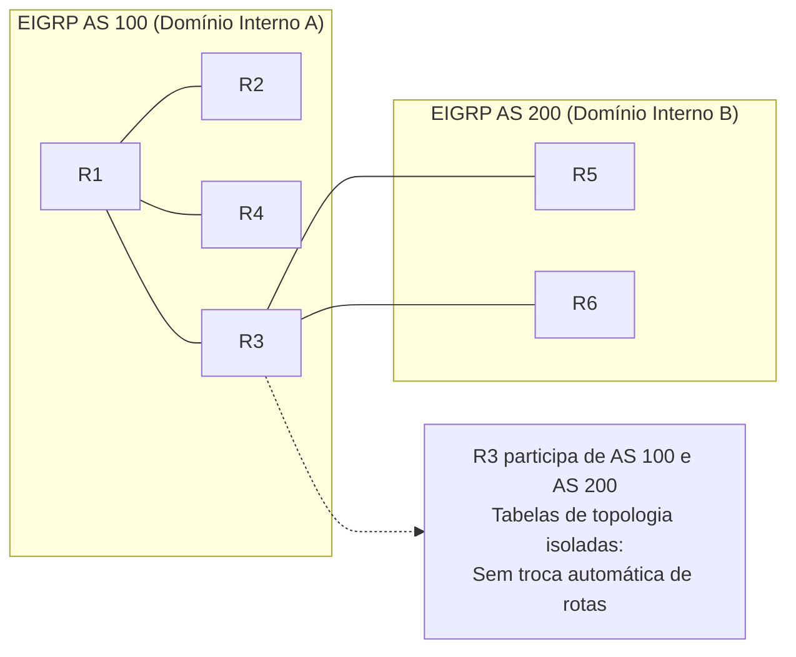
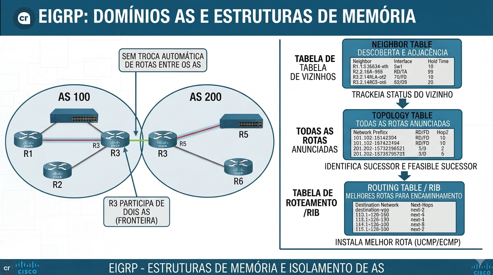
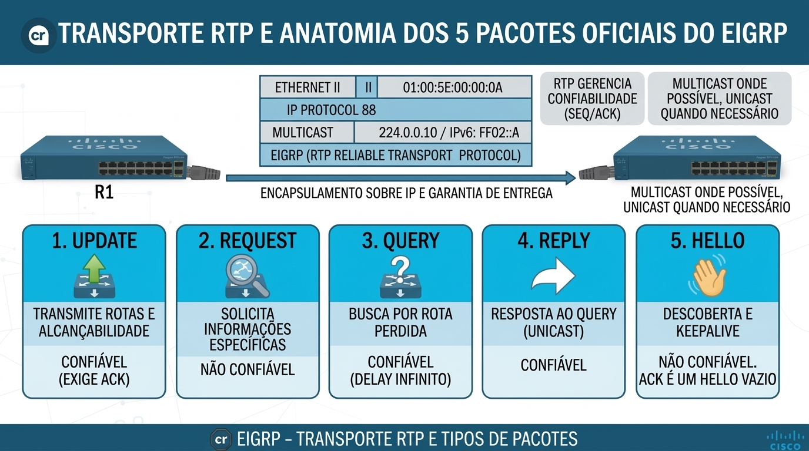
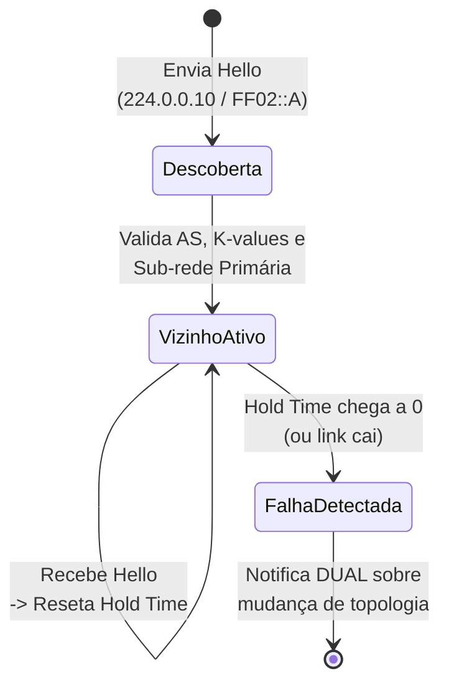
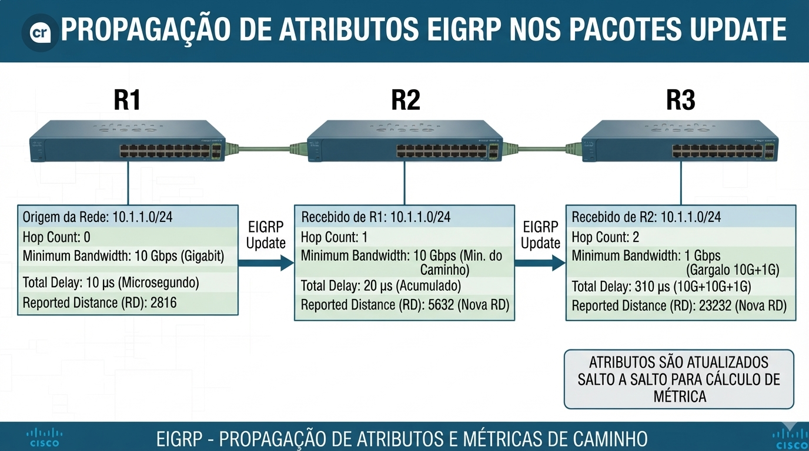

# Layer 3 Infrastructure: EIGRP (Parte 01) — Fundamentos, Sistema Autônomo, Pacotes e Propagação de Atributos

- [Layer 3 Infrastructure: EIGRP (Parte 01) — Fundamentos, Sistema Autônomo, Pacotes e Propagação de Atributos](#layer-3-infrastructure-eigrp-parte-01--fundamentos-sistema-autônomo-pacotes-e-propagação-de-atributos)
  - [Objetivo e Contexto na Trilha CCNP ENCOR (350-401)](#objetivo-e-contexto-na-trilha-ccnp-encor-350-401)
  - [Origem e Propósito: Superando os Limites do Distance Vector Clássico](#origem-e-propósito-superando-os-limites-do-distance-vector-clássico)
  - [Visão Geral: Como o EIGRP Funciona na Prática](#visão-geral-como-o-eigrp-funciona-na-prática)
  - [O Que é um Sistema Autônomo (AS) no EIGRP?](#o-que-é-um-sistema-autônomo-as-no-eigrp)
    - [Isolamento Entre Processos e Diferença para o BGP](#isolamento-entre-processos-e-diferença-para-o-bgp)
  - [Dicionário Técnico: Termos Fundamentais Utilizados no EIGRP](#dicionário-técnico-termos-fundamentais-utilizados-no-eigrp)
  - [As Três Estruturas de Memória (Tabelas Operacionais)](#as-três-estruturas-de-memória-tabelas-operacionais)
  - [Transporte (RTP), Endereçamento e Os 5 Pacotes Oficiais](#transporte-rtp-endereçamento-e-os-5-pacotes-oficiais)
  - [Timers, Detecção de Falhas e Formação de Vizinhança](#timers-detecção-de-falhas-e-formação-de-vizinhança)
  - [Propagação de Atributos Salto a Salto nos Updates](#propagação-de-atributos-salto-a-salto-nos-updates)
  - [Resumo Executivo para Revisão e Próximos Passos](#resumo-executivo-para-revisão-e-próximos-passos)
  - [🧪 Pronto para Testar seu Conhecimento?](#-pronto-para-testar-seu-conhecimento)

## Objetivo e Contexto na Trilha CCNP ENCOR (350-401)

Este documento inaugura a série de estudos sobre **EIGRP (Enhanced Interior Gateway Routing Protocol)** voltada ao exame **CCNP ENCOR 350-401** (tópico **3.2.a** e base conceitual para os comparativos de **50 a 55** contra o OSPF). Ele estabelece a fundação operacional do protocolo antes de avançarmos para a matemática do algoritmo DUAL, métricas estendidas e balanceamento de carga (*Parte 02*) e para a convergência avançada e contenção de consultas (*Parte 03*).

O material foi estruturado para atender tanto quem busca precisão técnica em operação e *troubleshooting* (Engenheiros e Analistas de Redes, Infraestrutura e Automação) quanto quem avalia, ensina ou acompanha a evolução da trilha.

## Origem e Propósito: Superando os Limites do Distance Vector Clássico

Protocolos *Distance Vector* tradicionais, como o RIPv2, baseiam suas decisões exclusivamente na contagem de saltos (*hop count*) e possuem restrições severas de escalabilidade, como o limite máximo de 15 saltos. Depender apenas de *hop count* ignora fatores críticos de rede, como a capacidade real dos enlaces e o atraso acumulado ao longo do caminho.

O **EIGRP** foi projetado para superar essas deficiências mantendo a simplicidade operacional de um protocolo *Distance Vector* (*routing by rumor* — cada roteador aprende rotas a partir do que seus vizinhos anunciam), mas adicionando recursos avançados:

- **Alcance ampliado:** Suporte a redes distantes até **255 saltos** (padrão de 100 saltos, configurável até 255).

- **Convergência rápida:** Uso do algoritmo **DUAL** (*Diffusing Update Algorithm*) para identificar caminhos e manter rotas de backup pré-calculadas e livres de loops.

- **Seleção baseada em desempenho:** Avaliação de múltiplos fatores (como largura de banda e *delay*) em vez de apenas contagem de saltos.

- **Balanceamento de carga assimétrico:** Capacidade de distribuir tráfego entre caminhos com métricas diferentes (*unequal-cost load balancing*).

## Visão Geral: Como o EIGRP Funciona na Prática

Diferente de protocolos que enviam toda a tabela de roteamento periodicamente (como o RIP) ou que exigem que todos os roteadores construam um mapa completo da topologia (como o OSPF), o EIGRP opera em um ciclo orientado a eventos e pré-validação matemática:

1. **Descoberta de Vizinhos:** Roteadores enviam pacotes *Hello* em enlaces ativos para descobrir adjacências diretamente conectadas.
2. **Troca Inicial e Atualizações Parciais:** Ao fechar vizinhança, trocam suas tabelas de roteamento uma única vez. Depois disso, enviam apenas **atualizações incrementais e limitadas** (*bounded updates*) quando ocorre alguma mudança.
3. **Cálculo Local e Reserva Instantânea:** O algoritmo **DUAL** calcula o melhor caminho (*Successor*) e já deixa caminhos alternativos validados contra loops (*Feasible Successors*) engatilhados em memória.
4. **Encaminhamento Ativo:** Apenas os melhores caminhos eleitos são instalados na Tabela de Roteamento (RIB).

## O Que é um Sistema Autônomo (AS) no EIGRP?

Na arquitetura de redes corporativas e no contexto do EIGRP, um **Sistema Autônomo (Autonomous System — AS)** representa um **domínio administrativo e técnico de roteamento comum** (identificado por um número inteiro de 1 a 65535 configurado no processo do roteador).

Dentro de um mesmo AS EIGRP:

1. Todos os roteadores operam sob a mesma política de cálculo de métrica (mesmos *K-values*).

2. Os roteadores formam adjacências e trocam informações de alcançabilidade apenas com outros membros configurados com o **mesmo número de AS**.

### Isolamento Entre Processos e Diferença para o BGP

- **Isolamento Nativo:** Um único roteador pode executar múltiplos processos EIGRP simultaneamente, cada um vinculado a um AS distinto. Cada processo mantém sua própria **Tabela de Topologia** totalmente independente. Se um roteador central participa do **AS 100** (conectado aos roteadores R1, R2 e R4) e do **AS 200** (conectado a R5 e R6), ele **não** repassa automaticamente as rotas aprendidas no AS 100 para o AS 200 (e vice-versa), a menos que seja configurada redistribuição explícita entre os processos.

- **EIGRP AS vs. BGP AS:** Não se deve confundir o *Autonomous System* do EIGRP com o *Autonomous System Number (ASN)* do **BGP**. No BGP, o ASN identifica uma organização ou provedor inteiro na Internet global (atribuído por órgãos reguladores como IANA/NIC.br); no EIGRP, o número de AS é apenas um identificador interno de processo e domínio IGP dentro da rede da empresa.

## Dicionário Técnico: Termos Fundamentais Utilizados no EIGRP

Para operar, diagnosticar e projetar redes com EIGRP no nível CCNP, é essencial dominar com precisão a terminologia oficial do protocolo:

| Termo                          | Definição Técnica                                                                                                                  | Papel na Operação do Protocolo                                                                                                                                 | 
| -----                          | -----                                                                                                                              | -----                                                                                                                                                          | 
| **DUAL**                       | *Diffusing Update Algorithm*. O motor matemático e algoritmo de máquina de estados utilizado pelo EIGRP.                           | Calcula o melhor caminho e valida rotas de backup livres de loops sem depender de temporizadores de *holddown*.                                                | 
| **RTP**                        | *Reliable Transport Protocol*. Protocolo proprietário de transporte (IP Protocol 88) usado pelo EIGRP.                             | Garante a entrega confiável e ordenada de pacotes críticos (*Update*, *Query*, *Reply*) via multicast ou unicast, sem usar TCP/UDP.                            | 
| **Successor**                  | O roteador vizinho (*next-hop*) que oferece o caminho de menor custo total até uma rede de destino.                                | É o vizinho escolhido para encaminhar o tráfego ativo na Tabela de Roteamento (RIB).                                                                           | 
| **Successor Route**            | O caminho completo (sequência de saltos) de menor métrica calculado até o prefixo de destino.                                      | Representa a rota vencedora instalada na tabela de roteamento principal.                                                                                       | 
| **Feasible Distance (FD)**     | A menor métrica total calculada localmente pelo roteador para alcançar uma rede de destino (via *Successor*).                      | Serve como referência histórica de melhor custo e como limite matemático para validar rotas de backup.                                                         | 
| **Reported Distance (RD)**     | Também chamada de *Advertised Distance (AD)*. É a métrica que o roteador vizinho informa ter da porta dele até o destino.          | Na prática, a **RD** recebida de um vizinho é exatamente a **FD** que aquele vizinho calculou para si mesmo.                                                   | 
| **Feasibility Condition (FC)** | Regra matemática de segurança contra loops: $RD < FD$.                                                                             | Garante que o caminho alternativo informado por um vizinho não passa de volta pelo próprio roteador local.                                                     | 
| **Feasible Successor (FS)**    | Um vizinho/rota alternativa armazenada na Tabela de Topologia que satisfez a *Feasibility Condition* ($RD < FD$).                  | Atua como rota de backup pré-aprovada, assumindo imediatamente em caso de falha do *Successor* sem precisar enviar *Queries*.                                  | 
| **Passive State (`P`)**        | Estado operacional normal de uma rota na Tabela de Topologia (`show ip eigrp topology`).                                           | Indica que a rota está estável, convergente e não está passando por recálculo no algoritmo DUAL.                                                               | 
| **Active State (`A`)**         | Estado transitório de alerta na Tabela de Topologia quando o *Successor* falha e não existe *Feasible Successor*.                  | Indica que o roteador está enviando pacotes *Query* aos vizinhos em busca de um novo caminho livre de loops.                                                   | 
| **Variance**                   | Multiplicador inteiro (padrão `1`, configurável de `1` a `128`) aplicado sobre a *Feasible Distance (FD)*.                         | Habilita o *Unequal-Cost Load Balancing*, permitindo instalar *Feasible Successors* de custo maior na tabela de roteamento.                                    | 
| **Stuck-in-Active (SIA)**      | Falha de convergência ocorrida quando um roteador envia um *Query* e não recebe o *Reply* dentro do tempo limite (*Active Timer*). | Faz com que o roteador encerre a adjacência com o vizinho que não respondeu à consulta.                                                                        | 
| **Query Boundary**             | Ponto na topologia onde a propagação de pacotes *Query* é interrompida durante uma falha de rota.                                  | Pode ser criado naturalmente (um roteador sem a rota ou consulta vinda de um *non-successor*) ou via arquitetura (*EIGRP Stub* e *Sumarização por Interface*). | 

## As Três Estruturas de Memória (Tabelas Operacionais)

Ao contrário de implementações *Distance Vector* mais simples, o EIGRP mantém uma **tabela de topologia** dedicada, peça central para o funcionamento do DUAL e para a identificação de rotas alternativas livres de loops. Na prática, o protocolo organiza suas informações em três estruturas complementares:

1. **Neighbor Table (Tabela de Vizinhos):** Registra os vizinhos EIGRP diretamente conectados com os quais o roteador estabeleceu adjacência, monitorando a interface de saída, *Hold Time* e temporizadores de retransmissão (*SRTT* / *RTO*).

2. **Topology Table (Tabela de Topologia):** Armazena todos os prefixos de rede anunciados dentro do AS EIGRP, os vizinhos que anunciaram cada prefixo, as métricas associadas (*FD*, *RD* e *hop count*) e os parâmetros usados no cálculo da métrica (*load*, *reliability*, *total delay* e *minimum bandwidth*).

3. **Routing Table / RIB (Tabela de Roteamento):** Consolida apenas as melhores rotas eleitas pelo algoritmo DUAL (*Successors*, ou *Feasible Successors* quando o `variance` está ativo) para encaminhamento efetivo de pacotes.

## Transporte (RTP), Endereçamento e Os 5 Pacotes Oficiais

O EIGRP é encapsulado diretamente sobre o IP utilizando o **número de protocolo 88** no cabeçalho IP. Sempre que possível, utiliza **multicast** para o endereço **`224.0.0.10`** (que corresponde ao endereço MAC multicast **`01:00:5E:00:00:0A`** em Ethernet, ou **`FF02::A`** em IPv6), recorrendo a **unicast** quando necessário para retransmissões ou confirmações diretas.

A troca de informações entre roteadores utiliza **cinco tipos de pacotes** oficiais (identificados por *Opcode* na documentação Cisco):

| Opcode | Tipo de Pacote | Transporte      | Função Operacional                                                                                                                                                                                                                         |
| -----  | -----          | -----           | -----                                                                                                                                                                                                                                      |
| **1**  | **Update**     | Confiável (RTP) | Transmite informações de roteamento e alcançabilidade para outros vizinhos EIGRP. Na formação de adjacência, vizinhos trocam a tabela completa e, após isso, enviam apenas atualizações incrementais quando ocorrem mudanças na topologia. |
| **2**  | **Request**    | Não confiável   | Utilizado para solicitar informações específicas de um ou mais vizinhos (usado principalmente em servidores de rota/aplicações específicas).                                                                                               |
| **3**  | **Query**      | Confiável (RTP) | Enviado durante a convergência (com *Delay* setado para infinito) para buscar um caminho alternativo quando o *Successor* falha e não há *Feasible Successor*.                                                                             |
| **4**  | **Reply**      | Confiável (RTP) | Enviado via unicast em resposta a um pacote *Query*, informando se o roteador possui ou não um caminho alternativo.                                                                                                                        |
| **5**  | **Hello**      | Não confiável   | Utilizado para descobrir vizinhos EIGRP e detectar quando um vizinho deixa de estar disponível.                                                                                                                                            |

*(Nota operacional: pacotes de confirmação **ACK** são tecnicamente pacotes **Hello** sem dados de carga útil enviados via unicast contendo apenas o número de sequência para confirmar o recebimento de pacotes confiáveis como Update, Query e Reply).*

## Timers, Detecção de Falhas e Formação de Vizinhança

Os pacotes *Hello* cumprem um papel contínuo de verificação de saúde entre vizinhos. Eles são enviados em intervalos definidos pelo **Hello Timer**, enquanto o **Hold Time** determina por quanto tempo o roteador considera o vizinho alcançável e operacional.

- **Interfaces de alta velocidade:** *Hello Timer* padrão de **5 segundos** e *Hold Time* padrão de **15 segundos** (3 vezes o *Hello*).

- **Interfaces lentas (T1 — 1.544 Mbps — ou inferiores):** *Hello Timer* padrão de **60 segundos** e *Hold Time* padrão de **180 segundos** (3 vezes o *Hello*).

- **Independência de Timers:** Diferente do OSPF, o EIGRP **não exige** que os timers de *Hello* e *Hold* sejam idênticos entre vizinhos para estabelecer adjacência, pois cada roteador anuncia dentro do seu próprio pacote *Hello* quanto tempo o vizinho deve aguardar antes de declará-lo inativo.

- **Contagem regressiva e falha:** Ao receber um *Hello*, o *Hold Time* é reiniciado. Se o *Hold Time* atingir `0`, o EIGRP declara o vizinho inalcançável e notifica o DUAL sobre a mudança de topologia.

## Propagação de Atributos Salto a Salto nos Updates

Nos pacotes *Update*, cada prefixo vem acompanhado de atributos de caminho — como *hop count*, *cumulative delay* (*total delay*), *minimum bandwidth* e *Reported Distance (RD)*. À medida que o anúncio avança de um roteador para o próximo dentro do AS, esses valores são atualizados em cada salto para que cada roteador avalie independentemente o melhor caminho:

- **Hop Count:** Incrementa em `+1` a cada salto atravessado.

- **Minimum Bandwidth:** Reflete a menor largura de banda encontrada ao longo do caminho até o destino (o gargalo do trajeto).

- **Total Delay:** Acumula a soma dos atrasos (*delays*) de todas as interfaces de saída ao longo do caminho.

- **Reported Distance (RD):** Atualiza-se a cada roteador que propaga o anúncio (correspondendo à *Feasible Distance* calculada pelo roteador transmissor).

## Resumo Executivo para Revisão e Próximos Passos

- **Natureza e Transporte:** EIGRP opera como *Distance Vector* avançado sobre **IP Protocol 88**, usando multicast **`224.0.0.10`** (`01:00:5E:00:00:0A` / `FF02::A`) e **5 tipos de pacotes** (*Update*, *Request*, *Query*, *Reply*, *Hello*).

- **Domínios e Memória:** Processos são isolados por **Autonomous System (AS)** (sem troca automática de rotas entre AS distintos) e organizados em *Neighbor Table*, *Topology Table* e *Routing Table*.

- **Timers:** Padrão de **5s / 15s** em enlaces rápidos e **60s / 180s** em enlaces lentos ($\le$ T1), sem exigência de igualdade entre vizinhos.

- **Atributos:** *Hop count*, *minimum bandwidth*, *total delay* e *RD* são recalculados e atualizados salto a salto nos *Updates*.

## 🧪 Pronto para Testar seu Conhecimento?

Parabéns por concluir a teoria e os laboratórios de **EIGRP** (Tópico 3.2.a do CCNP ENCOR)

Agora é o momento de consolidar o aprendizado e testar sua rapidez e precisão em questões no mesmo formato cobrado no exame de certificação.

👉 **Acesse os simulados de EIGRP (CCNP ENCOR 350-401)**

🔗 [Abrir Simulados de EIGRP](https://alcancil.github.io/Cisco/CCNP%20350-401%20ENCOR/03%20-%20Infrastructure/04%20-%20Fundamentos%20de%20Roteamento/01%20-%20Teoria/Arquivos/Simulado/)

**Simulados temáticos:**

1. [Fundamentos, Adjacência, Vizinhança e Tipos de Pacotes EIGRP](https://alcancil.github.io/Cisco/CCNP%20350-401%20ENCOR/03%20-%20Infrastructure/05%20-%20EIGRP/01%20-%20Fundamentos%20de%20EIGRP/Arquivos/Simulado/01.html)
2. [Métrica Composta (K-values), Cálculo (Classic vs. Wide) e Variance](https://alcancil.github.io/Cisco/CCNP%20350-401%20ENCOR/03%20-%20Infrastructure/05%20-%20EIGRP/01%20-%20Fundamentos%20de%20EIGRP/Arquivos/Simulado/02.html)
3. [Algoritmo DUAL, Feasibility Condition, Successor e Feasible Successor](https://alcancil.github.io/Cisco/CCNP%20350-401%20ENCOR/03%20-%20Infrastructure/05%20-%20EIGRP/01%20-%20Fundamentos%20de%20EIGRP/Arquivos/Simulado/03.html)
4. [Convergência, Queries, Reply e Estados Active/Passive](https://alcancil.github.io/Cisco/CCNP%20350-401%20ENCOR/03%20-%20Infrastructure/05%20-%20EIGRP/01%20-%20Fundamentos%20de%20EIGRP/Arquivos/Simulado/04.html)
5. [Sumarização, EIGRP Stub e Autenticação](https://alcancil.github.io/Cisco/CCNP%20350-401%20ENCOR/03%20-%20Infrastructure/05%20-%20EIGRP/01%20-%20Fundamentos%20de%20EIGRP/Arquivos/Simulado/05.html)

**Simulado completo de EIGRP:** [50 questões — 75 minutos](https://alcancil.github.io/Cisco/CCNP%20350-401%20ENCOR/03%20-%20Infrastructure/05%20-%20EIGRP/01%20-%20Fundamentos%20de%20EIGRP/Arquivos/Simulado/completo.html)

**📊 Painel de Estatísticas:** [Acompanhe seu desempenho](https://alcancil.github.io/Cisco/CCNP%20350-401%20ENCOR/03%20-%20Infrastructure/05%20-%20EIGRP/01%20-%20Fundamentos%20de%20EIGRP/Arquivos/Simulado/dashboard.html)

**Próximo passo:** Avançar para a **Parte 02 (Algoritmo DUAL, Métricas Classic vs. Wide e Variance)** para detalhar como o roteador utiliza esses atributos para eleger *Successor* e *Feasible Successor*, calcular métricas e balancear tráfego de forma assimétrica.  
