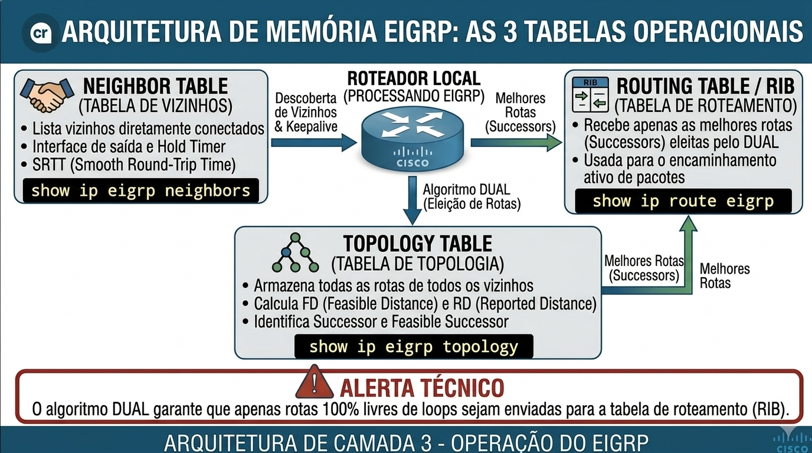
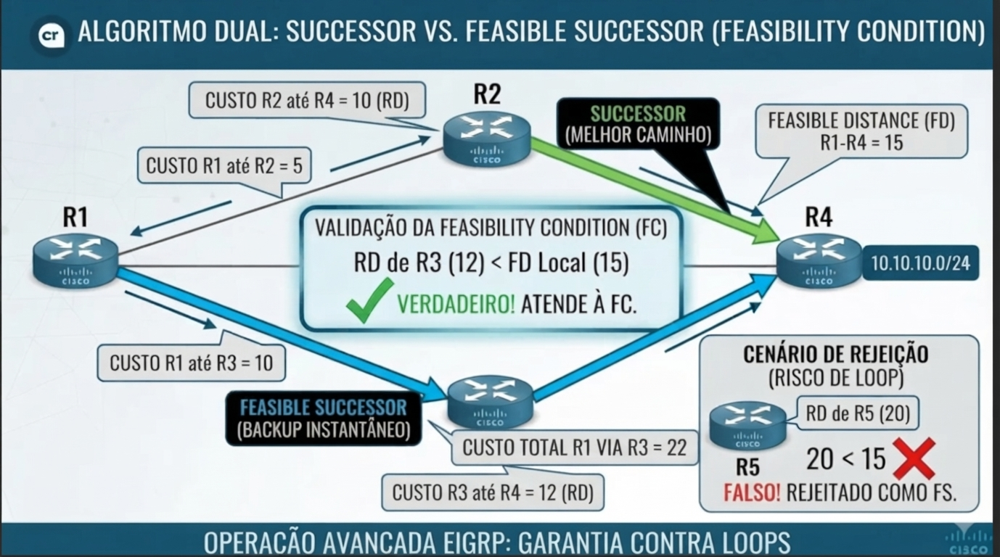
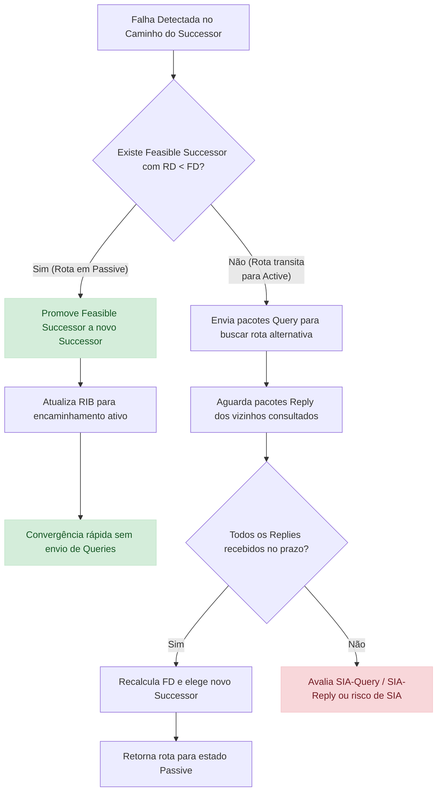
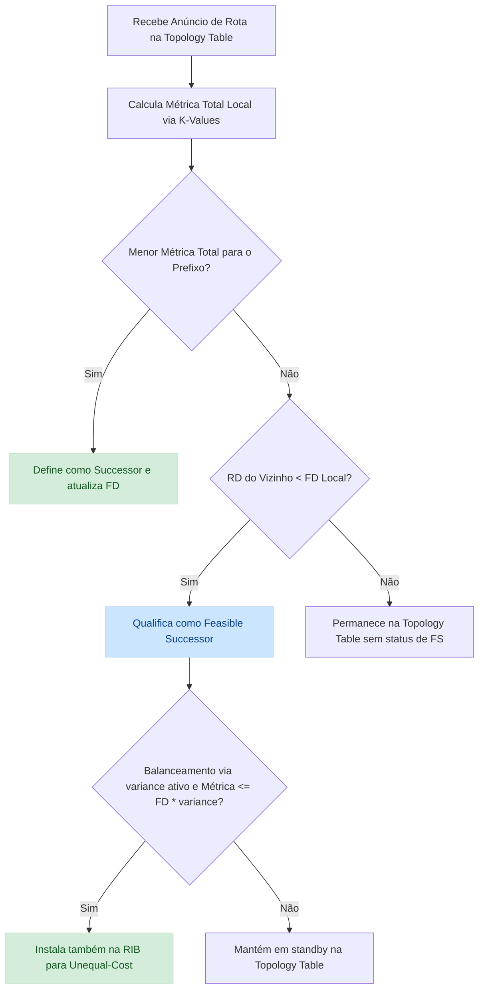
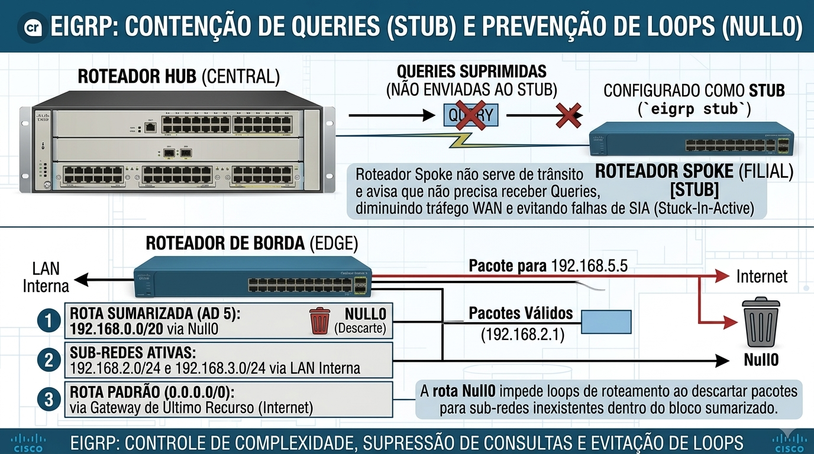

# Layer 3 Infrastructure: EIGRP (Parte 02) — Algoritmo DUAL, Métricas, Balanceamento e Escalabilidade

- [Layer 3 Infrastructure: EIGRP (Parte 02) — Algoritmo DUAL, Métricas, Balanceamento e Escalabilidade](#layer-3-infrastructure-eigrp-parte-02--algoritmo-dual-métricas-balanceamento-e-escalabilidade)
  - [Glossário Técnico de EIGRP (Dicionário de Roteamento Dinâmico)](#glossário-técnico-de-eigrp-dicionário-de-roteamento-dinâmico)
  - [🎯 Objetivo do Documento](#-objetivo-do-documento)
  - [Como Este Documento Deve Ser Lido](#como-este-documento-deve-ser-lido)
  - [Transição da Parte 01: Memória Operacional e Requisitos de Adjacência](#transição-da-parte-01-memória-operacional-e-requisitos-de-adjacência)
    - [Regras de Transporte Confiável (RTP), Query e Retransmissão](#regras-de-transporte-confiável-rtp-query-e-retransmissão)
    - [Critérios de Formação de Vizinhança (IPv4 vs. IPv6)](#critérios-de-formação-de-vizinhança-ipv4-vs-ipv6)
  - [O Coração do Protocolo: Algoritmo DUAL e Seleção de Caminhos](#o-coração-do-protocolo-algoritmo-dual-e-seleção-de-caminhos)
    - [Terminologia Crítica do DUAL](#terminologia-crítica-do-dual)
    - [A Condição de Viabilidade (Feasibility Condition - FC)](#a-condição-de-viabilidade-feasibility-condition---fc)
    - [Fluxograma de Decisão e Convergência do DUAL](#fluxograma-de-decisão-e-convergência-do-dual)
  - [A Matemática da Decisão: Métrica Composta e K-Values](#a-matemática-da-decisão-métrica-composta-e-k-values)
    - [Fórmula Clássica, Arredondamento e Wide Metrics](#fórmula-clássica-arredondamento-e-wide-metrics)
    - [Fluxograma de Avaliação de Métrica e Elegibilidade de Rotas](#fluxograma-de-avaliação-de-métrica-e-elegibilidade-de-rotas)
  - [Balanceamento de Carga (ECMP e Unequal-Cost via Variance)](#balanceamento-de-carga-ecmp-e-unequal-cost-via-variance)
    - [Como Funciona o Comando `variance`](#como-funciona-o-comando-variance)
  - [Escalabilidade e Controle de Consultas: EIGRP Stub Routing](#escalabilidade-e-controle-de-consultas-eigrp-stub-routing)
    - [O Problema do Stuck-in-Active (SIA) e o Mecanismo SIA-Query / SIA-Reply](#o-problema-do-stuck-in-active-sia-e-o-mecanismo-sia-query--sia-reply)
    - [Solução Arquitetural com Stub](#solução-arquitetural-com-stub)
  - [Sumarização Manual e Prevenção de Loops com Null0](#sumarização-manual-e-prevenção-de-loops-com-null0)
  - [Configuração Essencial: Classic Mode vs. Named Mode](#configuração-essencial-classic-mode-vs-named-mode)
  - [Comandos Essenciais de Diagnóstico e Validação](#comandos-essenciais-de-diagnóstico-e-validação)
  - [Consolidação do Conhecimento](#consolidação-do-conhecimento)
  - [🧪 Pronto para Testar seu Conhecimento?](#-pronto-para-testar-seu-conhecimento)
  - [🧪 Próximos Passos](#-próximos-passos)

---

## Glossário Técnico de EIGRP (Dicionário de Roteamento Dinâmico)

Os termos abaixo consolidam o vocabulário arquitetural necessário para operar, diagnosticar e projetar redes baseadas em EIGRP com clareza técnica e segurança operacional:

| Termo                       | Significado Técnico                                                                                                                                      | Analogia Prática                                                                                                                  |
| :---                        | :---                                                                                                                                                     | :---                                                                                                                              |
| **DUAL**                    | *Diffusing Update Algorithm*. O motor matemático do EIGRP que garante rotas livres de loops e convergência ágil sem depender de mapas globais da rede.   | Um sistema de navegação que já mantém uma rota alternativa validada antes mesmo de ocorrer um bloqueio na via principal.          |
| **RTP**                     | *Reliable Transport Protocol*. Mecanismo de transporte sobre IP Protocol 88 que gerencia entrega ordenada e confiável para pacotes específicos do EIGRP. | Um serviço de entrega com confirmação de recebimento próprio, operando diretamente sobre o protocolo IP.                          |
| **Successor**               | O roteador vizinho (e caminho associado) com a menor métrica total até o destino, selecionado para encaminhar o tráfego na tabela de roteamento (RIB).   | O trajeto principal adotado para o fluxo regular de tráfego.                                                                      |
| **Feasible Successor (FS)** | Um vizinho alternativo na tabela de topologia que satisfaz a *Feasibility Condition*, pronto para assumir sem recálculo amplo caso o *Successor* falhe.  | Um desvio previamente validado sem risco de retorno indesejado, disponível para contingência imediata.                            |
| **Feasible Distance (FD)**  | A menor métrica total calculada do roteador local até a rede de destino, servindo de referência para a *Feasibility Condition*.                          | O menor custo total conhecido da sua posição até o destino final.                                                                 |
| **Reported Distance (RD)**  | Também referenciada como *Advertised Distance (AD)*. É a métrica que o vizinho informa ter da perspectiva dele até a rede de destino.                    | A distância que o vizinho reporta que falta da posição dele até o destino.                                                        |
| **Feasibility Condition**   | Regra matemática ($RD < FD$) que garante que um caminho alternativo não retorna pelo roteador local, prevenindo loops de roteamento.                     | Aceitar uma rota alternativa apenas quando a distância reportada pelo vizinho até o destino é menor que a melhor distância local. |
| **Variance**                | Multiplicador inteiro (1 a 128) que habilita *unequal-cost load balancing* entre caminhos elegíveis dentro do limite calculado sobre a *FD*.             | Dividir o tráfego entre caminhos de custos diferentes, respeitando um teto proporcional definido em relação ao melhor custo.      |
| **SIA (Stuck-in-Active)**   | Condição em que uma rota permanece aguardando respostas *Reply* a *Queries* além do tempo limite, podendo levar à queda da adjacência.                   | Aguardar uma confirmação crítica por tempo excessivo sem retorno de um vizinho consultado.                                        |
| **EIGRP Stub**              | Recurso que restringe o envio de *Queries* para roteadores de borda ou filiais, reduzindo o escopo de buscas durante alterações de topologia.            | Informar aos roteadores centrais que uma filial não deve ser consultada para buscar caminhos alternativos por ela.                |

---

## 🎯 Objetivo do Documento

Este documento consolida a operação interna do **EIGRP (Enhanced Interior Gateway Routing Protocol)** para o exame **CCNP ENCOR 350-401**, aprofundando os mecanismos de decisão, cálculo de métricas, balanceamento de carga e contenção de consultas em topologias corporativas.

Ao concluir este estudo, você terá domínio técnico para:

- Compreender como a *Neighbor Table*, a *Topology Table* e a *Routing Table (RIB)* interagem durante a operação normal e a convergência.
- Identificar os requisitos de formação de vizinhança em **IPv4** e **IPv6** e os cuidados operacionais com *timers*, *Query* e retransmissões.
- Aplicar o algoritmo **DUAL**, a **Feasibility Condition ($RD < FD$)** e a distinção entre **Successor** e **Feasible Successor**.
- Calcular métricas nas fórmulas **Clássica** e **Wide Metrics**, configurar *unequal-cost load balancing* com **`variance`** e prevenir loops na sumarização com **`Null0`**.
- Mitigar tempestades de *Queries* e falhas de **Stuck-in-Active (SIA)** com **`eigrp stub`** e diagnosticar cenários reais via CLI Cisco IOS / IOS-XE.

---

## Como Este Documento Deve Ser Lido

O conteúdo avança da mecânica de vizinhança e transporte até a matemática de seleção de caminhos, escalabilidade e diagnóstico:

1. **Adjacência e Transporte:** Revise como a confiança entre vizinhos é estabelecida e como o RTP controla *Updates*, *Queries* e *Replies*.
2. **Motor DUAL:** Domine *FD*, *RD*, *Feasibility Condition* e a transição entre os estados *Passive* e *Active*.
3. **Métricas e Balanceamento:** Acompanhe o cálculo de custo, o impacto dos *K-values*, *Wide Metrics* e o uso de `variance`.
4. **Escalabilidade, Sumarização e CLI:** Veja como controlar *Queries* com *Stub*, evitar loops com *Null0*, configurar *Classic* e *Named Mode* e validar o estado da rede.

---

## Transição da Parte 01: Memória Operacional e Requisitos de Adjacência

Na **Parte 01**, estabelecemos que o EIGRP é um protocolo *Advanced Distance Vector* (padronizado na [RFC 7868](https://www.rfc-editor.org/info/rfc7868/)) encapsulado sobre **IP Protocol 88**, utilizando endereços multicast **`224.0.0.10`** (`01:00:5E:00:00:0A` em Ethernet) para IPv4 e **`FF02::A`** para IPv6, com domínios isolados por **Autonomous System (AS)**.

Na memória do roteador, três estruturas trabalham de forma coordenada:

- **Neighbor Table:** Mantém os vizinhos adjacentes ativos, a interface associada, o tempo restante de *Hold Time* e métricas de troca de pacotes como *SRTT* (*Smooth Round-Trip Time*) e *RTO* (*Retransmission Timeout*).
- **Topology Table:** Armazena todos os prefixos anunciados dentro do AS, os vizinhos que os propagam, os valores de *FD* e *RD*, os atributos de caminho (*hop count*, *minimum bandwidth*, *total delay*) e o estado de cada rota (*Passive* ou *Active*).
- **Routing Table (RIB):** Recebe as melhores rotas (*Successors*, respeitando *ECMP* ou *variance*) eleitas para o encaminhamento de tráfego.



### Regras de Transporte Confiável (RTP), Query e Retransmissão

O EIGRP organiza sua troca de mensagens em cinco tipos de pacotes (*Update*, *Request*, *Query*, *Reply* e *Hello*, com confirmações enviadas como pacotes *Hello* vazios em unicast):

- **Pacotes Confiáveis (*Update*, *Query* e *Reply*):** Exigem confirmação (*ACK*) e utilizam números de sequência controlados pelo **RTP**.
- **Pacotes Não Confiáveis (*Hello* e *Request*):** Não exigem *ACK* explícito.
- **Comportamento de *Query* (Multicast vs. Unicast):** Quando um roteador perde o *Successor* e não dispõe de um *Feasible Successor*, envia pacotes *Query* via **multicast** (`224.0.0.10` / `FF02::A`) para buscar um caminho alternativo. Caso o pacote multicast não seja confirmado dentro do *RTO*, o RTP realiza retransmissões via **unicast** diretamente ao vizinho pendente (até o limite de retransmissões antes de encerrar a adjacência).

### Critérios de Formação de Vizinhança (IPv4 vs. IPv6)

Para que dois roteadores estabeleçam adjacência EIGRP, devem coincidir:

- **Autonomous System (AS):** O número do AS deve ser idêntico entre os vizinhos (`router eigrp <asn>`).
- **K-Values (`K1` a `K5`):** Os pesos da fórmula de métrica devem ser exatamente iguais em ambos os lados.
- **Autenticação (quando ativa):** Chaves e algoritmos configurados devem corresponder.
- **Interface não passiva:** A interface não pode estar definida como `passive-interface`.
- **Compatibilidade de Endereçamento por Família de Endereços:**
  - **Em IPv4:** O endereço IP de origem do pacote *Hello* deve pertencer à mesma sub-rede primária da interface receptora.
  - **Em IPv6:** A comunicação de vizinhança ocorre sobre endereços **Link-Local (`FE80::/10`)**, não exigindo que os prefixos globais das interfaces estejam na mesma sub-rede para formar adjacência.

> 💡 **Precisão de Prova (Timers):** Ao contrário de protocolos que exigem *Hello* e *Hold Time* idênticos para formar vizinhança, o EIGRP **não exige** igualdade de *timers* entre vizinhos. Cada roteador envia pacotes *Hello* no seu próprio *Hello Timer* (padrão `5s` em enlaces rápidos e `60s` em enlaces T1 ou inferiores) e informa no próprio *Hello* qual é o seu *Hold Time* (padrão `3x` o *Hello*: `15s` ou `180s`), indicando ao vizinho em quanto tempo deve declará-lo inativo caso não receba novos *Hellos*.

---

## O Coração do Protocolo: Algoritmo DUAL e Seleção de Caminhos

O **DUAL (*Diffusing Update Algorithm*)** é o algoritmo central do EIGRP. Ele avalia continuamente as rotas na *Topology Table* para selecionar os melhores caminhos sem risco de loops e convergir com rapidez quando ocorrem falhas.

### Terminologia Crítica do DUAL

- **Feasible Distance (FD):** Menor métrica total calculada pelo roteador local até a rede de destino. Funciona como a referência de melhor custo conhecida para aquele prefixo.
- **Reported Distance (RD) / Advertised Distance (AD):** Métrica total que o roteador vizinho informa ter da perspectiva dele até o destino. Em outras palavras, é a *FD* daquele vizinho anunciada no pacote *Update*.
- **Successor:** O vizinho (e caminho associado) que apresenta a menor métrica total até o destino. É instalado na *RIB* para o encaminhamento ativo.
- **Feasible Successor (FS):** Um vizinho alternativo na *Topology Table* que já atende à *Feasibility Condition* e pode assumir o encaminhamento sem depender de uma busca ampla na rede caso o *Successor* falhe.

### A Condição de Viabilidade (Feasibility Condition - FC)

Um caminho alternativo qualifica-se como **Feasible Successor** quando sua *Reported Distance* é estritamente menor que a *Feasible Distance* calculada pelo roteador local:

$$\text{RD do Vizinho} < \text{FD Local}$$

**Garantia matemática contra loops:** Se um vizinho estivesse encaminhando pacotes para o destino passando de volta pelo roteador local, o custo anunciado por ele ($RD$) teria de incluir ao menos a *FD* local mais o custo do trajeto até esse vizinho — tornando impossível que $RD < FD$. Portanto, a condição $RD < FD$ assegura que o vizinho possui um caminho até o destino que não retorna pelo roteador local.



### Fluxograma de Decisão e Convergência do DUAL



> ⚠️ **Leitura de Estado na Tabela de Topologia:** Uma rota em estado **Passive (`P`)** indica estabilidade e convergência concluída. Uma rota em estado **Active (`A`)** indica que o roteador perdeu o caminho principal, não possuía *Feasible Successor* e está aguardando respostas (*Reply*) a pacotes *Query* enviados na rede.

---

## A Matemática da Decisão: Métrica Composta e K-Values

O EIGRP calcula métricas de caminho a partir de até cinco parâmetros ponderados pelos coeficientes **K1 a K5**:

- **K1:** *Bandwidth* (menor largura de banda em Kbps ao longo do caminho até o destino — o gargalo do trajeto).
- **K2:** *Load* (carga do enlace, de 1 a 255).
- **K3:** *Delay* (soma acumulada dos atrasos das interfaces ao longo do caminho).
- **K4:** *Reliability* (confiabilidade do enlace, de 1 a 255).
- **K5:** *MTU* / parâmetro de controle associado a *K4* na fórmula clássica.

Por padrão, apenas **K1** e **K3** estão habilitados (`K1 = 1, K2 = 0, K3 = 1, K4 = 0, K5 = 0`). Qualquer divergência nos *K-values* entre dois roteadores impede a formação de adjacência.

### Fórmula Clássica, Arredondamento e Wide Metrics

Na **Métrica Clássica** (32 bits), com os valores padrão (`K1 = 1, K3 = 1`), o cálculo segue a expressão:

$$\text{Métrica Clássica} = 256 \times \left( \left\lfloor \frac{10^7}{\text{Menor Bandwidth (Kbps)}} \right\rfloor + \sum \frac{\text{Delay ($\mu$s)}}{10} \right)$$

Onde:

- $10^7$ representa a referência de largura de banda em Kbps (equivalente a `10.000.000` Kbps = `10 Gbps`).
- O termo $\lfloor 10^7 / \text{Menor Bandwidth} \rfloor$ utiliza **divisão inteira** (descartando a parte fracionária antes de somar o *delay* acumulado e multiplicar por `256`).
- O *delay* de cada interface é somado ao longo do caminho e dividido por `10` (convertendo microssegundos em dezenas de microssegundos, unidade clássica do EIGRP).

**Limitação em enlaces de alta velocidade e Wide Metrics (64 bits):**
Na fórmula clássica, qualquer enlace com largura de banda igual ou superior a **10 Gbps** (`10.000.000` Kbps) produz `1` na divisão $10^7 / \text{BW}$, impedindo que o cálculo clássico distinga um enlace de 10 Gbps de outro de 40 Gbps ou 100 Gbps. As **Wide Metrics** (64 bits), ativadas por padrão no **EIGRP Named Mode**, ampliam a escala de referência de banda ($10^7 \times 65536$) e utilizam maior precisão para *delay*, aplicando um fator de escala (*RIB scale*, padrão `128`) ao instalar a métrica na *RIB*.

### Fluxograma de Avaliação de Métrica e Elegibilidade de Rotas



---

## Balanceamento de Carga (ECMP e Unequal-Cost via Variance)

Quando existem múltiplos caminhos para o mesmo prefixo dentro do mesmo processo EIGRP:

- **ECMP (*Equal-Cost Multi-Path*):** Caminhos com exatamente a mesma métrica total são instalados em conjunto na *RIB* (até o limite de *maximum-paths* configurado, padrão `4`), dividindo o tráfego entre eles.
- **Unequal-Cost Load Balancing (`variance`):** Permite instalar também rotas com métrica total superior à do *Successor*, desde que atendam aos critérios do EIGRP.

### Como Funciona o Comando `variance`

O comando `variance <multiplicador>` (de `1` a `128`, padrão `1`) define um limite superior em relação à *FD* do *Successor*. Para uma rota alternativa ser incluída no balanceamento de custo desigual, ela deve atender **simultaneamente** a dois requisitos:

1. **Ser um *Feasible Successor* ($RD < FD$):** A rota alternativa deve satisfazer a *Feasibility Condition* para garantir ausência de loops.
2. **Respeitar o teto da *Variance*:**

$$\text{Métrica Total da Rota Alternativa} \le \text{FD do Successor} \times \text{Variance}$$

Quando ambas as condições são cumpridas, o roteador instala os caminhos na *RIB* e distribui o tráfego de forma **proporcional** às métricas (rotas com menor métrica recebem maior proporção de tráfego).

---

## Escalabilidade e Controle de Consultas: EIGRP Stub Routing

Em redes corporativas maiores — especialmente topologias *Hub-and-Spoke* — a propagação irrestrita de pacotes *Query* pode impactar a estabilidade.

### O Problema do Stuck-in-Active (SIA) e o Mecanismo SIA-Query / SIA-Reply

Quando um roteador perde o *Successor* de um prefixo sem ter um *Feasible Successor*, ele entra em estado *Active* e envia *Queries* para buscar caminhos alternativos. Se um vizinho não responder dentro do tempo previsto pelo *Active Timer* (padrão de **3 minutos** no temporizador de *Active*), ocorre a condição **Stuck-in-Active (SIA)**, podendo levar à queda da adjacência com o vizinho que não respondeu.

Para reduzir quedas indevidas quando um roteador vizinho está apenas aguardando respostas de outros roteadores mais distantes na rede, o EIGRP utiliza os mecanismos de **SIA-Query** e **SIA-Reply** na metade do *Active Timer* (`90` segundos):

- O roteador que aguarda a resposta envia um **SIA-Query** ao vizinho para verificar se ele continua operacional e aguardando *Replies* de terceiros.
- Se o vizinho estiver ativo e aguardando *downstream*, ele responde com um **SIA-Reply**, renovando o temporizador de espera em vez de derrubar imediatamente a adjacência.

### Solução Arquitetural com Stub

Em roteadores de filial ou borda (*Spokes*) que não devem atuar como trânsito para outras partes da rede, configurar **`eigrp stub`** instrui os vizinhos a não enviarem *Queries* para aquele roteador, delimitando o escopo das buscas durante mudanças de topologia:

```text
Router_Spoke(config)# router eigrp 100
Router_Spoke(config-router)# eigrp stub connected summary
```

---

## Sumarização Manual e Prevenção de Loops com Null0

A sumarização manual reduz o tamanho das tabelas de roteamento e o volume de anúncios propagados na rede. No EIGRP, ao configurar sumarização em uma interface:

- A rota sumarizada instalada localmente na *RIB* recebe **Administrative Distance padrão igual a `5`** e aponta para a interface virtual **`Null0`**.
- Essa rota para `Null0` atua como proteção contra loops: caso exista uma rota padrão (`0.0.0.0/0`) e cheguem pacotes destinados a sub-redes não alocadas dentro do bloco sumarizado, o prefixo sumarizado (mais específico que `/0` pela regra do *Longest Prefix Match*) intercepta e descarta localmente esses pacotes sem devolvê-los em loop ao vizinho.
- A métrica da rota sumarizada reflete a **menor métrica** entre os prefixos específicos componentes que estão ativos na tabela de topologia.

```text
R1(config)# interface GigabitEthernet0/1
R1(config-if)# ip summary-address eigrp 100 192.168.0.0 255.255.252.0
```



---

## Configuração Essencial: Classic Mode vs. Named Mode

O EIGRP pode ser configurado no **Classic Mode** (processo tradicional por família de endereços) ou no **Named Mode** (configuração unificada por nome de instância e *address-family*, habilitando *Wide Metrics* de 64 bits por padrão):

```text
! --- Classic Mode (IPv4) ---
R1(config)# router eigrp 100
R1(config-router)# network 10.1.12.0 0.0.0.3
R1(config-router)# variance 2

! --- Named Mode (IPv4 com Wide Metrics e Stub) ---
R1(config)# router eigrp ENCOR_EIGRP
R1(config-router)# address-family ipv4 unicast autonomous-system 100
R1(config-router-af)# network 10.1.12.0 0.0.0.3
R1(config-router-af)# topology base
R1(config-router-af-topology)# variance 2
R1(config-router-af-topology)# exit-af-topology
R1(config-router-af)# af-interface GigabitEthernet0/0
R1(config-router-af-interface)# hello-interval 5
R1(config-router-af-interface)# hold-time 15
R1(config-router-af-interface)# exit-af-interface
R1(config-router-af)# exit-address-family
```

---

## Comandos Essenciais de Diagnóstico e Validação

A verificação periódica dos estados de vizinhança, topologia e parâmetros do processo assegura previsibilidade operacional:

1. **`show ip eigrp neighbors`:** Confirma vizinhos ativos, *Hold Time* restante, *SRTT*, *RTO* e fila de pacotes pendentes (**`Q Cnt`**). Valores de `Q Cnt` persistentemente elevados indicam atraso ou perda na confirmação de pacotes confiáveis.

   ```text
   R1# show ip eigrp neighbors
   EIGRP-IPv4 Neighbors for AS(100)
   H   Address         Interface      Hold Uptime   SRTT   RTO  Q  Seq
                                      (sec)         (ms)       Cnt Num
   0   10.1.12.2       Gi0/0            12 01:14:22   14   100  0  45
   ```

2. **`show ip eigrp topology`:** Exibe prefixos, estado (`P` = *Passive*, `A` = *Active*), *FD* e *RD* de cada vizinho, permitindo validar quem é *Successor* e quem atende a $RD < FD$ como *Feasible Successor*.

   ```text
   R1# show ip eigrp topology
   EIGRP-IPv4 Topology Table for AS(100)/ID(1.1.1.1)
   Codes: P - Passive, A - Active, U - Update, Q - Query, R - Reply,
          r - reply Status, s - sia Status

   P 192.168.10.0/24, 1 successors, FD is 3072
           via 10.1.12.2 (3072/2816), GigabitEthernet0/0
           via 10.1.13.3 (3328/2816), GigabitEthernet0/1
   ```

3. **`show ip protocols`:** Mostra o *Autonomous System*, os valores ativos de **K1–K5**, a distância administrativa do EIGRP (padrão `90` para rotas internas e `170` para rotas externas), o multiplicador de *variance* e o status de *Stub*.

---

## Consolidação do Conhecimento

- **Segurança contra Loops:** O algoritmo **DUAL** valida rotas alternativas pela condição $RD < FD$, mantendo *Feasible Successors* prontos para contingência sem depender de mapas globais.
- **Cálculo de Métrica:** Baseia-se por padrão em *Bandwidth* (`K1`) e *Delay* (`K3`), com divisão inteira na fórmula clássica e suporte a *Wide Metrics* (64 bits) no *Named Mode*.
- **Balanceamento de Carga:** Suporta *ECMP* e *unequal-cost load balancing* via `variance` (aplicado apenas a rotas que atendem à *Feasibility Condition* e ao limite definido).
- **Escalabilidade e Prevenção de Loops:** O uso de `eigrp stub` reduz o alcance de *Queries* em filiais, e rotas sumarizadas para `Null0` (AD `5`) evitam loops para prefixos não alocados.

---

## 🧪 Pronto para Testar seu Conhecimento?

Parabéns por concluir a teoria da **Parte 02 de EIGRP** — **Algoritmo DUAL, Métricas, Balanceamento e Escalabilidade** (Tópico 3.2.a do CCNP ENCOR)!

Agora é o momento de consolidar o aprendizado e testar sua rapidez e precisão em questões no mesmo formato cobrado no exame de certificação.

👉 **Acesse os simulados da Parte 02 de EIGRP (CCNP ENCOR 350-401)**

🔗 [Abrir Simulados de EIGRP — Parte 02](https://alcancil.github.io/Cisco/CCNP%20350-401%20ENCOR/03%20-%20Infrastructure/05%20-%20EIGRP/02%20-%20Algoritmo_DUAL_M%C3%A9tricas_%20Balanceamento_e_Escalabilidade/Arquivos/Simulado/)

**Simulados temáticos:**

1. [Algoritmo DUAL, Feasibility Condition, Successor e Feasible Successor](https://alcancil.github.io/Cisco/CCNP%20350-401%20ENCOR/03%20-%20Infrastructure/05%20-%20EIGRP/02%20-%20Algoritmo_DUAL_M%C3%A9tricas_%20Balanceamento_e_Escalabilidade/Arquivos/Simulado/01.html)
2. [Métrica Composta (K-values), Cálculo (Classic vs. Wide) e Variance](https://alcancil.github.io/Cisco/CCNP%20350-401%20ENCOR/03%20-%20Infrastructure/05%20-%20EIGRP/02%20-%20Algoritmo_DUAL_M%C3%A9tricas_%20Balanceamento_e_Escalabilidade/Arquivos/Simulado/02.html)
3. [Convergência, Queries, Reply e Estados Active/Passive (SIA)](https://alcancil.github.io/Cisco/CCNP%20350-401%20ENCOR/03%20-%20Infrastructure/05%20-%20EIGRP/02%20-%20Algoritmo_DUAL_M%C3%A9tricas_%20Balanceamento_e_Escalabilidade/Arquivos/Simulado/03.html)
4. [EIGRP Stub Routing e Contenção de Consultas](https://alcancil.github.io/Cisco/CCNP%20350-401%20ENCOR/03%20-%20Infrastructure/05%20-%20EIGRP/02%20-%20Algoritmo_DUAL_M%C3%A9tricas_%20Balanceamento_e_Escalabilidade/Arquivos/Simulado/04.html)
5. [Sumarização Manual (Null0) e Modos Classic vs. Named](https://alcancil.github.io/Cisco/CCNP%20350-401%20ENCOR/03%20-%20Infrastructure/05%20-%20EIGRP/02%20-%20Algoritmo_DUAL_M%C3%A9tricas_%20Balanceamento_e_Escalabilidade/Arquivos/Simulado/05.html)

**Simulado completo da Parte 02:** [50 questões — 75 minutos](https://alcancil.github.io/Cisco/CCNP%20350-401%20ENCOR/03%20-%20Infrastructure/05%20-%20EIGRP/02%20-%20Algoritmo_DUAL_M%C3%A9tricas_%20Balanceamento_e_Escalabilidade/Arquivos/Simulado/completo.html)

**📊 Painel de Estatísticas:** [Acompanhe seu desempenho](https://alcancil.github.io/Cisco/CCNP%20350-401%20ENCOR/03%20-%20Infrastructure/05%20-%20EIGRP/02%20-%20Algoritmo_DUAL_M%C3%A9tricas_%20Balanceamento_e_Escalabilidade/Arquivos/Simulado/dashboard.html)

## 🧪 Próximos Passos

Avançar para o **Guia Prático de Comandos CLI do EIGRP (Parte 03)** — cobrindo configuração passo a passo em **Classic Mode** e **Named Mode**, ativação em **IPv4 e IPv6**, ajuste de *timers* e métricas, sumarização com `Null0`, *EIGRP Stub* e autenticação — antes de partirmos para os laboratórios no EVE-NG.
