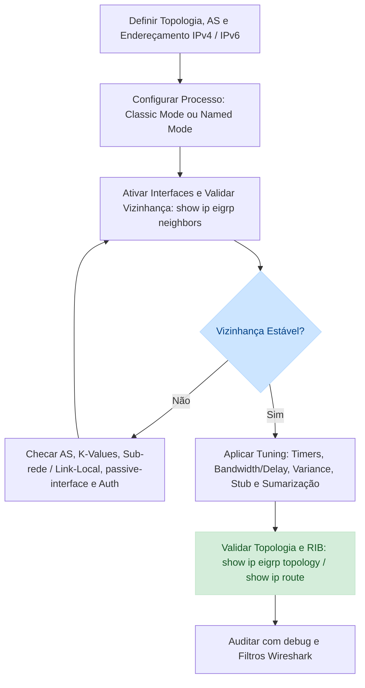
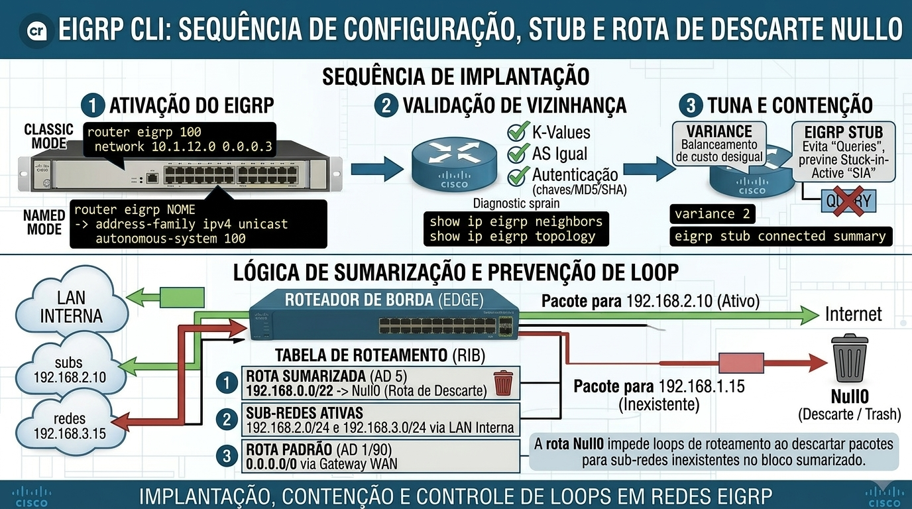

# Layer 3 Infrastructure: EIGRP (Parte 03) — Guia Prático de Comandos CLI, Troubleshooting e Wireshark

- [Layer 3 Infrastructure: EIGRP (Parte 03) — Guia Prático de Comandos CLI, Troubleshooting e Wireshark](#layer-3-infrastructure-eigrp-parte-03--guia-prático-de-comandos-cli-troubleshooting-e-wireshark)
  - [🎯 Objetivo do Guia](#-objetivo-do-guia)
  - [Como Utilizar Este Guia na Prática e em Laboratório](#como-utilizar-este-guia-na-prática-e-em-laboratório)
  - [Fluxograma Operacional: Sequência de Implantação e Validação](#fluxograma-operacional-sequência-de-implantação-e-validação)
  - [1. Ativação do EIGRP e Definição de Autonomous System (AS)](#1-ativação-do-eigrp-e-definição-de-autonomous-system-as)
    - [Classic Mode (IPv4 e IPv6)](#classic-mode-ipv4-e-ipv6)
    - [Named Mode (IPv4 e IPv6)](#named-mode-ipv4-e-ipv6)
  - [2. Ativação em Interfaces e Controle de Vizinhança (`passive-interface`)](#2-ativação-em-interfaces-e-controle-de-vizinhança-passive-interface)
  - [3. Tuning de Timers, Métricas, K-Values e Variance](#3-tuning-de-timers-métricas-k-values-e-variance)
    - [Hello Timer e Hold Time](#hello-timer-e-hold-time)
    - [Bandwidth, Delay e K-Values](#bandwidth-delay-e-k-values)
    - [Balanceamento Desigual com `variance` e `maximum-paths`](#balanceamento-desigual-com-variance-e-maximum-paths)
  - [4. Escalabilidade com EIGRP Stub](#4-escalabilidade-com-eigrp-stub)
  - [5. Sumarização Manual e Rota de Descarte (`Null0`)](#5-sumarização-manual-e-rota-de-descarte-null0)
  - [6. Autenticação no EIGRP (MD5 e HMAC-SHA-256)](#6-autenticação-no-eigrp-md5-e-hmac-sha-256)
    - [Classic Mode (Key Chain / MD5)](#classic-mode-key-chain--md5)
    - [Named Mode (Key Chain / MD5 e SHA-256)](#named-mode-key-chain--md5-e-sha-256)
  - [7. Comandos `show` Essenciais para Diagnóstico e Validação](#7-comandos-show-essenciais-para-diagnóstico-e-validação)
  - [8. Comandos `debug` e Cuidados Operacionais](#8-comandos-debug-e-cuidados-operacionais)
  - [9. Filtros Wireshark e O Que Observar na Captura](#9-filtros-wireshark-e-o-que-observar-na-captura)
  - [10. Consolidação e Próximos Passos](#10-consolidação-e-próximos-passos)

---

## 🎯 Objetivo do Guia

Este documento reúne a sequência operacional de comandos do **EIGRP (Enhanced Interior Gateway Routing Protocol)** para o exame **CCNP ENCOR 350-401**, conectando os conceitos de *Advanced Distance Vector*, algoritmo **DUAL**, **RTP**, métricas e escalabilidade à execução prática em equipamentos Cisco IOS / IOS-XE e laboratórios em simuladores/emuladores de rede.

Ao concluir este guia, você terá segurança técnica para:

- Implantar e estruturar o EIGRP em **Classic Mode** e **Named Mode** para **IPv4** e **IPv6**.
- Controlar a participação de interfaces, ajustar *timers*, manipular *bandwidth*/*delay*/*K-values* e configurar *ECMP* e *variance*.
- Aplicar **EIGRP Stub**, **sumarização manual com `Null0`** (AD `5`) e **autenticação** entre vizinhos.
- Diagnosticar falhas de adjacência, convergência e métricas com comandos **`show`**, **`debug`** e análise de pacotes no **Wireshark**.

---

## Como Utilizar Este Guia na Prática e em Laboratório

A ordem das seções espelha um fluxo de engenharia disciplinado:

1. **Estrutura e Vizinhança:** Suba o processo, defina o *Autonomous System (AS)* e valide a formação de vizinhança antes de aplicar ajustes finos.
2. **Tuning e Balanceamento:** Ajuste *timers*, parâmetros de métrica e `variance` após a adjacência estar estável.
3. **Escalabilidade e Segurança:** Aplique *Stub*, sumarização e autenticação com critério para evitar quedas indesejadas de vizinhança ou rotas de descarte inesperadas.
4. **Verificação e Captura:** Valide com `show`, utilize `debug` com cautela e confirme no plano de dados/controle via *Wireshark*.

---

## Fluxograma Operacional: Sequência de Implantação e Validação



---

## 1. Ativação do EIGRP e Definição de Autonomous System (AS)

No EIGRP, o número do **Autonomous System (AS)** delimita um domínio interno de roteamento. Vizinhos precisam pertencer ao mesmo AS para trocar rotas, e processos em AS distintos permanecem isolados por padrão.

### Classic Mode (IPv4 e IPv6)

No modo clássico, a configuração é separada por família de endereços:

```text
! --- Ativação EIGRP IPv4 (Classic Mode - AS 100) ---
R1(config)# router eigrp 100
R1(config-router)# eigrp router-id 1.1.1.1
R1(config-router)# network 10.1.12.0 0.0.0.3

! --- Ativação EIGRP IPv6 (Classic Mode - AS 100) ---
! 1. Habilita encaminhamento unicast IPv6 no roteador
R1(config)# ipv6 unicast-routing

! 2. Cria/habilita o processo EIGRP IPv6 AS 100 e define o Router ID
R1(config)# ipv6 router eigrp 100
R1(config-rtr)# eigrp router-id 1.1.1.1
R1(config-rtr)# no shutdown
R1(config-rtr)# exit

! 3. Ativa o EIGRP IPv6 AS 100 diretamente na interface desejada
R1(config)# interface GigabitEthernet0/0
R1(config-if)# ipv6 address 2001:DB8:0:12::1/64
R1(config-if)# ipv6 eigrp 100
```

> 💡 **Observação Operacional (IPv6 Classic Mode):** Em muitas versões do IOS, o processo `ipv6 router eigrp <asn>` inicia em estado `shutdown` até que você execute `no shutdown` dentro do modo do roteador e habilite o EIGRP nas interfaces desejadas.
>
> Lembrando que, em IPv6, a formação de adjacência EIGRP usa endereços Link-Local FE80::/10 na interface, então a interface precisa estar up/up e ter endereço IPv6 / Link-Local ativo para os pacotes Hello em FF02::A saírem e formarem vizinhança


### Named Mode (IPv4 e IPv6)

No **Named Mode**, uma única instância nomeada centraliza as famílias de endereços (`address-family`), submodos de topologia (`topology`) e submodos de interface (`af-interface`), habilitando **Wide Metrics (64 bits)** por padrão:

```text
! --- Ativação EIGRP Named Mode (Instância ENCOR_EIGRP, AS 100) ---
R1(config)# ipv6 unicast-routing
R1(config)# router eigrp ENCOR_EIGRP
R1(config-router)# address-family ipv4 unicast autonomous-system 100
R1(config-router-af)# eigrp router-id 1.1.1.1
R1(config-router-af)# network 10.1.12.0 0.0.0.3
R1(config-router-af)# exit-address-family
!
R1(config-router)# address-family ipv6 unicast autonomous-system 100
R1(config-router-af)# eigrp router-id 1.1.1.1
R1(config-router-af)# af-interface GigabitEthernet0/0
R1(config-router-af-interface)# exit-af-interface
R1(config-router-af)# exit-address-family
R1(config-router)# exit
!
! --- Ativação da interface IPv6 (e adjacência via Link-Local FE80::/10) ---
R1(config)# interface GigabitEthernet0/0
R1(config-if)# ipv6 address 2001:DB8:0:12::1/64
```

---

## 2. Ativação em Interfaces e Controle de Vizinhança (`passive-interface`)

A ativação em interfaces determina onde o roteador envia e recebe pacotes *Hello* e anuncia prefixos:

- **Em IPv4 (Classic / Named):** O comando `network <rede> <wildcard>` seleciona as interfaces cujos endereços IP primários correspondem à faixa informada (sem *wildcard*, assume a máscara natural da classe).
- **Em IPv6 (Classic / Named):** A ativação é feita diretamente na interface.
- **Controle com `passive-interface`:** Suprime o envio de pacotes *Hello* na interface (impedindo formação de vizinhança nela), mantendo o prefixo da interface anunciado quando incluído pela regra de ativação.

```text
! --- Ativação de IPv6 na Interface (Classic Mode) ---
R1(config)# interface GigabitEthernet0/0
R1(config-if)# ipv6 eigrp 100

! --- Ativação de IPv6 na Interface (Named Mode) ---
R1(config)# interface GigabitEthernet0/0
R1(config-if)# ipv6 enable
R1(config-if)# router eigrp ENCOR_EIGRP
R1(config-router)# address-family ipv6 unicast autonomous-system 100
R1(config-router-af)# af-interface GigabitEthernet0/0
R1(config-router-af-interface)# exit-af-interface
R1(config-router-af)# exit-address-family

! --- Bloqueando Hellos em LAN de usuários (Classic Mode) ---
R1(config)# router eigrp 100
R1(config-router)# passive-interface default
R1(config-router)# no passive-interface GigabitEthernet0/0

! --- Bloqueando Hellos em LAN de usuários (Named Mode - IPv4) ---
R1(config)# router eigrp ENCOR_EIGRP
R1(config-router)# address-family ipv4 unicast autonomous-system 100
R1(config-router-af)# af-interface default
R1(config-router-af-interface)# passive-interface
R1(config-router-af-interface)# exit-af-interface
R1(config-router-af)# af-interface GigabitEthernet0/0
R1(config-router-af-interface)# no passive-interface
R1(config-router-af-interface)# exit-af-interface
R1(config-router-af)# exit-address-family
```

**OBS:** uma boa prática é sempre utilizar o `passive-interface` no modo **default**, ou seja, todas as portas irão parar de enviar / receber os *Hellos* por padrão. Ai o correto é ir liberando somente as interfaces que irão fazer parte da comunicação.

---

## 3. Tuning de Timers, Métricas, K-Values e Variance

### Hello Timer e Hold Time

Por padrão, o EIGRP utiliza *Hello* de `5s` e *Hold Time* de `15s` em interfaces de alta velocidade, e *Hello* de `60s` e *Hold Time* de `180s` em enlaces lentos (T1 ou inferiores). O EIGRP não exige que os *timers* sejam iguais entre vizinhos para formar adjacência, pois cada roteador anuncia seu próprio *Hold Time* nos pacotes *Hello*.

```text
! --- Ajuste de Timers no Classic Mode (IPv4 e IPv6) ---
R1(config)# interface GigabitEthernet0/0
R1(config-if)# ip hello-interval eigrp 100 10
R1(config-if)# ip hold-time eigrp 100 30
R1(config-if)# ipv6 hello-interval eigrp 100 10
R1(config-if)# ipv6 hold-time eigrp 100 30

! --- Ajuste de Timers no Named Mode ---
R1(config)# router eigrp ENCOR_EIGRP
R1(config-router)# address-family ipv4 unicast autonomous-system 100
R1(config-router-af)# af-interface GigabitEthernet0/0
R1(config-router-af-interface)# hello-interval 10
R1(config-router-af-interface)# hold-time 30
R1(config-router-af-interface)# exit-af-interface
R1(config-router-af)# exit-address-family
```

### Bandwidth, Delay e K-Values

Os comandos `bandwidth` (em Kbps) e `delay` (em dezenas de microssegundos na configuração de interface) alteram os valores usados pelo EIGRP para calcular métricas e propagar atributos nos *Updates*, sem alterar a taxa física da interface. Na métrica clássica padrão (`K1 = 1, K3 = 1`), aplica-se:

$$\text{Métrica Clássica} = 256 \times \left( \left\lfloor \frac{10^7}{\text{Menor Bandwidth (Kbps)}} \right\rfloor + \sum \frac{\text{Delay ($\mu$s)}}{10} \right)$$

Qualquer alteração nos coeficientes `K1` a `K5` deve ser idêntica entre os vizinhos, caso contrário a adjacência não se forma.

```text
! --- Ajuste de Bandwidth e Delay na Interface ---
R1(config)# interface GigabitEthernet0/0
R1(config-if)# bandwidth 100000
R1(config-if)# delay 100

! --- Ajuste de K-Values no Classic Mode (exige igualdade entre vizinhos) ---
R1(config)# router eigrp 100
R1(config-router)# metric weights 0 1 0 1 0 0

! --- Ajuste de K-Values no Named Mode (submodo topology base) ---
R1(config)# router eigrp ENCOR_EIGRP
R1(config-router)# address-family ipv4 unicast autonomous-system 100
R1(config-router-af)# topology base
R1(config-router-af-topology)# metric weights 0 1 0 1 0 0
R1(config-router-af-topology)# exit-af-topology
R1(config-router-af)# exit-address-family
```

### Balanceamento Desigual com `variance` e `maximum-paths`

Para participar do balanceamento desigual via `variance <1..128>` (padrão `1`), a rota alternativa deve ser um **Feasible Successor** ($RD < FD$) e satisfazer:

$$\text{Métrica Total da Rota Alternativa} \le \text{FD do Successor} \times \text{Variance}$$

```text
! --- Classic Mode ---
R1(config)# router eigrp 100
R1(config-router)# maximum-paths 4
R1(config-router)# variance 2

! --- Named Mode ---
R1(config)# router eigrp ENCOR_EIGRP
R1(config-router)# address-family ipv4 unicast autonomous-system 100
R1(config-router-af)# topology base
R1(config-router-af-topology)# maximum-paths 4
R1(config-router-af-topology)# variance 2
R1(config-router-af-topology)# exit-af-topology
R1(config-router-af)# exit-address-family
```

---

## 4. Escalabilidade com EIGRP Stub

Em topologias *Hub-and-Spoke*, o comando `eigrp stub` indica aos vizinhos que o roteador não deve ser consultado com pacotes *Query*, reduzindo o escopo de buscas e prevenindo *Query Storms* e falhas de *Stuck-in-Active (SIA)*.

```text
! --- Classic Mode em roteador Spoke ---
R_SPOKE(config)# router eigrp 100
R_SPOKE(config-router)# eigrp stub connected summary

! --- Named Mode em roteador Spoke ---
R_SPOKE(config)# router eigrp ENCOR_EIGRP
R_SPOKE(config-router)# address-family ipv4 unicast autonomous-system 100
R_SPOKE(config-router-af)# eigrp stub connected summary
R_SPOKE(config-router-af)# exit-address-family
```

---

## 5. Sumarização Manual e Rota de Descarte (`Null0`)

A sumarização manual reduz o tamanho das tabelas e o volume de anúncios. Quando aplicada, o EIGRP cria automaticamente uma rota local para **`Null0`** com **Administrative Distance padrão igual a `5`**, descartando pacotes para sub-redes não alocadas dentro do bloco sumarizado (vence a rota padrão `0.0.0.0/0` pelo *Longest Prefix Match*) e evitando loops de roteamento.

```text
! --- Sumarização IPv4 no Classic Mode (na interface de saída) ---
R1(config)# interface GigabitEthernet0/1
R1(config-if)# ip summary-address eigrp 100 192.168.0.0 255.255.252.0

! --- Sumarização IPv6 no Classic Mode (na interface de saída) ---
R1(config)# interface GigabitEthernet0/1
R1(config-if)# ipv6 summary-address eigrp 100 2001:DB8:10::/46

! --- Sumarização no Named Mode (sob af-interface) ---
R1(config)# router eigrp ENCOR_EIGRP
R1(config-router)# address-family ipv4 unicast autonomous-system 100
R1(config-router-af)# af-interface GigabitEthernet0/1
R1(config-router-af-interface)# summary-address 192.168.0.0 255.255.252.0
R1(config-router-af-interface)# exit-af-interface
R1(config-router-af)# exit-address-family
```



---

## 6. Autenticação no EIGRP (MD5 e HMAC-SHA-256)

A autenticação garante que apenas vizinhos legítimos e autenticados participem da troca de mensagens de roteamento. Chaves e *key IDs* devem coincidir entre os vizinhos.

### Classic Mode (Key Chain / MD5)

```text
R1(config)# key chain EIGRP_KEYS
R1(config-keychain)# key 1
R1(config-keychain-key)# key-string ChaveSeguraEIGRP100
!
R1(config)# interface GigabitEthernet0/0
R1(config-if)# ip authentication mode eigrp 100 md5
R1(config-if)# ip authentication key-chain eigrp 100 EIGRP_KEYS
```

### Named Mode (Key Chain / MD5 e SHA-256)

```text
R1(config)# key chain EIGRP_KEYS
R1(config-keychain)# key 1
R1(config-keychain-key)# key-string ChaveSeguraEIGRP100
R1(config-keychain-key)# cryptographic-algorithm hmac-sha-256
!
R1(config)# router eigrp ENCOR_EIGRP
R1(config-router)# address-family ipv4 unicast autonomous-system 100
R1(config-router-af)# af-interface GigabitEthernet0/0
R1(config-router-af-interface)# authentication mode hmac-sha-256
R1(config-router-af-interface)# authentication key-chain EIGRP_KEYS
R1(config-router-af-interface)# exit-af-interface
R1(config-router-af)# exit-address-family
```

---

## 7. Comandos `show` Essenciais para Diagnóstico e Validação

Use os comandos abaixo para inspecionar vizinhança, tabela de topologia, parâmetros globais e rotas instaladas na *RIB*:

```text
! --- Valida vizinhos ativos, Hold Time, SRTT, RTO e fila Q Cnt ---
R1# show ip eigrp neighbors
R1# show ipv6 eigrp neighbors

! --- Valida tabela de topologia: estados P/A, FD, RD, Successor e Feasible Successor ---
R1# show ip eigrp topology
R1# show ip eigrp topology all-links
R1# show ipv6 eigrp topology

! --- Valida parâmetros globais: AS, K1-K5, AD (90 interna / 170 externa), variance e stub ---
R1# show ip protocols
R1# show ipv6 protocols

! --- Valida rotas instaladas na RIB (incluindo AD 5 para Null0 e traffic share count) ---
R1# show ip route eigrp
R1# show ip route 192.168.0.0
R1# show ipv6 route eigrp
```

**O que observar nas saídas:**
- **`show ip eigrp neighbors`:** Se `Q Cnt` permanecer continuamente acima de `0`, há atraso ou perda de confirmação (*ACK*) em pacotes confiáveis.
- **`show ip eigrp topology`:** `P` (*Passive*) indica estabilidade; `A` (*Active*) indica perda do caminho sem *Feasible Successor* e espera de *Replies* às *Queries*. A notação `(FD/RD)` mostra a métrica total do caminho e a *Reported Distance* do vizinho para validar $RD < FD$.
- **`show ip route`:** Confirma o *Successor* na *RIB*, a rota sumarizada para `Null0` com distância administrativa `5` e a distribuição de carga quando `variance` está ativo.

---

## 8. Comandos `debug` e Cuidados Operacionais

Comandos `debug` geram saída em tempo real e podem elevar o consumo de CPU ou inundar o console em redes ativas. Utilize em janelas controladas ou laboratórios e desative com `undebug all` (ou `u all`).

```text
! --- Depuração de pacotes e eventos EIGRP ---
R1# debug eigrp packets
R1# debug eigrp neighbors
R1# debug ip eigrp

! --- Encerrar todos os debugs ativos ---
R1# undebug all
```

**O que observar no `debug`:**
- **Falha de vizinhança:** Divergência de *AS*, *K-values*, sub-rede primária (IPv4) ou autenticação não correspondente impedem o estabelecimento da adjacência.
- **Troca de pacotes:** Identifica envio e recebimento de *Hello*, *Update*, *Query*, *Reply* e confirmações (*ACK*), além de eventuais retransmissões quando o *RTO* expira sem *ACK*.

---

## 9. Filtros Wireshark e O Que Observar na Captura

Na captura de pacotes no **Wireshark**, o tráfego EIGRP utiliza **IP Protocol 88** e, em IPv4, endereço multicast **`224.0.0.10`** (MAC multicast **`01:00:5E:00:00:0A`**), ou **`FF02::A`** em IPv6.

```text
! --- Filtros úteis no Wireshark ---
eigrp
ip.proto == 88
ip.dst == 224.0.0.10
ipv6.dst == ff02::a
eigrp.opcode == 1    ! Update
eigrp.opcode == 3    ! Query
eigrp.opcode == 4    ! Reply
eigrp.opcode == 5    ! Hello (inclui ACKs como Hello sem carga útil)
```

**O que observar na análise de pacotes:**
- **Cabeçalho IP e Endereçamento:** Confirma encapsulamento direto sobre IP com protocolo `88` e destino multicast `224.0.0.10` / `FF02::A` (ou *unicast* em retransmissões/confirmações específicas).
- **Opcode e Confiabilidade (RTP):** Verifica o tipo de pacote (`Update`, `Query`, `Reply`, `Hello`), números de sequência/confirmação nos pacotes confiáveis e pacotes *Hello* vazios atuando como *ACK*.
- **Parâmetros de Vizinhança e Atributos:** Nos *Hellos*, valida *AS* e *K-values*; nos *Updates*, observa a propagação dos atributos de caminho e métricas anunciadas entre vizinhos.

---

## 10. Consolidação e Próximos Passos

Com este guia de comandos, validação e captura no **Wireshark**, você reúne o ferramental operacional completo do **EIGRP** para o exame **CCNP ENCOR 350-401**:

- **Configuração e Modos:** Domínio por *AS*, suporte a *Classic Mode* e *Named Mode* (com *Wide Metrics* de 64 bits), ativação em *IPv4* e *IPv6* e controle de *Hello* com `passive-interface`.
- **Métricas, DUAL e Escala:** Ajuste de *timers* e *bandwidth*/*delay*, *Feasibility Condition* ($RD < FD$), *unequal-cost load balancing* via `variance`, contenção de *Queries* com `eigrp stub`, prevenção de loops com `Null0` (AD `5`) e autenticação.
- **Diagnóstico:** Leitura precisa de `show ip eigrp neighbors`, `show ip eigrp topology`, `show ip route`, `show ip protocols`, `debug` controlado e filtros **Wireshark**.

**Próximo passo:** Executar os cenários práticos em laboratório (validando vizinhança, *Feasible Successor*, `variance`, `eigrp stub`, sumarização com `Null0`, autenticação e captura de pacotes) antes de avançar para o estudo de **OSPF** e o comparativo entre os dois protocolos.